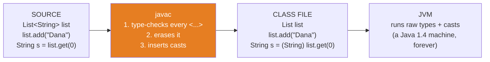
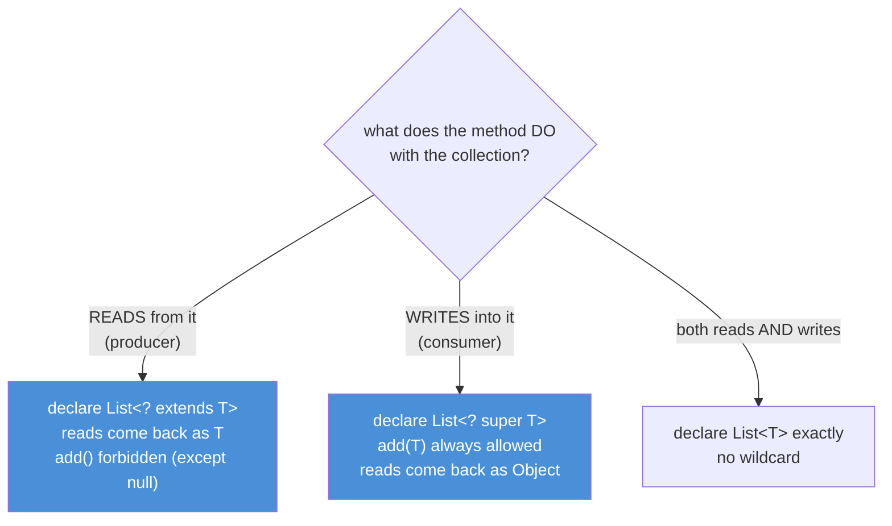

# 01 — Generics Deep-Dive: The Compiler's Beautiful Lie

**The big idea:** generics are a **compile-time illusion**. The compiler checks every
`<String>`, `<Transaction>`, `<T>` in your source — then *erases* it and inserts plain
casts. The class file, and therefore the JVM, never sees your type parameters. Every
"weird rule" of Java generics — why `List<Integer>` is not a `List<Number>`, why you
cannot write `new T[]`, why a mysterious `compareTo(Object)` appears in your bytecode —
follows from that one fact. Learn erasure once, and the whole topic stops being rules to
memorize.

**In one sentence:** generics protect you at compile time and get out of the way at
runtime — the casts they insert are the receipt.

## Why generics exist: the problem you can still feel

Before Java 5, every container held `Object`. Taking anything out required a manual
cast, and a wrong cast was a runtime crash:

```java
// Java 1.4 — the world generics replaced
List owners = new ArrayList();          // raw: holds anything
owners.add("Dana");
String name = (String) owners.get(0);   // cast on EVERY read; hope you remembered the type
owners.add(Integer.valueOf(42));        // nothing stops this...
String boom = (String) owners.get(1);   // ...and this explodes at runtime, far from the crime
```

Generics move that crash **into the compiler**: `List<String>` refuses `add(42)` at
build time. The price of moving the check earlier is that the runtime keeps none of the
labels — that price is erasure, and this module is the itemized bill.

## Erasure: the pipeline



**Read the diagram:**
- Left: what you write. The `<String>` label exists here and nowhere else after the build.
- Middle (orange): javac does three jobs — check the labels, delete them, and put a cast
  at every read so behavior stays correct.
- Right: what runs. The JVM only ever executes raw `List` operations and explicit casts.
  It cannot misbehave with generics, because as far as it knows, generics don't exist.

**Walkthrough — what javac does with `String s = list.get(0)`:**
1. Check: `list` is declared `List<String>`, so `get(0)` is a `String`. The assignment is legal.
2. Erase: the declaration becomes raw `List`; the call becomes `list.get(0)` returning `Object`.
3. Insert: a cast is added — `(String) list.get(0)` — so your variable still receives a `String`.
4. Runtime: if a raw reference smuggled an `Integer` in (banner 3 of `ErasureProofDemo`),
   the cast in step 3 throws `ClassCastException`. The check moved from the write to the read.

The type argument survives in exactly **one** place: the *generic signature* metadata of
fields and methods, readable by reflection (`getGenericType()`). That metadata is how
Spring knows your field says `List<Account>` — modules 02 and 03 are built on it.

## Invariance and wildcards: "some ONE type, unnamed"

`List<Integer>` is **not** a `List<Number>`, even though every `Integer` is a `Number`.
This is called *invariance*, and it is deliberate: a `List<Number>` must accept
`add(3.14)`, and if the compiler allowed the assignment, that `3.14` would land inside a
list some other code still trusts to hold only `Integer`s. Arrays made the opposite
choice (covariance) and pay for it with runtime `ArrayStoreException`s
(`collections-framework` 01, wall #4).

Wildcards get flexibility back **soundly**. A wildcard means: *some ONE type, but I am
not telling you which* — and the compiler uses that honesty to restrict you to only the
operations that are safe for **every** possible "which":



**Read the diagram:**
- One question decides the signature: does the method take elements OUT, put elements IN, or both?
- Out → `? extends T`. The unknown type is *at least* a `T`, so reads are safe as `T`;
  writes are unprovable (the list might hold a narrower subtype), so `add` is banned.
- In → `? super T`. The unknown type *can hold* a `T`, so `add(T)` is safe; reads only
  promise `Object`.
- Both → no wildcard. An exact `T` is the only signature that allows both directions.

**PECS** = **P**roducer **E**xtends, **C**onsumer **S**uper. The JDK teaches it in one
signature: `Collections.copy(List<? super T> dest, List<? extends T> src)` — dest is
written into (consumer, `super`), src is read from (producer, `extends`).

## The table to photograph — wildcard cheat sheet

| Declaration | Means | You may READ | You may ADD | Example use |
|---|---|---|---|---|
| `List<T>` | exactly this element type | `T` | `T` | method builds and returns its own list |
| `List<? extends T>` | some one unknown **subtype** of `T` | `T` | nothing (except `null`) | `sum(List<? extends Number>)` |
| `List<?>` | some one unknown type | `Object` | nothing (except `null`) | `printAll(List<?>)` |
| `List<? super T>` | some one unknown **supertype** of `T` | `Object` | `T` | `fill(List<? super Integer>)` |
| raw `List` | no generics at all (legacy) | `Object`, unchecked | anything, unchecked | never, in new code |

## Bridge methods: erasure leaves fingerprints

`Comparable<T>` declares `compareTo(T)`; erased, the interface says `compareTo(Object)`.
But `Transaction` declares `compareTo(Transaction)` — a *different* signature that does
not override anything. So how does `Transaction` satisfy `Comparable`?

**Walkthrough — how a bridge method is born:**
1. You write `class Transaction implements Comparable<Transaction>` with `compareTo(Transaction)`.
2. javac erases the interface obligation to `compareTo(Object)`.
3. Your method does not match, so javac **generates** a second method:
   `synthetic bridge compareTo(Object o) { return compareTo((Transaction) o); }`.
4. `Collections.sort` (also erased) calls `compareTo(Object)` — it lands on the bridge.
5. The bridge casts and delegates to your method. If the argument is not a `Transaction`,
   the cast throws — this is *literally* the `ClassCastException` core-java 10 produced
   when a non-`Comparable` rode a raw list into a sort.

`BridgeMethodsDemo` finds both methods with reflection (`Method.isBridge()`);
`GenericsProofTest` asserts the bridge exists, is synthetic, and drives a real sort.

## Java 21 corner

Records, sealed types and pattern matching change the **ceremony**, not the **type
system**:
- `record Envelope<T>(T payload, String trackingId)` erases exactly like a class —
  `Envelope<Transaction>` and `Envelope<String>` share one runtime class (asserted in the test).
- `sealed interface Payment permits CardPayment, TransferPayment` closes the family, so a
  `switch` over it can be **exhaustive with no `default`** — add a third implementation
  tomorrow and every switch over `Payment` in the codebase stops compiling until handled.
  That is the Visitor pattern's core benefit (module 09) enforced by the compiler for free.

## The traps, all printed as evidence in the demos

- **Trap 1 — no `new List<String>[10]`:** arrays are *reified* (they check every store at
  runtime), and an erased element type cannot be checked — so the compiler refuses to
  create the unsound array. Use `List<?>[]` or a `List<List<String>>`.
- **Trap 2 — no `instanceof List<String>`:** the erased object has no "String-ness" to
  test; the check would compile to plain `instanceof List` — a lie in source form.
- **Trap 3 — no static field of type `T`:** one static slot cannot serve every
  instantiation. Generic **methods** (`static <T> T first(List<T>)`) are legal because
  their `T` is chosen per call.
- **Trap 4 — no `new T()`, `T.class`, `catch (T)`:** all three need the runtime type the
  erasure deleted. The workaround is the **type token**: pass `Class<T>` in
  (`new Vault<>(Transaction.class)`) — the pattern every framework uses.
- **Trap 5 — varargs heap pollution:** calling `dangerous(List<String>... lists)` builds a
  raw `List[]` behind your back (trap 1, quietly legalized). A callee can store a
  `List<Integer>` into it with no alarm; the crash surfaces later, on an innocent read,
  far from the crime. `@SafeVarargs` is the author's signed promise "I never write into
  this array" — `List.of` and `Arrays.asList` carry it.

**In one sentence:** every prohibition exists because erasure would turn it into a
silent runtime lie, and every workaround hands the runtime the type information it lost.

## Class flow

1. Show the two diagrams above (erasure pipeline first — the fact; wildcard decision
   tree second — the consequence). Read the "Read the diagram" bullets aloud.
2. Run the demos in order: `.\mvnw.cmd -pl 01-generics-deep-dive compile exec:java`
   (this runs `GenericsDemos`, which calls each demo `main()` in teaching order).
3. Run the tests as *proof*: `.\mvnw.cmd -pl 01-generics-deep-dive test` — each test
   prints the behavior it asserts, including the deterministic failures (CCE from the
   smuggled Integer, CCE from heap pollution).

| Demo class | What it shows |
|---|---|
| `ErasureProofDemo` | one Class for all parameterizations; signatures survive for reflection; the inserted cast caught red-handed |
| `WildcardsPecsDemo` | invariance vs array covariance; `? extends` reads, `? super` writes; `Collections.copy` as the JDK's own PECS lesson |
| `BridgeMethodsDemo` | reflection finds the synthetic `compareTo(Object)`; a real sort drives it |
| `GenericTrapsDemo` | the five forbidden moves, each with its workaround; live heap pollution |
| `RecordsSealedGenericsDemo` | generic records erase too; sealed + switch = compiler-enforced exhaustiveness |

| Test | What it proves |
|---|---|
| `erasedTypesShareOneClass` | `List<String>` and `List<Integer>` are the same Class object (`==`) |
| `signaturesSurviveErasure` | `getGenericType()` reconstructs `List<Transaction>` from field metadata |
| `uncheckedSmuggleExplodesOnRead` | the inserted cast fires on read, not on write |
| `bridgeMethodExists` | the bridge is there, is synthetic, and sorts for real |
| `pecsBothDirections` | one `sum` reads two element types; one `fill` writes two target types |
| `heapPollutionThrows` | varargs pollution: silent write, fatal read, message names `Integer` |
| `typeTokenWorkaround` | `Class<T>` passed in restores what erasure deleted |
| `genericMethodPerCall` | one static method, two different `T`s in a single run |
| `recordsAndSealedObeyTheSameRules` | records erase; `getPermittedSubclasses()` shows the sealed family |

## Where this leads

Erasure's leftovers feed the next two modules directly: reflection (02) is how you read
the surviving signatures and call methods by name; annotations (03) are metadata stickers
that reflection decodes — together they are the machinery Spring uses to wire
`List<Account>` into your beans. The bridge-method cast connects back to
`core-java/10-comparable-comparator`, and invariance connects back to
`collections-framework/01-why-collections` (arrays' covariance was the cautionary tale).
