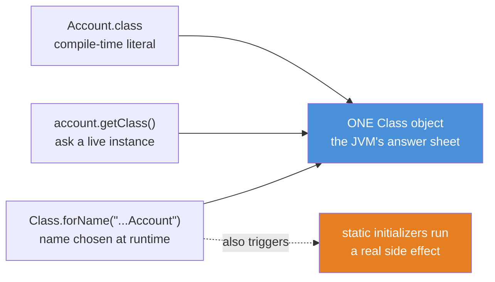
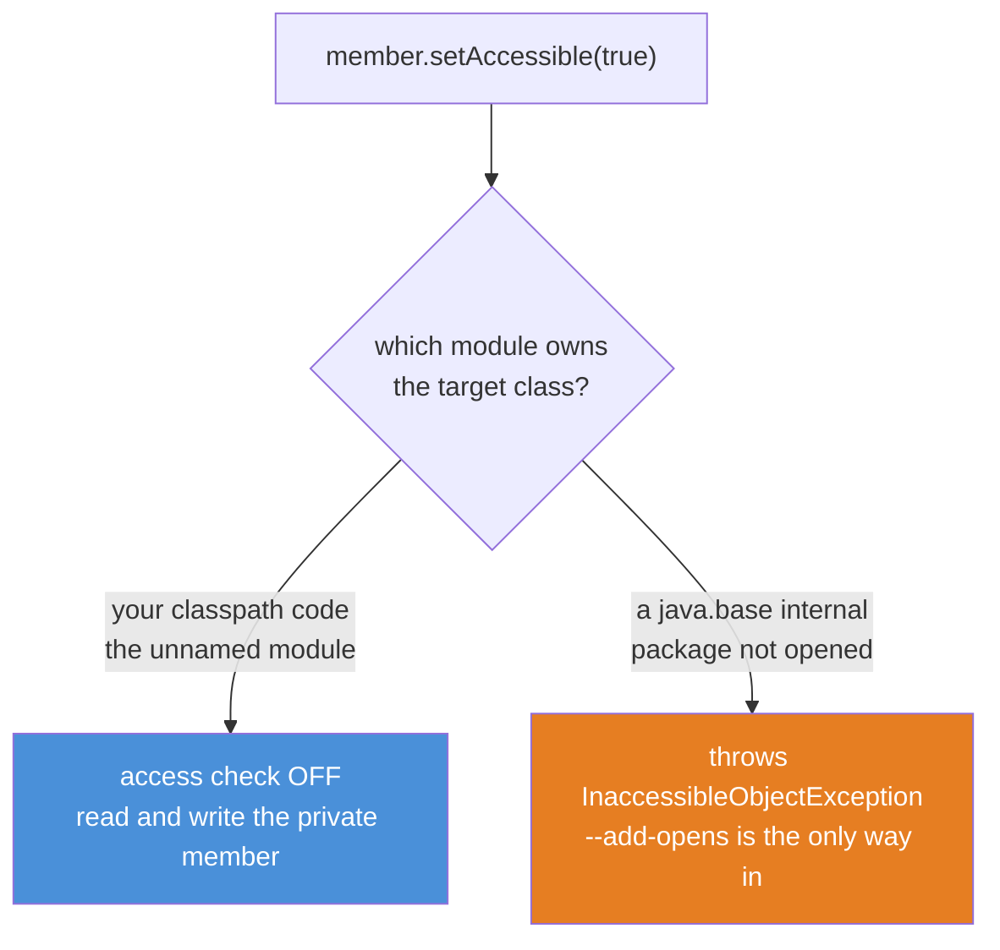
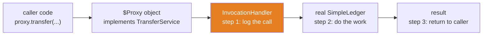

# 02 — Reflection: Code That Reads Code

**The big idea:** every loaded type in your program has a **`Class` object** — the JVM's
*answer sheet* about that type. It records the type's name, its fields, its methods, its
constructors, and its annotations. **Reflection** is the ordinary Java code that reads that
answer sheet at runtime and then acts on it: listing a class's private fields, building an
object from a name in a config file, calling a method it only meets at runtime, or wrapping
your bean in a proxy. Nothing about reflection is magic — it is one object (`Class`) plus a
handful of methods (`getDeclaredFields`, `newInstance`, `invoke`). Frameworks are built on it,
and after this module so are you.

**In one sentence:** reflection lets code treat other code as *data* it can read and drive at
runtime — which is the only way a framework can call a class it has never seen.

## Why reflection exists: the problem you can feel

Imagine writing a JSON mapper. A string arrives over the wire; you must fill the **private**
fields of a `Customer` class you have never compiled against. Or write Spring: a bean named in
`application.properties` must be instantiated and have its `@Autowired` fields filled — but the
framework author wrote Spring years before you wrote your bean.

Plain Java cannot do either. At compile time the mapper does not know `Customer` exists, and
`private` means "no outside code may touch this." Reflection removes both limits:

- A `Class` object can be obtained from a **name string** chosen at runtime (`Class.forName`).
- Given the `Class`, you can list its private members and, with `setAccessible(true)`, reach in.

That is the whole trick. The price is that you give up compile-time checking — reflection fails
at runtime, with strings and exceptions, not at build time. Use it where the type is genuinely
unknown until the program runs; never where a normal method call would do.

**In one sentence:** reflection exists because a framework must operate on types its author
could not have named, and the only handle available at runtime is the `Class` object.

## The Class object and the three doors to it

For one loaded type there is exactly **one** `Class` object. Three doors return that same
object:

**Read the diagram:**
- Three doors on the left, one `Class` object on the right. `Account.class`, `account.getClass()`,
  and `Class.forName("...Account")` all hand back the *same* object — compare with `==`, not `equals`.
- `Account.class` is the compile-time literal: cheapest, and it does **not** initialize the class.
- `account.getClass()` asks a live instance for its runtime type — which may be a subclass.
- `Class.forName(name)` (orange dashed arrow) is the only door that also **initializes** the type:
  its `static {}` blocks and static field initializers run. That is a side effect you must expect.

A `Class` object is *reified* — unlike a generic type argument, which module 01 erased. There is
one `Account.class` and it is a real object you can pass around, store, and interrogate.

**Walkthrough — what happens when you call `Class.forName(name)`:**
1. The class loader searches the classpath (and module path) for a class file whose name matches.
2. If it is not loaded yet, the JVM reads the bytecode and creates the one `Class` object for it.
3. The JVM **initializes** the class: it runs the static field initializers and `static {}` blocks,
   in source order, exactly once. This is the step `Account.class` and `getClass()` skip.
4. `forName` returns a reference to that `Class` object.
5. If no such class exists, step 1 fails and you catch `ClassNotFoundException`.

`ClassObjectDemo` proves step 3 with a tripwire: a dedicated `Probe` class increments a counter in
its `static {}` block. Before `forName`, the counter is `0`; after, it is `1`. The counter lives in
a *separate* class (`ProbeLog`) on purpose — reading `Probe`'s own static field would initialize it
early and ruin the "before" reading (touching any static member triggers initialization, JLS 12.4.1).

**In one sentence:** all three doors reach one shared `Class` object, but only `Class.forName`
also runs the type's static initializers on the way in.

## Reading the answer sheet: a class's shape

Once you hold a `Class`, reflection lists everything the class file recorded. Two families of
methods do the listing, and confusing them is the most common beginner bug:

- `getDeclaredFields()` / `getDeclaredMethods()` / `getDeclaredConstructors()` — **only this
  class**, at **any** visibility (private included). Nothing inherited.
- `getFields()` / `getMethods()` — **only public**, but **including** members inherited from every
  supertype (all the way up to `Object`).

`Modifier.toString(field.getModifiers())` turns the raw bitmask into words like `private final`.
`InspectDemo` dumps `Account`'s whole shape and shows the counts differ: `getDeclaredMethods()`
returns 7 (Account's own), `getMethods()` returns 15 (those 7 minus the shared `toString`, plus
`Object`'s 8 public methods).

### The table to photograph — `getDeclared*` vs `get*`

| Call | Whose members | Which visibility | SecureBank example |
|---|---|---|---|
| `getDeclaredFields()` | this class only | any, including private | finds `Account`'s private `balance` |
| `getFields()` | this class plus every supertype | public only | every public constant up the tree |
| `getDeclaredMethods()` | this class only | any | `Account`'s own seven methods |
| `getMethods()` | this class plus every supertype | public only | those seven plus `Object`'s public methods |
| `getDeclaredConstructors()` | this class only | any | `Account`'s three-argument constructor |
| `getMethod(name, params…)` | this class or a supertype | public only | must pass the EXACT parameter types |

The last row hides a trap: reflection matches parameter types **exactly**. `getMethod("transferCents",
long.class)` finds the method; `getMethod("transferCents", Long.class)` throws `NoSuchMethodException`,
because the primitive `long` is not the boxed `java.lang.Long`. Autoboxing is a compile-time courtesy;
at runtime the erased parameter type is what counts.

Reflection also reads what erasure left behind. Module 01 proved objects lose their `<Transaction>`
but the **declaration** survives in the field's *generic signature*. `getGenericType()` reconstructs
it: `InspectDemo` prints `java.util.List<com.evaitcs.advanced.reflection.Transaction>` for `Account`'s
`statement` field. That metadata is exactly how Spring knows your `@Autowired` field says
`List<Account>`.

**In one sentence:** `getDeclared*` is "my own members, any access," `get*` is "the public ones,
whole family tree," and both match signatures exactly — including the generic ones erasure kept.

## Reaching in: `setAccessible` and the module gate

`private` normally blocks outside code. `setAccessible(true)` switches that check **off** for one
member, so reflection can read and write it. On ordinary classpath code this works — it is how
Jackson fills private fields and how Hibernate reads private ids. Since JDK 9, though, the platform
is split into **modules**, and a module decides which of its packages are *opened* to deep reflection.

**Read the diagram:**
- One call, `setAccessible(true)`, hits a decision: which module owns the class you are reflecting into?
- Your own code lives in the *unnamed module* and is wide open, so the access check turns off (blue).
  `PrivateAccessDemo` reads and overwrites `Account`'s private `owner` field this way.
- A `java.base` internal — `ArrayList`'s private `size` — is in a package that `java.base` does **not**
  open, so the call throws `InaccessibleObjectException` (orange). Getting the `Field` object is fine;
  *opening* it is refused.

**Walkthrough — what happens when you call `setAccessible(true)`:**
1. Reflection asks the module system: does the module owning this member **open** its package to my module?
2. If the target is your classpath code (the unnamed module), the answer is yes; the access-check flag flips off.
3. Later `get`/`set`/`invoke` calls on that member skip the usual private/protected visibility rules.
4. If the target is a `java.base` package that is not opened, the answer is no, and the call throws
   `InaccessibleObjectException` immediately — it does not silently proceed.

The one-paragraph version of the module system: before JDK 9 everything sat on one flat classpath and
`setAccessible` could open anything. JDK 9 grouped the platform into modules; each declares which
packages it **exports** (you may compile against them) and which it **opens** (you may deep-reflect
into them). `java.base` *exports* `java.util` — so you can use `ArrayList` — but does not *open* it,
so you cannot touch `ArrayList`'s internals. The escape hatch is the startup flag
`--add-opens java.base/java.util=ALL-UNNAMED`. This course never uses it: we catch the refusal and
teach it instead, because knowing the wall is there is the lesson.

**In one sentence:** `setAccessible(true)` opens private members of your own classpath code, but the
module system can refuse it for platform internals — and `--add-opens` is the only key that overrides it.

## Dynamic proxies: a class fabricated at runtime

A **dynamic proxy** is an object that implements *your interface* but runs *your handler* for every
call. `java.lang.reflect.Proxy.newProxyInstance(...)` invents a brand-new class at runtime — its name
looks like `jdk.proxy3.$Proxy26` — that implements the interfaces you list and forwards each method to
an `InvocationHandler`. The handler decides what happens: log, time, check security, open a
transaction… then usually delegate to the real object.

**Read the diagram:**
- The caller thinks it holds a `TransferService`. It actually holds a fabricated `$Proxy` object (left).
- The `$Proxy` has no logic of its own; it passes the `Method` and arguments to your `InvocationHandler`
  (orange), which is where the *around* behavior lives — here, appending the call to an audit log.
- The handler then delegates to the real `SimpleLedger`, which does the actual work.
- The real result flows back out through the handler to the caller, who never touched the real class.

**Walkthrough — what happens when you call a method on a dynamic proxy:**
1. The call lands on the fabricated `$ProxyN` class, which implements your interface but contains no business logic.
2. `$ProxyN` forwards the resolved `Method` object and the argument array to your `InvocationHandler.invoke(proxy, method, args)`.
3. Your handler runs its *around* logic — in `DynamicProxyDemo`, it appends `method.getName()` to a `List<String>` audit log.
4. The handler usually calls `method.invoke(target, args)` to delegate to the real object and get the real result.
5. The handler returns that result (or a substitute); the caller receives it as if it came straight from the real class.

One subtlety the demo handles: `Object`'s own methods — `toString`, `hashCode`, `equals` — *also*
arrive at the handler. We pass those straight through without auditing them, so the log records only
real service calls. This is **exactly** how Spring `@Transactional` wraps your bean: the object in the
context is not your class, it is a proxy that begins a transaction, calls your method, then commits or
rolls back. It is also why calling one `@Transactional` method from another *in the same bean* skips
the proxy — `this` is the raw object, not the wrapper.

**In one sentence:** a dynamic proxy is a runtime-fabricated implementation of your interface whose
handler runs before, after, or instead of the real method — the seam every framework injects behavior through.

## MethodHandles: the fast modern path

`Method.invoke` is the classic reflective call. It re-checks access, boxes arguments, and crosses a
native trampoline on *every* call. A **`MethodHandle`** is a typed, pre-resolved "function pointer" to
a method. You resolve it once with a `Lookup` (`MethodHandles.lookup().findVirtual(...)`), then invoke
it as often as you like — and the JIT can inline a hot handle the way it inlines a direct call.

`MethodHandlesDemo` calls `Account.deposit` both ways on two accounts with identical starting balances
and shows both return `150.00`. The result is the same; the difference is speed under repetition. That
is why serializers and DI containers resolve a handle per field at startup and **cache** it, rather
than calling `Method.invoke` in a hot loop. `findVirtual` obeys the same exact-type rule as `getMethod`:
`long.class` and `Long.class` are different handles.

**In one sentence:** `MethodHandle` is the typed, JIT-friendly version of `Method.invoke` — resolve
once, invoke often, cache it — which is what fast frameworks do under the hood.

## Java 21 corner

- **MethodHandles are the modern default** for repeated reflective calls; `invokeExact` (with exact
  static types) lets the JIT inline the call. Classic `Method.invoke` is fine for one-off calls.
- **Records expose their shape directly.** `Account` is a class, but a `record Transaction(...)`
  answers `getRecordComponents()`, handing reflection its components in declaration order — no guessing.
- **Sealed types are listable.** `getPermittedSubclasses()` (module 01) returns the closed family, so a
  framework can enumerate every allowed implementation.
- **Strong encapsulation is the default.** The module gate on `setAccessible` is not a Java 9 relic —
  it is enforced on 21. Plan for `InaccessibleObjectException` when reflecting into the JDK.
- **Pattern matching cleans up the casts.** The demos use `generic instanceof ParameterizedType pt`
  instead of the old cast-and-hope ladder.

## The traps, all printed as evidence in the demos

- **Trap 1 — `getMethod` vs `getDeclaredMethod`:** `getMethod` finds **public** methods (this class or
  inherited) and needs exact parameter types; `getDeclaredMethod` finds **any** visibility but only in
  *this* class. Pick wrong, or pass `Long.class` for a `long` parameter, and you get `NoSuchMethodException`.
- **Trap 2 — `Class.forName` initializes:** a class with heavy or side-effecting `static {}` blocks runs
  them the moment you `forName` it (the classic: a JDBC driver self-registering). To load *without*
  initializing, use `Class.forName(name, false, loader)` or the `.class` literal.
- **Trap 3 — `setAccessible` can be refused:** on a non-opened `java.base` package it throws
  `InaccessibleObjectException`. `--add-opens` is the only fix; never design around deep-reflecting JDK internals.
- **Trap 4 — `newInstance` wraps your exceptions:** if the constructor itself throws, the real cause
  arrives wrapped in `InvocationTargetException` (call `getCause()`); wrong argument types give `IllegalArgumentException`.
- **Trap 5 — JDK proxies are interfaces-only:** `Proxy` cannot wrap a concrete class (no interface means
  you need CGLIB/ByteBuddy, which is Spring's fallback). And `equals`/`hashCode`/`toString` route through
  the handler too — handle `Object` methods or your log and semantics will surprise you.

**In one sentence:** every reflection trap is the price of moving a check from compile time to runtime —
exact signatures, initialization side effects, and the module gate are what you now must handle yourself.

## Class flow

1. Show the three diagrams above in order — three doors (the fact), the `setAccessible` gate (the limit),
   the proxy call flow (the payoff). Read the "Read the diagram" bullets aloud.
2. Run the demos in teaching order: `.\mvnw.cmd -pl 02-reflection compile exec:java`
   (this runs `ReflectionDemos`, which calls each demo `main()` in order).
3. Run the tests as *proof*: `.\mvnw.cmd -pl 02-reflection test` — each test prints the behavior it
   asserts, including the caught `InaccessibleObjectException` and the proxy's audit log.

| Demo class | What it shows |
|---|---|
| `ClassObjectDemo` | three doors to one `Class` object; `forName`'s initialize side effect via the `Probe` tripwire |
| `InspectDemo` | dumping fields/methods/constructors; `getDeclared*` vs `get*`; `long` vs `Long`; the surviving generic signature |
| `PrivateAccessDemo` | `setAccessible` reads and writes a private field; the caught `InaccessibleObjectException` on `ArrayList.size` |
| `DynamicProxyDemo` | an audit-logging proxy around `TransferService`; the `$ProxyN` class name; the `instanceof` facts |
| `MethodHandlesDemo` | `findVirtual` vs `Method.invoke` — same result; why frameworks cache handles |

| Test | What it proves |
|---|---|
| `classObjectIsSharedAcrossAllThreeRoutes` | literal, `getClass()`, and `forName` return the same object (`==`) |
| `forNameRunsStaticInitializer` | `forName` runs `Probe`'s static block — the counter goes `0` to `1` |
| `newInstanceBuildsWorkingAccount` | `Constructor.newInstance` builds a real, functional `Account` |
| `setAccessibleOpensPrivateField` | a private field is read and written after `setAccessible(true)` |
| `javaBaseInternalsRefuseSetAccessible` | `InaccessibleObjectException` on `ArrayList`'s private `size` |
| `getMethodRequiresExactParameterTypes` | `long.class` finds the method; `Long.class` throws `NoSuchMethodException` |
| `genericSignatureSurvivesErasure` | `getGenericType()` reconstructs `List<Transaction>` (module 01 tie-in) |
| `proxyImplementsInterfaceButIsNotTheTargetClass` | the proxy IS-A the interface and is NOT the concrete class |
| `proxyLogsEveryCallInOrderAndDelegates` | calls are logged in order and delegation returns the real values |
| `methodHandleMatchesReflectiveInvoke` | a cached `MethodHandle` equals the `Method.invoke` result |

## Where this leads

Reflection is the machinery; module 03 points it at **annotations** — the metadata stickers a reader
decodes. Together they are literally how Spring builds beans: `@Autowired` reads the surviving generic
signature (this module, `getGenericType`), `@Transactional` wraps your bean in a proxy (this module,
`DynamicProxyDemo`), and every `@Annotation` is found with `getAnnotation` (module 03). The generic
signature connects straight back to `01-generics-deep-dive`, where erasure promised reflection would
find the declaration. When you reach `stage-2-monolith`, `@RestController`, `@Service` and `@Transactional`
will stop being magic — you will see the `Class` object, the proxy, and the `invoke`.
