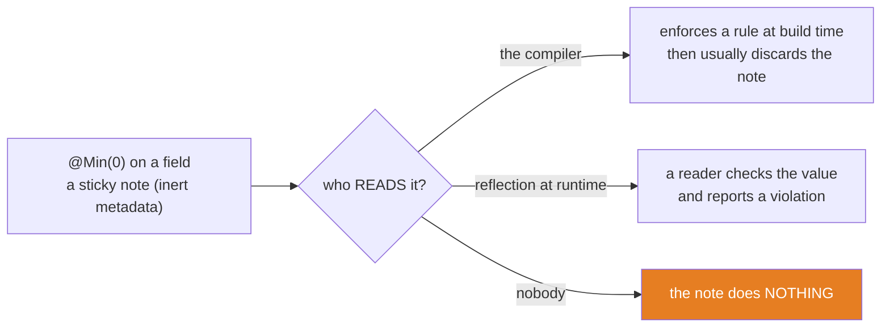
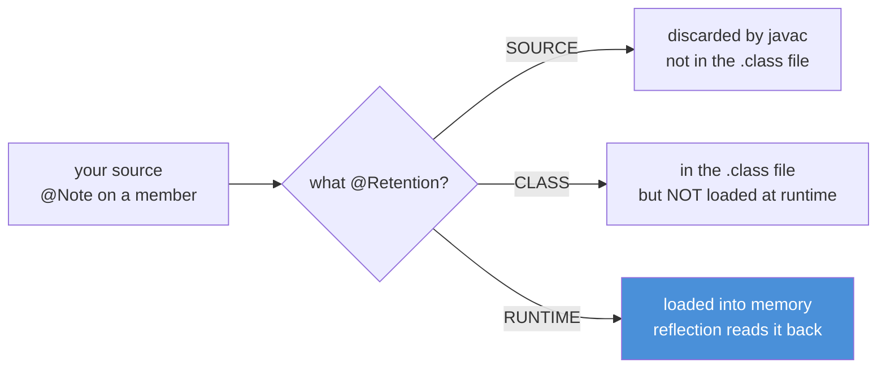
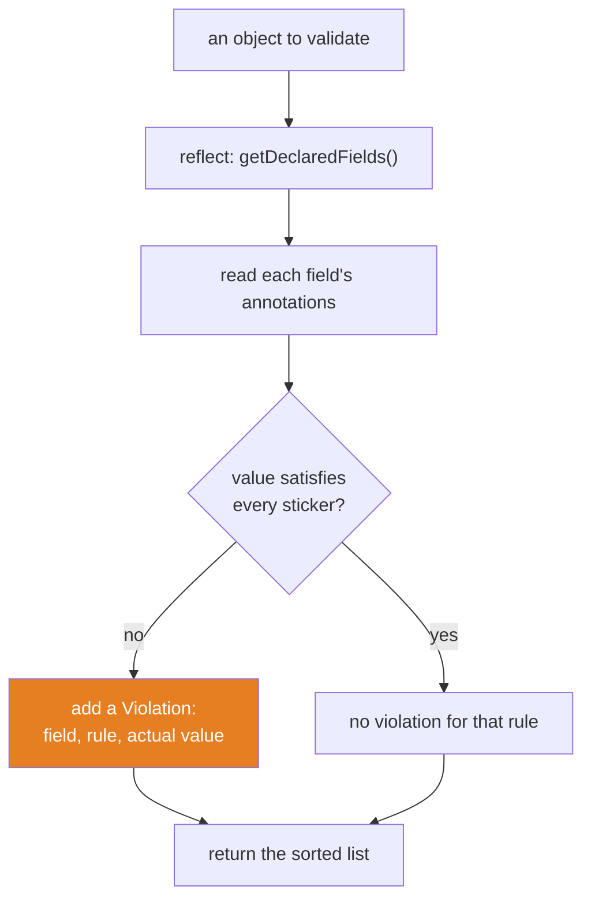

# 03 — Annotations: Sticky Notes That Do Nothing

**The big idea:** an **annotation** is a *sticky note* you attach to code — a class, method,
field, parameter, or type. By itself it changes **nothing**. It is *metadata*: data about your
code, not code. `@Min(0)` on a balance field does not validate anything. `@Transactional` on a
method does not open a transaction. The note only matters when a **reader** looks at it and acts —
the *compiler* (for `@Override`), or *reflection at runtime* (module 02, for everything Spring does).
So the real subject of this module is not the stickers; it is the **readers**. Build one reader
yourself — a 40-line validator, a 20-line dependency-injection container — and every framework
annotation you will ever meet stops being magic.

**In one sentence:** an annotation is inert metadata, and a reader (the compiler or reflection) is
what turns it into behavior.

## Why annotations exist: the problem you can feel

Before annotations, frameworks needed a way for *your* code to tell *their* code something, at a
distance in time and authorship. Two old answers both hurt:

- **Naming conventions** ("any method called `testXyz` is a test"). Brittle: a typo silently
  un-enrolls your method, and the convention cannot carry extra data.
- **Config files / marker interfaces** (XML bean definitions, `implements Serializable`). The wiring
  lives far from the code it describes, so it drifts, and it is boilerplate.

An annotation fixes both. It sits **right next to the code** it describes, it is **checked by the
compiler** (`@Target` stops you putting a field-note on a method), and it can **carry data**
(`@Min(0)`, `@Deprecated(since = "2.0")`). JUnit 5 reads `@Test`; Spring reads `@Autowired`; Jakarta
Validation reads `@NotNull`. The framework author defines the note once; you stick it on; their reader
does the rest.

**In one sentence:** annotations let you annotate your code with machine-readable intent that a
framework's reader — not you — acts on, right where the code lives.

## A sticky note needs a hand



**Read the diagram:**
- Left: the annotation itself. It is a note, not an action — it stores a fact ("minimum is 0") and nothing more.
- Middle: the only thing that gives the note meaning is a **reader**. There is no behavior without one.
- Top-right: the *compiler* is a reader. `@Override` makes javac verify you really override something.
- Middle-right: *reflection* (module 02) is the other reader. A validator reads `@Min(0)` at runtime and enforces it.
- Bottom-right (orange): if no reader exists, the note is decoration. This is the whole lesson — and the
  most common beginner confusion ("I added the annotation, why does nothing happen?").

**In one sentence:** the annotation is the noun; the reader is the verb — without the verb, nothing runs.

## The built-ins you already use

Five built-in annotations cover most daily use. Notice the pattern: four are read by the **compiler**,
and only the ones a runtime tool needs are kept at runtime.

| Annotation | Read by | Retention | What it does |
|---|---|---|---|
| `@Override` | the compiler | SOURCE | proves a method really overrides a supertype method; catches the `setNmae` typo |
| `@SuppressWarnings` | the compiler | SOURCE | silences a named warning in a scope |
| `@Deprecated(since, forRemoval)` | compiler **and** reflection | RUNTIME | marks an API discouraged; `forRemoval=true` means "will be deleted" |
| `@FunctionalInterface` | the compiler | RUNTIME | enforces exactly one abstract method, so the type is a valid lambda target |
| `@SafeVarargs` | the compiler | RUNTIME | the author's promise the method never writes into its varargs array (module 01, trap 5) |

The `setNmae` story makes `@Override` concrete. You mean to override `setName`; you typo `setNmae`.
With `@Override`, javac refuses to compile — the method overrides nothing. Without it, the typo
compiles happily as a brand-new method that nothing ever calls, the real `setName` stays un-overridden,
and the bug ships. `BuiltInsDemo` also proves the retention split: it reads `@Deprecated`'s `since`
and `forRemoval` back with reflection (RUNTIME, visible), then shows `@SuppressWarnings` is *gone* at
runtime (SOURCE, invisible — `isAnnotationPresent` returns `false`).

**In one sentence:** the built-ins teach the rule the whole module rests on — a note read by the
compiler can be SOURCE-retained and vanish, while a note read at runtime must be RUNTIME-retained.

## Retention: who can see the note

**Retention** is the policy that says how long an annotation survives. It is the single most important
fact about annotations for framework work, because it decides whether your runtime reader can see the
note at all.



**Read the diagram:**
- One note enters; its `@Retention` sends it down one of three paths.
- SOURCE: javac reads it (if a compiler pass cares) and throws it away. It never reaches the `.class` file.
- CLASS: it is written into the `.class` file, but the JVM does **not** load it into memory at runtime.
  Bytecode tools (build plugins, instrumenters) can read it; ordinary reflection cannot. CLASS is the
  **default** when you omit `@Retention`.
- RUNTIME (blue): written to the file **and** loaded, so `getAnnotation`/`getAnnotationsByType` read it
  back with exact element values. This is the only path a runtime framework can use.

**Walkthrough — what happens to an annotation under each retention:**
1. javac parses the annotation and checks it against its `@Target` (where it may go) and `@Retention`.
2. If SOURCE, javac acts on it during compilation (or ignores it) and then **discards** it; nothing is written.
3. If CLASS, javac writes it into the `.class` file, but the JVM leaves it out of the in-memory model at runtime.
4. If RUNTIME, javac writes it and the JVM loads it, so reflection can retrieve it and every element value.

`RetentionMatrixDemo` puts three fields side by side — one `@SourceNote`, one `@ClassNote`, one
`@RuntimeNote` — and asks reflection about each. Only the RUNTIME one answers. It also proves
**defaults**: the second `@RuntimeNote` supplies only `value()`, so `level()` reads back as its declared
default of `1`.

### The table to photograph — retention

| `@Retention` | Where it lives | Who can read it | Example |
|---|---|---|---|
| `SOURCE` | in source only; javac discards it | the compiler | `@Override`, `@SuppressWarnings` |
| `CLASS` | in the `.class` file; not loaded at runtime | build and bytecode tools | the default when `@Retention` is omitted |
| `RUNTIME` | in the `.class` file; loaded into memory | reflection, so frameworks | `@Deprecated`, `@NotNull`, `@Autowired` |

**In one sentence:** retention picks the reader — SOURCE for the compiler, CLASS for bytecode tools,
RUNTIME for reflection — and a framework that runs with your program can only ever see RUNTIME.

## Declaring your own annotation

An annotation type is declared with `@interface` and carries **elements** (methods that return values,
optionally with `default`s). Two meta-annotations — annotations on annotations — control it:

```java
@Retention(RetentionPolicy.RUNTIME)   // so a runtime reader can see it
@Target(ElementType.FIELD)            // so it may ONLY be stuck on fields
public @interface Min {
    long value();                     // REQUIRED element: no default, so every use site supplies it
    String message() default "";      // OPTIONAL element: has a default
}
```

- `@Retention` and `@Target` are the two you will always write. `@Target` is a compiler-enforced fence:
  put `@Min` on a method and it will not compile.
- An element with **no default** (`long value()`) is required; an element with a **default**
  (`String message() default ""`) is optional. `@Min(0)` uses the shorthand for a single element named `value`.
- Element types are restricted to primitives, `String`, `Class`, enums, annotations, and arrays of those.
- `@Documented` is a marker asking that the note appear in generated Javadoc; it has no runtime behavior.
- Two more meta-annotations appear later: `@Inherited` (subclass inheritance) and `@Repeatable` (a container).

## Build a mini framework: the centerpiece

Time to be the framework author. Three custom stickers go on `Account`:

```java
@NotNull                     private final String owner;
@Min(0) @CurrencyScale(2)    private final BigDecimal balance;
@CurrencyScale(2)            private final BigDecimal withdrawalLimit;
```

`MiniValidator` is the reader. It does exactly what Hibernate Validator does, in ~40 lines:



**Read the diagram:**
- The reader starts with an object and asks reflection (module 02) for its fields — including the private ones.
- For each field it reads the annotations stuck there; a field with no sticker is skipped.
- Each sticker present becomes a check against the field's actual value.
- A failed check (orange) produces one `Violation` naming the field, the rule, and the offending value.
- The violations are collected, **sorted** (because `getDeclaredFields()` order is unspecified), and returned.

**Walkthrough — what happens when `MiniValidator.validate(account)` runs:**
1. Call `account.getClass().getDeclaredFields()` — reflection lists every field, private ones included.
2. For each field, `setAccessible(true)` then `field.get(account)` reads its current value.
3. Read the field's stickers: `isAnnotationPresent(NotNull.class)`, `getAnnotation(Min.class)`, `getAnnotation(CurrencyScale.class)`.
4. For each sticker present, enforce its rule against the value: not-null, `>= min`, `scale == expected`.
5. Every failed rule adds a `Violation(field, rule, actual)` to a list.
6. Sort the list by field then rule — deterministic output, because reflection does not promise field order — and return it.

`MiniValidatorDemo` runs a clean account (zero violations) and a dirty one with three planted problems
(`owner = null`, `balance = -5.00`, `withdrawalLimit` with scale 3) and prints the three violations as
numbered steps. Rename `@NotNull`/`@Min` to `jakarta.validation.constraints.*` and `MiniValidator` to
Hibernate Validator, and you have Bean Validation — which is exactly what Spring runs when a controller
parameter says `@Valid`, turning violations into a `400` ProblemDetail in `stage-2`.

**In one sentence:** a validation framework is one loop — reflect the fields, read the stickers, enforce
the rules — and you have now written one.

## @Repeatable and @Inherited: two exact rules

**@Repeatable** lets one element carry the same annotation more than once. Java has no "list of
annotations," so `@Repeatable(Container.class)` names a **container** annotation holding an array. When
you write `@Audit("login") @Audit("transfer")`, the compiler folds both into one `@Audits({...})`. The
consequence trips everyone up: `getAnnotation(Audit.class)` returns **null** (the single form is gone),
and only `getAnnotationsByType(Audit.class)` unpacks the container and returns **both**. The container
must have a `value()` array element and a retention/target at least as wide as the repeatable one.

**@Inherited** is narrower than its name suggests. It applies **only** to:
- **class-level** annotations, and
- **class-to-subclass** (`extends`), read via `getAnnotation` on the `Class`.

It does **not** cross implemented interfaces, and it has **no effect on methods**. `RepeatableInheritedDemo`
proves the exact nuance: `ChildService extends BaseService` reports `BaseService`'s `@SecureService`
(`@Inherited`), but when `ChildService` *overrides* a `@Logged` method, the override carries **no**
`@Logged`. That is why frameworks like Spring walk the type hierarchy themselves (`AnnotatedElementUtils`)
instead of trusting `getAnnotation` to find inherited method notes.

**In one sentence:** `@Repeatable` needs a container and `getAnnotationsByType`; `@Inherited` reaches
subclasses for classes only — never methods, never interfaces.

## WireMe: a 20-line Spring

The last demo combines everything into a **dependency-injection (DI) container**. Two stickers:
`@WireMe` marks a class to build (Spring's `@Component`); `@Inject` marks a field to fill by type
(Spring's `@Autowired`). The reader runs two passes.

**Walkthrough — what happens when the WireMe container wires a set of classes:**
1. **Pass 1 — instantiate.** For each class, read `@WireMe`. If present, build one instance with
   `getDeclaredConstructor().newInstance()` and register it under the annotation's name (or the
   decapitalized simple name — Spring's default bean-naming rule).
2. **Pass 2 — inject.** For each bean just built, iterate `getDeclaredFields()`.
3. For every field carrying `@Inject`, `setAccessible(true)`, then find the registered bean that is an
   instance of the field's type and `field.set(bean, match)`.
4. Return the map — a fully wired object graph, assembled purely from annotations plus reflection.

`WireMeDemo` wires an `AuditLogger` into a `TransferHandler`, then proves the graph is live: calling
`handler.transfer("A","B")` reaches the injected logger, which records `"A->B"`. Replace `@WireMe` with
`@Component`, `@Inject` with `@Autowired`, and the map with the `ApplicationContext`, and you have Spring's
core. Spring adds classpath scanning, scopes, proxies (module 02's `DynamicProxyDemo`), and lifecycle
callbacks — but the heart is these two passes.

**In one sentence:** dependency injection is a reader that turns `@WireMe`/`@Inject` stickers into a live
object graph — twenty lines here, and the exact idea Spring scales to a whole application.

## Compile-time processing (the other kind of reader)

Not every reader runs with your program. An **annotation processor** (the Pluggable Annotation
Processing API, JSR 269) runs *inside javac at build time* and can **generate new code**. Lombok reads
`@Getter`/`@Data` and writes the accessor methods into the `.class` file; MapStruct reads `@Mapper` and
generates a mapper implementation; QueryDSL generates `Q`-classes. By the time your program runs, the
generated code is real and the annotations are often already gone (SOURCE retention).

The contrast that matters: a **runtime** reader (our `MiniValidator`) can *never* see a SOURCE-retained
annotation, and an **annotation processor** runs at build time, not when the program runs. This is why
Lombok "disappears" at runtime — you see generated methods, not the note. We explain APT here but do not
run a live processor: it needs build-time wiring that would distract from the runtime-reader lesson.

**In one sentence:** annotations are read either at build time (processors that generate code) or at
runtime (reflection that acts on live objects) — and retention decides which reader can see the note.

## Java 21 corner

- **Records carry annotations too.** Annotate a record *component* and, depending on the annotation's
  `@Target`, it propagates to the backing field, the constructor parameter, and the accessor. Reflection
  reads them with `getRecordComponents()`. `MiniValidator` works on a record unchanged — `getDeclaredFields()`
  finds the components' private final fields.
- **`TYPE_USE` targets any type.** `@Target(ElementType.TYPE_USE)` lets a note sit on a *type use*, not
  just a declaration: `List<@NonNull String>` or `@Nullable Account`. Static-analysis tools (Checker
  Framework, NullAway) read these to prove null-safety at build time.
- **Pattern matching keeps readers tidy.** The validator uses `value instanceof BigDecimal decimal` to
  test and bind in one step, instead of the old cast-and-hope ladder.

## The traps, all printed as evidence in the demos

- **Trap 1 — wrong retention (the #1 "my annotation does nothing" bug):** omit `@Retention` and you get
  CLASS, which a runtime reader cannot see. A framework annotation MUST declare `@Retention(RUNTIME)`.
- **Trap 2 — reading a @Repeatable with getAnnotation:** it returns `null` once two are present, because
  they were folded into the container. Use `getAnnotationsByType`, and give the container a `value()` array.
- **Trap 3 — assuming @Inherited is sticky everywhere:** it covers classes via `extends` only. Interfaces
  get nothing, and an overriding **method** never inherits its parent's annotations — walk the hierarchy yourself.
- **Trap 4 — expecting the note to act:** `@Min(0)` validates nothing until a validator runs. No reader, no behavior.
- **Trap 5 — required vs default elements:** an element with no `default` is mandatory at every use site;
  forgetting it is a compile error. Element types are limited to primitives, `String`, `Class`, enums, annotations, and their arrays.
- **Trap 6 — confusing the two reader kinds:** a SOURCE note is for build-time processors (Lombok, MapStruct);
  a runtime reader will never see it. Match the retention to the reader you intend.

**In one sentence:** almost every annotation bug is a mismatch between the note's retention/target and
the reader you expected to act on it.

## Class flow

1. Show the three diagrams in order — sticky note + reader (the idea), the retention pipeline (the axis
   that decides visibility), the validator loop (the payoff). Read the "Read the diagram" bullets aloud.
2. Run the demos in teaching order: `.\mvnw.cmd -pl 03-annotations compile exec:java`
   (this runs `AnnotationDemos`, which calls each demo `main()` in order).
3. Run the tests as *proof*: `.\mvnw.cmd -pl 03-annotations test` — each test prints the behavior it
   asserts, including the exact violation list and the wired object graph.

| Demo class | What it shows |
|---|---|
| `BuiltInsDemo` | `@Override` catches the typo; `@Deprecated` read at runtime; `@FunctionalInterface`; `@SafeVarargs`; `@SuppressWarnings` invisible |
| `RetentionMatrixDemo` | SOURCE and CLASS invisible at runtime, RUNTIME visible with exact values, and element defaults applied |
| `MiniValidatorDemo` | the centerpiece: a reader walks fields, reads `@NotNull`/`@Min`/`@CurrencyScale`, and prints violations as steps |
| `RepeatableInheritedDemo` | `@Repeatable` container with `getAnnotationsByType == 2`; `@Inherited` for classes, never for an overridden method |
| `WireMeDemo` | a 20-line DI container: `@WireMe` + `@Inject` build a live, working object graph |

| Test | What it proves |
|---|---|
| `runtimeAnnotationsAreVisibleButSourceAndClassAreNot` | SOURCE and CLASS are invisible at runtime; RUNTIME is readable with exact values |
| `annotationDefaultsApplyWhenElementOmitted` | an omitted element falls back to its declared default (`level()` == 1) |
| `validatorFlagsExactlyThePlantedViolations` | three planted problems give the exact violation list; a clean account gives none |
| `repeatableAnnotationReturnsBothValues` | `getAnnotationsByType` returns 2; `getAnnotation` is null (folded into the container) |
| `inheritedAnnotationPassesToSubclassButNotToOverriddenMethod` | `@Inherited` reaches the subclass (class); an overridden method inherits nothing |
| `wireMeInjectsTheDependencyGraph` | the `@Inject` field is non-null, is the registered instance, and the graph works |
| `deprecatedIsRuntimeVisibleButOverrideIsNot` | `@Deprecated` reads back (`since`, `forRemoval`); `@Override` is invisible at runtime |

## Where this leads

Modules 02 and 03 are one arc, and you have now walked it end to end: reflection is the **machinery**,
annotations are what frameworks **point it at**. Every Spring sticker in `stage-2-monolith` is read by
exactly the code you just wrote. `@Autowired` is `WireMeDemo` (inject by type). `@Transactional` is
module 02's `DynamicProxyDemo` (a proxy that runs around your method). `@Valid` + `@NotNull` is
`MiniValidatorDemo` (reflect, read, enforce, return a ProblemDetail). `@RestController` and `@Service`
are `@WireMe` (scan, instantiate, register). When you reach `stage-2`, you will not be learning magic —
you will be recognizing a `Class` object, a retention policy, a proxy, and a reader you built yourself.
