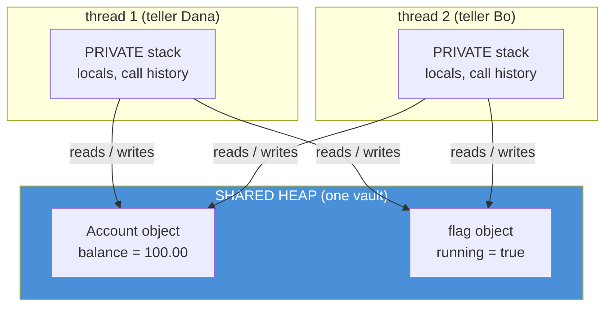
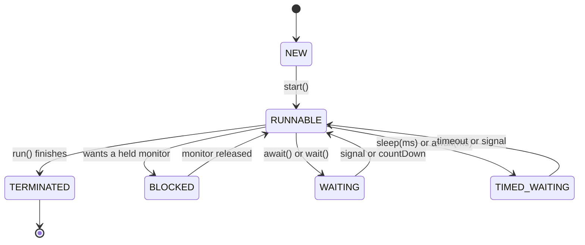
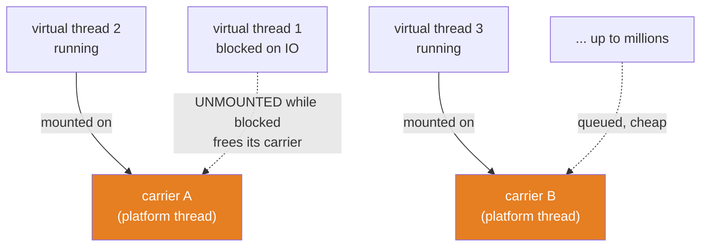
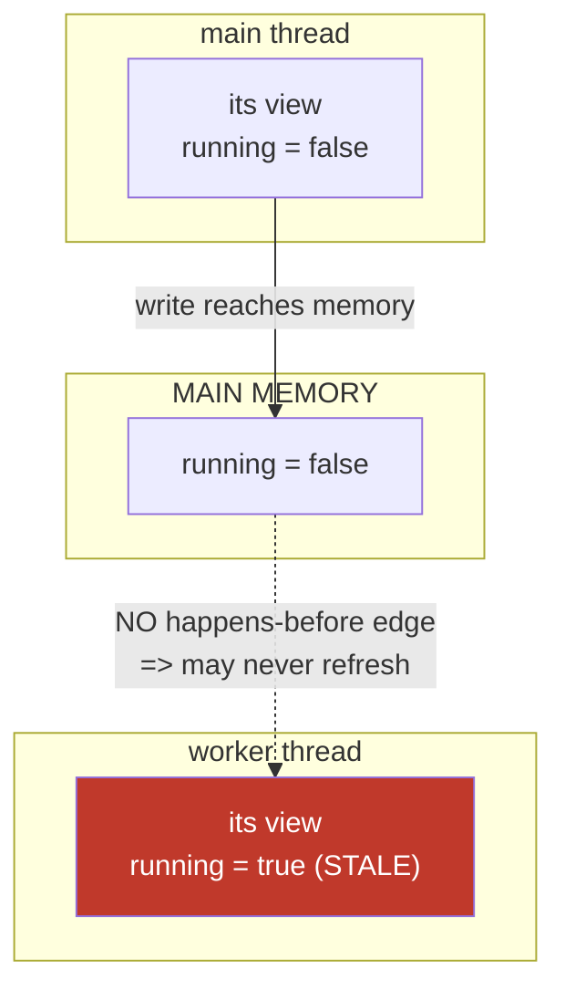

# 04 — Threads & the Java Memory Model: Why Your Variable Is Not My Variable

**The big idea:** a *thread* — one independent stream of execution, with its own stack
but sharing the heap with every other thread — does **not** see memory the way you
assume. Each thread may work from a *cached copy* of a variable, and the compiler and
CPU may *reorder* your reads and writes as long as the single thread's own result looks
correct. So "I set the flag to `false`" does not mean "the other thread sees `false`."
The **Java Memory Model (JMM)** — the set of rules that says exactly when one thread's
write becomes visible to another — is the contract you are actually programming against.
Learn its one guarantee, *happens-before*, and every "weird threading bug" stops being
bad luck and becomes a missing edge you can point at.

**In one sentence:** a thread gets a *view* of memory, not *the* memory — and
`volatile`, locks, `start()`/`join()` and immutable objects are how you publish changes
between views.

## Why this module exists: a bug you can feel

You write the most natural stop-flag in the world:

```java
class Worker {
    boolean running = true;                 // plain field, shared
    void loop() { while (running) { /* work */ } }   // another thread spins here
}
// main thread:
worker.running = false;                     // "stop now"
```

You expect the loop to end. Sometimes it never does. The spinning thread may keep
reading a **cached** `true` forever, because nothing in the JMM forces main's write to
reach it, and the JIT is even allowed to hoist the read out of the loop and compile
`while (running)` into `while (true)`. This is not a JVM bug. It is the contract you
never read. `VisibilityDemo` runs this exact code and *prints which of the two legal
outcomes happened* — because the plain version is genuinely allowed to do either.

The fix is one keyword (`volatile`), but the fix only makes sense once you see the
model. That is this module.

## What a thread actually is

A thread is one execution stream. It owns a **stack** (its local variables and method
call history, private to it). It **shares the heap** (all objects) with every other
thread in the process. Two tellers, one vault:



**Read the diagram:**
- Bottom two boxes: each thread has its **own private stack**. Local variables live
  there and are never shared, so they need no protection.
- Top box: the **heap is shared**. Both threads reach the *same* `Account` and the
  *same* `flag` object. This sharing is the entire source of both the power and the pain.
- The arrows are the danger: two threads reading and writing one object with no
  coordination is exactly the picture the rest of this module is about.

**Walkthrough — what happens when two threads touch one plain field:**
1. Dana's thread reads `running`. The value may come from main memory or from a cache
   in front of Dana's CPU core — the JMM lets the JVM choose.
2. Bo's thread writes `running = false`. The write may sit in Bo's cache and not reach
   main memory yet — again, allowed.
3. Dana reads `running` again. With **no edge** between Bo's write and Dana's read, the
   JVM may hand Dana the stale cached `true`. Forever.
4. So the loop never ends — not because the machine is broken, but because nothing told
   it to synchronize the two views.

**In one sentence:** threads share objects but not the *caches* in front of them, so a
write on one thread is a rumor on another until an edge makes it official.

## The lifecycle: six states, one enum

Every thread is always in exactly one of six `Thread.State` values. `getState()` reports
which. The states and the events that move between them:



**Read the diagram:**
- A thread is born `NEW`, becomes `RUNNABLE` on `start()`, and ends at `TERMINATED`
  when `run()` returns. Those are the two ends.
- The three middle states are all "parked, waiting to return to `RUNNABLE`" — but for
  **three different reasons**, and confusing them is the classic mistake.
- `BLOCKED` is *only* about a monitor lock. `WAITING` and `TIMED_WAITING` are about
  signals and clocks, not locks.

### The table to photograph — the six thread states

| State | What it means | How it gets there | How it leaves |
|---|---|---|---|
| NEW | built, not started | `new Thread(...)` | `start()` |
| RUNNABLE | running or ready to run | `start()`, or waking up | parks, blocks, or finishes |
| BLOCKED | queued for a **monitor lock** | entering a `synchronized` block another thread holds | the holder exits the block |
| WAITING | parked, **no deadline** | `latch.await()`, `object.wait()`, `queue.take()` | another thread signals it |
| TIMED_WAITING | parked, **with a deadline** | `Thread.sleep(ms)`, `await(ms)`, `wait(ms)` | the deadline passes or a signal arrives |
| TERMINATED | `run()` has returned | the body finished or threw | never — a dead thread cannot restart |

**Walkthrough — the BLOCKED vs WAITING distinction that trips everyone:**
1. A thread calls `countDown`-style `latch.await()`. It parks with no clock and no lock
   involved. State: **WAITING**. It needs a *signal* (`countDown()`).
2. A thread tries to enter `synchronized (monitor)` while another thread holds that
   monitor. It queues for the lock. State: **BLOCKED**. It needs the *holder to exit*.
3. A thread calls `Thread.sleep(1000)`. It parks with a clock. State: **TIMED_WAITING**.
   It wakes on the *deadline* (or an interrupt).
4. `LifecycleDemo` parks one thread in each and reads `getState()` — made deterministic
   by having `main` hold the monitor (so `BLOCKED` is certain) and by using latches (so
   `WAITING`/`TIMED_WAITING` are certain).

**In one sentence:** `BLOCKED` is a lock queue, `WAITING` is a signal park, and
`TIMED_WAITING` is a clock park — three mechanisms that all look like "the thread stopped."

## Platform threads, virtual threads, and the carrier

A **platform thread** maps 1:1 to an operating-system thread. It is heavy: roughly 1 MB
of reserved stack each, so a few thousand is already a lot. A **virtual thread** (Java
21) is scheduled by the JVM itself onto a small pool of platform threads called
**carriers** — about one carrier per CPU core. When a virtual thread blocks, the JVM
*unmounts* it (parks its state on the heap) and hands the carrier to another virtual
thread, so blocking is nearly free.



**Read the diagram:**
- The two orange boxes are the **carriers** — the only real OS threads here, roughly one
  per core. Everything else is a virtual thread.
- Solid arrows: virtual threads 2 and 3 are **mounted**, actively using a carrier.
- Dashed arrow: virtual thread 1 is **blocked**, so the JVM unmounted it and its carrier
  is now free to run someone else. Blocking cost almost nothing.
- Millions of virtual threads can wait on only a handful of carriers, because waiting
  threads are not occupying one.

**Walkthrough — what happens when a virtual thread calls `Thread.sleep(100)`:**
1. The virtual thread reaches the blocking call. Instead of blocking its carrier OS
   thread, the JVM **unmounts** it: the stack frames move to the heap and the carrier is
   released.
2. The carrier immediately picks up the next runnable virtual thread. No OS thread sat
   idle.
3. After 100 ms the timer fires. The JVM **re-mounts** the virtual thread onto whatever
   carrier is free and resumes it exactly where it left off.
4. Result: 10,000 virtual threads each sleeping 100 ms finish in a fraction of a second
   of wall time — `VirtualThreadsDemo` prints the elapsed number — while the same on
   platform threads would need 10,000 OS threads and about 10 GB of stacks.

| Situation | Use | Why |
|---|---|---|
| One task per request that blocks (DB, HTTP, files) | virtual threads | blocking is free; millions are cheap |
| CPU-bound crunching (hashing, compression) | platform threads | the work stays on the core; more threads than cores adds nothing |
| Code with `synchronized` around blocking calls | platform threads (or refactor) | a virtual thread there is **pinned** to its carrier and cannot unmount |

**In one sentence:** virtual threads make "one thread per task" cheap again by freeing
the carrier the moment they block — so use them for blocking work and platform threads
for CPU-bound work.

## The Java Memory Model: cached copies and reordering

The **Java Memory Model (JMM)** is the rulebook for how threads interact through memory.
Its central, humbling fact: a thread is not required to read the latest value of a plain
field. It may read from a cache, and the compiler/CPU may reorder operations that a
single thread cannot tell apart. Visibility across threads is **not automatic**.



**Read the diagram:**
- Middle: main memory eventually holds `running = false` after main writes it.
- Left: main's own view is consistent — it wrote `false`, it sees `false`.
- Right (red): the worker's view may stay `true` indefinitely. The dashed arrow is the
  whole problem — with **no happens-before edge**, the JVM is not required to refresh the
  worker's copy from main memory.

**Walkthrough — the spin-flag, both endings (`VisibilityDemo`):**
1. A worker spins on `while (running) { ... }` where `running` is a **plain** boolean.
2. Main sets `running = false`. There is no `volatile`, no lock, no `join` between that
   write and the worker's reads — so no edge.
3. The JIT may hoist the read: `while (running)` becomes `while (true)` with `running`
   read once. The worker spins forever. `VisibilityDemo` starts it as a **daemon** thread
   and calls `join(1000)`, then prints `still spinning? true/false` as *observed reality*.
4. The **volatile** version cannot do this. A `volatile` write *happens-before* every
   subsequent `volatile` read of that field, so the loop must re-read the flag each turn
   and always sees `false`. That one you can assert — and the test does.

Why we never assert the plain hang: the JMM *permits* the stale read but does not
*require* it. On some machines or JVMs the write happens to be seen. So the honest move
is to print which outcome occurred and assert only the safety property (daemon thread,
so the JVM always exits).

**In one sentence:** without a happens-before edge, your write is a rumor the other
thread may never hear — `volatile` turns the rumor into a contract.

## Happens-before: the JMM's one guarantee

**Happens-before (HB)** is the only visibility promise the JMM makes. If action A
*happens-before* action B, then everything A did is visible to B and ordered before it.
It is not "earlier on a wall clock" — it is a guaranteed edge the compiler and CPU may
not reorder across. There are five ways to build one, plus a rule for chaining them:

| Rule | The edge it creates | Where this module proves it |
|---|---|---|
| Program order | within one thread, each action HB every action after it | trivially — a thread sees its own writes |
| Monitor lock | unlocking a monitor HB every later lock of that same monitor | module 05 (`synchronized`) |
| Volatile | a write to a volatile field HB every later read of it | `VisibilityDemo`, section 2 |
| Thread start | `thread.start()` HB every action inside that thread | `HappensBeforeDemo`, section 2 |
| Thread join | every action in a thread HB the moment `join()` returns | `HappensBeforeDemo`, section 1 |
| Transitivity | if A HB B and B HB C, then A HB C | chains the four edges above |

**Walkthrough — how `join()` publishes plain fields (`HappensBeforeDemo`):**
1. A worker thread writes several **plain** (non-volatile, non-final) fields: an `int`,
   a `String`, a `BigDecimal`, a `boolean`, and an `Account` balance. No synchronization.
2. The main thread calls `worker.join()`. By the join rule, *everything the worker did*
   happens-before the moment `join()` returns.
3. After `join()`, main reads every field. Because of the edge, main is guaranteed to see
   all the writes — not one of them stale. The test asserts each value exactly.
4. This is why `join()` (and `CountDownLatch.await()`, which is built on the same idea)
   is the backbone of every deterministic concurrency test in this course: the latch/join
   *is* the edge that makes the assertion legal.

**In one sentence:** stop asking "is my write flushed?" and start asking "is there a
happens-before edge to the reader?" — the edges are `volatile`, locks, `start()`,
`join()`, and final fields.

## Safe publication: why immutable records are thread-safe for free

Publishing an object means making its reference visible to another thread. **Safe
publication** means the other thread sees a fully-built object, not a half-constructed
one. The JMM gives you this for free with `final` fields: it *freezes* them at the end
of the constructor, so any thread that sees the reference sees the correct final values
— even across a plain data race with no other edge.

A Java 21 `record` has nothing but final components. So a `record Transaction(String id,
String description, BigDecimal amount)` is **inherently thread-safe**: there is no
half-built window to catch, no lock needed, no `volatile` needed. This is the deep
reason the whole course (and modern banking code) prefers immutable records for anything
shared between threads. Mutable objects are the ones that need the edges above.

**In one sentence:** make it a `record` and the memory model publishes it safely for
you; make it mutable and publishing it correctly is now your job.

## Interruption is a request, not a command

`Thread.interrupt()` does **not** stop a thread. It sets a boolean *interrupt flag* on
the target. The target then cooperates: polling code checks the flag and winds down;
blocking code (`sleep`, `wait`, `join`, `await`) throws `InterruptedException`.

**Walkthrough — the three facts `InterruptDemo` proves:**
1. **interrupt() sets a flag.** With no blocking call involved, the flag stays set, and
   `isInterrupted()` reads it *without* clearing it. (The static `Thread.interrupted()`
   is the one that reads *and* clears.)
2. **A blocking method throws — and the throw clears the flag.** If a thread is parked in
   `Thread.sleep(60_000)` and you interrupt it, `sleep` throws `InterruptedException`,
   and *inside the catch block* `isInterrupted()` is already `false`. The act of throwing
   consumed the flag.
3. **Re-interrupt to restore it.** Because the flag is now cleared, swallowing the
   exception loses the interruption for every caller above you. The house idiom is
   `Thread.currentThread().interrupt();` inside the catch, which re-sets the flag so the
   pool or caller can still react. Every catch block in this course does this.

**In one sentence:** interruption is a cooperative flag — a thrown
`InterruptedException` clears it, so always re-interrupt (or rethrow) instead of
swallowing, or the signal is lost.

## Daemon vs user threads

A **user thread** keeps the JVM alive; the process runs until the last user thread
finishes. A **daemon thread** does not — when only daemons remain, the JVM exits. Use
`thread.setDaemon(true)` for background work that must never hold the process hostage.

This matters for the demos: the plain spin-flag worker in `VisibilityDemo` *might* spin
forever, so it is a **daemon**. That is why the build always terminates even when the
stale read reproduces. Module 05's deadlock demo relies on the same rule.

## sleep vs wait — the setup for module 05

Two ways to pause, and the difference is the whole reason module 05 exists:

| Aspect | `Thread.sleep(ms)` | `Object.wait()` |
|---|---|---|
| Called on | the current thread (a static method) | a specific object, inside its `synchronized` block |
| Releases the monitor? | **No** — keeps holding every lock it owns | **Yes** — releases the object's monitor so others can enter |
| Wakes on | the deadline, or an interrupt | `notify()`/`notifyAll()`, the deadline, or an interrupt |
| Requires ownership? | no | yes — you must hold the monitor or it throws `IllegalMonitorStateException` |

`sleep` is a private pause; `wait` is a cooperative hand-off that lets another thread
into the locked region. Module 05 turns `wait`/`notify` into the far more usable
`Condition` queues of `java.util.concurrent.locks`.

## Java 21 corner

- **Virtual threads** (`Thread.ofVirtual().start(...)`, `Thread.startVirtualThread(...)`)
  are the headline. `isVirtual()` tells you which kind of thread you are on. They turn
  "one thread per request" from a scaling liability into the default — see module 06 for
  the executor integration.
- **Records** are the safe-publication win: immutable by construction, thread-safe for
  free under the JMM's final-field rule.
- **`Thread.onSpinWait()`** (Java 9) is the polite way to write a busy-wait: it hints the
  CPU that this is a spin loop so it can save power and be a better neighbor. The demos
  use it in every spin loop.

## The traps, all shown live in the demos

- **Trap 1 — the plain spin-flag:** a non-`volatile` boolean may be cached forever and
  the loop may never end. `VisibilityDemo` prints whether it reproduced; the fix is
  `volatile` (or any HB edge).
- **Trap 2 — BLOCKED vs WAITING:** they are different states with different cures. A
  thread `BLOCKED` needs a lock released; a thread `WAITING` needs a signal. Misreading
  a thread dump sends you fixing the wrong thing.
- **Trap 3 — swallowing `InterruptedException`:** an empty catch clears the flag and
  loses the interruption. Re-interrupt or rethrow, always.
- **Trap 4 — unsafe publication of a mutable object:** handing another thread a
  partially-built mutable object (or one published with no edge) can show default/`null`
  fields. Use immutable records, or publish across an edge.
- **Trap 5 — pinning a virtual thread:** a virtual thread inside `synchronized` (or a
  native call) is pinned to its carrier and cannot unmount, so blocking there wastes a
  real OS thread. Prefer `ReentrantLock` in virtual-thread code (module 05).
- **Trap 6 — asserting a race outcome:** you cannot assert that a data race produces a
  specific wrong value, nor that it always hangs. Assert only what the model guarantees
  (edges, atomics); print the rest. Every test here follows that rule.

**In one sentence:** nearly every concurrency bug is a missing happens-before edge or a
misread thread state — and both are things you can now name.

## Class flow

1. Show the "what a thread is" heap/stack diagram first — the shared heap is the whole
   problem. Then the lifecycle state machine and the six-state table. Read the "Read the
   diagram" bullets aloud.
2. Run the demos in order: `.\mvnw.cmd -pl 04-threads-and-jmm compile exec:java`
   (this runs `ThreadModelDemos`, which calls each demo `main()` in teaching order).
   Pause on `VisibilityDemo` — the plain-vs-volatile contrast is the emotional core.
3. Run the tests as *proof*: `.\mvnw.cmd -pl 04-threads-and-jmm test`. Point out that the
   plain-spin test prints its outcome and asserts nothing about the spin — that honesty
   is the lesson.

| Demo class | What it shows |
|---|---|
| `LifecycleDemo` | all six `Thread.State` values, caught deterministically with latches and a main-held monitor |
| `VirtualThreadsDemo` | 10,000 virtual threads sleep in a fraction of a second; `isVirtual()`; carriers; pinning caveat |
| `VisibilityDemo` | the spin-flag both ways: plain may hang (printed, not asserted), volatile always stops |
| `HappensBeforeDemo` | `join()` publishes plain fields; the five HB rules narrated; records and safe publication |
| `InterruptDemo` | cooperative polling; the flag stays set, a thrown exception clears it, re-interrupt restores it |

| Test | What it proves |
|---|---|
| `lifecycleStatesAreExact` | a thread passes through all six states and `getState()` names each exactly |
| `volatileFlagAlwaysStopsWorker` | a volatile write is always seen: the spinner stops within a generous deadline |
| `plainFlagOutcomeIsReportedNotAsserted` | the plain spin's outcome is printed, never asserted; only daemon-safety is asserted |
| `joinPublishesPlainFieldWrites` | after `join()`, every plain field the worker wrote reads back exactly |
| `interruptFlagSemantics` | interrupt sets the flag, a thrown exception clears it, re-interrupt restores it |
| `thousandVirtualThreadsCountExactly` | 1000 virtual threads increment one `AtomicInteger` to exactly 1000 |

## Where this leads

The JMM's monitor-lock edge and the `sleep`-vs-`wait` distinction feed **module 05**
directly: there, `synchronized` becomes the monitor you can see, `wait`/`notify` become
`Condition` queues, and the atomic variables that make `thousandVirtualThreadsCountExactly`
exact get taken apart down to the CPU's compare-and-set instruction. Virtual threads
return in **module 06** as the thing that makes "one thread per task" the default server
model. And every deterministic test in this course — start-gun, `join()`, then assert —
is applying this module's central idea: build a happens-before edge, and only then is an
assertion legal.
