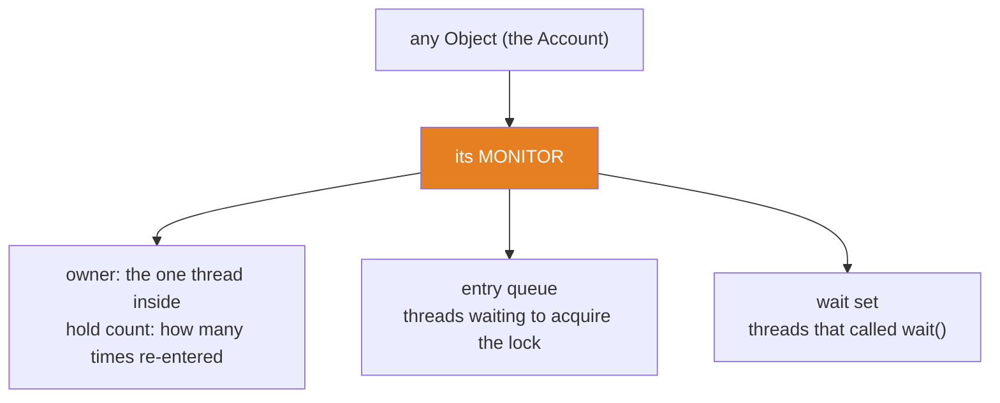
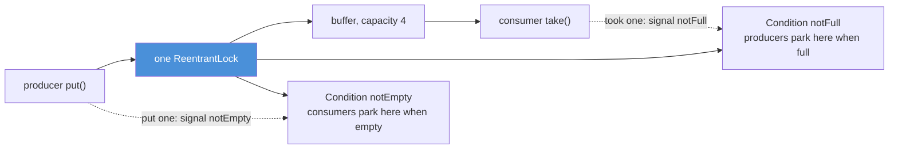
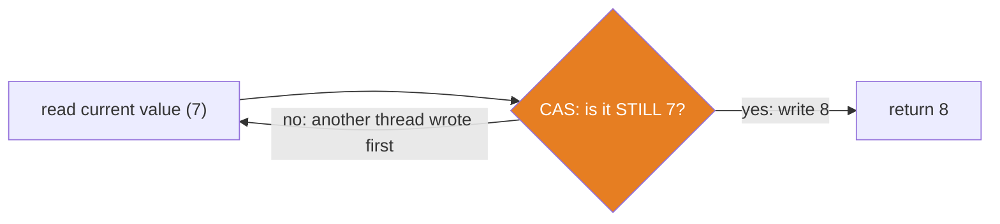
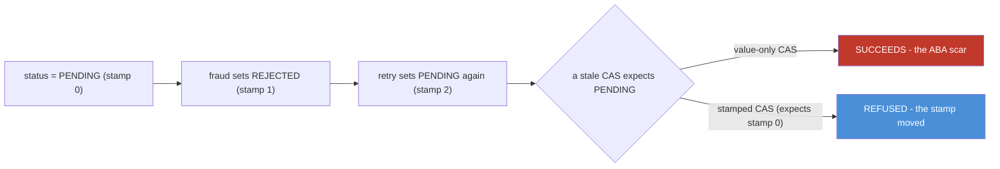

# 05 — Locks & Atomics: Queues, CAS, and the ABA Scar

**The big idea:** `synchronized` is a single, all-or-nothing tool. Under the hood every
object has a *monitor* — a lock with an **entry queue** (threads waiting to get in) and a
**wait set** (threads that called `wait()`). It is correct, but coarse: you cannot ask
"is it free?" without blocking, you cannot give up after a timeout, you cannot be
rescued while waiting, readers cannot share, and there is only one anonymous wait set.
`java.util.concurrent.locks` sells those same guarantees **à la carte** — `tryLock`,
timed waits, interruptible waits, fairness, and as many `Condition` queues as you like.
And `java.util.concurrent.atomic` skips the queue entirely with one CPU instruction,
**compare-and-set (CAS)**: "swap the value only if it is unchanged." Skipping the queue
buys speed and leaves two scars you must know — the **lost update** (fixed by CAS) and
**ABA** (fixed by a version stamp). Queues have their own scar: **deadlock**.

**In one sentence:** `synchronized` is a hardware-backed queue on one object; `Lock`
sells the same guarantee in pieces; atomics dodge the queue with compare-and-set — and
each choice has one classic failure you can now name and prevent.

## Why this module exists: what the queue costs

Module 04 ended with two facts: a monitor is the lock behind `synchronized`, and `wait()`
releases it while `sleep()` does not. That is enough to be correct — and enough to be
slow and rigid. Picture one bank window and eight tellers who all need it:

```java
synchronized (vault) {          // one window; everyone else queues, readers included
    balance = balance.add(x);
}
```

`synchronized` cannot express the reasonable things you now want:
- "Is the vault free *right now*, without joining the queue?" — no `tryLock`.
- "Wait at most 200 ms, then give up." — no timeout.
- "Let an interrupt pull me out of the queue." — a monitor wait is not interruptible.
- "Let the five *readers* in together; only a *writer* needs the window alone." — no split.
- "Wake the producers, not the consumers." — one wait set, so `notifyAll` wakes everyone.

`java.util.concurrent.locks` and `java.util.concurrent.atomic` exist to sell exactly
these pieces. This module takes them apart one at a time.

## Every object has a monitor

A **monitor** (the concurrency meaning — not a screen) is the lock attached to every Java
object, used by `synchronized`. It has three parts:



**Read the diagram:**
- Every object owns exactly one monitor (orange). `synchronized (obj)` means "become the
  owner of `obj`'s monitor."
- **Owner + hold count:** at most one thread owns it. If that same thread re-enters, the
  *hold count* rises instead of blocking — this is **reentrancy**.
- **Entry queue:** threads that want the lock but cannot have it wait here. Their state is
  `BLOCKED` (module 04).
- **Wait set:** threads that own the lock, called `wait()`, and gave the lock up wait
  here for a `notify()`. Their state is `WAITING` or `TIMED_WAITING`.

**Walkthrough — what happens when a second thread enters `synchronized (obj)`:**
1. The JVM checks `obj`'s monitor. If it is free, the thread becomes owner (hold count 1)
   and runs the block.
2. If another thread owns it, the arriving thread parks in the **entry queue** and its
   state becomes `BLOCKED`. It does not spin; it is descheduled.
3. When the owner exits the block, the hold count drops. At 0 the monitor is released and
   the JVM wakes one queued thread — but the wake order is **not promised** (a monitor is
   effectively non-fair).
4. The winner re-acquires, becomes owner, and runs. On exit it too releases, and so on.

**Walkthrough — reentrancy, the hold count (`MonitorReentrancyDemo`):**
1. A thread enters `synchronized (obj)` — hold count 1.
2. Inside, it calls another `synchronized (obj)` method on the *same* object. Because it
   already owns the monitor, it re-enters — hold count 2. It does **not** block.
3. Without reentrancy, step 2 would wait for a lock the same thread already holds: a
   **self-deadlock**. Reentrancy is what makes a `synchronized` method able to call
   another one safely.
4. Each exit drops the count (2 → 1 → 0); the monitor is released only at 0.
5. `ReentrantLock.getHoldCount()` shows this invisible count as a real number — same
   model, explicit API.

**In one sentence:** a monitor is a one-owner lock with a re-entry count, an entry queue
for the blocked, and a wait set for those who called `wait()`.

## wait/notify need ownership, and wait() releases the lock

`wait()`, `notify()` and `notifyAll()` are **monitor operations**. You must own the
monitor to call them — that means calling them inside `synchronized (obj)`. Call them
without ownership and the JVM throws `IllegalMonitorStateException` before anything can
corrupt the wait set.

**Walkthrough — what `obj.wait()` does (`MonitorReentrancyDemo` proves each step):**
1. Precondition: the calling thread owns `obj`'s monitor (you are inside `synchronized (obj)`).
2. `wait()` **releases** the monitor (so other threads can enter) and moves the caller
   into `obj`'s **wait set**. The thread is now `WAITING` (or `TIMED_WAITING` for `wait(ms)`).
3. Another thread acquires the now-free monitor, does its work, and calls `obj.notify()`.
4. `notify()` moves one thread from the wait set back to the **entry queue**. It does not
   release the monitor — the notifier must still exit its `synchronized` block first.
5. The woken thread re-acquires the monitor (competing with the entry queue) and returns
   from `wait()`, holding the lock again.

This is the module-04 `sleep` vs `wait` table, now live: `sleep(ms)` **keeps** the monitor
(a second thread stays locked out for the whole nap), while `wait()` **releases** it (a
second thread walks straight in). `MonitorReentrancyDemo` shows both with two real threads
and prints the difference.

**In one sentence:** you must hold a monitor to `wait`/`notify` on it, and `wait()` is the
only blocking call that hands the monitor back so others can proceed.

## ReentrantLock: the monitor, sold in pieces

`ReentrantLock` gives the same mutual exclusion and reentrancy as a monitor, but as an
explicit object with methods. The price is discipline: **you** must unlock, in a `finally`.

```java
ReentrantLock lock = new ReentrantLock();
lock.lock();                    // acquire OUTSIDE the try
try {
    // critical section
} finally {
    lock.unlock();              // release in FINALLY — if the body throws, this still runs
}
```

Forgetting the `finally` leaks the lock forever: every later thread queues behind a lock
no one will release. `synchronized` cannot leak (the JVM releases on exit, even on an
exception); `ReentrantLock` trusts you. That trust buys the extra methods:

| Capability | `synchronized` (monitor) | `ReentrantLock` |
|---|---|---|
| Acquire and release | implicit, automatic on block exit | explicit `lock()` and `unlock()` in `finally` |
| Ask without blocking | not possible | `tryLock()` returns true or false at once |
| Ask with a deadline | not possible | `tryLock(timeout, unit)` waits, then gives up |
| Be rescued while waiting | not possible (not interruptible) | `lockInterruptibly()` throws on interrupt |
| Choose queue fairness | not possible (effectively non-fair) | `new ReentrantLock(true)` grants in FIFO order |
| Number of wait queues | one wait set | many `Condition` queues (next section) |
| Reentrancy | yes (hold count, hidden) | yes (`getHoldCount()` shows it) |

`TryLockDemo` choreographs all of this with latches: `tryLock()` returns `false` instantly
while a holder owns the lock, `tryLock(200 ms)` waits and then returns `false`, and both
return `true` after the holder releases. **Fairness** is the one behavioural knob a monitor
cannot offer: a *fair* lock grants in first-come order (predictable, slightly slower); a
*non-fair* lock lets a newly-arriving thread **barge** if the lock happens to be free
(higher throughput, but a queued thread can wait longer).

**In one sentence:** `ReentrantLock` is the monitor taken apart — you accept the `finally`
discipline and, in exchange, get `tryLock`, timeouts, interruptibility and fairness.

## Conditions: a lock can have several waiting queues

A monitor's single wait set forces `notifyAll` to wake everyone, even threads waiting for
a different reason. A `ReentrantLock` can create multiple **`Condition`** queues — each a
separate waiting line tied to the same lock. The canonical use is a **bounded buffer**
(a fixed-capacity queue) where producers and consumers wait for opposite things:



**Read the diagram:**
- One lock (blue) guards the buffer. Only one thread is ever inside the critical section.
- Two separate waiting lines hang off that one lock: `notFull` for blocked producers,
  `notEmpty` for blocked consumers.
- Dashed arrows are the **targeted signals**: a consumer that removes an item signals
  `notFull` (wakes a producer only); a producer that adds an item signals `notEmpty`
  (wakes a consumer only). No waking the wrong line.

**Walkthrough — what happens on `put(item)` when the buffer is full (`BoundedBufferDemo`):**
1. The producer calls `lock.lock()` and enters. If `size == capacity`, the buffer is full.
2. It calls `notFull.await()`. Like `wait()`, this **releases the lock** and parks the
   producer on the `notFull` queue.
3. A consumer calls `take()`, acquires the now-free lock, removes an item, and calls
   `notFull.signal()`. That moves one producer from `notFull` back toward the lock.
4. The signalled producer re-acquires the lock and returns from `await()`. It **re-checks**
   the condition in a `while` loop — because another producer may have refilled the buffer
   in the meantime. A wakeup is an invitation to look again, not a guarantee.
5. With room confirmed, it adds the item and calls `notEmpty.signal()` to wake a consumer.
6. `finally { lock.unlock(); }` releases the lock no matter what.

The `while`-not-`if` rule is the single most-missed detail: always re-check a condition
after `await()`. `signal()` wakes one waiter (targeted, efficient); `signalAll()` wakes all
(use it only when waiters have different conditions and one event frees several).

**In one sentence:** `Condition` gives one lock several named waiting lines, so a bounded
buffer wakes exactly a producer or exactly a consumer instead of the whole world.

## ReadWriteLock and StampedLock

A plain lock is exclusive: while one thread *reads*, every other thread waits — even
readers who cannot conflict. `ReentrantReadWriteLock` splits the lock in two modes:
- **read lock:** many readers may hold it at the same time;
- **write lock:** exactly one writer, and no readers while it is held.

**How the demo proves readers run concurrently:** three reader threads each take the read
lock and then meet at a `CyclicBarrier(3)`. A barrier trips **only** when all three
parties arrive together. If the read lock were exclusive, reader 2 would wait for reader 1,
the third would never arrive, and the barrier would time out. It trips — so three read
locks were genuinely held at once. In the test, a barrier timeout *is* the failure.

`StampedLock` goes further with **optimistic reads**: read without locking, then check a
version *stamp* to see whether a write landed meanwhile.

**Walkthrough — an optimistic read (`ReadWriteLockDemo`):**
1. `long stamp = lock.tryOptimisticRead();` — takes **no lock**, just returns a version token.
2. Read the field(s) you care about.
3. `if (!lock.validate(stamp))` — ask "did any write happen since step 1?" If a write
   landed, `validate` returns false and your copy is stale.
4. On stale, fall back to a real `readLock()`, re-read, and `unlockRead()`.

**Caveats, stated plainly:** `StampedLock` is **not reentrant** (re-locking deadlocks
yourself) and has **no `Condition` queues**. Its optimistic read is a gamble that pays off
when writes are rare. Use `ReentrantReadWriteLock` for the general case; reach for
`StampedLock` when reads dominate overwhelmingly and you have measured the need.

**In one sentence:** read-write locks let readers share and a writer own; `StampedLock`
lets readers skip locking entirely and just validate a stamp — at the cost of reentrancy
and conditions.

## Atomics: skip the queue with compare-and-set

**Compare-and-set (CAS)** is a single CPU instruction: "if this memory cell still equals
the value I read, write my new value; otherwise do nothing and tell me it failed." It is
the hardware primitive under every `java.util.concurrent.atomic` class.



**Read the diagram:**
- The thread reads the current value (7) and computes what it wants next (8).
- CAS (orange) asks the hardware: "is it still 7?" If yes, it writes 8 in one indivisible
  step and succeeds.
- If another thread changed it first, CAS fails and the loop **re-reads** the fresh value
  and retries. No lock, no queue, no context switch — a bounded spin on one cell.

**Walkthrough — `AtomicInteger.incrementAndGet()` under contention (`CasRaceDemo`):**
1. Read the current value.
2. Compute `current + 1`.
3. CAS: if the cell still holds `current`, write `current + 1` and return it.
4. If it changed (another teller got there first), CAS fails; go back to step 1 with the
   fresh value. The retry loop is why no increment is ever lost.

**Walkthrough — the lost update, live:** four threads each do `plainCents++` 25,000 times
(100,000 total expected). Because `cents++` is really *read, add, write* with an unguarded
gap, two threads can read the same value and both write back one increment — a deposit
vanishes. `CasRaceDemo` starts all four with a start-gun latch, joins them, and prints
`expected 100000, actual 28054 -> 71946 updates LOST`. The exact loss is
scheduler-dependent, so the code asserts only the safe direction (`actual <= expected`)
and **prints** the loss. The `AtomicInteger` version of the identical race prints
`actual 100000 -> EXACT, every run` — and the test asserts that exact number, because CAS
guarantees it.

**LongAdder vs AtomicLong:** an `AtomicLong` is **one** cell every core fights over, so
the cache line ping-pongs between CPUs. A `LongAdder` keeps a base cell plus **striped**
`Cell[]` slots; contending threads spread across stripes and `sum()` adds them up. Under
heavy write contention `LongAdder` wins; the trade is that `sum()` is a snapshot across
cells, not one atomic instant. Both are **exact when joined** — the demo prints both totals
and both timings (timings printed, never asserted).

**In one sentence:** locks make threads wait in a queue; atomics make them retry a value
with CAS — same exact count, no parking — and `LongAdder` spreads the retries across
stripes when one cell gets too hot.

## ABA: the scar

CAS proves a value is **unchanged**, not that **nothing happened**. If a value goes
A → B → A, a stale CAS sees "still A" and succeeds — on a world that moved. That is
**ABA**.



**Read the diagram:**
- The value leaves `PENDING`, becomes `REJECTED`, then returns to `PENDING`. The *value*
  is unchanged end to end; the *history* is not.
- A value-only CAS (red) asks "still PENDING?" — yes — and wrongly approves, blind to the
  rejection that happened in between.
- A stamped CAS (blue) also checks the **version stamp**. The stamp moved 0 → 1 → 2, so a
  CAS carrying the stale stamp 0 is refused. The worker must re-read and re-decide.

**Walkthrough — the doomed interleaving (`AbaDemo`, scripted on one thread):**
1. A payment worker reads `status = PENDING` and plans `CAS(PENDING → APPROVED)`.
2. The worker is descheduled. It holds no lock, so nothing is frozen.
3. A fraud service sets `PENDING → REJECTED`.
4. A retry resets `REJECTED → PENDING`. The value is `PENDING` again — but a rejection
   happened in between.
5. The worker resumes and runs `CAS(PENDING → APPROVED)`. It **succeeds**, because the
   value matches. The worker approved a payment that was briefly rejected and never
   re-examined. That success is the bug.

Like `collections-framework` 09's scripted interleavings, `AbaDemo` **plays** both workers
step by step on one thread in the doomed order, so the scar appears every run instead of
depending on a lucky schedule.

**The fix — `AtomicStampedReference`:** it pairs the value with an int **stamp** that you
advance on every write. A CAS must match *both* value and expected stamp. The worker's
stale stamp (0) no longer matches the current stamp (2), so the CAS fails and the worker
re-reads. This is exactly a database **`@Version`** column: `UPDATE ... WHERE version = 3`
refuses a stale row the same way (stage-2 optimistic locking). In everyday lock-based Java,
ABA is rare — a lock freezes the world between check and act, and the GC never reuses a
live object's identity — so ABA lives mainly in lock-free structures and in *values* that
can return to a previous state.

**In one sentence:** CAS proves a value is unchanged, not that nothing happened; add a
version stamp and "unchanged" finally means "no one touched it," which deletes the whole
ABA class of bugs.

## Deadlock: when the queue eats itself

**Deadlock** is a set of threads each holding a lock and waiting for a lock another of
them holds, so none can ever proceed. It needs **all four** of the Coffman conditions at
once — so breaking **any one** prevents it:

| Condition | What it means here | How to break it |
|---|---|---|
| Mutual exclusion | a lock is exclusive: one holder at a time | hard to remove — it is the point of a lock |
| Hold and wait | a thread holds one lock while waiting for another | acquire all at once, or use `tryLock(t)` and let go |
| No preemption | a held lock cannot be forcibly taken | use interruptible / timed locks (`lockInterruptibly`, `tryLock(t)`) |
| Circular wait | A waits for B while B waits for A | impose a global lock order (acquire by sorted key) |


**Read the diagram:**
- Dana holds lock A (red) and will not release it until she gets lock B.
- Bo holds lock B and will not release it until he gets lock A.
- The two arrows form a **cycle**. Neither can proceed, and neither will let go — a
  deadlock, and it is forever.

**Walkthrough — building, detecting, and breaking it (`DeadlockDemo`):**
1. Two **daemon** threads (so the JVM can always exit) take their first lock, signal a
   latch, wait for the other's latch, then reach for the second lock. The latches force the
   circular wait to close every run — the deadlock is choreographed, not hoped for.
2. `main` polls `ThreadMXBean.findDeadlockedThreads()` with a **bounded deadline** until it
   returns the two stuck threads, then prints each thread's name and which lock it waits
   for and who owns it. That MXBean is the production smoke detector.
3. `main` **interrupts** both threads. Because the demo uses `ReentrantLock.lockInterruptibly()`
   (not `synchronized`), the blocked acquisition throws `InterruptedException`, each thread
   releases its lock in `finally`, and both exit. A thread blocked on a *monitor* cannot be
   rescued this way — that interruptibility is one of the pieces j.u.c sells.

**The two fixes, both shown live:**
- **Lock ordering** breaks circular wait: give every lock a global order (here, by account
  id, since `Account` is `Comparable`) and always acquire in that order. Dana (A→B) and Bo
  (B→A) both take A before B, so no cycle can form. Both transfers complete.
- **`tryLock` with a timeout** breaks hold-and-wait: acquire the second lock with
  `tryLock(t)`; if it fails, release the first and retry after a backoff. No thread holds
  one lock while waiting forever for another, so the deadlock cannot persist.

**In one sentence:** deadlock needs all four Coffman conditions; order your locks to break
circular wait or use `tryLock(t)` to break hold-and-wait, and detect whatever slips
through with `ThreadMXBean.findDeadlockedThreads()`.

## The table to photograph — which tool, when

| Tool | Reach for it when | Do NOT use it for |
|---|---|---|
| `synchronized` | simple mutual exclusion, short critical sections | needing tryLock, timeouts, fairness, or several wait queues |
| `ReentrantLock` | you need tryLock, a deadline, interruptibility, or fairness | trivial guards where `synchronized` is clearer |
| `ReentrantReadWriteLock` | many readers, rare writers | write-heavy work (reader bookkeeping costs more) |
| `StampedLock` | overwhelming reads, rare writes, and you measured the need | anything needing reentrancy or `Condition` queues |
| `AtomicInteger` / `AtomicReference` | a single counter or reference updated by CAS | guarding several fields that must change together |
| `LongAdder` | a very hot write-mostly counter (statistics, tallies) | needing an exact instantaneous read (`sum()` is a snapshot) |

## Java 21 corner

- **Virtual threads change the lock calculus.** In Java 21, a virtual thread that blocks
  inside a `synchronized` block is **pinned** to its carrier — it cannot unmount, so it
  wastes a real OS thread (module 04's pinning caveat). In virtual-thread code, prefer
  `ReentrantLock` around blocking work: it lets the virtual thread unmount while waiting.
- **Records stay the safe default.** Immutable records need no lock to share (module 04's
  safe publication), so the best synchronization is often to make the data immutable and
  keep the locks small.
- **`Thread.onSpinWait()`** is the polite hint inside any hand-written CAS-style spin loop.

## The traps, all shown live in the demos

- **Trap 1 — `unlock()` without `finally`:** an exception in the critical section leaves
  the lock held forever and every later thread queues behind a ghost. Always `finally`.
- **Trap 2 — `wait()`/`notify()` without the monitor:** throws `IllegalMonitorStateException`
  deterministically. You must own the lock (`Condition.await()`/`signal()` enforce the same
  rule but read more clearly).
- **Trap 3 — `if` instead of `while` around `await()`:** a wakeup is not a guarantee; the
  condition may have changed again. Always re-check in a loop.
- **Trap 4 — `signal()` when you meant `signalAll()`:** if waiters have different reasons
  to wake, one targeted signal can leave the wrong waiter asleep (a "lost wakeup").
- **Trap 5 — upgrading a read lock to a write lock:** `ReentrantReadWriteLock` cannot
  atomically promote read → write; trying to take the write lock while holding the read
  lock deadlocks. Release the read lock first.
- **Trap 6 — assuming no ABA on value-equal CAS:** any value that can return to a previous
  state (a status, a balance, a pooled node) needs a stamp (`AtomicStampedReference`).
- **Trap 7 — two-lock transfers with no order:** any code that locks two accounts in
  "my direction" order deadlocks under concurrency. Order by a global key (account id).
- **Trap 8 — deadlocking with user threads in a demo:** the JVM would never exit. Deadlock
  demos use daemon threads and break the deadlock with `lockInterruptibly` + interrupt.

**In one sentence:** every lock trap is either a lock you failed to release, a condition
you failed to re-check, a cycle you failed to order, or a value you failed to stamp.

## Class flow

1. Show the monitor diagram (owner/hold count, entry queue, wait set) — it is the object
   everything else is compared against. Then the bounded-buffer two-Condition diagram and
   the CAS retry-loop diagram. Read the "Read the diagram" bullets aloud.
2. Run the demos in order: `.\mvnw.cmd -pl 05-locks-and-atomics compile exec:java`
   (this runs `LocksDemos`, which calls each demo `main()` in teaching order). Pause on
   `CasRaceDemo` (the lost update is the emotional core) and `DeadlockDemo` (the detection
   printout lands hard).
3. Run the tests as *proof*: `.\mvnw.cmd -pl 05-locks-and-atomics test`. Point out that the
   plain-int race prints its loss and asserts only `<=`, while the atomic race asserts the
   exact 100,000 — that asymmetry *is* the lesson.

| Demo class | What it shows |
|---|---|
| `MonitorReentrancyDemo` | reentrancy and hold count; `wait`/`notify` need ownership (`IllegalMonitorStateException`); `wait()` releases the monitor while `sleep()` keeps it |
| `TryLockDemo` | the `lock`/`try`/`finally` idiom; `tryLock()` fails while held and succeeds after release; `tryLock(200 ms)` waits then gives up; fair vs non-fair |
| `BoundedBufferDemo` | one lock, two Conditions: the `notFull`/`notEmpty` producer-consumer dance, every await/signal printed as a numbered step |
| `ReadWriteLockDemo` | a `CyclicBarrier(3)` proves three readers hold the read lock at once; a writer stands alone; `StampedLock` optimistic read, stale stamp, and caveats |
| `CasRaceDemo` | plain `int++` loses updates (loss printed), `AtomicInteger` is exact; `LongAdder` vs `AtomicLong` striping |
| `AbaDemo` | a scripted A→B→A interleaving fools a value-only CAS; `AtomicStampedReference` refuses the stale stamp and accepts a fresh one |
| `DeadlockDemo` | a choreographed deadlock between two daemon threads, detected by name via `ThreadMXBean`, broken with interrupt, then fixed by ordering and by `tryLock(t)` |

| Test | What it proves |
|---|---|
| `tryLockReflectsOwnership` | `tryLock()` is false while held, `tryLock(200 ms)` waits then false, and it is true after release |
| `boundedBufferTransfersAllInFifoOrder` | eight transactions cross a capacity-4 buffer in exact FIFO order (producer and consumer joined) |
| `threeReadersHoldReadLockSimultaneously` | three readers pass a `CyclicBarrier(3)` under the read lock — a timeout would fail the test |
| `atomicIntegerCountsExactly` | 4 × 25,000 atomic increments total exactly 100,000 (start gun + join) |
| `plainIntRaceOnlyLosesUpdates` | 4 × 25,000 plain `int++` is at most 100,000; the observed loss is printed, not asserted |
| `waitWithoutMonitorThrows` | `wait()` and `notify()` without the monitor throw `IllegalMonitorStateException` |
| `stampedReferenceRefusesStaleAndAcceptsFresh` | `AtomicStampedReference` refuses a stale stamp and accepts a fresh one |
| `deadlockIsDetectedByName` | `findDeadlockedThreads()` names both daemon tellers within a bounded poll, then interrupt breaks it |

## Where this leads

Everything here is the machinery under the next modules and the rest of the course. The
`Condition`-based bounded buffer is `ArrayBlockingQueue`/`LinkedBlockingQueue`, which are
the heart of the thread pools and `CompletableFuture` pipelines in **module 06**. The
atomics and CAS are what `ConcurrentHashMap` runs on (`collections-framework` 10). The
`AtomicStampedReference` stamp is a database `@Version` column — **stage-2** optimistic
locking is `AbaDemo` in SQL — and the four deadlock conditions are exactly why a database
reports "deadlock detected" when two transactions update rows in opposite order. Lock
ordering and `tryLock` reappear as idempotency and distributed-lock patterns in
**stage-5**. Once you can see the queue, the CAS, and the scar, none of that is magic
anymore.
