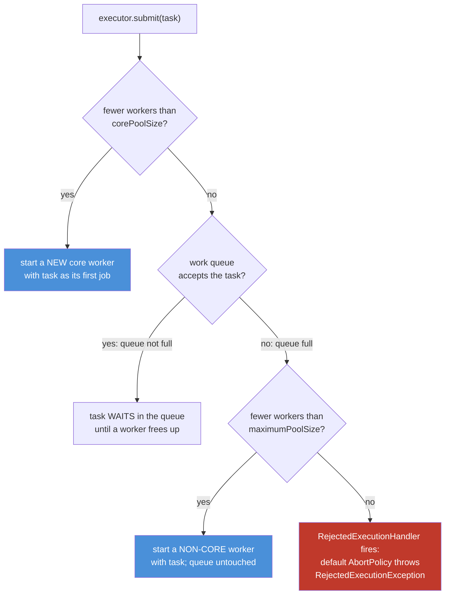
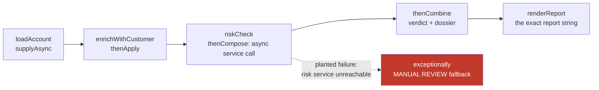

# 06 — Executors & Async: Renting Threads, Chaining Futures

**The big idea:** a thread is the most expensive object you will ever create casually.
An *executor* — an object that runs tasks for you, instead of you starting threads —
rents threads out of a pool: a fixed crew, a waiting line, and a bouncer for when both
are full. A *future* — a receipt for a task whose result does not exist yet — is how the
work comes back. `CompletableFuture` upgrades the receipt into a **pipeline**: you
register the next stage instead of blocking for the last one, and whichever thread
finishes stage N usually runs stage N+1. And Java 21's *virtual threads* make "one
thread per task" affordable again: 10,000 of them, no pool, exact count. This module is
literally what `stage-2`'s `@Async` and the Tomcat request pool do underneath.

**In one sentence:** stop selling threads one by one — pools rent them out,
`CompletableFuture` chains the results, and virtual threads make thread-per-task cheap
again.

## Why pools exist: the problem you can still feel

Module 04 ended with you starting threads by hand. Try that under load and three things
hurt, in order:

1. **Birth cost.** A *platform thread* — the classic `new Thread(...)`, mapped 1:1 onto
   an operating-system thread — costs a native OS call and roughly **1 MB of reserved
   stack memory** at creation. 200 of them: 200 OS calls, ~200 MB reserved.
2. **Context-switch death.** Every runnable thread competes for CPU time. Past a few
   hundred, the OS spends more time *switching between* threads than running them.
3. **The wall.** Keep creating them and you end in
   `OutOfMemoryError: unable to create native thread`.

`PoolAnatomyDemo` measures cost #1 live: 200 raw threads versus 200 no-op tasks on an
8-thread pool — elapsed milliseconds **printed, never asserted** (timings belong to the
machine, not to the lesson).

A *pool* (the "shared crew you rent from" meaning, not the swimming meaning) is exactly
three things: **reused threads** + a **work queue** + an **admission policy** for when
both are full. SecureBank analogy: a bank branch does not hire one teller per arriving
customer. It keeps a fixed counter crew, seats arrivals in a queue, and when the queue
hits the fire limit, the guard turns people away *at the door* — loudly, not silently.

**In one sentence:** pools exist because threads are expensive to create, expensive to
schedule, and fatal to create without limit — so reuse a crew, queue the overflow, and
define what "full" means.

## Under the hood: the anatomy of a ThreadPoolExecutor

Every `Executors` factory in this module (except the virtual-thread one) builds the same
class in disguise: `ThreadPoolExecutor`. Its four dials:

- **corePoolSize** — the standing crew. Up to this many workers are created on demand
  and (by default) never fired, even while idle.
- **maximumPoolSize** — the surge ceiling. Extra *non-core* workers are created only
  when the queue is full, and die after `keepAliveTime` idle.
- **workQueue** — the waiting line: a `BlockingQueue<Runnable>` (module 05's blocking
  queue) holding submitted-but-not-started tasks.
- **RejectedExecutionHandler** — the admission policy, invoked when the queue is full
  **and** the pool is at maximum. The default `AbortPolicy` throws
  `RejectedExecutionException`. Alternatives: `CallerRunsPolicy` (the *submitting*
  thread runs the task itself — natural back-pressure), `DiscardPolicy` (silently drop),
  `DiscardOldestPolicy` (drop the queue's head, retry).

**Read the diagram:**
- Top: `submit(task)` enters a three-question gauntlet — every pool decision is this
  picture, on every task, forever.
- Question 1: below core size? The pool creates a **new** core worker running your task
  immediately — even if other workers are idle (core threads are created, not matched).
- Question 2: core is staffed, so the task tries the **queue**. Accepted means waiting,
  not running.
- Question 3: the queue is full, so the pool makes one last effort — a **non-core**
  worker up to `maximumPoolSize`, running your task directly.
- Red bottom: at maximum with a full queue, the admission policy fires. With the default
  `AbortPolicy` your `submit` call itself throws `RejectedExecutionException`.

**Walkthrough — what happens when you call `executor.submit(task)`:**
1. The pool reads its worker count. Below `corePoolSize`? Start a new core worker with
   your task as its *first* job. Done — the task never sees the queue.
2. Otherwise, the pool offers the task to the `workQueue`. If the queue has room, the
   task waits there until some worker's current task finishes and it polls the next one.
3. If the queue refused (full), the pool tries to start a **non-core** worker — but only
   while the count is below `maximumPoolSize`.
4. If that also fails, the `RejectedExecutionHandler` runs. Default: throw
   `RejectedExecutionException` at the submitter, synchronously.
5. Later: a non-core worker idle for `keepAliveTime` terminates itself; core workers
   keep waiting (unless `allowCoreThreadTimeOut(true)`).

That is the *whole* machinery behind every factory below — and behind Tomcat's request
pool in `stage-2`.

**In one sentence:** `submit` is a gauntlet — core thread, then queue, then grow to
maximum, then reject — and knowing which door your task went through tells you exactly
how your service behaves under load.

## Factory tour: what each `Executors` method really configures

| Factory | Core size | Maximum size | Work queue | What that means under load |
|---|---|---|---|---|
| `newFixedThreadPool(n)` | n | n | unbounded `LinkedBlockingQueue` | the maximum is never reached; tasks queue forever — no rejection, possible memory growth (trap 1) |
| `newCachedThreadPool()` | 0 | `Integer.MAX_VALUE` | `SynchronousQueue` (zero capacity) | the queue never holds, so every task with all-hands-busy spawns a thread — elastic, unbounded |
| `newSingleThreadExecutor()` | 1 | 1 | unbounded `LinkedBlockingQueue` | wrapped so you cannot recast and reconfigure it; one worker means tasks run in submission order |
| `newScheduledThreadPool(n)` | n | `Integer.MAX_VALUE` | `DelayedWorkQueue` | the only factory that understands *time*: `schedule`, `scheduleAtFixedRate`, `scheduleWithFixedDelay` |
| `newVirtualThreadPerTaskExecutor()` | — | — | none | not a `ThreadPoolExecutor` at all: one new **virtual** thread per task, no dials to set |

`PoolAnatomyDemo` prints this table **live** by casting each factory's product back to
`ThreadPoolExecutor` and reading its dials — with two honest exceptions it also prints:
`newSingleThreadExecutor` hands you a deliberate wrapper that refuses the cast (so nobody
can change its single-thread promise later), and the virtual-thread executor has no
dials because it has no pool.

## The table to photograph — which executor when

| Situation | Use | Why |
|---|---|---|
| CPU-bound work (parsing, pricing, rendering) | `newFixedThreadPool(about core count)` | threads beyond the core count only add switching cost |
| Blocking input/output, many concurrent calls | `newVirtualThreadPerTaskExecutor()` | a blocked virtual thread is nearly free; no pool sizing to guess |
| Legacy blocking code on platform threads | `newCachedThreadPool()` or a sized fixed pool | platform threads are scarce — reuse them hard |
| Timers, heartbeats, delayed retries | `newScheduledThreadPool(1)` | the only factory that schedules by *time* |
| Events that must be processed in order | `newSingleThreadExecutor()` | one worker gives you order plus happens-before (module 04) |
| A bounded resource (database connections) | fixed pool sized to the resource, or virtual threads + `Semaphore` | the pool is the admission policy; virtual threads do not limit resources |

## Runnable vs Callable, and the Future receipt

Two task shapes, one receipt:

- `Runnable` — work with **no result** and no checked exception: `void run()`.
- `Callable<V>` — work **with a result** and/or checked exceptions: `V call() throws Exception`.
- `execute(Runnable)` — fire-and-forget. No receipt. If the task throws, the exception
  goes to the thread's `UncaughtExceptionHandler` and kills that worker (the pool
  quietly replaces it).
- `submit(...)` — returns a `Future<V>`: the receipt. Exceptions are **captured inside
  it** and surface only at `get()`, wrapped in `ExecutionException`. A receipt nobody
  reads is a failure nobody sees (trap 2).

**Walkthrough — what happens when you call `future.get()`:**
1. Task not finished? The calling thread **parks** — it blocks and gives up its CPU
   (module 05's parking machinery), without polling.
2. The task completed normally? `get()` returns its value.
3. The task threw? `get()` throws `ExecutionException`; your exception is the `getCause()`.
4. The task was cancelled? `get()` throws `CancellationException` — the receipt is void.
5. `get(timeout, unit)` adds a fuse: `TimeoutException` instead of blocking forever
   (trap 6 — always know what you wait for).

`cancel(mayInterruptIfRunning)` has two lives. On a **queued** task it simply un-queues
it — the task never runs. On a **running** task, `cancel(true)` interrupts the worker —
and an interrupt is a *signal, not a kill*: the task stops only if it cooperates (checks
`isInterrupted()`, or calls `sleep`/`await`, which throw `InterruptedException`). That
contract is module 04's; `FutureBasicsDemo` shows a cancelled task reporting the
interrupt, and `PoolAnatomyDemo` shows `shutdownNow()` relying on the same cooperation.

**In one sentence:** `submit` hands you a receipt that blocks on `get()`, captures
exceptions, and treats `cancel(true)` as a polite interrupt — everything else is the
task's cooperation.

## Graceful shutdown: three moves, one story

1. `shutdown()` — stop **accepting** new tasks; queued and running tasks finish
   naturally. The branch stops admitting customers and serves the line.
2. `shutdownNow()` — interrupt all running tasks and **return the list of queued tasks
   that never started** (log them, re-submit them, or mourn them). It works exactly as
   far as interrupt cooperation reaches.
3. `awaitTermination(timeout, unit)` — block until everything is over, or until the
   timeout. It is the **only proof** the pool is done; `isShutdown()` merely reports
   that shutdown was *called*.

Java 19 made `ExecutorService` `AutoCloseable`: `close()` = `shutdown()` +
`awaitTermination()`, so `try (ExecutorService ex = ...)` cannot leak a pool — the demos
use it wherever a pool has a short life.

## CompletableFuture: chaining instead of blocking

A plain `Future` has one move: block on `get()`. Block enough threads and you are back
to scarcity. `CompletableFuture<T>` — a future you can *continue* — inverts it: you
register "when this completes, run that stage", and no thread ever parks waiting.
It is Java 8 vintage (see "Java 21 corner" for what changed around it).

The vocabulary, in pipeline order:

- `supplyAsync(supplier)` — run a value-producing task. With **no executor argument** it
  uses `ForkJoinPool.commonPool()`: one pool shared by the *whole JVM*, sized
  `availableProcessors - 1`. The demo prints the executing thread's name — watch for
  `ForkJoinPool.commonPool-worker-N`.
- `thenApply(f)` — transform the result (`map`).
- `thenAccept(c)` / `thenRun(r)` — consume the result / ignore it.
- `thenCompose(f)` — chain a stage that itself returns a `CompletableFuture`, **without
  nesting** (`flatMap` — trap 4).
- `thenCombine(other, f)` — wait for **two independent** futures, merge both values.
- `exceptionally(fn)` — a fallback value when *any* upstream stage failed.
  `handle((v, ex) -> ...)` sees success and failure in one lambda; `whenComplete`
  observes without transforming.
- `allOf(...)` — completes when **all** given futures complete. `anyOf(...)` — when the
  **first** one does (which one wins is a race; never assert it).

**Read the diagram:**
- Left to right: the SecureBank report pipeline — load the account, attach the customer,
  ask the risk service, merge the verdict with the dossier, render one exact string.
- The dotted red branch is the **planted failure**: account `A-666` always crashes in
  `riskCheck`, so `exceptionally`'s fallback (`REPORT A-666 | MANUAL REVIEW | risk
  service unreachable`) is provable on every run.
- Nothing in the picture blocks a thread. Each arrow means "register", not "wait".

**Walkthrough — what happens when a stage completes:**
1. The stage's supplier returns — or throws. The completing thread stores the outcome in
   the `CompletableFuture`'s single result slot with one compare-and-set (module 05).
2. Every dependent stage registered on that future is released. If the dependent was
   registered *before* completion, it typically runs **inline on the same worker that
   just finished**; if it was registered *after* the future had already completed, the
   **registering thread** runs it on the spot. Either way: no handoff, no wake-up, no
   parked thread — and the demo's stage lines name the thread that proves it.
3. A `thenCompose` stage's future *adopts* the inner future's outcome when the inner one
   completes — that adoption is the flattening.
4. On failure, the exception **skips every value-transforming stage** and travels down
   the chain (surfacing at `join()` wrapped in `CompletionException`) until an
   `exceptionally` or `handle` intercepts it. No interceptor? Silent failure — the
   exception never reaches stderr on its own.
5. The `...Async` variants (`thenApplyAsync`, `thenComposeAsync`, ...) re-submit the
   stage to an executor instead of running inline — and that second argument is where
   you hand over your **own** executor.

**The rule — do not block the common pool.** The common pool is small (cores − 1) and
shared by *every* `CompletableFuture` without an explicit executor and *every* parallel
stream in the JVM. Park one of its workers on a JDBC call and you have stolen it from
everyone else, including code you did not write. CPU-bound stages: common pool is fine.
Blocking IO: pass your own executor — in Java 21, usually a virtual-thread one. The demo
applies the rule in banners 5 and 6 (a dedicated `ioLane`).

**In one sentence:** `CompletableFuture` turns "wait for the result" into "register the
next stage", failures ride the same chain until someone claims them, and the common pool
is for computing — never for blocking.

## Virtual threads: thread-per-task is cheap again

A *virtual thread* (final in Java 21, JEP 444) is a thread the **JVM** schedules
instead of the OS. Two consequences:

1. Its stack lives in small chunks **on the heap**, starting at a few hundred bytes —
   not ~1 MB of reserved native memory. 10,000 of them fit where 10,000 platform
   threads would not.
2. When it blocks (`sleep`, socket read, `queue.take`), it **unmounts** from its
   *carrier thread* — the platform thread currently hosting it — which immediately runs
   another virtual thread. **Blocking became cheap.**

`Executors.newVirtualThreadPerTaskExecutor()` creates one fresh virtual thread per task:
no core size, no queue, no rejection — the pool's reason for existing (thread scarcity)
evaporates for blocking work. `VirtualThreadExecutorDemo` runs 10,000 tasks that each
park 1 ms of simulated IO and counts completions **exactly** (guaranteed by `close()`,
not by timing). Two honest limits, both in the demo's verdict:

- **CPU-bound work gains nothing** — you cannot run more code than you have cores. Fixed
  pools and the common ForkJoinPool still own that row of the table.
- **Virtual threads limit nothing.** To protect a database with 20 connections, use a
  `Semaphore(20)` (module 05), not a 20-thread pool — pooling threads to guard a
  resource was always a workaround.

**Structured concurrency (one paragraph, narrative only — the API is still incubating).**
Java 21 also previews *structured concurrency* (`StructuredTaskScope`, JEP 453): it
treats a fork of subtasks as one unit of work inside a scope you `try`-with-resources, so
subtasks never outlive their parent and cancellation propagates down the tree — "fire N
futures and pray" becomes "a scope that succeeds or fails together". Because it is
incubating (renamed and reshaped between releases), this module teaches the stable API
and points at scopes as the direction of travel. No demo, no test — watch Java 25.

**In one sentence:** virtual threads did not make pools obsolete; they made *thread
scarcity* obsolete, so pools remain for CPU-bound sizing and admission control while
blocking work simply takes one cheap thread per task.

## Java 21 corner

- **Virtual threads are final** (JEP 444) — the executor tour gained its last row, and
  "don't block a platform thread" graduated from advice to design rule.
- **`ExecutorService` is `AutoCloseable`** since Java 19: `close()` = `shutdown()` +
  `awaitTermination()`, so `try (ExecutorService ex = ...)` guarantees no demo (and no
  service) leaks a pool.
- **`CompletableFuture` itself is Java 8 vintage** — chaining predates virtual threads.
  Java 21 did not replace it; it gave it better threads to run on (`supplyAsync(task,
  virtualThreadExecutor)`).
- **Structured concurrency stays preview/incubating** — narrative above, deliberately no
  code here.

## The traps, all printed as evidence in the demos

- **Trap 1 — `newFixedThreadPool`'s queue is unbounded:** the maximum is never reached,
  rejection never fires, and a producer faster than the crew grows the queue until
  `OutOfMemoryError`. Rejection — and back-pressure — exist only where *you* construct a
  `ThreadPoolExecutor` with a **bounded** queue, exactly as `PoolAnatomyDemo` does.
- **Trap 2 — `submit()` swallows exceptions into the Future:** a throwing task looks
  identical to a running one until somebody calls `get()`, which then throws
  `ExecutionException`. `execute()` fails loudly through the thread's
  `UncaughtExceptionHandler`. A forgotten receipt is a silent failure.
- **Trap 3 — blocking the common pool starves the whole JVM:** every
  default-`supplyAsync` *and* every parallel stream shares those few workers. One JDBC
  call inside a stage and unrelated code across the process waits behind it.
- **Trap 4 — `thenApply` nests when the stage returns a future:** you get
  `CompletableFuture<CompletableFuture<T>>`; the outer one reports "done" while the
  inner work still runs. `thenCompose` is the `flatMap` that fixes it.
- **Trap 5 — `shutdownNow()` cannot stop a task that ignores interrupts:** it returns
  the never-started queue and interrupts the runners — a task with no
  `sleep`/`await`/`isInterrupted()` runs to completion anyway (module 04's cooperation
  rule, enforced by nobody).
- **Trap 6 — `Future.get()` without a timeout can block forever:** the receipt has no
  fuse. `get(timeout, unit)` throws `TimeoutException` instead — and then you decide.

**In one sentence:** every trap here is the same crime in six outfits — treating a pool,
a queue, or a future as magic instead of as threads + queue + policy that *you*
configured and *you* must observe.

## Class flow

1. Show the two diagrams (the `submit` gauntlet first — the anatomy; the pipeline
   second — the chaining). Read the "Read the diagram" bullets aloud.
2. Run the demos in order: `.\mvnw.cmd -pl 06-executors-and-async compile exec:java`
   (runs `ExecutorsDemos`, which calls each demo `main()` in teaching order).
3. Run the tests as *proof*: `.\mvnw.cmd -pl 06-executors-and-async test` — every task
   is joined (futures, latches, `awaitTermination`, `close()`) before anything is
   asserted; the only timing anywhere is generous deadlines.

| Demo class | What it shows |
|---|---|
| `PoolAnatomyDemo` | 200 raw threads vs 200 pooled tasks (timings printed); the four dials read from a live pool; reuse proven by thread names (6 tasks, 2 threads); rejection provoked with latches and caught; `shutdown` vs `shutdownNow` with interrupt cooperation |
| `FutureBasicsDemo` | `execute` vs `submit`; `Runnable` vs `Callable`; `get()` blocks then returns; exceptions captured into the receipt (`ExecutionException` with cause); `cancel(true)` as an interrupt request |
| `CompletableFuturePipelineDemo` | the SecureBank report pipeline with per-stage thread names; common pool named; `thenApply` vs `thenCompose` nesting; planted failure + exact `exceptionally` fallback; `thenCombine`; `allOf`/`anyOf`; the "own executor for blocking" rule applied |
| `VirtualThreadExecutorDemo` | 10,000 tasks each blocking 1 ms on virtual threads; exact completion count via `close()`; elapsed printed, never asserted |
| `ScheduledExecutorDemo` | one-shot `schedule` + `get()`; `scheduleAtFixedRate` with an **exact** 3-tick count (the task cancels itself — no race); `shutdownNow` returns the dropped queue |

| Test | What it proves |
|---|---|
| `poolReusesThreads` | 6 tasks on a 2-thread pool run on at most 2 distinct threads (all joined first) |
| `saturatedPoolRejects` | busy core + full bounded queue + maximum reached throws `RejectedExecutionException` |
| `futureGetReturnsCallableValue` | `get()` blocks, then returns the `Callable`'s exact `BigDecimal` |
| `completableChainBuildsExactReport` | the four-stage pipeline joins to the exact report string |
| `exceptionallyCatchesPlantedFailure` | the planted failure becomes the exact MANUAL REVIEW fallback; the raw join throws `CompletionException` with the planted cause |
| `thenCombineSumsTwoStages` | two independent stages sum to the exact exposure |
| `allOfWaitsForAll` | after `allOf(...).join()`, the counter is exactly at the task count |
| `virtualThreadExecutorCompletesEveryTask` | 1,000 tasks, `close()` waits, count exact |
| `awaitTerminationTrueAfterShutdown` | termination is reported only after every result exists |

## Where this leads

This module is `stage-2`'s engine room. `@Async` is module 03's annotation bolted onto
*exactly* this machinery: Spring hands your method to an executor configured with the
anatomy above. The Tomcat request pool **is** a `ThreadPoolExecutor` with its own queue
and rejection policy — when it saturates, you have just watched walkthrough step 4
happen to an HTTP request, and `CallerRunsPolicy` is why "the framework throttles
itself". `stage-5`'s resilience patterns (timeouts, retries, circuit breakers) wrap
`CompletableFuture` chains. Module 07 asks where 10,000 virtual-thread stacks actually
live — the heap, whose rent collector 07 comes to collect. And module 08's selectors
share this module's commandment verbatim: do not block a platform thread.
