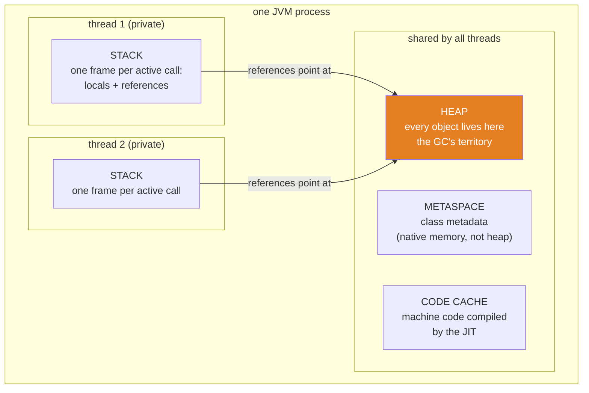
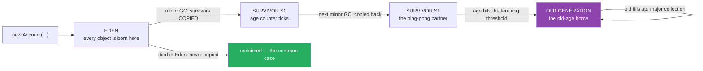
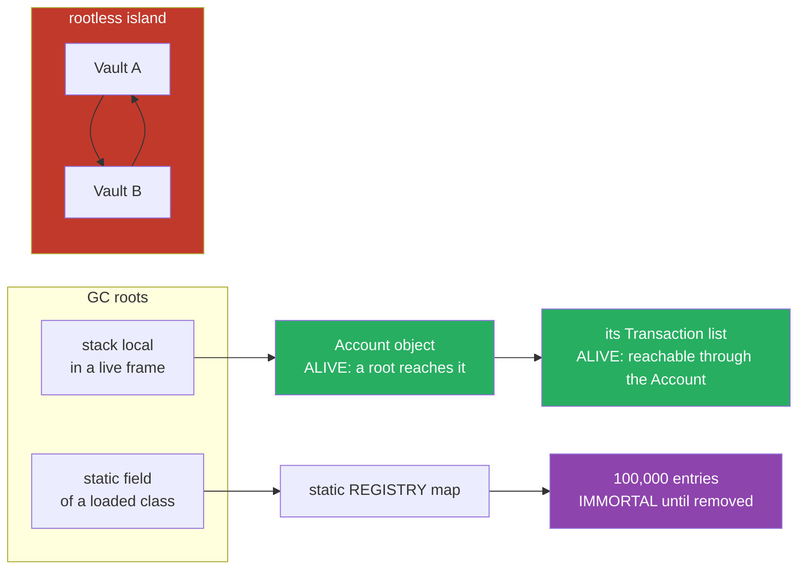

# 07 — JVM Memory & GC: The Nursery, the Old-Age Home, and the Leak Hunt

**The big idea:** your objects live in ONE shared heap; your variables live in
per-thread stacks. The heap is split into *generations* — a nursery where every object
is born, and an old-age home where the few survivors retire — because of one
statistical fact: **most objects die young**. The collector never asks "how many
references point at this object?" (that is reference counting, and it leaks on cycles).
It asks one question: **"can I reach it from a root?"** Unreachable means garbage —
cycle or no cycle. And a *leak* in Java is the mirror image of the C bug: not "forgot
to free", but "forgot to let go" — an object you can no longer use but the collector
dare not free, because you are still holding it.

**In one sentence:** the JVM rents you memory from a generational heap, reclaims it by
tracing reachability from roots, and leaks only what you refuse to release.

## Why garbage collection exists: the problem you can still feel

In C, every `malloc` needs a matching `free`, and exactly one of two disasters happens
when you get it wrong:

- **Forgot to free** — the leak: memory dies with the process still gripping it.
- **Freed too early** — the dangling pointer: memory that looks valid and now belongs
  to someone else; the crash lands far from the crime (core-java's whole "objects vs
  references" lesson, with segfaults).

Java's bargain: **you never free anything**. A background collector finds objects no
live reference can reach and reclaims their space. Disaster two is extinct — a
dangling pointer is unwriteable in Java. Disaster one mutates instead: the collector
may only free what is *unreachable*, so anything you keep holding — a static registry,
a listener list, a `ThreadLocal` on a pooled thread — is immortal, useful or not.
That survivor is the Java leak, and hunting it is this module's finale.

**In one sentence:** GC trades "you must remember to free" for "you must remember to
let go" — and the second mistake is quieter, so this module teaches you to hear it.

## Runtime data areas: the map of the machine

Four rooms, and every memory story in Java happens in one of them. An *MXBean*
("em-X-bean") — a Managed Bean, the JVM's standardized self-reporting object read
through the public `java.lang.management` API — lets you watch all of them live; this
module uses MXBeans only, never `com.sun` internals.



**Read the diagram:**
- Orange, bottom-left of the shared box: the **heap** — every object you `new` into
  existence, visible to every thread, and the only room the garbage collector cleans.
- Beside it: **metaspace** (the blueprints — one `Account` *class* however many
  `Account` *objects*) and the **code cache** (the JIT's machine code). Both are native
  memory, not heap; both have their own `OutOfMemoryError` flavor.
- Top: each thread owns a private **stack** of frames — parameters, locals, and
  *references*. Arrows cross the boundary in exactly one direction: a stack frame
  points INTO the heap; heap objects never live on a stack.
- The stack is private, the heap is shared — which is precisely why module 04 needed
  `volatile` and happens-before: two threads reading the same heap object through two
  private views.

**Walkthrough — what happens when you run `Account a = new Account(...)`:**
1. `new` allocates the object in the heap (in Eden — next section). The record's
   fields (`id`, `owner`, `balance`) are inside that heap block.
2. The local variable `a` gets a slot in the *current frame* on the current thread's
   stack. The slot holds a **reference** — an address-sized pointer — not the object.
3. Calling `a.balance()` pushes a new frame for `balance()`; the reference is copied
   into it. Two frames, one object — `System.identityHashCode` agrees, and
   `MemoryMapDemo` prints exactly this.
4. `balance()` returns: its frame pops, the copied reference dies. `a`'s frame remains,
   so the object is still reachable.
5. When `a`'s frame pops too (and nothing else points at the object), it becomes
   unreachable — collectable. The collector arrives *when it wants*, not when the
   frame pops.

**In one sentence:** frames are cheap, private and die young; objects are shared, live
on the heap, and die only when every root path to them is gone.

## Stacks: frames, and the budget that runs out

A *frame* is one method call's slice of stack: parameters, locals, operand scratch
space, return address. Frames have a fixed cost, and each thread's stack has a fixed
budget (`-Xss`, default roughly 1 MB). Recursion without a base case pushes frames
faster than returns pop them — the budget hits zero and the JVM throws
**`StackOverflowError`**. Three facts `StackOverflowDemo` proves live:

- It is an **Error**, not an Exception — `catch (Exception e)` sails right past it.
  Catching it is legal, but production code should let it crash: it means your frames,
  not the JVM's memory, ran out.
- The depth is **your frame budget on this JVM** — thousands of frames typically, but
  it varies with `-Xss` and with how fat each frame is. Print it; never hard-code it.
- The budget is **per thread**: the demo runs the same recursion on a thread built with
  a 256 KB stack and it falls much sooner. Virtual threads (module 06) keep their
  frames in heap-allocated continuations — and still throw `StackOverflowError`.

## Heap generations: the nursery and the old-age home

The heap is not one flat room. It is split into *generations* — areas that hold objects
of different ages — built on the **generational hypothesis**: *most objects die young*.
A `Transaction` built to render one web page is garbage milliseconds later; the
`DataSource` singleton lives for years. Treating both the same way wastes work, so the
heap separates them:

- **Young generation** (the nursery): **Eden** — where every new object lands — plus
  two small **survivor spaces** (S0, S1) that play ping-pong.
- **Old generation** (the old-age home): objects *tenured* — promoted — after surviving
  enough collections.



**Read the diagram:**
- Left: every allocation starts in **Eden**. No object is ever born in the old
  generation (large objects and humongous G1 regions aside).
- A **minor GC** (young collection) sweeps Eden: the *dead* majority is simply
  abandoned, and only *survivors* are **copied** into a survivor space. Copying cost is
  proportional to survivors, not to garbage — that is the hypothesis paying rent.
- Survivor spaces alternate (ping-pong) each minor GC, and every survived collection
  ticks the object's **age counter**.
- Age hits the **tenuring threshold** (G1 adapts it dynamically; `-XX:MaxTenuringThreshold`
  caps it, classically 15)? The object is promoted to the **old generation**.
- Green arrow: the common case — born in Eden, died in Eden, never copied anywhere.
- Purple self-loop: when the old generation fills, a **major** (old/full) collection
  runs — rarer and more expensive than any minor GC, because old-generation objects
  are, by definition, the survivors everyone references.

**Walkthrough — what happens to `new byte[1024]` over its lifetime:**
1. Allocation: the JVM bumps a pointer in Eden (allocation is *fast* — no free-list
   search; this is why "objects are cheap" in Java).
2. Your code uses it. If it becomes garbage before Eden fills — the hypothesis says it
   usually does — its story ends at step 3.
3. Eden fills. A **minor GC** starts: roots and old-to-young references are scanned,
   survivors are copied to the empty survivor space with **age = 1**, and all of Eden
   is reclaimed in one move.
4. Each further minor GC the object survives, it is copied to the *other* survivor
   space and its age ticks up.
5. At the tenuring threshold, it is copied into the **old generation** — tenured.
6. The old generation slowly fills. When it can no longer satisfy allocation (or a
   collector-specific trigger fires), a **major collection** reclaims it — the pause
   your monitoring dashboard watches.

**Minor vs major, in one line each:** a *minor GC* collects the young generation —
frequent, fast, copies almost nothing. A *major* (or *full*) GC collects the old
generation (sometimes everything) — rare, slow, and the thing every pause target tries
to avoid.

**In one sentence:** generations industrialize the observation that most objects die
young — Eden is a cheap mass grave, survivor spaces are the aging queue, and the
old-age home is where the expensive cleanup eventually happens.

## Collector tour: who does the cleaning

The *collector* is the algorithm doing the tracing and reclaiming. Java 21 ships
several; you pick with a flag (`-XX:+UseG1GC` and friends) and watch through
`GarbageCollectorMXBean`s — `GcTourDemo` prints the ones on duty, and the burst of
short-lived allocations makes the young collector's cumulative count climb live.

| Collector | Strategy | Pause behavior | Choose it when |
|---|---|---|---|
| Serial | one thread does everything | longest pauses, smallest footprint | tiny apps, containers with one CPU |
| Parallel | many threads, throughput-first | pauses scale with heap; total work minimized | batch jobs where throughput beats latency |
| G1 (**default since Java 9**) | heap split into equal **regions**; each region plays Eden, survivor or old; collects the regions with the most garbage first, aiming at a pause target (`-XX:MaxGCPauseMillis`, default 200 ms) | balanced; pauses steered toward the target | the sane default for servers — what `stage-2` runs on |
| ZGC / Shenandoah | trace **concurrently** with your program: the collector works while your threads run, using techniques like *colored pointers* — spare bits inside each pointer that record the GC's own state, so it can catch stale reads mid-flight | sub-millisecond pauses, nearly independent of heap size | huge heaps (multi-GB) with hard latency limits |

**How to see it live** (separate process — README-only command, never in tests):

```powershell
.\mvnw.cmd -pl 07-jvm-memory-and-gc compile
java -Xlog:gc -cp 07-jvm-memory-and-gc\target\classes com.evaitcs.advanced.jvm.GcTourDemo
```

Every collection then prints a line like
`GC(3) Pause Young (Normal) (G1 Evacuation Pause) 24M->2M(256M) 4.321ms` — read as:
fourth GC, young pause, heap went from 24 MB to 2 MB of a 256 MB heap, in 4.3 ms. The
MXBeans tell you *who* and *how often*; `-Xlog:gc` tells you *why* and *how long*.

## Reachability: the collector's only question

A **GC root** is a starting point the collector trusts by definition:

- local variables and parameters in the frames of **live threads** (a popped frame is
  not a root — `StackOverflowDemo`'s unwound recursion keeps nothing alive);
- **static fields** of loaded classes (the class object itself is reachable, so its
  statics are roots — `LeakHuntDemo`'s registry is exactly this);
- **JNI references** held by native code, plus a few JVM internals.

An object is **reachable** if you can walk from some root, through reference fields, to
it. Reachable = alive, *useful or not*. Unreachable = garbage, *referenced or not* —
including from other garbage.



**Read the diagram:**
- Left box: two of the GC-root kinds — a stack local in a live frame, and a static
  field of a loaded class. Every trace starts here; nothing else counts.
- Green: the `Account` is alive because a root reaches it; its `Transaction` list is
  alive because the *reachable* Account reaches it. Reachability is transitive.
- Purple: the static registry keeps all 100,000 entries alive — this is `LeakHuntDemo`'s
  leak in one arrow: reachable, therefore immortal, useful or not.
- Red: `Vault A` and `Vault B` reference only each other. No path from any root reaches
  the island, so both are garbage — even though each has one reference pointing at it.
  `ReachabilityCyclesDemo` proves exactly this with weak observers.

That red island kills the classic interview question: a reference *counting* collector
(C++ `shared_ptr`, Swift/ObjC ARC) sees "count 1 — somebody wants it!" on both objects
and leaks them forever; a *tracing* collector sees "no root reaches the island" and
collects the whole thing.

**Walkthrough — how the collector decides an object's fate:**
1. Start at every GC root: stack slots of live threads, statics, JNI references.
2. Follow every reference field to its object; mark each object reached; recurse.
3. Anything never marked is garbage — including every member of a rootless cycle.
4. G1's twist: mark *regions* worth collecting (most garbage first — "garbage-first",
   hence the name), copy survivors out, reclaim whole regions in one move.

**In one sentence:** the collector's only question is "reachable from a root?" — so
cycles die naturally, and the ONLY way to leak is to keep a root path alive yourself.

## The reference-strength ladder (`java.lang.ref`)

"Holding a reference" is not one thing. Since Java 1.2 there are four strengths — four
different contracts with the collector, from "keep it forever" down to "keep nothing,
just tell me when it died":

**The table to photograph — reference strengths:**

| Reference | Collector takes the referent when... | `get()` returns | Typical use |
|---|---|---|---|
| Strong (an ordinary variable — no class in `java.lang.ref`) | never, while the reference exists | the object | everything you write by default |
| `SoftReference` | only under real memory pressure — shortly before `OutOfMemoryError` | the object, or `null` after clearing | memory-sensitive caches |
| `WeakReference` | at the **next** collection, if nothing stronger holds it | the object, or `null` after clearing | `WeakHashMap`, observer lists, canonicalizing tables |
| `PhantomReference` | the referent is collected; the reference is **enqueued** after | **always `null`, by contract** | post-mortem cleanup of native resources — the machinery under `DirectByteBuffer`'s `Cleaner` |

A **`ReferenceQueue`** is the notification channel: register a weak/soft/phantom
reference with one, and the collector drops the *reference object itself* onto the
queue after clearing it — so your code can learn *which* entries died and clean up
along. `ReferenceQueue.poll()` is how `WeakHashMap` knows which entries to expunge, and
`ReferenceTypesDemo` shows the queue catching both a weak and a phantom reference.

**Walkthrough — what happens when the collector finds a weakly reachable object:**
1. During marking, the collector computes each object's *strongest* reachability: if
   any root path uses only strong references, the object is strongly reachable and
   nothing below applies.
2. If the strongest path to it is **weak** (and no soft path either), the referent is
   **cleared**: the `WeakReference.get()` slot is set to `null`.
3. If the reference was registered with a `ReferenceQueue`, the reference object is
   **enqueued** — your cleanup code can now `poll()` it and react.
4. The referent itself — now unreachable — is reclaimed like any other garbage.
5. Soft references follow the same steps, but the collector clears them only when its
   pressure policy says so (in practice: all softs die before the heap truly runs out).
6. Phantom references skip step 2's usefulness: `get()` was always `null`; only the
   enqueued notification ever arrives — access was never the point.

**`WeakHashMap`** is the ladder's everyday product: keys are held through weak
references, so an entry whose key nobody else references evaporates at the next GC and
is expunged at the next map access. Two traps decide whether it works: an **interned**
string key is strongly reachable from the string pool forever (core-java 03 — hence the
demo builds keys with `new String(...)`), and a **value that references its own key**
pins the entry through the map's strong hold on values.

**In one sentence:** reference strength is how loudly you tell the collector "keep
this" — and `WeakHashMap` plus a `ReferenceQueue` is that sentence spoken as a
self-cleaning data structure.

## Memory leaks in a garbage-collected language

A Java *leak* — define it once, precisely: **an object that is reachable but useless**.
No code will ever read it again, yet a root path — almost always a static or
static-lifetime holder — keeps it immortal. The classic shapes, all variations of "a
long-lived collection outlives the entries' usefulness":

- a **static registry** that only grows (`LeakHuntDemo`'s `REGISTRY`: 100,000 entries,
  nobody ever removes one);
- **listener lists** where deregistration is everybody's job and therefore nobody's;
- **`ThreadLocal`s on pooled threads** — module 06's pools keep threads alive for the
  whole run, and every `ThreadLocalMap` entry rides along.

**Walkthrough — the leak hunt with a `MemoryMXBean`:**
1. Take a calm baseline: request `System.gc()` (a hint — see below), settle briefly,
   read `getHeapMemoryUsage().getUsed()`.
2. Fill the registry. Read again: heap-used grew by roughly the payload — every byte
   reachable from the static field, every byte immortal.
3. `clear()` the registry and request another GC. Read again: the drop appears —
   the entries became unreachable the instant the map let go.
4. Read the numbers as **observations, never contracts**: G1 hands memory back on its
   own schedule, JIT activity wobbles the baseline, and the exact bytes differ per
   machine. The demo prints checkpoints; the test asserts only *structure* (map grows
   with puts, empties on clear).

**`OutOfMemoryError` — the narrative, and how to reproduce it in class.** When
allocation fails and collecting cannot free enough, the JVM throws
`OutOfMemoryError`. Its *message names the room that ran out*, and each message is a
different diagnosis: `Java heap space` (live data genuinely exceeds `-Xmx`, or a leak
filled it), `GC overhead limit exceeded` (the collector runs constantly and reclaims
almost nothing — a leak in slow motion), `unable to create native thread` (module 06's
unbounded-thread death — nothing to do with the heap), `Metaspace` (too many classes —
dynamic proxies gone wild, module 02). Class reproduction, in a **separate process** so
the demo JVM survives — tests never provoke OOM:

```powershell
java -Xmx16m -cp 07-jvm-memory-and-gc\target\classes com.evaitcs.advanced.jvm.LeakHuntDemo
# expected: Exception in thread "main" java.lang.OutOfMemoryError: Java heap space
```

The 100k-entry fill simply does not fit in 16 MB, and the error arrives mid-loop: the
leak made the heap's usable fraction zero while the registry stayed "healthy".

**In one sentence:** the GC can only collect garbage, and garbage means unreachable —
so in Java you leak by *remembering*, and the fix is always the same: remove,
deregister, or hold it weakly.

## The GC-dependent discipline: `System.gc()` is a hint

Every GC-dependent demo and test in this module goes through ONE shared helper,
`GcProbe.collectUntil(condition, deadlineMs)`: request `System.gc()`, check the
observable, retry until a 5-second deadline. Why the ceremony: `System.gc()` is a
**hint** — the spec guarantees nothing, and `-XX:+DisableExplicitGC` (common on
servers) ignores it outright. Default HotSpot *honors* it with a full collection, so
"request, observe, retry within a deadline" is deterministic in practice without
asserting anything about the collector itself. The rule for the whole module: assert
**structure** (cleared / not cleared / enqueued / monotonic counts), print **numbers**
(heap bytes, GC counts, timings), never the reverse.

## Java 21 corner

- **Generational ZGC** arrived in Java 21 (JEP 439): the sub-millisecond collector
  adopted this module's core idea — a nursery and an old-age home — because even
  concurrent collectors pay less when most objects die young.
- **Virtual threads** (module 06) moved stacks: their frames live in heap-allocated
  continuations, not reserved native memory. Consequence for this module: a million
  parked virtual threads are *heap* citizens, and `StackOverflowError` still exists —
  the budget just moved rooms.
- **G1 remains the default**; `-Xlog:gc` unified logging (since Java 9) is the modern
  way to watch it — the `PrintGCDetails` flags of old tutorials are dead.

## Escape analysis, scalar replacement, and JIT warmup

One paragraph, because the demos can only *hint* at it: the JIT compiler (C2) can prove
that an object never **escapes** its method — no reference survives in a field, a
static, or another thread — and then *scalar-replace* it: the "object" is never heap
allocated at all; its fields live in registers or frame slots. So `GcTourDemo`'s burst
loop may allocate less than it appears once hot, escape analysis having dissolved the
arrays into locals. This is also why the first seconds of any benchmark lie: code runs
in the *interpreter* until methods get hot enough to compile, and interpreter numbers
are not JIT numbers. Warm up before you measure, and remember allocation in Java is
cheap — and sometimes free.

## Interned strings: the pool that outlives you (core-java 03, revisited)

String literals live in the **string pool** — a JVM-internal table whose entries are
reachable for the whole run, which makes every literal effectively a GC root. That is
why `WeakHashMap` demos must build keys with `new String(...)`: an interned literal key
is *never* weakly reachable, so its entry never dies, and your "self-cleaning" map
becomes a leak with extra steps. `String.intern()` opts in manually; `"SESSION-" + i`
opts out (concatenation builds a fresh heap String). Same lesson as core-java 03 —
`==` versus `equals` — now told from the collector's side of the table.

## The traps, all printed as evidence in the demos

- **Trap 1 — believing `System.gc()`:** it is a hint; servers often disable it. Build
  logic on *observables within a deadline* (`GcProbe`), never on "the collection I
  asked for". Likewise never assert heap numbers or GC counts — print them.
- **Trap 2 — a soft-reference cache that looks like a leak:** `SoftReference`s are
  cleared only under real pressure, so your monitoring shows a full heap that is
  *perfectly healthy* — the collector will cash the softs in before it throws OOM.
  Know which of your caches is soft before you panic.
- **Trap 3 — `StackOverflowError` slips past `catch (Exception)`:** it is an `Error`.
  And the depth you observe is a budget, not a spec — `-Xss`, frame size, and JVM
  version all move it.
- **Trap 4 — `OutOfMemoryError` does not always mean "heap too small":** read the
  message. `unable to create native thread` is a thread leak (module 06); `Metaspace`
  is a class leak (module 02's proxies); only `Java heap space` is about the nursery
  and the old-age home.
- **Trap 5 — `WeakHashMap` pinned by its own values:** the map holds values strongly;
  a value that references its key makes the key strongly reachable *through the map* —
  the entry never dies. Same family: an interned key never dies (previous section).
- **Trap 6 — `ThreadLocal` + module 06's pools:** a pooled thread may live for weeks;
  its `ThreadLocalMap` entries live exactly as long. Remove what you set, or leak one
  value per thread per key, forever.

**In one sentence:** every trap is the same misreading — treating the collector as an
*accountant of what you own* instead of a *tracer of what you can reach*.

## Class flow

1. Show the three diagrams in order — data areas (where things live), generations (how
   the heap ages things), and let `ReachabilityCyclesDemo`'s output be the third
   picture (roots vs island). Read the "Read the diagram" bullets aloud.
2. Run the demos: `.\mvnw.cmd -pl 07-jvm-memory-and-gc compile exec:java` (runs
   `JvmMemoryDemos`, which calls each demo `main()` in teaching order).
3. Run the tests as *proof*: `.\mvnw.cmd -pl 07-jvm-memory-and-gc test` — every
   GC-dependent test shares `GcProbe.collectUntil` (bounded retry, 5 s deadline);
   nothing asserts a heap number anywhere.
4. Optional live shows, each in a SEPARATE process: `java -Xlog:gc ...` for the
   collector's diary, and `java -Xmx16m ... LeakHuntDemo` for the
   `OutOfMemoryError` — commands above, never in tests.

| Demo class | What it shows |
|---|---|
| `MemoryMapDemo` | the four runtime data areas narrated, then measured live through MXBeans — heap, non-heap, pools, thread count; two references, one object; heap delta printed, never asserted |
| `StackOverflowDemo` | the frame budget spent to the last frame and counted; `Error` not `Exception`; a 256 KB-stack thread falls sooner — the budget is per thread |
| `ReachabilityCyclesDemo` | a rootless reference cycle collected whole: weak observers, bounded-retry GC, numbered steps, tracing versus counting verdict |
| `ReferenceTypesDemo` | the four strengths side by side through one GC storm; the `ReferenceQueue` catches weak and phantom; `WeakHashMap` evicts 1,000 dropped keys and keeps the retained one |
| `LeakHuntDemo` | a static registry grows 100k entries: heap checkpoints printed around fill → clear → gc; the `-Xmx16m` OOM reproduction command; verdict "reachable but useless = leak" |
| `GcTourDemo` | the collector beans on duty; an allocation burst of 200,000 short-lived objects makes young counts climb (printed, monotonic); the `-Xlog:gc` command to watch it live |

| Test | What it proves |
|---|---|
| `stackOverflowCountsFrames` | `StackOverflowError` is thrown, and more than 1000 frames were stacked (depth printed) |
| `weakReferenceClearedAfterGc` | `weak.get()` is `null` within the bounded-retry deadline |
| `strongReferenceSurvivesTheSameGc` | the same GC pass clears a weak-only twin while the strongly held object survives — `assertSame` |
| `referenceCycleIsCollected` | both halves of a rootless cycle are cleared together |
| `referenceQueueReceivesClearedReference` | `queue.poll()` hands back the very `WeakReference` registered |
| `weakHashMapShrinksAfterKeyDrop` | 1,001 entries shrink to the 1 retained entry after the keys are dropped |
| `mxBBeansReportSaneNumbers` | heap used > 0, collector list non-empty, counts monotonic between two reads (>= only) |
| `leakRegistryGrowsAndClears` | the static registry grows with puts and empties on clear — structure only, zero heap assertions |

## Where this leads

`stage-2` runs this module in production clothing: the Docker image sets `-Xmx` inside
a container memory limit, and the two numbers must agree — a heap that outgrows its
container is not `OutOfMemoryError` but the kernel's OOM-killer, which `stage-4`/`stage-5`
(Kubernetes `resources.limits`) make a daily concern: JVM OOM writes a stack trace,
`OOMKilled` writes nothing. Heap dumps and MAT are the professional form of
`LeakHuntDemo`; G1's pause targets are the professional form of `GcTourDemo`. Module
10 collects the design-level anti-patterns — the god-registry, the unbounded cache, the
listener that never unsubscribes — all of which are this module's "reachable but
useless", wearing architecture instead of bytecode. And module 06's pools meet this
module's `ThreadLocal`s in trap 6: two innocent features, one immortal leak.
