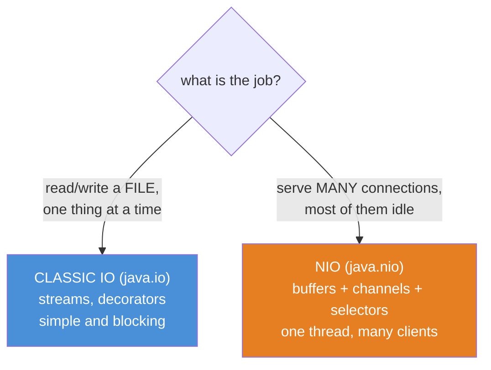
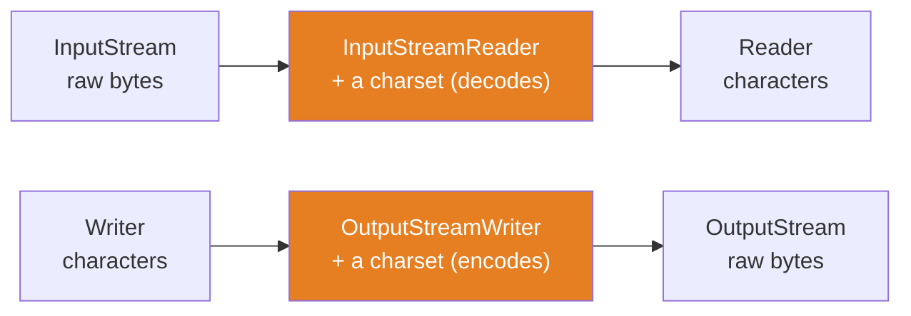
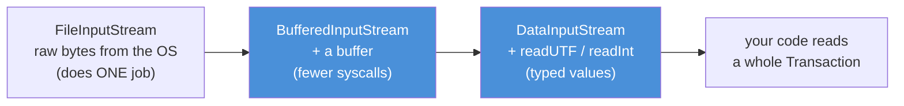
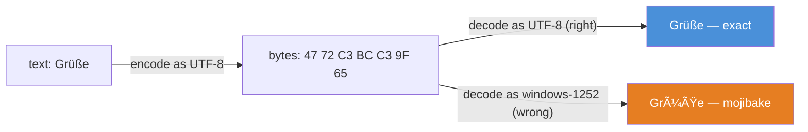
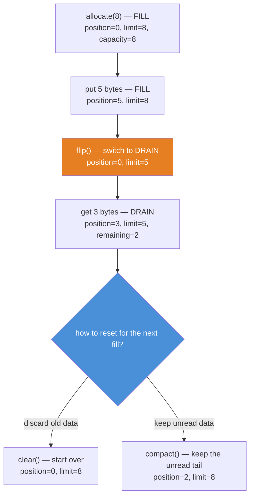
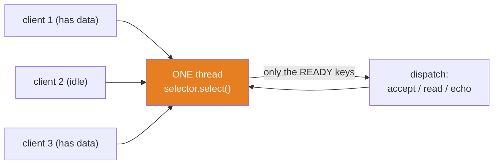

# 08 — IO & NIO: Streams, Channels, and the One-Thread-Many-Connections Trick

**The big idea:** Java has **two IO worlds**, and the second exists because the first could
not scale. **Classic IO** (`java.io`) moves data one byte or one character at a time through
*streams* you stack like Russian dolls. It is simple and it blocks: a thread reading a socket
is stuck until bytes arrive. **NIO** (`java.nio`, "new IO") moves data in *blocks* through
three pillars — **buffers** (a block of data with three pointers), **channels** (bidirectional
pipes you read and write *via* buffers), and **selectors** (one thread watching many channels
at once). The selector is the trick behind every server you have ever used: a handful of
threads handling ten thousand connections. Learn the buffer pointers and the select loop, and
NIO stops being intimidating.

**In one sentence:** classic IO is byte-at-a-time streams you decorate; NIO is blocks and
buffers plus a selector that lets ONE thread serve MANY connections — and the buffer's
`flip()`/`clear()` dance is the one thing you must understand cold.

## Why there are two IO worlds: the problem you can still feel

Classic IO is *stream-oriented* and *blocking*. You read a byte, then the next, then the next;
if no byte is ready, the thread **blocks** (waits, doing nothing). For one client that is fine.
For ten thousand clients it is fatal: the classic answer is one thread per connection, and each
thread costs a stack (about half a megabyte) and a scheduler slot. A few thousand idle clients
and the server is out of threads — *before it has done any real work.*

NIO was added (Java 1.4, then rebuilt in Java 7) to break that limit. It is *block-oriented*
and *non-blocking*: one thread asks the operating system "which of my connections are ready
**right now**?" and services only those. An idle connection costs almost nothing. That single
idea — multiplexing many connections onto few threads — is why NIO exists.



**Read the diagram:**
- One question decides which world you reach for: are you moving data through a single pipe, or
  juggling many connections at once?
- Blue (classic IO): the right tool for reading a file, a config, a single request. Streams you
  stack, each adding a capability. It blocks, and that is fine when there is only one thing.
- Orange (NIO): the right tool for a server. Data moves in blocks (buffers) through channels,
  and a selector lets one thread watch all of them. This is the scalable world.

The rest of this page walks the classic world first (streams, charsets, resource safety,
serialization), then the NIO world (buffers, channels, selectors), then the modern `Files`/`Path`
API that wraps NIO in one-liners you will actually type every day.

**In one sentence:** classic IO is the simple, blocking, byte-at-a-time world; NIO is the
block-oriented, non-blocking world built so one thread can serve many connections.

## Classic IO 1 — two families of streams: bytes vs characters

`java.io` has **two parallel families**, and beginners mix them up forever. Here is the whole
distinction in one line each:

- **Byte streams** (`InputStream` / `OutputStream`) move raw 8-bit **bytes**. They know nothing
  about text. A byte is a byte. This is *ground truth* — files and sockets store bytes.
- **Character streams** (`Reader` / `Writer`) move **characters** (text). Every one of them
  carries a **charset** — the table that maps characters to bytes and back.

Why two? Because storage is bytes but programs want text, and the conversion needs a charset.
The bridge between the families is a pair of adapters: `InputStreamReader` wraps an
`InputStream` and *decodes* its bytes into characters; `OutputStreamWriter` wraps an
`OutputStream` and *encodes* characters into bytes.



**Read the diagram:**
- Left half (reading): a byte stream becomes a character stream by passing through
  `InputStreamReader`, which decodes bytes *using a charset*.
- Right half (writing): a character stream becomes a byte stream through `OutputStreamWriter`,
  which encodes characters *using a charset*.
- The two orange boxes are the adapters — the only place a charset enters classic IO. Omit the
  charset and you get the platform default, which is the mojibake bug two sections down.

**Walkthrough — what happens when you read text from a file:**
1. `new FileInputStream(path)` opens a **byte** stream to the file. It can only hand you bytes.
2. `new InputStreamReader(fis, StandardCharsets.UTF_8)` wraps it and says "decode those bytes
   as UTF-8." It buffers encoded bytes and turns them into `char`s.
3. `new BufferedReader(isr)` wraps *that* and adds a buffer, so `readLine()` can return whole
   lines without a syscall per character.
4. You call `readLine()`. Bytes flow up the chain: file → decode → buffer → a `String`.

**In one sentence:** byte streams move bytes, character streams move text, and an
`InputStreamReader`/`OutputStreamWriter` is the charset-carrying adapter between them.

## Classic IO 2 — the Decorator pattern, literally

The nesting you just saw is not an accident. It is the **Decorator pattern** (module 09) built
into the JDK. The classic chain every Java programmer writes is:



**Read the diagram:**
- The innermost box (`FileInputStream`) does exactly one job: pull raw bytes from the OS.
- Each box to the right **wraps** the one before it and **adds one capability** — buffering,
  then typed reads. No box replaces another; they compose.
- Every box **is-a** `InputStream`. That is the Decorator signature: same interface, added
  behavior, composed at runtime. You get buffering + typed reads without a class named
  `BufferedTypedFileInputStream`.

`StreamDecoratorDemo` writes a `Transaction` through `FileOutputStream → BufferedOutputStream →
DataOutputStream` and reads it back through the mirror chain, printing the round-trip. The same
nesting gives you the modern text one-liner: `BufferedReader.lines()` returns a lazy
`Stream<String>` (that is `java8-features` streams) — one line to read a whole file. `Scanner`
is the older sibling: it *tokenizes* mixed types (an id, a word, an amount) from the same
underlying bytes. Both are decorators; reach for `lines()` for text and `Scanner` for tokens.

**In one sentence:** every useful stream is a decorator stacked on a raw one, so you compose
capabilities (buffering, typed reads, line reading) at runtime instead of inheriting a subclass
for each combination.

## Classic IO 3 — charsets and the mojibake everyone remembers

Bytes are truth. A **charset** is the contract that turns bytes into text. Read the same bytes
with the wrong contract and you get **mojibake** — garbled text (the word is Japanese for
"scrambled characters"). The file was never corrupted; your *decode* was wrong.



**Read the diagram:**
- Top: the text `Grüße` encoded as UTF-8 is six-ish bytes; `ü` and `ß` each become **two** bytes
  (`C3 BC` and `C3 9F`). That is why UTF-8 byte counts exceed character counts.
- Bottom-left: decode those bytes as UTF-8 (the contract that made them) and you get the exact
  original back.
- Bottom-right: decode the *same bytes* as windows-1252 (a one-byte-per-char contract) and each
  byte becomes its own character — `C3`→`Ã`, `BC`→`¼` — producing mojibake.

**Walkthrough — what `CharsetMojibakeDemo` proves:**
1. Take `"Grüße, SecureBank"` and encode it to bytes with UTF-8. Print the bytes in hex.
2. Decode those bytes with `windows-1252`. Compare to the original: **not equal** — that string
   is mojibake.
3. Decode the *same bytes* with UTF-8. Compare: **equal** — exact round-trip.
4. The bytes never changed between steps 2 and 3. Only the charset did. That is the whole lesson.

Why this bites in real life: the **default charset**. `Charset.defaultCharset()` is what a
`Reader`/`Writer` uses when you *omit* the charset. Since **Java 18** the default is UTF-8 on
every platform — that was JEP 400, the "UTF-8 by default" proposal. Before Java 18 the default
was the platform charset (windows-1252 on Windows), so code that omitted the charset worked on
the developer's laptop and produced mojibake on a different-locale server. The rule: **always
pass an explicit `Charset`.** Never let a stream pick the default for you.

**In one sentence:** bytes are truth and a charset is the decode contract — the same bytes read
with the wrong contract give you mojibake, so name the charset every single time.

## Classic IO 4 — resource safety: try-with-resources and suppressed exceptions

Streams hold OS resources (file handles, sockets). Leak them and the process eventually dies.
**try-with-resources** closes them for you: declare any `AutoCloseable` in the `try (...)`
header and Java calls `close()` when the block ends — even if it throws.

**Walkthrough — what happens at the end of a try-with-resources block:**
1. Java closes the resources in **reverse declaration order**. If you declared `A`, then `B`,
   then `C`, they close `C`, `B`, `A`. Reverse order matters because an outer decorator may
   depend on the inner stream it wraps, so the outer one must close first (this is exactly how
   the `DataInputStream → BufferedInputStream → FileInputStream` chain unwinds).
2. If the `try` **body** throws, that exception is the *primary* one — it is what propagates.
3. If a `close()` **also** throws while the primary is in flight, Java does not lose it: it
   attaches the close exception to the primary via `addSuppressed()`.
4. You read them back with `primary.getSuppressed()` — an array. `TryWithResourcesDemo` proves
   `getSuppressed().length == 1`: the body's exception wins, and the failing `close()` rides
   along so nothing is silently swallowed.

**In one sentence:** try-with-resources guarantees close in reverse order and preserves a
failing close as a *suppressed* exception, so you never leak a handle and never lose an error.

## Classic IO 5 — the serialization trap

Java **serialization** turns an object graph into bytes (`ObjectOutputStream.writeObject`) and
back (`ObjectInputStream.readObject`). Those two are decorators over a byte stream — same
pattern as before — and both must be closed, so try-with-resources fits them perfectly. It is
also the API you should reach for *last*, for two reasons:

- **`serialVersionUID` (the version stamp).** A classic `Serializable` class carries a
  `private static final long serialVersionUID`. If you omit it, the compiler generates one from
  the class's shape. Add or reorder a field and the generated id changes, so any bytes written
  by the old version throw `InvalidClassException` on read. Pin the id yourself — or avoid the
  whole problem.
- **Security (the real reason the industry moved on).** `readObject()` constructs **whatever
  class the incoming bytes name**. Attackers craft a **gadget chain** — ordinary-looking library
  objects whose `readObject`/`readResolve` methods run code as they reassemble — and turn a
  "deserialize this" endpoint into remote code execution. The rule: **never deserialize bytes
  you do not trust.** Prefer JSON or Protobuf, or a record plus an explicit parser that reads
  fields rather than instantiating arbitrary types.

The Java 21 bright spot: **records are serializable by design.** Declare `record Transaction(...)
implements Serializable` and deserialization runs the *canonical constructor* — invariants are
re-checked, and there are no settable fields to tamper with. `TryWithResourcesDemo` round-trips
a `Transaction` record to show how clean that form is (and then narrates the two traps above).

**In one sentence:** Java serialization is just another stream decorator, but its
`serialVersionUID` fragility and its "instantiate whatever the bytes name" behavior make it a
security anti-pattern — serialize records or JSON, never untrusted bytes.

## NIO pillar 1 — Buffers: three pointers, one lifecycle

A **buffer** is a fixed-size block of data with **three pointers** you must track. Learn these
three and buffers are easy; confuse them and NIO feels impossible.

- **capacity** — how many elements the buffer can *ever* hold. Fixed at allocation. Never changes.
- **position** — the index of the *next* element to read or write. Moves as you `put`/`get`.
- **limit** — the boundary you must not cross. Its *meaning* depends on the mode (below).

The whole confusion collapses into one idea: a buffer is in exactly one of two modes.

- **FILL mode** (writing): `limit == capacity`. You `put` elements; `position` climbs toward `limit`.
- **DRAIN mode** (reading): `limit == how many bytes you wrote`. You `get` elements; `position`
  climbs toward `limit`.

`flip()` is the switch from FILL to DRAIN. `clear()` and `compact()` switch back to FILL for the
next round. This is the clearest picture in the course, so here it is at every step:



**Read the diagram:**
- Top to bottom is the lifecycle: allocate, FILL it, `flip()` to DRAIN, drain part of it, then
  decide how to reset.
- The orange box is `flip()` — the mode switch. It sets `limit` to the old `position` (how much
  you wrote) and resets `position` to 0, so you now read exactly what you just wrote.
- The blue diamond is the reset choice: `clear()` throws the old data away (start over);
  `compact()` keeps the bytes you have not read yet and slides them to the front (make room).

The same five states as the demo's pointer ruler — `P` is `position`, `L` is `limit`, and the
index runs `0..capacity` (so `limit` can sit at index 8, one past the last slot):

```
step        0 1 2 3 4 5 6 7 8     position  limit   mode
allocate(8) P . . . . . . . L        0        8      FILL
put x5      . . . . . P . . L        5        8      FILL
flip()      P . . . . L . . .        0        5      DRAIN
get x3      . . . P . L . . .        3        5      DRAIN  (remaining = 2)
clear()     P . . . . . . . L        0        8      FILL
compact()*  . . P . . . . . L        2        8      FILL  (after draining 3 of 5)
```

**Walkthrough — what happens when you `flip()` then drain:**
1. You `put` 5 bytes. `position` is now 5, `limit` is still 8 (capacity).
2. You call `flip()`. Java sets `limit = position` (5), then `position = 0`. You are in DRAIN
   mode: the readable data is slots `[0, limit)` = `[0, 5)` — exactly the 5 bytes you wrote.
3. You `get` 3 bytes. `position` advances to 3. `remaining()` is `limit - position = 2` — two
   bytes (D, E) are still to read.
4. To reuse the buffer, `clear()` (position=0, limit=capacity, old bytes ignored) or `compact()`
   (keep the 2 unread bytes at the front, position=2, limit=capacity, room for more after them).

`clear()` does **not** erase the bytes — it only resets the pointers, saying "ignore the old
content, fill me from scratch." That surprises everyone exactly once.

Two allocation flavors, one line each: `ByteBuffer.allocate(n)` gives a **heap** buffer (backed
by a `byte[]` on the JVM heap, cheap, managed by the garbage collector (GC));
`ByteBuffer.allocateDirect(n)` gives a **direct** buffer (native memory off the heap, so the OS
can move it via direct memory access (DMA) without an extra copy). Default to heap; use direct
only for large, long-lived IO buffers, because allocating and freeing native memory costs more.

**In one sentence:** a buffer is in FILL mode or DRAIN mode, `flip()` switches between them by
making `limit` the old `position`, and `clear()`/`compact()` reset for the next fill — watch
`position` and `limit` and buffers stop being mysterious.

## NIO pillar 2 — Channels: bidirectional and buffer-driven

A **channel** is a bidirectional pipe to a file, socket, or other endpoint. "Bidirectional" is
the first difference from classic IO: a `FileInputStream` only reads and a `FileOutputStream`
only writes, but a single `FileChannel` does **both**. The second difference: a channel never
hands you a `byte[]` — it **fills or drains a buffer**. You always go channel ↔ buffer.

**Walkthrough — the read loop you will write forever:**
1. Allocate a buffer: `ByteBuffer buf = ByteBuffer.allocate(8);`
2. Read: `int n = channel.read(buf);` The channel fills `buf` from `position` up to `limit` and
   advances `position`. It returns how many bytes it read.
3. Check the return: for a **file** channel, `-1` means end of file — stop. For a **non-blocking
   socket** channel, `0` means "no data right now" — that is not EOF, so a socket server uses a
   selector (next section) instead of spinning on `read`.
4. `buf.flip()` to switch to DRAIN, then take the bytes out.
5. `buf.clear()` (or `compact()`) to switch back to FILL, then loop to step 2.

`BufferWalkthroughDemo` runs exactly this loop over a file with an 8-byte buffer, printing the
iteration count and the reconstructed text. The write side is the mirror: `while
(buf.hasRemaining()) channel.write(buf);` drains the buffer into the channel.

One more tool worth knowing: `FileChannel.transferTo(position, count, targetChannel)` copies
bytes **channel to channel** without a user-space buffer. The OS does the move (often via DMA or
`sendfile`), so your JVM never copies the bytes into a `byte[]` and back. That is **zero-copy**,
and it is how fast static-file servers ship data.

**In one sentence:** a channel is a bidirectional, buffer-driven pipe — you read and write
through a `ByteBuffer` in a `flip`/`clear` loop until a file channel returns `-1`, and
`transferTo` moves bytes channel-to-channel with zero copies.

## NIO pillar 3 — Selectors: the one-thread-many-connections trick

A **selector** lets ONE thread watch MANY channels. The thread asks the OS which channels are
**ready** (data waiting, a new connection pending) and services only those. This event-driven
design is the **reactor pattern**, and it is the answer to "ten thousand mostly-idle clients"
that classic blocking IO could not give.



**Read the diagram:**
- Three connections feed one selector. Two have data; one is idle.
- The single thread blocks in `select()` until the OS reports which channels are ready. It gets
  client 1 and client 3 — **not** the idle client 2, which costs nothing.
- The thread dispatches the ready ones (accept a new connection, read bytes, echo), then loops
  back to `select()`. One thread, many connections, none wasted on idle clients.

Two `SelectionKey` terms: **`interestOps`** is what you *ask* to be told about (e.g. `OP_ACCEPT`,
`OP_READ`); **`readyOps`** is what is *actually* ready right now. You register interest once and
read readiness each loop.

**Walkthrough — the select loop (this is the reactor's heartbeat):**
1. Register a `ServerSocketChannel` with the selector for `OP_ACCEPT` ("tell me when a new
   client connects").
2. The thread calls `selector.select(timeout)`. It **blocks** until at least one channel is
   ready, or the timeout expires (the timeout lets a demo/test shut the loop down cleanly).
3. `select()` returns the count of ready keys. The thread iterates `selector.selectedKeys()`
   and **removes each key** as it processes it (if you forget to remove, the same key is
   reprocessed forever — a classic reactor bug).
4. For a key that `isAcceptable()`: call `serverChannel.accept()`, set the new `SocketChannel`
   non-blocking, and register it for `OP_READ`.
5. For a key that `isReadable()`: `channel.read(buffer)`; when a full message has arrived, handle
   it (here, echo it back).
6. Loop to step 2. One thread now serves every connection, dispatching only the ready ones.

`SelectorEchoDemo` runs this live and deterministically: a `ServerSocketChannel` bound to a
**loopback** address on an **ephemeral** port (`0`), one `reactor-thread`, and two clients that
each send a message and read their own echo back. Every client read has a bounded `SO_TIMEOUT`,
the latch await is bounded, and the thread is joined and the channels closed, so nothing can
hang. The output shows both echoes matching — served by ONE thread.

**Tie it all together:** this selector machinery is what runs under **Tomcat's NIO connector**
and **Netty**. And it connects straight back to module 06: *thread pools* and *reactors* are the
two answers to "many clients." A pool rents out a bounded number of threads; a reactor serves
many connections from few threads. Virtual threads (module 06, Java 21) are a third answer — keep
thread-per-connection, but make each thread cheap. Reactor = few threads, event-driven; virtual
threads = many threads, cheap.

**In one sentence:** a selector lets ONE thread ask the OS which connections are ready and serve
only those, which is how a handful of threads handle ten thousand clients — the reactor pattern
under Tomcat NIO and Netty.

## Files and Path: the API you will actually use

Everything above is machinery. In real application code you rarely open a `FileChannel` by hand —
you call `java.nio.file.Files`, which wraps that machinery in one-liners. `Path` replaces the old
`java.io.File`: it is immutable, filesystem-aware, and composes with `resolve()` and
`relativize()`. The three you will use daily:

- `Files.walk(root)` — a lazy `Stream<Path>` over a whole tree, depth-first. Count files, find
  matches, delete trees. Close it (try-with-resources): it holds directory handles open.
- `Files.readString(path, charset)` / `Files.writeString(path, text, charset)` — whole-file text
  in one call. Still name the charset (see the mojibake section).
- `Files.lines(path, charset)` — a lazy `Stream<String>`; `.filter(...).toList()` reads a huge
  file without loading it all into memory. Close it too.

`FilesPathDemo` plants a three-level tree in a temp directory and does all three. This is the
day-to-day face of NIO.

**In one sentence:** `Files` and `Path` are the everyday NIO API — walk a tree, read/write whole
files, and stream their lines — all one-liners over the channels and buffers above.

## The table to photograph — buffer methods and the two pointers they move

| Method | position | limit | When you call it |
|---|---|---|---|
| `allocate(n)` / `wrap(arr)` | set to 0 | set to capacity | to start FILLing |
| `put(...)` / `get(...)` | advances by the count | unchanged | to write / read the next elements |
| `flip()` | set to 0 | set to the old position | to switch from FILL to DRAIN |
| `clear()` | set to 0 | set to capacity | to start over (old data ignored) |
| `compact()` | set to remaining count | set to capacity | to keep unread data and make room |
| `remaining()` | reads it | reads it | `limit − position`, elements left to drain |

## Java 21 corner

Java 21 sharpens both worlds:

- **Records are serializable by design.** `record Transaction(...) implements Serializable` needs
  no `serialVersionUID` dance: deserialization runs the canonical constructor, so invariants are
  re-checked and there are no settable fields. It is the safe end of the serialization story.
- **`Files.readString` / `writeString` / `lines`** are the modern file API — no manual streams,
  no `BufferedReader` boilerplate for the common case.
- **Virtual threads (module 06) are the rival to the reactor.** Both solve "many clients." The
  reactor multiplexes many connections onto few threads with a selector (event-driven, more code,
  no blocking allowed). Virtual threads let you write plain blocking code, one virtual thread per
  connection, and the JVM makes those threads cheap. Newer server code increasingly picks virtual
  threads for readability; the reactor still wins for the highest-scale event loops (Netty).
  Knowing *both* is the point — and NIO buffers/channels are the vocabulary either way.

## The traps, all printed as evidence in the demos

- **Trap 1 — forgetting `flip()` before draining.** You wrote 5 bytes, so `position` is 5. Read
  now and you read `[position, limit)` = nothing (or garbage). `flip()` first: it sets `limit` to
  what you wrote and rewinds `position` to 0.
- **Trap 2 — reading into a full buffer.** A channel fills from `position` to `limit`. If the
  buffer is already full (`position == limit`), `read` returns 0 and you loop forever. `clear()`
  or `compact()` between reads.
- **Trap 3 — omitting the charset.** `new FileReader(f)` uses the platform default. It worked on
  your laptop and produces mojibake in production. Always pass an explicit `Charset`.
- **Trap 4 — not closing, or losing the close error.** Skip try-with-resources and leak handles;
  write your own `finally` and you may swallow a `close()` exception. try-with-resources keeps it
  as a *suppressed* exception (`getSuppressed()`), so you see both failures.
- **Trap 5 — deserializing untrusted bytes.** `readObject()` instantiates whatever class the
  bytes name; a gadget chain turns that into remote code execution. Never deserialize input you
  do not trust.
- **Trap 6 — forgetting `it.remove()` in the select loop.** `selectedKeys()` does not clear
  itself. Process a key without removing it and you handle the same event forever. And never
  **block** inside the reactor thread — that stalls every other connection the thread serves.

**In one sentence:** every trap is either a buffer pointer you moved wrong (`flip`, `clear`), a
charset you forgot to name, a resource you failed to close safely, or a reactor rule (remove the
key, never block) you broke.

## Class flow

1. Show the two-worlds diagram (which job → which IO world), then the buffer lifecycle diagram —
   that second one is the centerpiece; read the pointer ruler aloud. Read every "Read the
   diagram" bullet list.
2. Run the demos in order: `.\mvnw.cmd -pl 08-io-and-nio compile exec:java` (this runs
   `IoNioDemos`, which calls each demo `main()` in teaching order: classic streams → charset →
   resource safety → buffers → channels+selector → modern Files).
3. Run the tests as *proof*: `.\mvnw.cmd -pl 08-io-and-nio test` — each test prints the behavior
   it asserts, including the exact buffer pointer values at every step and the two-client echo.

If em-dashes or `ü`/`ß` print as garbage in a plain `cmd` window, run `chcp 65001` first (UTF-8
code page). Windows Terminal and IDE consoles are fine as-is — the mojibake demo still proves its
point because the assertions run on `String` objects, not on what the console shows.

| Demo class | What it shows |
|---|---|
| `StreamDecoratorDemo` | byte vs char families; the `FileInputStream → BufferedInputStream → DataInputStream` Decorator chain; `BufferedReader.lines()` vs `Scanner` |
| `CharsetMojibakeDemo` | UTF-8 bytes read as windows-1252 give mojibake, read as UTF-8 give the exact text; `Charset.defaultCharset()` and JEP 400 |
| `TryWithResourcesDemo` | reverse close order; a throwing `close()` becomes one suppressed exception; a record serialization round-trip plus the two traps |
| `BufferWalkthroughDemo` | THE centerpiece: `position`/`limit`/`capacity` printed at every step of fill→flip→drain→clear/compact; the `FileChannel` read loop; `transferTo` zero-copy |
| `SelectorEchoDemo` | the reactor: one thread echoes two loopback clients through a `Selector`, deterministic and bounded |
| `FilesPathDemo` | `Files.walk` a planted three-level tree; `readString`/`writeString`; `lines().filter()` |

| Test | What it proves |
|---|---|
| `bufferLifecyclePointersAreExact` | `allocate(8)`+fill(5) → pos=5/lim=8; `flip()` → 0/5; drain 3 → pos=3; `clear()` → 0/8 — exact integers |
| `mojibakeProvesTheCharsetIsTheContract` | UTF-8 bytes as windows-1252 ≠ original; as UTF-8 == original |
| `tryWithResourcesClosesReverseAndSuppresses` | close order is `[C, B, A]`; a throwing close yields `getSuppressed().length == 1` |
| `filesRoundTripExact` | `Files.writeString` then `readString` in a `@TempDir` returns the exact text |
| `fileChannelLoopReadsExactBytes` | a `FileChannel` read loop until `-1` reads back every byte written |
| `selectorEchoesTwoClientsExactly` | one reactor thread returns each of two clients its own exact echo (bounded, joined) |
| `filesWalkCountsPlantedTreeExactly` | `Files.walk` counts a planted three-level tree exactly: 3 directories, 3 files |

## Where this leads

The Decorator chain here is the same pattern module 09 names and catalogues across the JDK. The
reactor is the machinery under Tomcat's NIO connector and Netty, and it connects straight to
module 06: thread pools, `CompletableFuture`, and virtual threads are the other answers to "many
clients," and NIO buffers/channels are the vocabulary all of them share. Downstream, `stage-2`'s
Spring Boot web layer runs on exactly this NIO reactor (Tomcat), and `stage-5`'s gateways and
service-to-service calls lean on the same non-blocking IO — so when you reach the frameworks,
the streams, buffers and selectors underneath are no longer magic.
