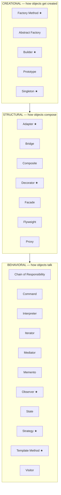

# 09 — Design Patterns: The GoF in the JDK and in Your Bank

**The big idea:** a design pattern is a **name for a solution shape that keeps
recurring** — nothing more mystical than that. In 1994 four authors (the "Gang of
Four", GoF) catalogued 23 such shapes and gave each a name. The names are the gift:
in a design review, "that is just a Decorator" replaces a paragraph of explanation.
And here is the part most courses skip — **you have already used at least ten of the
23 in this curriculum**, by their JDK names, without knowing their pattern names.
This module renames what you already speak, then builds eight patterns as real
SecureBank code in Java 21 — where records, sealed types and pattern-matching
`switch` shrink the 1994 ceremony to a fraction of its size.

**In one sentence:** the GoF patterns are not recipes to memorize — they are
vocabulary for solutions the JDK, this course, and your bank already use daily.

## Why patterns are vocabulary, not recipes

A recipe says "do these steps". A pattern says "when you feel THIS problem, solutions
shaped LIKE THIS tend to work — here is the shape, and here is how it goes wrong".
Every pattern in this module is taught the same way:

1. **Problem** — one sentence you can feel.
2. **Solution** — one sentence naming the shape.
3. **Where you already met it** — the JDK or course example that WAS this pattern.
4. **SecureBank version** — a live demo class in this module.
5. **Trap** — when NOT to use it, because a pattern applied wrongly is worse than none.

If you memorize the class diagrams and skip the traps, you will write pattern-shaped
damage. The traps are not footnotes; they are half the lesson.

## The map: 23 patterns, 3 intents



**Read the diagram:**
- The GoF sorts its 23 patterns by *intent* — what the pattern is FOR — into three
  boxes: making objects (creational, 5), composing objects into bigger shapes
  (structural, 7), and distributing responsibility between objects (behavioral, 11).
- Every pattern marked ★ gets a live SecureBank demo class in this module (8 of them).
- The unmarked patterns are not skipped by accident: most you have already met by
  their JDK names (Iterator, Command, Proxy), and the rest are named in
  `PatternMapDemo` with a JDK example and a banking counterpart, so you can spot
  them in the wild.
- The arrow between boxes is reading order, not dependency: creation, then
  composition, then conversation.

### The table to photograph

| Category | The question it answers | Count | Two examples you already used |
|---|---|---|---|
| Creational | How should this object come into being? | 5 | `List.of` (Factory Method), `StringBuilder` (Builder) |
| Structural | How do these objects compose into a bigger shape? | 7 | `BufferedInputStream` chains (Decorator), `Arrays.asList` (Adapter) |
| Behavioral | Who does the work, and how do objects talk? | 11 | `for-each` (Iterator), `Comparator` (Strategy) |

**In one sentence:** intent is the filing system — before asking "which pattern?",
ask "am I creating, composing, or coordinating?"

## You already speak this vocabulary

Ten patterns, ten things you have personally written or read in this curriculum:

| Pattern | Where you already met it | What it is doing there |
|---|---|---|
| Iterator | `collections-framework` 03 | Walks a collection without exposing how it is stored |
| Strategy | `core-java` 10 | A `Comparator` IS a strategy: `sort` keeps the skeleton, you swap the ordering |
| Decorator | module 08 (IO streams) | `BufferedInputStream(FileInputStream)` layers behavior around a stream |
| Proxy | module 02 (dynamic proxies) | A generated stand-in that controls access to the real object |
| Template Method | `collections-framework` 02 | `AbstractList` writes `indexOf` once over your `get`/`size` slots |
| Command | module 06 (executors) | A `Runnable` is a request packaged as an object, executed later, elsewhere |
| Factory Method | everywhere | `List.of`, `Integer.valueOf` — construction with a decision inside |
| Adapter | module 08 | `InputStreamReader` translates bytes into characters |
| Observer | Swing listeners; module 06 | `future.whenComplete(callback)` — publish a result to whoever subscribed |
| Singleton | `Runtime.getRuntime()` | Exactly one instance, globally reachable |

**In one sentence:** the catalog below is not new knowledge — it is new NAMES for
knowledge you already have, which is exactly what makes the names worth learning.

## The eight live demos

Each pattern below follows the five-step teaching order from the top of this README.
Demo class names are given so you can run them one at a time:

```powershell
.\mvnw.cmd -pl 09-design-patterns-gof compile exec:java "-Dexec.mainClass=com.evaitcs.advanced.gof.FeeStrategyDemo"
```

### Strategy: the one you already wrote in core-java

**Problem:** the transfer fee depends on the product — flat, percentage, or free
above a threshold — and products change every quarter.
**Solution:** put the fee RULE behind one type (`FeePolicy`) and pass it INTO the
calculator as a parameter; swapping algorithms becomes swapping arguments.
**You already met it:** `Collections.sort(list, comparator)` — the sort skeleton is
fixed in the JDK, the ordering algorithm arrives as a parameter (`core-java` 10).
**SecureBank version:** `FeeStrategyDemo` — a sealed `FeePolicy` permits three
records (`FlatFee`, `PercentFee`, `FreeOverThreshold`) and one `FeeCalculator`
picks the rule with an exhaustive pattern-matching `switch`.

**Walkthrough — what happens when `calculator.feeFor(policy, 250.00)` runs:**
1. The `switch` matches `policy` against the sealed family's record patterns —
   no `default` branch exists, because the compiler knows the family is complete.
2. The matched record pattern deconstructs the policy (`PercentFee(var rate)`
   binds `rate` to `0.01`) — no cast, no getter ceremony.
3. The arm computes the fee and rounds to scale 2 `HALF_UP` — money rules, as always.
4. The caller gets a `BigDecimal` and never learned WHICH algorithm ran.

**Trap / when NOT to use it:** if the "variants" are just different numbers
(fee 2.50 versus fee 3.00), you need a constant or a config row — not a type per
number. Strategy pays off when the ALGORITHM differs, not when only data differs.

**In one sentence:** Strategy turns "which algorithm?" into a parameter, so the
code that uses the algorithm never has to know which one it got.

### Factory Method: List.of is one you call every day

**Problem:** the caller knows the payment type as a string ("card", "wire") but
must not decide which class to instantiate or how to fill its fields.
**Solution:** one static factory method owns the decision and returns the sealed
product type; callers state WHAT they want, never HOW it is made.
**You already met it:** `List.of(a, b, c)` chooses an internal list class you never
name; `Integer.valueOf(n)` decides new-object versus cached (that caching half is
the Flyweight pattern).
**SecureBank version:** `PaymentFactoryDemo` — `PaymentFactory.from(String, amount)`
returns one of three sealed `Payment` records via `switch`, and throws
`IllegalArgumentException` for unknown types AT the decision point.

**Walkthrough — what happens when `PaymentFactory.from("wire", amount)` runs:**
1. The type string is lowercased with an explicit `Locale.ROOT` (the Turkish-locale
   "I" bug is a real factory killer).
2. The `switch` matches `"wire"` and constructs `new WirePayment(iban, amount)` —
   defaults like the demo IBAN live HERE, in one place, not at call sites.
3. The caller receives it typed as `Payment` — the sealed supertype.
4. Unknown strings hit `default` and throw loudly: an error at the decision point
   beats a mystery three layers later at the use point.

**Trap / when NOT to use it:** if the caller already KNOWS the concrete type,
`new WirePayment(...)` is clearer than a string-keyed factory. Factories earn
their keep only when the choice is real: input-driven, cached, or config-driven.

### Builder: the fix for the telescoping constructor

**Problem:** a loan application has 3 required and 2 optional fields; a constructor
overload per combination is the unreadable "telescoping constructor" shape, and
every call site is null-padded and position-dependent.
**Solution:** a fluent Builder collects the pieces BY NAME; `build()` validates
once and refuses to hand out a half-made object.
**You already met it:** `StringBuilder.append(...).append(...)`,
`HttpRequest.newBuilder()`, `Stream.builder()`.
**SecureBank version:** `LoanBuilderDemo` — `LoanApplication.builder()` chains
named setters; `build()` collects EVERY missing required field and throws
`IllegalStateException` naming all of them at once. The record's compact
constructor validates again, so even code that bypasses the Builder cannot
create an invalid `LoanApplication`.

**Walkthrough — what happens when `.build()` runs:**
1. The Builder checks each required slot (`applicantId`, `amount`, `termMonths`)
   and collects the unset ones into a list — all of them, not just the first.
2. If the list is non-empty, `build()` throws `IllegalStateException` with the
   list in the message: `missing required fields: [applicantId, amount, termMonths]`.
3. If the list is empty, the immutable record is constructed; optional slots
   contribute the Builder's defaults (`purpose = "PERSONAL"`, rate `6.50`).
4. The record's compact constructor re-checks nulls and positivity — defense in
   depth: two doors into the object, both locked.

**Trap / when NOT to use it:** a 3-field all-required object needs NO builder —
its constructor is already clear. Builder earns its keep with optional fields,
fluent readability, or one-shot validation of a complex aggregate.

### Template Method: AbstractList taught you this in collections-framework

**Problem:** every report has the SAME shape — header, rows, footer — but different
content; copy-pasting the shape into each report invites one report to drift.
**Solution:** a `final generate()` in the base class owns the ORDER forever;
subclasses fill only the abstract slots.
**You already met it:** `AbstractList` implements `indexOf`, `iterator` and
`spliterator` ONCE, on top of two abstract slots — `get(int)` and `size()`
(`collections-framework` 02). Spring's `JdbcTemplate` (stage-2) is the same
pattern with the word "Template" in its name: it owns
open-connection/execute/close; your lambda fills the SQL slot.
**SecureBank version:** `ReportTemplateDemo` — `ReportGenerator.generate()` is
final; `TaxReport` and `StatementReport` fill `header()`/`rows()`/`footer()`.
Every step appends its name to a list, so the exact execution order is printable
and testable evidence.

**Walkthrough — what happens when `taxReport.generate()` runs:**
1. `generate()` records `generate:start`, then the skeleton marker `header`.
2. It calls the abstract `header()` — dynamic dispatch lands in `TaxReport`,
   which records `tax:title` and adds its title line.
3. The skeleton records `rows`, calls `rows()` — the subclass records and adds
   one row-step per line (`tax:row:interest`, `tax:row:withheld`).
4. The skeleton records `footer`, calls `footer()` — the subclass computes the
   total with real `BigDecimal` subtraction and records `tax:total`.
5. `generate()` records `generate:end` and returns an immutable copy of the step
   list — same frame for every subclass, because the frame lives in the FINAL
   method the subclass cannot touch.

**Trap / when NOT to use it:** Template Method is inheritance — one fixed
skeleton, slots only. If callers need to reorder or SKIP steps, pass functions
instead (that is Strategy again). Use it when the order is a RULE (audit
reports, compliance output), not a coincidence.

### Decorator: IO streams are the canonical chain

**Problem:** transfers must be audited, but the audit must not be welded INTO the
transfer code — some deployments want it, some want two layers, some want none.
**Solution:** `AuditDecorator` implements the SAME `TransferService` interface,
holds a delegate, passes the call through untouched, and adds ONE behavior: an
audit line.
**You already met it:** module 08's `new DataInputStream(new BufferedInputStream(
new FileInputStream(f)))` — each layer adds one behavior and forwards the rest;
`Collections.unmodifiableList` is the same wrap shape adding a RESTRICTION.
**SecureBank version:** `AuditDecoratorDemo` — decorated and bare services return
the identical reference and move identical money; the only difference is the
appended log entry (asserted exactly in the test).

**Walkthrough — what happens when `audited.transfer("ACC-1", "ACC-2", 250.00)` runs:**
1. The call lands on `AuditDecorator.transfer` — the caller's variable is typed
   `TransferService`, so nothing at the call site knows a wrapper exists.
2. The decorator calls `delegate.transfer(...)` — the base service checks funds,
   moves money, and returns reference `"TXN-1"`.
3. The decorator appends `"AUDIT TXN-1 ACC-1 -> ACC-2 250.00"` to its log.
4. The decorator returns the delegate's reference UNCHANGED — add behavior,
   never alter results; that is the decorator's contract.

**Decorator vs Proxy — same shape, different intent** (module 02's dynamic audit
proxy looked almost identical; the difference is WHY, not WHAT):

| Question | Decorator | Proxy |
|---|---|---|
| What is the intent? | ADD behavior you chose | CONTROL access to the target |
| Who decides to wrap? | The call site, explicitly | Usually infrastructure, invisibly |
| May the result change? | No — it passes through | Yes — it may block, delay, or redirect |
| Course example | IO stream chains (module 08) | dynamic audit proxy (module 02) |
| Spring example | — | `@Transactional` wraps your bean to open and commit around it |

**Trap / when NOT to use it:** a chain five wrappers deep is a debugging maze.
If EVERY deployment needs the same three wrappers, write one class that does all
three. Decorate when layers are optional or combined per call site.

### Adapter: Arrays.asList and the 2009 ledger

**Problem:** the new statement engine consumes typed `StatementSource` entries;
the 2009-era vendor ledger only offers `rows()` — pipe-delimited strings. The
vendor jar cannot be edited, and the engine must not learn 2009 dialects.
**Solution:** a translator class implements the NEW interface while holding the
OLD object — `LedgerAdapter` converts rows into `StatementEntry` records in
exactly one place.
**You already met it:** `Arrays.asList(array)` — a `List` VIEW translating onto
the array (its `add()` throws `UnsupportedOperationException` because arrays
cannot grow); `InputStreamReader` — bytes adapted to characters (module 08).
**SecureBank version:** `LegacyLedgerAdapterDemo` — `totalCredits(source)` is
written only against `StatementSource`; the legacy format could be replaced by a
database tomorrow without touching the engine.

**Walkthrough — what happens when `adapter.entries()` runs:**
1. The adapter asks the legacy object for `rows()` — raw strings, unchanged.
2. A stream maps each row through the private `parse` method.
3. `parse` splits on `|`, builds a `LocalDate`, keeps the description, and
   constructs a scale-2 `BigDecimal` — the mini-protocol dies inside this method.
4. An immutable `List<StatementEntry>` comes back; if the legacy format changes,
   ONLY `parse` changes.

**Trap / when NOT to use it:** adapters are debt wrappers, not goals. Three
adapters around the same legacy class mean the translation belongs inside a
REPLACEMENT. And never adapter-wrap-adapter: each layer hides failures deeper.

### Observer: from Swing listeners to Kafka

**Problem:** when a balance changes, the statement printer, the fraud watcher and
the SMS alerter all want to know — but `Account` must not KNOW those classes.
**Solution:** `Account` holds a list of `BalanceListener`s and publishes a typed
event to all of them on every deposit; WHO listens is decided elsewhere, at runtime.
**You already met it:** Swing's `ActionListener`; `future.whenComplete(callback)`
(module 06) — a one-shot observer on a result; and `java.util.Observer`, the JDK's
original — **deprecated in Java 9 and later removed**, because its untyped
`update(Object)` could not carry typed events and encouraged stringly-typed code.
The pattern did not die: stage-5's payment-service publishes `TransferEvent`s to
Kafka and notification-service observes them ACROSS A NETWORK — same shape,
bigger distance.
**SecureBank version:** `BalanceObserverDemo` — `BalanceEvent` is a record (typed,
unlike `Observer`'s `Object`); listeners are functional, so a method reference
can BE an observer.

**Walkthrough — what happens when `account.deposit(50.00)` runs:**
1. The balance field updates: `100.00` becomes `150.00`.
2. One immutable `BalanceEvent("ACC-1", 150.00)` record is constructed — a single
   event object shared by all listeners, safe because records cannot be mutated.
3. The listener list is COPIED before iteration, so a listener that registers
   another listener mid-notification cannot trigger a
   `ConcurrentModificationException` (fail-fast iterators, `collections-framework` 09).
4. Each listener is called in exact registration order — the test asserts the
   event lists element by element.
5. After `removeListener(l)`, listener `l` receives nothing further — deregistration
   is immediate and exact.

**Trap — and it is live in the demo:** a lambda or method reference is a NEW
object per evaluation, so `removeListener(events::add)` removes NOTHING — the
list still holds the original reference (identity equality). Keep the registered
reference around to deregister it. Also: a listener that throws can starve the
listeners after it (decide a policy), and a forgotten `removeListener` keeps the
listener alive through the subject — a classic GC-root leak (module 07).

### Singleton: the enum form, and why DI made the rest obsolete

**Problem:** the fee schedule is shared reference data; two copies that drift
would charge different fees for the same transfer.
**Solution (Effective Java Item 3):** a one-constant ENUM — the JVM initializes
each constant exactly once, at class initialization, and neither reflection nor
serialization can forge a second instance.
**You already met it:** `Runtime.getRuntime()`; the `Integer.valueOf` cache's
single shared instances.
**SecureBank version:** `EnumSingletonDemo` — `FeeSchedule.INSTANCE` survives a
live serialization round trip (`==` afterwards) and a live reflection attack
(`Constructor.newInstance` special-cases enums and throws
`IllegalArgumentException: Cannot reflectively create enum objects`).

**Walkthrough — why the classic forms fail and the enum does not:**
1. **Eager** (`static final INSTANCE = new X()`): safe, but pays construction
   even if never used.
2. **Lazy, double-checked locking**: without `volatile` it is WRONG — module 04's
   reordering can publish a half-constructed object to a second thread.
3. **Any plain class**: reflection can `setAccessible(true)` a private
   constructor and call it; deserialization creates a second instance unless you
   hand-write `readResolve()`.
4. **Enum**: class-initialization gives the once-only guarantee; the JDK
   hard-blocks reflective enum creation; enum serialization writes only the
   constant's NAME, so `readObject` resolves to the same instance via `valueOf`.

**Trap — the bigger one:** a manual singleton is a GLOBAL. Any class can reach it,
so no constructor reveals the dependency, and tests cannot substitute a fake.
Under dependency injection the container makes and owns the one instance
(singleton SCOPE) and injects it — same uniqueness, visible wiring. In Spring
code, hand-rolled singletons and service locators are anti-patterns; module 10
builds the alternative in about 60 lines.

**In one sentence:** the enum singleton is the only one-instance trick the JVM
enforces against both reflection and serialization — but under DI, the container
should own your singletons anyway.

## Java 21 corner: the patterns lost their ceremony

The 1994 book predates lambdas by 20 years, so its shapes assume one class per
role. Modern Java keeps the INTENT and deletes the boilerplate:

| Pattern | Classic ceremony | Java 21 here |
|---|---|---|
| Strategy | 1 interface + 3 classes + context = 5 files | sealed interface + 3 records + 1 exhaustive switch = 1 screen |
| Factory Method | interface + subclasses + `if/else` chain | sealed records + `switch` with `->` arms, `default` throws |
| Command | a class implementing `Runnable` | a lambda: `executor.submit(() -> transfer.run())` |
| Observer | a class implementing `Observer` | a method reference: `account.addListener(events::add)` |
| Visitor | visitor + accept in every node class | sealed family + exhaustive `switch` — module 01's compiler-enforced to-do list |

The sealed `switch` deserves special mention: because the family is closed, the
compiler knows every case. Add a fourth `FeePolicy` or `Payment` tomorrow and
EVERY switch over that family stops compiling until handled. That is the Visitor
pattern's core benefit — "no subtype is forgotten" — enforced by the compiler for
free, with zero visitor classes.

**In one sentence:** Java 21 did not change what the patterns MEAN; records,
sealed types and pattern matching removed how much they COST.

## Class flow

1. Show the map diagram; read the "Read the diagram" bullets aloud. Ask the class
   which ★ patterns they have already used (answer: at least Strategy, Iterator,
   Decorator, Template Method, Factory Method).
2. Run the demos in order: `.\mvnw.cmd -pl 09-design-patterns-gof compile exec:java`
   (this runs `GofDemos`, which calls each demo `main()` in teaching order).
3. Run the tests as *proof*: `.\mvnw.cmd -pl 09-design-patterns-gof test` — each
   test prints the behavior it asserts, including the caught exceptions
   (`IllegalArgumentException` from the factory, `IllegalStateException` from the
   builder, the reflection block on the enum).

| Demo class | What it shows |
|---|---|
| `PatternMapDemo` | all 23 patterns, 3 intents, each with a JDK example and a banking counterpart — the module on one screen |
| `FeeStrategyDemo` | one calculator, three sealed fee policies swapped at runtime, exact fees |
| `PaymentFactoryDemo` | `from(String)` picks the sealed subtype; unknown types fail loudly at the factory |
| `LoanBuilderDemo` | fluent named collection; `build()` names ALL missing required fields; defaults for optionals |
| `ReportTemplateDemo` | final skeleton `generate()`; two subclasses; exact step order recorded as evidence |
| `AuditDecoratorDemo` | same interface, added audit line, result unchanged — plus the Proxy contrast |
| `LegacyLedgerAdapterDemo` | 2009 pipe-rows translated to typed entries in one place; the engine never learns |
| `BalanceObserverDemo` | typed events, registration-order notification, the lambda-identity deregistration trap |
| `EnumSingletonDemo` | one instance vs reflection (blocked) and serialization (round-trips to `==`) |

| Test | What it proves |
|---|---|
| `strategySwapChangesTheFeeExactly` | three policies on chosen amounts: 2.50 / 2.50 / 0.00, and 1.00 below threshold |
| `factoryReturnsTheRightSealedSubtypeAndRejectsUnknown` | each type string maps to its record class; "crypto" throws naming itself |
| `builderEnforcesRequiredFieldsAndBuildsCorrectly` | `IllegalStateException` names all three missing fields; built record exact; direct `new` with null still blocked |
| `templateMethodRunsTheSkeletonInExactOrder` | both reports record the identical frame with different slot steps between markers |
| `decoratorDelegatesUnchangedAndAppendsAudit` | identical reference and balances; exactly one audit line appended |
| `observerNotifiesInOrderAndStopsAfterDeregister` | exact event lists in order; deregistered listener receives nothing more |
| `adapterMapsLegacyRowsExactly` | every pipe-row equals its typed record; credits total 2462.50 exactly |
| `enumSingletonIsOneInstanceAndCannotBeForged` | both lookup paths are `==`; reflective creation throws the JVM's own message |
| `enumSingletonSurvivesSerializationAsSameInstance` | write, read back, still `==` the one constant |

## Where this leads

Module 10 picks up exactly where the Singleton trap left off: if manual singletons
and global lookups are anti-patterns, what replaces them? Dependency injection —
built from scratch with module 02's reflection and module 03's annotations — plus
the architectural, concurrency and API families the GoF never covered, and the
anti-patterns (anemic domain model, god class) that eat banking codebases alive.
In stage-2, `JdbcTemplate` (Template Method), `@Transactional` proxies (Proxy),
and singleton-scoped beans make this module's vocabulary literal framework
behavior. In stage-5, the Observer crosses process boundaries as Kafka events,
and the Facade becomes the `api-gateway`.
