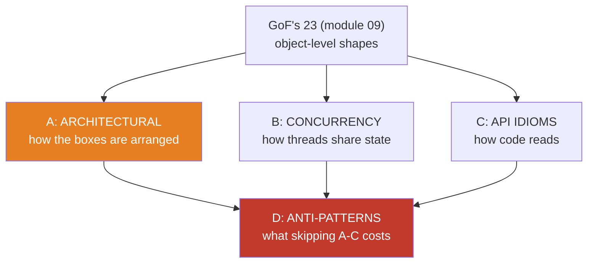
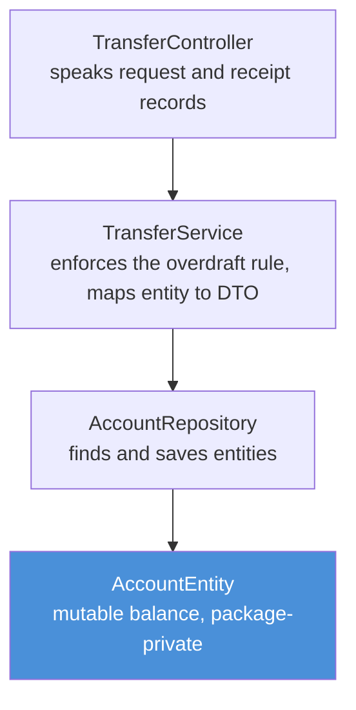
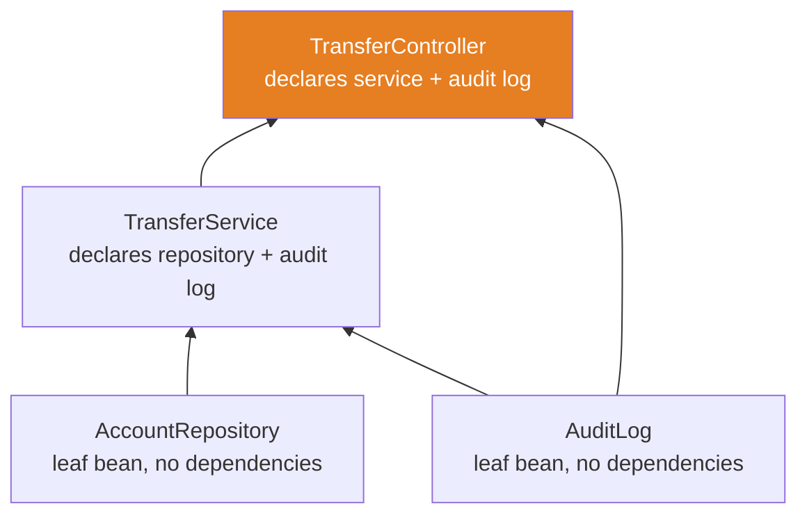
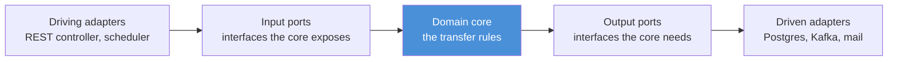
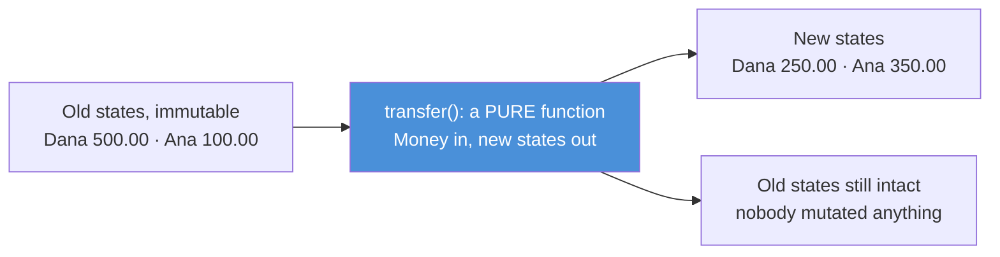
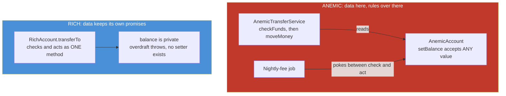

# 10 — Patterns Beyond GoF: The Ones Real Systems Run On

**The big idea:** the GoF's 23 patterns (module 09) are about **objects** — how one
object creates, composes with, or talks to another. Real systems are built from
larger shapes, and they fall into four families the 1994 book never covered:
**architectural** (how the boxes are arranged), **concurrency** (how threads share
state), **API idioms** (how code reads at the call site), and **anti-patterns**
(the recurring mistakes that eat banking codebases alive). None of this is
theory: family A is literally the package structure of `stage-2-monolith`, its
sagas and gateways run in `stage-5-microservices`, family B is modules 04–08
renamed by intent, and family D is what happens when the other three get skipped.
The centerpiece is **Dependency Injection** — rebuilt here from scratch, in about
60 lines, out of module 02's reflection and module 03's annotations — so that when
you meet `@Autowired` in stage-2, you have already watched the machine from inside.

**In one sentence:** beyond GoF, patterns stop being about single objects and start
being about arrangements — of layers, threads, APIs and mistakes.

## The map: four families the GoF never covered

**Read the diagram:**
- Top: module 09's vocabulary is the trunk — these four families grow out of it,
  they do not replace it.
- A (orange) is the heart of the module: layered, DI, Repository, DTO, gateway,
  saga — the shapes `stage-2` and `stage-5` are written in.
- B and C are the families you have already LIVED: B renames modules 04–08 by
  intent; C names the habits that make JDK APIs predictable.
- D (red) sits at the bottom on purpose: anti-patterns are the bill that arrives
  when A, B and C are skipped — and naming them is how a team refuses the bill.

### The table to photograph

| Family | The question it answers | Centerpiece demo here | Where it runs for real |
|---|---|---|---|
| Architectural | Where does code live, and who may call whom? | `MiniContainerDemo` | `stage-2-monolith`, `stage-5-microservices` |
| Concurrency | Who is allowed to touch this state, and when? | `ConcurrencyPatternMapDemo` | every module from 04 to 08 |
| API idioms | How does an API read at the call site? | `MoneyValueObjectDemo`, `IdiomsDemo` | the JDK itself |
| Anti-patterns | Which reasonable shortcut bills us later? | `AntiPatternsDemo` | every codebase that lacks names |

## Family A — Architectural: how the boxes are arranged

### Layered: one-way traffic, entities die at the service

**Problem:** code that mixes HTTP parsing, business rules and SQL in one place
cannot be tested, reused or reasoned about. **Solution:** stack the code into
layers with one-way calls — controller → service → repository — and let each
layer own exactly one kind of knowledge. **You already met it:** the real
`stage-2-monolith` packages are `web` (controllers), `web/dto` (records),
`service`, `repository`, `domain`. **SecureBank version:** `LayeredBankDemo`
rebuilds that shape in plain Java — `TransferController` → `TransferService` →
`AccountRepository` over a `HashMap`, with record DTOs crossing every boundary.

**Read the diagram:**
- Arrows point DOWN only — no layer ever calls upward, and each layer only knows
  the type directly below it.
- The controller speaks only records (`TransferRequest` in, `TransferDto` out);
  it has never heard of `AccountEntity`.
- The entity (blue) is package-private in the demo, so the compiler ITSELF
  enforces the boundary: the mutable, storage-shaped object cannot leak above
  the service. The test asserts the returned object's class to prove it.
- The overdraft rule lives in exactly one place — the service — so no controller,
  batch job or test can move money by forgetting to check.

**Walkthrough — what happens when `controller.handle(request)` runs:**
1. The web layer receives a `TransferRequest` record and calls one service method.
2. The service asks the repository for both `AccountEntity` objects (`requireById`).
3. The service checks the rule: `balance >= amount`, else
   `InsufficientFundsException` — the same exception name stage-2 uses, which its
   `GlobalExceptionHandler` maps to an RFC 7807 ProblemDetail.
4. The service mutates the entities (`debit`/`credit`) and saves them back.
5. The service maps entities → a frozen `TransferDto` receipt; the entities stop
   HERE — only the record makes the trip back up through the controller.

**Repository vs DAO (the nuance interviewers ask about):**

| Term | Talks about | Vocabulary |
|---|---|---|
| DAO (Data Access Object) | TABLES and rows | insert, update, delete, selectByColumn |
| Repository | DOMAIN objects, as if a collection | save, findById, requireById |

A Repository hides the storage technology (stage-2: Spring Data generates the
implementation over PostgreSQL); a DAO leaks it. **DTO** (Data Transfer Object)
completes the trio: a frozen record that crosses a boundary, so entities never do
— mutable objects escaping into JSON responses is how half of all API bugs are born.

**Trap / when NOT to use it:** pass-through layers. A service method that only
forwards to the repository adds a hop, not value; layers earn their keep when each
OWNS something (transport, rules, storage access).

**In one sentence:** layered architecture is one-way traffic through narrowing
knowledge, with frozen DTOs as the only things allowed to travel back up.

### Dependency Injection / IoC — the centerpiece

**Problem:** every class that builds its own dependencies (`new TransferService(
new AccountRepository(), new AuditLog())`) hard-wires the graph: untestable,
unduplicable, and every wiring change touches every call site. **Solution —
in plain words:** *dependency injection* means an object RECEIVES its
collaborators instead of constructing them; *inversion of control* (IoC) names the
flip — the program no longer controls construction order, a CONTAINER does.
**You already met it:** module 03 (an annotation is a sticky note that does
nothing until a reader acts on it) and module 02 (reflection reads constructors
and calls `newInstance`). **SecureBank version:** `MiniContainerDemo` — a custom
`@Wire` annotation plus a ~60-line `MiniContainer` that scans a fixed class list
and builds the whole graph by constructor injection.

**Read the diagram:**
- An arrow means "is injected into": leaves (`AccountRepository`, `AuditLog`) at
  the bottom, the top bean (`TransferController`, orange) last.
- The container builds BOTTOM-UP: it cannot construct a bean before the beans its
  constructor declares — recursion gives that order for free.
- ONE `AuditLog` instance has arrows to both the service and the controller: the
  container's singleton cache means the whole graph shares it (the demo proves
  both layers write to the same list).

**Walkthrough — what happens when `container.get(TransferController.class)` runs:**
1. Cache check: the container looks in its `Map<Class<?>, Object>`. Found? Return
   the SAME instance — that map is the entire "singleton scope" mechanism.
2. Ticket check: `isAnnotationPresent(Wire.class)`. The annotation alone does
   nothing (module 03) — this check is the reader that gives it meaning. A class
   without `@Wire` is refused with `IllegalArgumentException`.
3. Constructor scan: reflection lists declared constructors; exactly one, or the
   container refuses to guess (Spring's single-constructor rule, same reason).
4. Dependency resolution: for EACH parameter type, the container calls `get(...)`
   RECURSIVELY — `TransferService` first, which itself pulls `AccountRepository`
   and `AuditLog` out of the same cache. Leaves get built before dependents.
5. Construction: `constructor.newInstance(args)` — module 02, line for line.
6. Caching: the new instance goes into the map BEFORE being returned, so the next
   `get` (and every injection point downstream) receives this exact object.

**This IS stage-2 startup.** Replace `@Wire` with `@Component`/`@Service`, the
fixed class list with classpath scanning, and the `HashMap` with the Spring
`ApplicationContext` — and you have described what happens between "Starting
SecureBankApplication" and "Started" in the stage-2 logs. `@Autowired` is step 4
wearing an annotation. Spring's version also handles cycles (it detects them and
throws `BeanCurrentlyInCreationException` — this mini one would recurse forever),
scopes beyond singleton, and proxies for `@Transactional` (module 09's Proxy).

**Trap — the service locator anti-pattern:** calling `container.get(X.class)` from
INSIDE business code re-hides the dependency you just worked to make visible —
that is the singleton-abuse story from module 09 with a new name. Inject at the
edges; let the middle of the graph take constructor parameters.

**In one sentence:** dependency injection is "declare your needs, let a reader
build them" — annotations say WHAT is a bean, reflection figures out HOW to wire
it, and one map makes everything a singleton per container.

### The rest of family A, in one paragraph each

- **API Gateway / Facade.** Problem: eight services, eight URLs, eight auth
  setups — clients drown. Solution: ONE front door that routes, authenticates and
  rate-limits. You will meet it as `stage-5-microservices/api-gateway` (Spring
  Cloud Gateway); the GoF name is Facade, scaled to a network.
- **Saga.** Problem: a microservice transfer spans two databases, and there is no
  distributed transaction to roll both back. Solution: a sequence of LOCAL steps,
  each with a COMPENSATING action that undoes it — debit, then credit; if credit
  fails, re-credit. `stage-5`'s payment-service runs exactly this
  (`TransferSagaService`), tracking each transfer's status so failures compensate
  instead of corrupting.
- **Event-driven.** Problem: services that call each other in chains freeze
  together — one slow callee stalls the caller. Solution: publish what HAPPENED
  and let whoever cares subscribe. This is module 09's Observer grown to network
  scale: `stage-5`'s Kafka topics carry transfer events to the notification
  service without the payment service knowing it exists.
- **Hexagonal (ports and adapters).** The diagram below is the whole idea: the
  domain core sits in the middle knowing only INTERFACES (ports); everything that
  touches the outside world (REST, Postgres, Kafka) is an adapter plugged into a
  port. Layered architecture is a special case; `stage-5`'s services approximate
  the full shape.

**Read the diagram:**
- Traffic enters from the left (someone asks for a transfer) and exits right
  (the core needs storage or messaging).
- The core (blue) never names a technology: it calls port INTERFACES, so swapping
  Postgres for an in-memory map in a test touches zero domain lines — exactly
  what `LayeredBankDemo`'s `HashMap` repository does for free.
- "Driving" adapters call IN; "driven" adapters get called BY the core. That
  direction is the hexagon's only rule.

**In one sentence:** architectural patterns decide where knowledge lives so that
changing one kind of knowledge never rewrites the others.

## Family B — Concurrency: the recap with depth

Modules 04–08 taught the mechanisms. This table names the recurring SHAPES those
mechanisms serve — "use a producer-consumer queue" says in four words what a
paragraph of mechanism cannot. `ConcurrencyPatternMapDemo` prints it live.

| Pattern | The one-line shape | Where you already ran it |
|---|---|---|
| Producer-consumer | A queue decouples producing rate from consuming rate | `BlockingQueue` (collections-framework 06 + 10); every pool in module 06 |
| Immutability by default | Records as messages: nothing to corrupt, nothing to lock | module 04 (safe publication), module 01 (records); the live scene below |
| Thread confinement | Data seen by exactly one thread needs no synchronization | module 04; the live scene below |
| Worker pool | Rent threads instead of selling them one by one | module 06 (`Executors`); virtual threads made one-per-task cheap again |
| Future / promise | A handle now, the result later, chainable | module 06 (`CompletableFuture` pipelines) |
| Reactor | One thread, many connections, events instead of blocking | module 08 (the `Selector` IS a reactor — Netty and Tomcat NIO run on it) |
| Fork-join divide-and-conquer | Split the work, solve halves, combine | java8-features 07 (parallel streams); module 06 (`ForkJoinPool`) |

### The live scene: confined accounts, immutable Money, zero locks

**Read the diagram:**
- The transfer (blue) takes two `AccountState` records and an immutable `Money`,
  and RETURNS two new states — it writes to nothing.
- The old states remain readable and unchanged; history comes for free (the same
  trick event-sourced ledgers use).
- Because nothing shared ever changes, module 04's visibility problems and module
  05's locks are simply not needed — the strongest concurrency pattern is the one
  that deletes the concurrency problem.

**Walkthrough — why the anti-scene loses:** the demo narrates module 04's live
numbers instead of re-racing them: two threads doing 50,000 `balance++` each on
ONE shared account produced 73412 instead of 100000 — read-modify-write
interleaved, updates lost. The fixes, in order of preference: (1) don't share —
the immutable scene above; (2) confine — one owner mutates, others message it;
(3) serialize — module 05's locks and atomics. Shared MUTABLE state is the root
anti-pattern of family D, and every concurrency pattern above is an organized
answer to it.

**In one sentence:** concurrency patterns are answers to one question — who may
touch this state, and when — and the best answer is usually "nobody, because it
never changes".

## Family C — API idioms: how code reads

Not GoF, below its radar: habits the JDK follows so consistently that you can
PREDICT an unfamiliar API. `IdiomsDemo` runs five scenes; `MoneyValueObjectDemo`
runs the sixth.

- **Fluent interface.** Problem: positional constructors with optional slots are
  unreadable (`new WireRequest(a, b, c, null)`). Solution: setters that return
  `this`, so calls chain into a sentence. Module 09's Builder IS the canonical
  fluent interface. Trap: fluent MUTATORS hide whether state changed or a new
  object came back — the name must tell the truth.
- **Static factory methods.** The JDK's four names, learn them and every API
  becomes predictable:

| Name | Means | JDK examples |
|---|---|---|
| `valueOf` | convert exactly what is given | `Integer.valueOf`, `BigDecimal.valueOf` |
| `of` | collect the arguments into one | `List.of`, `Map.of`, `EnumSet.of` |
| `from` | extract or decide from a source | `Instant.from`, module 09's `PaymentFactory.from` |
| `getInstance` | the singleton-ish classic | `Runtime.getRuntime`, `Calendar.getInstance` |

  Factories beat constructors because names carry meaning, factories can cache and
  validate, and they may return any subtype. This module follows suit: `Money.of("2.50")`.
- **Composition over inheritance.** Problem: `extends` freezes a choice at
  compile time and inherits the parent's every future change (the fragile base
  class). Solution: HAS-A plus delegation — `StatementPrinter` owns a
  `StatementFormatter` and swaps CSV for JSON at construction. Module 09's
  Decorator is the same shape used to STACK behavior instead of swap it.
- **Law of Demeter.** Problem: `customer.getAccount().getAddress().getCity()`
  welds the call site to the internal shape of three other classes. Solution:
  `customer.city()` — one hop, internals hidden. Both compile; both return
  "Amsterdam" today. When the bank restructures (addresses move into profiles),
  every train-wreck call site stops compiling while every `city()` call site
  never notices — `BeyondGofTest` simulates exactly that restructure and proves
  the wreck's first hop (`getAccount`) no longer exists.
- **Null Object vs Optional.** Two honest shapes for "nothing", chosen by
  position: a **Null Object** (`NullAuditSink`) is a real object whose behavior is
  a harmless, exact default — best for INJECTED collaborators, so call sites never
  null-check; **Optional** is a box that forces the CALLER to handle absence —
  best for RETURN types at API boundaries (java8-features 03). Trap: a Null Object
  hides that nothing happened; for a compliance audit, silence is dangerous.
- **Value Object.** An object defined by its value, not its identity: two
  `Money("2.50")`s ARE each other. `MoneyValueObjectDemo` implements it as a
  record whose compact constructor makes invalid states unrepresentable.

**Walkthrough — what happens when `Money.of("2.5")` runs:**
1. `of` parses the string into `BigDecimal("2.5")` and calls the canonical
   constructor.
2. The COMPACT constructor body runs BEFORE any field is assigned: `requireNonNull`
   passes; the scale check fails (`2.5` has scale 1).
3. `IllegalArgumentException` flies out — no `Money` object was ever created;
   there is nothing invalid to clean up. That is the whole trick: a bouncer at the
   only door in.
4. A legal value (`"2.50"`, scale 2, non-negative) proceeds: fields assign, and
   the record's generated `equals`/`hashCode` are SOUND — because scale is pinned,
   value equality is real equality. (Unpinned, `BigDecimal.equals` compares scale
   too: `1.5` does NOT equal `1.50` — the demo prints that surprise live.)
5. Negative zero cannot sneak in either: `BigDecimal` normalizes `"-0.00"` to
   plain `0.00` at parse time (asserted), `double`'s `-0.0` never becomes a
   `Money` because its scale is wrong — one more reason money is never `double`.

**Trap / when NOT to use it:** a Value Object must validate EVERY invariant its
equality promises. `Money` here has no currency component — fine for a
single-currency bank; the moment a second currency appears, it joins the record
and `add()` must check it, or `EUR 2.50 + USD 2.50` silently succeeds.

**In one sentence:** API idioms are small repeated promises — fluent reads,
factories decide, composition swaps, Demeter insulates, "nothing" gets a typed
shape, and values validate themselves into existence.

## Family D — Anti-patterns: named so you can refuse them

### Anemic domain model vs rich domain — implemented, not narrated

**Problem:** when objects are bare data (`AnemicAccount`: getters, setters, no
rules) and the rules live in services AWAY from the data, every rule enforcement
is a check-then-act across a gap that anyone can walk through. **Solution:** rich
domain — the behavior lives WITH the data it protects; `RichAccount.transferTo`
checks and acts as ONE method over a private balance, and no setter exists.
**You already met it:** `stage-2-monolith` made this choice deliberately —
`Account.deposit`/`withdraw` live ON the entity there, throwing the same
`InsufficientFundsException`. **SecureBank version:** `AntiPatternsDemo` runs the
SAME transfer against both worlds; the test asserts both outcomes exactly.

**Read the diagram:**
- Left (red): TWO callers touch the same bare data — the transfer service and an
  innocent nightly-fee job. Nothing coordinates them, because the account object
  has no opinion: `setBalance` accepts anything.
- The gap between `checkFunds` and `moveMoney` is the bug's home. Module 04 showed
  threads finding that gap by luck; the demo scripts a caller walking through it
  on cue — same shape, zero timing dependence.
- Right (blue): check and act are one method; the balance is private; the ONLY
  mutation path enforces the invariant. There is no gap to walk through.

**Walkthrough — the scripted overdraft (banner 2 of `AntiPatternsDemo`):**
1. `checkFunds(from, 50.00)` reads balance `60.00` — passes, correctly, right now.
2. Between the check and the act, the nightly-fee job calls
   `from.setBalance(40.00)` — legitimate code, and the account cannot object.
3. `moveMoney` re-reads `40.00`, blindly subtracts `50.00`, credits the receiver.
4. Result: `from = -10.00` — money created from nothing. `BeyondGofTest` asserts
   the corrupted `-10.00` AS THE EVIDENCE: a passing test that documents a failure.
5. The rich world, same numbers: `transferTo` re-checks INSIDE the act, throws
   `InsufficientFundsException`, and both balances stay exact — asserted too.

**Trap / the nuance:** "anemic" is not "small". DTOs SHOULD be anemic — frozen
records carrying data across boundaries are family A working as designed. The
anti-pattern is anemic DOMAIN objects: the ones whose invariants matter.

### The rest of family D

- **God class.** Problem: one class parses HTTP, writes SQL, computes fees, sends
  mail and generates PDFs — `BankManager`, 4,000 lines. The smell checklist
  (printed live): 20+ fields; 50+ methods; MANY reasons to change; a name ending
  in Manager/God/Util/Helper; a unit test that needs half the bank; every branch
  conflicting in it. Solution is not a pattern but a habit: each family-A layer
  owns one reason to change.
- **Singleton abuse / service locator.** Module 09's trap, grown up:
  `ServiceLocator.get(...)` hides what a class needs, poisons tests through shared
  global state, and allows exactly one graph per JVM. `MiniContainerDemo` is the
  cure — same singleton convenience, visible wiring, one graph per container.
- **Shared mutable state.** The root of module 04's lost updates (73412 of
  100000) and module 05's lock gymnastics — one line, because family B is the
  long version: prefer immutable, then confined, then serialized.
- **Golden hammer.** "We have Kafka, so everything is an event" — a 12-row lookup
  table needs a `Map`, not a streaming platform. Name the tool's job before
  reaching for the tool.
- **Premature optimization.** Speed work before measurement is guessing in a lab
  coat; module 07's MXBeans and profilers exist so the numbers decide.

**In one sentence:** anti-patterns are not stupid mistakes — they are reasonable
shortcuts whose bill arrives later, and naming them is how a team refuses the
bill on purpose.

## Class flow

1. Show the four-family map; read the "Read the diagram" bullets. Ask which
   family each earlier module belonged to (04–08: B; 02–03: the machinery of A).
2. Run the demos in order: `.\mvnw.cmd -pl 10-patterns-beyond-gof compile exec:java`
   (this runs `BeyondGofDemos`, which calls each demo `main()` in teaching order).
3. Run the tests as *proof*: `.\mvnw.cmd -pl 10-patterns-beyond-gof test` —
   including the two that assert CORRUPTION on purpose (the anemic `-10.00`) and
   the container identity checks (`==` inside a container, `!=` across containers).

| Demo class | What it shows |
|---|---|
| `ArchitecturalMapDemo` | the four families on one screen, every row pointing at where you already saw it |
| `LayeredBankDemo` | stage-2's exact shape by hand; DTOs cross, entities die at the service; overdraft rule in one place |
| `MiniContainerDemo` | DI from scratch: `@Wire` + reflection + one cache map; build order, singleton scope, the annotation as entry ticket |
| `MoneyValueObjectDemo` | the compact-constructor bouncer: three exact rejections, scale-pinned equality, no negative zero, operations return new instances |
| `ConcurrencyPatternMapDemo` | the seven concurrency shapes with course pointers, plus the confined-immutable transfer vs the narrated shared-mutable anti-scene |
| `IdiomsDemo` | fluent chains, the valueOf/of/from/getInstance table, has-a delegation, the Demeter restructure, Null Object vs Optional |
| `AntiPatternsDemo` | anemic vs rich on the same overdraft (corrupted `-10.00` vs refused), the god-class smell list, service locator, the one-liners |

| Test | What it proves |
|---|---|
| `miniContainerWiresTheGraphWithSingletonsPerContainer` | dependencies injected non-null and identical to the cache; one `AuditLog` shared by both layers; a second container is a fresh world |
| `miniContainerRefusesClassesWithoutTheWireAnnotation` | the annotation is the entry ticket — unmanaged classes are refused by name |
| `layeredFlowReturnsDtoAndTheEntityNeverCrossesTheBoundary` | exact DTO fields AND the returned object's class is the DTO; overdraft throws from the service |
| `moneyRejectsNullNegativeAndWrongScaleAtTheDoor` | `NullPointerException` for null, `IllegalArgumentException` for scale 1, scale 3 and negative; `-0.00` equals `0.00` |
| `moneyHasValueEqualityAndOperationsReturnNewInstances` | equal amounts are equal; `1.5` vs `1.50` shows why scale is pinned; `add` returns a new object leaving the old untouched |
| `richAccountTransfersExactlyAndRefusesOverdraft` | 60.00 → 10.00/50.00 exactly; the overdraft throws and changes nothing |
| `anemicAccountLetsTheSameOverdraftSlipThroughAndCorruptsTheBalance` | the scripted gap leaves `-10.00` — asserted as the EVIDENCE of the anti-pattern |
| `nullObjectIsASilentNoOpWithExactDefaults` | three records into the null sink: size 0, lastEntry "(none)"; identical call sites work on the real sink |
| `demeterCitySurvivesAnInternalRestructureTheTrainWreckWouldNot` | `city()` answers before and after the restructure; `getAccount` no longer exists on the restructured customer |

## Where this leads

This is the last module of `advanced-java`, and it is the doorway out of it. In
`stage-2-monolith` every family-A name becomes a Spring annotation you now
understand mechanically: `@Service` and `@Autowired` are `@Wire` plus a bigger
container; `JpaRepository` is the Repository; `web/dto` records are the DTOs; the
`@Transactional` proxy is module 09's Proxy around family A's service. In
`stage-5-microservices` the distributed patterns run for real: `api-gateway` is
the Facade, `TransferSagaService` is the saga, Kafka topics are the event-driven
Observer. When you read that code, nothing is magic anymore — you have built the
machine, watched it corrupt an anemic account, and refused the bill on purpose.
That is the whole point of the course.
