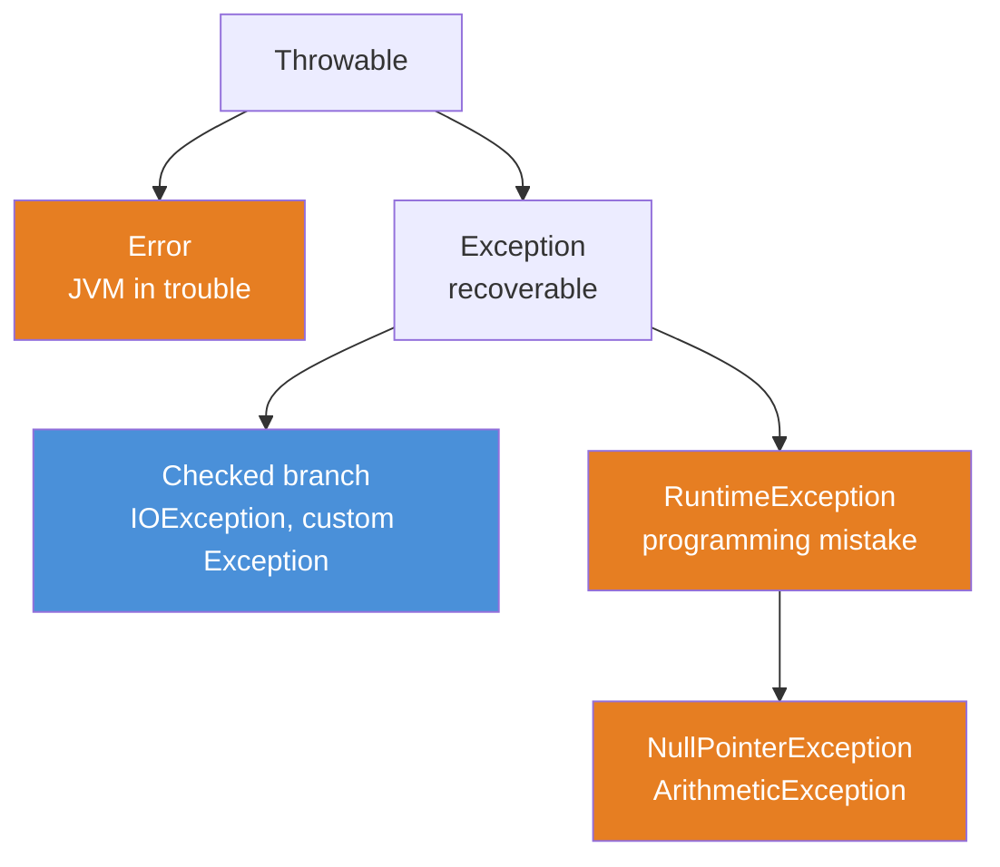
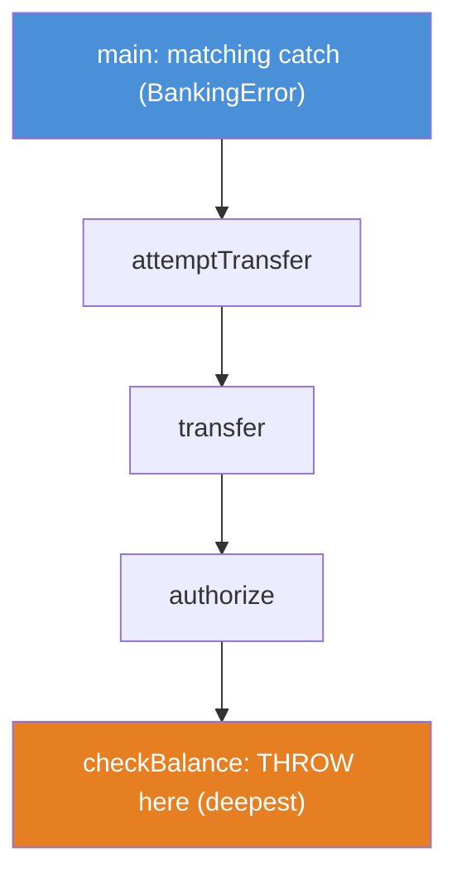
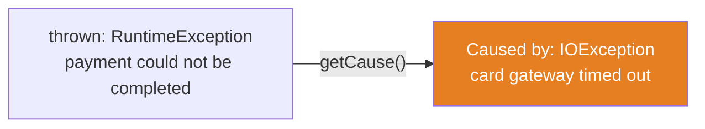
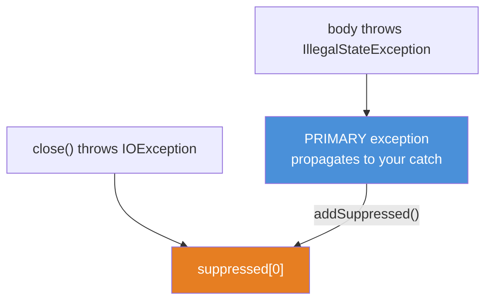
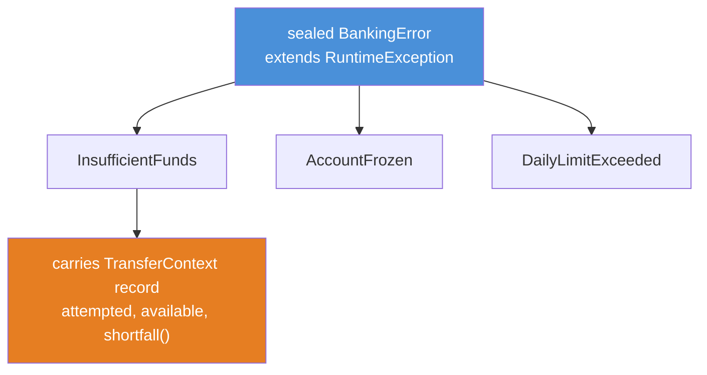

# 11 — Exceptions: The Stack Unwinds, and What You Do About It

**The big idea:** an exception is not a fancy `goto`. When you `throw`, the JVM does two
concrete, mechanical things: it **photographs the stack** into the exception
(`fillInStackTrace`), then it **unwinds** — popping stack frames, deepest first, throwing
away each method's local state — until it finds a `catch` whose type matches, or runs out
of frames and kills the thread. Everything else in this module — the cause chain,
suppression, checked-vs-unchecked, why exceptions are costly — is a consequence of those
two facts. Learn *unwinding* and *the stack snapshot* once, and exceptions stop being
syntax to memorize and become a machine you can predict.

**In one sentence:** `throw` photographs the stack and then unwinds it frame by frame
until a matching `catch` stops it — and the exception object is how you carry the reason
(and the origin, and the suppressed side-effects) safely up to that handler.

## Why exceptions exist: the alternative is worse

Before exceptions, a function reported failure with a **sentinel return value** or an
**error code** the caller had to check on every single call:

```java
// The pre-exception world: the caller MUST remember to check, every time.
int balance = readBalance(accountId);   // returns -1 on "no such account"
if (balance == -1) { /* handle */ }     // ...but -1 is also a legal overdraft!
int ok = transfer(from, to, amount);    // returns 0 = fine, 1 = insufficient, 2 = frozen
if (ok != 0) { /* which error? decode the int */ }
// Forget one check and the bad value flows on, silently, far from the crime.
```

Three problems, and exceptions fix all three:

1. **You can ignore a return code by accident; you cannot ignore a thrown exception.** An
   uncaught exception unwinds the stack and terminates the thread — loudly. A checked
   exception goes further: the *compiler* refuses to build until someone handles it.
2. **An int cannot carry the context.** An exception object carries typed fields
   (`accountId`, `attempted`, `available`), a message, a **cause**, and a **stack trace**.
3. **Error handling is tangled with the happy path.** Exceptions let a method `throw` from
   deep inside and a handler far up the call chain `catch` it — the frames in between
   don't have to know anything went wrong. That "teleport to the nearest handler" *is*
   stack unwinding.

**In one sentence:** exceptions exist because a failure must be impossible to ignore, rich
enough to act on, and able to travel straight to the code that can handle it.

## The Throwable hierarchy: checked vs unchecked

Every throwable descends from `Throwable`, which splits into two branches. The split
decides whether the **compiler forces you to handle it**.

- *checked* — the compiler refuses to build unless the method catches it or declares
  `throws`. Definition: `Exception` and its subclasses, **minus** `RuntimeException`.
- *unchecked* — the compiler says nothing; handling is the author's choice. Definition:
  `RuntimeException` (and subclasses) plus `Error` (and subclasses).



**Read the diagram:**
- Blue is **checked**; orange is **unchecked**. The color is the whole lesson.
- `Throwable` is the root — everything you can `throw` and `catch` IS-A `Throwable`.
- `Error` (orange) is a *separate branch* from `Exception`: it means the JVM itself is in
  trouble (`OutOfMemoryError`, `StackOverflowError`). You almost never catch an `Error`.
- `Exception` splits: the **checked branch** (blue — `IOException` and anything you write
  that extends `Exception` directly) versus `RuntimeException` (orange — programming
  mistakes like `NullPointerException`).
- So: **checked = blue = `Exception` minus `RuntimeException`; unchecked = orange =
  `RuntimeException` + `Error`.**

**Walkthrough — what the compiler does when it sees a checked `throw`:**
1. javac reads `throw new IOException(...)`. It asks: is `IOException` checked?
2. Checked means "a subtype of `Exception` that is NOT a subtype of `RuntimeException`."
   `IOException` qualifies, so yes.
3. javac then demands the enclosing method EITHER wraps the call site in `try/catch` OR
   lists `throws IOException` in its signature. Neither? **Compile error.**
4. If the method declares `throws`, the *same* rule applies to every caller, all the way
   up, until someone catches it or `main()` declares it. The obligation propagates.
5. Unchecked exceptions skip steps 3–4 entirely: no forcing, no required `throws`. That is
   why `Integer.parseInt` can throw `NumberFormatException` from a method that declares
   nothing.

`ThrowableHierarchyDemo` prints the subtype facts (asked of the public `Class` objects), a
checked throw that must be declared and caught, and an unchecked throw from a method with
no `throws` clause at all.

**In one sentence:** the checked/unchecked line is a compile-time *handling contract* —
checked exceptions force every caller up the chain to handle-or-declare; unchecked ones don't.

## What `throw` does at runtime: stack unwinding

This is the module's aha. A **stack frame** is one method call's record on the thread's
call stack — its parameters, locals, and return address. *Stack unwinding* is the JVM
popping those frames, deepest first, until it finds a `catch` that matches the thrown type.



**Read the diagram:**
- Arrows point DOWN, the direction of *calling*: `main` called `attemptTransfer`, which
  called `transfer`, and so on, down to `checkBalance` — the deepest frame (orange).
- The `throw` happens at the bottom, in `checkBalance`.
- Unwinding pops frames from the bottom UP: `checkBalance`, then `authorize`, then
  `transfer`, then `attemptTransfer` — each discarded, locals and all.
- It stops at the first frame with a matching `catch` — here, `main` (blue). If no frame
  matched, the thread would run out of frames and die.

**Walkthrough — what happens the instant `throw` executes:**
1. The exception object is constructed. Inside `Throwable`'s constructor, `fillInStackTrace()`
   walks the *current* stack and stores a `StackTraceElement[]` snapshot. This is the
   expensive part (see "The cost of exceptions").
2. The JVM stops running the throwing method and begins to unwind.
3. It pops the top frame and asks: does this frame have a `catch` whose type matches the
   thrown object (the thrown type or any supertype of it)?
4. If NO, the frame is discarded and the JVM pops the next one up. Repeat.
5. If YES, control transfers into that `catch` block; the caught variable is bound; unwinding ends.
6. If the JVM reaches the bottom of the thread's stack with no match, the thread
   **terminates** and its uncaught-exception handler prints the trace to stderr — that is
   the wall of text you see when a program crashes.

The `StackTraceElement[]` you get from `getStackTrace()` is a **photograph of the unwind
path, deepest first**. `StackUnwindingDemo` throws from `checkBalance` (three frames down),
catches in `main`, and prints the array so you can literally read the popped frames:
`checkBalance -> authorize -> transfer -> attemptTransfer -> main`. The test
`stackUnwindingPopsFramesInOrder` asserts exactly that order.

**In one sentence:** `throw` snapshots the stack, then unwinds it frame by frame until a
matching `catch` stops it — and the stack trace is the photograph of that unwind path.

## The cause chain: never lose the origin

Low-level code knows *what* broke (`IOException: card gateway timed out`); high-level code
knows *what it means* (`payment could not be completed`). The **cause chain** keeps both:
you wrap the low-level throwable in a high-level one with `new RuntimeException(context, cause)`.
The high-level exception's `getCause()` returns the low-level one, whose `getCause()` may
return a lower one still. `printStackTrace()` renders the chain as the familiar `Caused by:` lines.



**Read the diagram:**
- Left is the exception the caller catches; right (orange) is the low-level origin it wraps.
- The arrow is `getCause()` — walk it to recover where the failure really began.
- `printStackTrace()` prints the left box, then `Caused by:` and the right box.
- **Swallowing the cause** means deleting that arrow: `throw new RuntimeException("boom")`
  with no `cause` argument. The origin is gone and the bug becomes undebuggable.

**Walkthrough — wrapping honestly vs swallowing:**
1. Low level: `chargeCard()` throws `IOException("card gateway timed out")`.
2. Honest catch: `catch (IOException e) { throw new RuntimeException("payment could not be completed", e); }`
   — the second argument attaches `e` as the cause. `getCause()` returns it. Origin kept.
3. Swallowing catch: `catch (IOException e) { throw new RuntimeException("payment could not be completed"); }`
   — no cause argument. `getCause()` returns `null`. The `IOException` is gone forever.
4. Late binding: `new RuntimeException(msg)` then `initCause(e)` attaches the cause after
   construction — but only once (a second `initCause` throws `IllegalStateException`).

`CauseAndRethrowDemo` prints both chains side by side; the tests `causeChainIsPreserved`
(asserts `getCause()` is the identical `IOException`) and `swallowingTheCauseLosesTheOrigin`
(asserts `getCause() == null`) prove the difference.

**In one sentence:** always pass the caught exception as the `cause` — a wrapped chain
keeps the origin, and a naked rethrow throws it away.

## try-with-resources and suppression

Module 08 introduced **try-with-resources** for streams; here it is again as a pure
*exception* mechanism, because the subtle part is what happens when things throw. Any
`AutoCloseable` declared in the `try (...)` header has its `close()` called automatically
when the block ends — even if the body threw.

Two guarantees, both provable:



**Read the diagram:**
- If the **body** throws (blue), that throwable becomes the **primary** — it is what propagates.
- `close()` still runs (that's the guarantee). If it **also** throws (orange), the JVM does
  not let it replace the primary. It calls `primary.addSuppressed(closeError)`.
- You read the attached errors back with `primary.getSuppressed()` — an array.
- Net effect: the first failure is the headline, later close failures are footnotes. Nothing is lost.

**Walkthrough — how the JVM decides primary vs suppressed:**
1. Resources close in **reverse declaration order** (open A then B ⇒ close B then A), so an
   outer decorator is always closed before the resource it wraps (module 08's stream nesting).
2. If the body completes normally, `close()` runs and any `close()` error propagates alone.
3. If the body throws, that throwable is remembered as the **primary** (call it `P`).
4. `close()` still runs; if it throws (call it `S`), the JVM calls `P.addSuppressed(S)`
   instead of discarding `P` or letting `S` escape on its own.
5. `P` — with `S` attached — propagates to the nearest matching `catch`. With several
   resources, each failing `close()` is suppressed onto `P`, in reverse close order.

`SuppressionDemo` uses a `Ledger` (an `AutoCloseable` that records when it closed and can
be told to throw on close) to print the reverse order and then `getSuppressed()`. The tests
`resourcesCloseInReverseOrderOfDeclaration` and `tryWithResourcesSuppressesTheCloseException`
assert `[B, A]` and `getSuppressed().length == 1` respectively.

**In one sentence:** try-with-resources closes in reverse order and, when body and `close()`
both fail, keeps the body's exception primary and attaches `close()`'s as suppressed.

## Multi-catch and precise rethrow

Two small Java-7 features that remove ceremony:

- **Multi-catch** — one handler for several unrelated types: `catch (IOException | ConfigException e)`.
  The types may not be in a subtype relationship (that would be redundant). Inside the block,
  `e`'s static type is their least upper bound, and `e` is *effectively final*.
- **Precise rethrow** — if you `catch (Exception e)` and immediately `throw e`, the compiler
  analyzes what the `try` block can *actually* throw. If only `IOException` can reach the
  catch, then `throw e` is treated as throwing `IOException`, so the method may declare the
  narrow `throws IOException` — not the broad `throws Exception`.

**Walkthrough — why precise rethrow compiles:**
1. The `try` block calls `mayThrowIo()`, which declares `throws IOException` and nothing else.
2. You write `catch (Exception e) { throw e; }` — a broad catch, but the parameter `e` is
   effectively final (you never reassign it).
3. The compiler reasons: the only checked exception that can flow into this catch is
   `IOException`, so `throw e` can only rethrow `IOException` (or an unchecked type).
4. Therefore the enclosing method needs only `throws IOException`. Before Java 7 you would
   have been forced to declare `throws Exception`.

`CauseAndRethrowDemo` demonstrates both: one multi-catch handling two throw sites, and a
`preciseRethrow()` that catches `Exception` yet declares only `throws IOException`.

**In one sentence:** multi-catch collapses duplicate handlers, and precise rethrow lets a
broad `catch` still declare only the narrow type it can really propagate.

## Custom exceptions the RIGHT way: a sealed, typed family

This is the module's design centerpiece. The **anti-pattern** bakes every number into one
formatted message string; the caller who needs the shortfall must regex-parse its own
exception. The **pattern** carries structured data as typed fields, and closes the family
with `sealed` so a pattern-matching `switch` is exhaustive.



**Read the diagram:**
- `BankingError` (blue) is a **sealed abstract class extending `RuntimeException`**. It is a
  class, not an interface, so `catch (BankingError e)` compiles — an interface is not a `Throwable`.
- The family is **closed**: exactly three permitted subtypes. Sealing is what lets a `switch`
  over `BankingError` be exhaustive with no `default` (module 01).
- Each subtype is throwable AND catchable as the shared `BankingError` supertype.
- `InsufficientFunds` carries a `TransferContext` **record** (orange) — typed components
  `attempted`/`available` and a computed `shortfall()`. A record can't *be* an exception
  (records can't extend a class), so the exception *holds* one. That is the Java-21 way to
  give an exception typed, immutable, component-style data.

**Anti-pattern vs pattern:**

```java
// ANTI-PATTERN: structure baked into a String. Caller must PARSE its own exception.
throw new RuntimeException("Account ACC-1001 has 50.00 available but 80.00 was requested");
// caller: Matcher m = PATTERN.matcher(e.getMessage()); ... new BigDecimal(m.group(1)) ...  brittle!

// PATTERN: typed fields. Caller READS the number it needs.
throw new BankingError.InsufficientFunds(new BankingError.TransferContext("ACC-1001", attempted, available));
// caller: e.context().shortfall()  -> a BigDecimal. No parsing.
```

**Walkthrough — turning a typed error into a customer message (exhaustive switch):**
1. Catch by the family: `catch (BankingError error)`.
2. Switch on the concrete case with pattern matching — `case InsufficientFunds e -> ...`,
   `case AccountFrozen e -> ...`, `case DailyLimitExceeded e -> ...`.
3. Because `BankingError` is sealed, those three cases are **exhaustive**: no `default` needed.
4. Each branch reads typed fields (`e.context().shortfall()`, `e.reason()`, `e.limit()`) and
   returns a sentence. Add a fourth permitted error tomorrow and this switch **stops
   compiling** until someone handles it — a compiler-enforced to-do list.

`BankingErrorsDemo` prints the anti-pattern's regex parsing, the pattern's typed reads, and
the exhaustive switch over all three cases. `sealedHierarchyIsExhaustive` asserts every case
produces a message and that `getPermittedSubclasses().length == 3`;
`typedContextBeatsStringParsing` computes the shortfall from `BigDecimal` fields with no parsing.

**In one sentence:** a sealed family of typed exceptions lets the caller switch on the case
and read fields instead of parsing a string — and the compiler checks the switch is complete.

## The cost of exceptions: fillInStackTrace

Constructing an exception is not free, and the cost is almost entirely in **one** place:
`fillInStackTrace()` walks the current stack and stores a `StackTraceElement[]` snapshot.
Throwing and catching are cheap by comparison. This is why **exceptions for control flow**
is an anti-pattern: if you throw on an ordinary, expected outcome, you pay a stack capture
every single time.

**Walkthrough — what an exception constructor does:**
1. `new RuntimeException(msg)` chains up to `Throwable`'s constructor.
2. `Throwable` calls `fillInStackTrace()`, which snapshots the stack into a `StackTraceElement[]`.
   For a deep call stack this array is large — the demo shows a length of dozens of frames.
3. `Throwable(message, cause, suppression, writableStackTrace)` lets you pass
   `writableStackTrace = false`. Then step 2 is **skipped**: `getStackTrace()` is empty and
   construction is cheap.
4. The legitimate use: a **pre-allocated** control-flow signal thrown many times and never
   inspected. With no stack to go stale, one static instance can be reused safely.

`ExceptionCostDemo` prints `getStackTrace().length` for a normal exception (dozens) versus a
`writableStackTrace=false` one (zero), then compares `parseInt`-by-exception against a
predicate check over 100 000 iterations. It **prints** both elapsed times but **never
asserts which is faster** — timings are machine-dependent. It asserts only that both produce
the same answers. On the demo machine the exception path is roughly an order of magnitude
slower, but the *guarantee* we test is correctness, not speed.

**In one sentence:** an exception's price is the stack it captures at construction, so use
exceptions for the exceptional, check ordinary outcomes with predicates, and skip the
capture (`writableStackTrace=false`) only for pre-allocated signals nobody inspects.

## The table to photograph — mechanism → guarantee

| Mechanism | What it guarantees |
|---|---|
| Checked exception | the compiler forces every caller to handle it or declare `throws` |
| Stack unwinding | frames pop deepest-first until a matching `catch` is found |
| Cause chain | the low-level origin survives — if you pass it as the `cause` |
| Suppression | the body's failure stays primary; a failing `close()` is not lost |
| Multi-catch | one handler covers several unrelated types |
| Precise rethrow | a broad `catch` may declare only the narrow type it can throw |
| Sealed family | a `switch` is exhaustive; the compiler is your error-handling checklist |

## Java 21 corner

Two modern upgrades, one for the *accidental* throw and one for the *deliberate* one:

- **Helpful `NullPointerException`s (JEP 358, on by default since Java 15).** Before this,
  an NPE's message was simply `null` — you stared at a line with five dereferences and
  guessed. Now the JVM computes a precise message naming the null reference and the failed
  operation:

  **Walkthrough — how the JVM builds the message:** when a dereference of `null` throws, the
  JVM inspects the bytecode at the throw site, identifies which reference was null and which
  operation used it, and synthesizes the message. `Java21ExceptionsDemo` triggers
  `Account missing = null; missing.id();` and prints:
  `Cannot invoke "Account.id()" because "missing" is null`.

- **Sealed + pattern-matching `switch` make exhaustiveness a compile-time property**
  (module 01). Because `BankingError` closes its family, `customerMessage` needs no
  `default`, and `getPermittedSubclasses()` lists the three permitted types at runtime. Add
  a fourth and every switch over `BankingError` fails to compile until handled.

**In one sentence:** Java 21 makes the accidental `NullPointerException` tell you exactly
what was null, and the deliberate sealed error family impossible to switch over incompletely.

## The traps, all printed as evidence in the demos

- **Trap 1 — swallowing the cause.** `catch (IOException e) { throw new RuntimeException("boom"); }`
  drops the origin; `getCause()` returns `null` and the bug becomes undebuggable. Fix: pass
  `e` as the second constructor argument. (`CauseAndRethrowDemo` banner 2; test
  `swallowingTheCauseLosesTheOrigin`.)
- **Trap 2 — catching `Error` (or a bare `catch (Throwable)`).** `Error` means the JVM is in
  trouble (`OutOfMemoryError`); catching it and carrying on usually makes things worse. Catch
  the narrowest type you can actually recover from. (`ThrowableHierarchyDemo` banner 1.)
- **Trap 3 — message-only exceptions.** Baking numbers into a formatted string forces the
  caller to regex-parse its own exception. Use typed fields (a record) instead.
  (`BankingErrorsDemo` banner 1 vs 2; test `typedContextBeatsStringParsing`.)
- **Trap 4 — exceptions as control flow.** Throwing on an expected outcome pays a
  `fillInStackTrace` every time. Check ordinary results with a predicate. (`ExceptionCostDemo`
  banner 2; test `exceptionForControlFlowIsCostlierThanPredicate`.)
- **Trap 5 — a hand-written `finally` that loses the close error.** Close manually and a
  throwing `close()` can overwrite the body's exception. try-with-resources keeps the body
  primary and suppresses the close error instead. (`SuppressionDemo` banner 2.)
- **Trap 6 — the empty `catch`.** `catch (Exception ignored) {}` swallows the failure *and*
  the cause, and the program limps on with no evidence. At minimum, log it with its cause.

**In one sentence:** every trap is a way of losing information — the cause, the type, the
number, or the failure itself — and every fix is a way of carrying it safely to a handler.

## Class flow

1. Show the hierarchy tree first (the map), then the unwinding stack (the aha). Read the
   "Read the diagram" bullets aloud for both — the second one is where the module clicks.
2. Run the demos in order: `.\mvnw.cmd -pl 11-exceptions compile exec:java` (this runs
   `ExceptionDemos`, which calls each demo `main()` in teaching order).
3. Run the tests as *proof*: `.\mvnw.cmd -pl 11-exceptions test` — each test prints the
   behavior it asserts, including the deterministic failures (the swallowed cause, the
   suppressed close, the helpful NPE message).

| Demo class | What it shows |
|---|---|
| `ThrowableHierarchyDemo` | Error vs Exception vs RuntimeException; the checked/unchecked split; what the compiler does with a checked throw |
| `StackUnwindingDemo` | frames pop deepest-first; the caught `StackTraceElement[]` IS the unwind path; an uncaught throw kills its thread |
| `CauseAndRethrowDemo` | wrapping WITH the cause vs swallowing it; `initCause`; multi-catch; precise rethrow |
| `SuppressionDemo` | try-with-resources reverse close order; body primary vs `close()` suppressed (`getSuppressed()`) |
| `BankingErrorsDemo` | the sealed, typed error family; message-only anti-pattern vs typed fields; exhaustive pattern-matching switch |
| `ExceptionCostDemo` | `fillInStackTrace` is the cost; `writableStackTrace=false`; parseInt-by-exception vs predicate |
| `Java21ExceptionsDemo` | helpful `NullPointerException` (JEP 358); sealed exhaustiveness via `getPermittedSubclasses()` |

| Test | What it proves |
|---|---|
| `stackUnwindingPopsFramesInOrder` | the caught trace lists `checkBalance`, `authorize`, `transfer` — deepest first |
| `causeChainIsPreserved` | wrapping WITH the cause keeps the origin; `getCause()` returns the identical `IOException` |
| `swallowingTheCauseLosesTheOrigin` | rethrowing without the cause makes `getCause()` null |
| `tryWithResourcesSuppressesTheCloseException` | body is primary, the failing `close()` is the one suppressed exception |
| `resourcesCloseInReverseOrderOfDeclaration` | two `AutoCloseable`s close `[B, A]` — reverse of declaration |
| `multiCatchHandlesBoth` | one `catch (IOException \| ConfigException e)` handles two throw sites |
| `sealedHierarchyIsExhaustive` | a switch over all permitted `BankingError`s returns a message for each; the family has exactly three |
| `typedContextBeatsStringParsing` | the shortfall is computed from `BigDecimal` fields with no string parsing |
| `helpfulNpeMessageNamesTheNull` | dereferencing null yields a detailed JEP-358 message naming the null |
| `exceptionForControlFlowIsCostlierThanPredicate` | both approaches give the same answers; timings printed, never asserted |

## Where this leads

The typed-domain-exception pattern from "Custom exceptions the RIGHT way" is *exactly* what
`stage-2-monolith` does at the HTTP boundary. `InsufficientFundsException` (a typed domain
exception carrying `accountId`, `available`, `attempted`) is caught by a `@RestControllerAdvice`
(`GlobalExceptionHandler`) and translated into an **RFC 7807 `ProblemDetail`** response — a
structured JSON body with a status and typed detail. That is the same "catch a typed error,
switch on the case, emit a structured result" move, one layer up, at the edge of the system.

The cause chain and the async world connect too: `CompletableFuture`'s `exceptionally(...)`
and `handle(...)` (module 06) are the **asynchronous version of `catch`** — the failure
propagates down the future chain instead of up the call stack, but the discipline is
identical: preserve the origin, translate the typed failure into a result, never swallow it.

**In one sentence:** everything this module teaches about carrying a failure safely to a
handler reappears in `stage-2` as `ProblemDetail` at the HTTP edge and in module 06 as
`exceptionally`/`handle` on the async edge.
