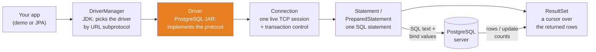
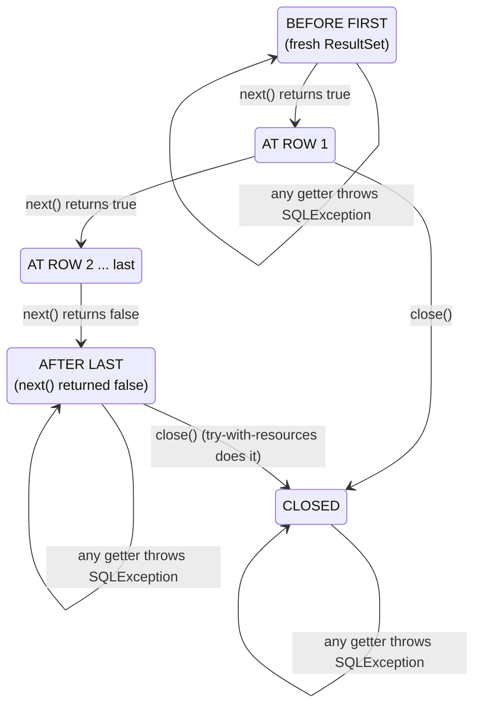
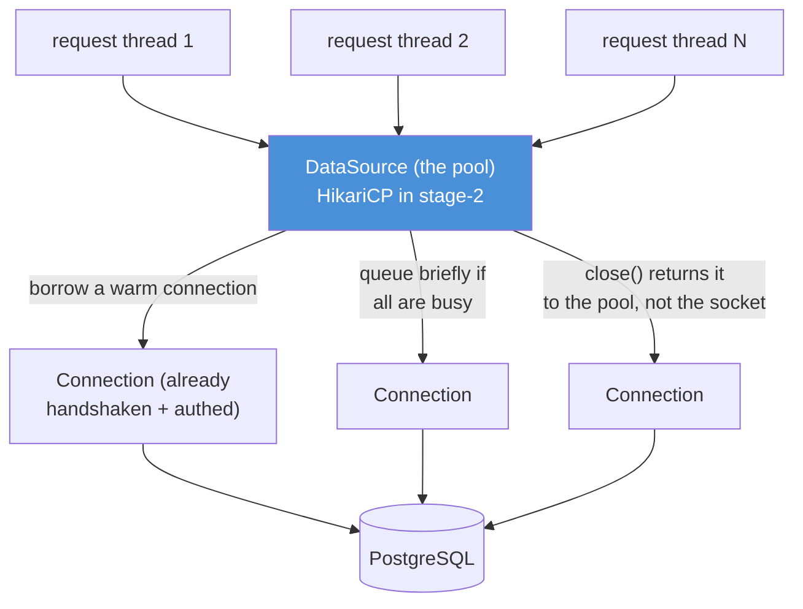

# 12 — JDBC: Talking to PostgreSQL Without the Magic

**The big idea:** every database library you will meet in this course — Spring Data
JPA, Hibernate, `JdbcTemplate` — is a builder on top of **exactly one thing**: the
Java Database Connectivity API (`java.sql`), a handful of small interfaces in the JDK
that open a socket to a database, send SQL text, and hand you the rows back. JDBC is
the *raw layer*. Once you have driven it by hand — connection, cursor, bind
parameters, transaction, rollback — an ORM stops being magic and becomes a loop you
could write yourself (and in `ReadingDemo`, you do).

**In one sentence:** JDBC is the road; every framework is just a car driving on it —
this module makes you walk the road once, against the real stage-1 PostgreSQL.

This is the ONLY module in any of the four course repos with a **third-party
dependency** (the PostgreSQL driver, declared in this module's `pom.xml` alone) and
the ONLY one that needs an **external service** running. Both facts shaped two hard
rules, stated loudly here and enforced in code:

> **RULE A — THE REACTOR ALWAYS BUILDS.** When PostgreSQL is not running, every test
> SKIPS (JUnit 5 `Assumptions`) and every demo prints start instructions and returns
> normally. Nothing fails, nothing hangs: `Db.isAvailable()` gives up within ~2
> seconds (`DriverManager.setLoginTimeout(2)` plus driver-level `connectTimeout`).
>
> **RULE B — NON-DESTRUCTIVE.** The stage-1 database holds **shared seed data**
> (Alice/Bob/Carol, balances 1500.00/5200.00/300.00) that other courses rely on.
> This module NEVER permanently mutates it. Reads are free. Every write demo runs
> inside a transaction that ends in **ROLLBACK**, or against a session-local **TEMP
> table** that is destroyed when the connection closes. Even when an assertion fails
> mid-test, a `finally` block rolls back.

## Prerequisites: start the database

The demos and tests talk to the REAL stage-1 PostgreSQL (the same `schema.sql` +
`seed.sql` the SQL course teaches). Start it from this folder:

```powershell
cd ..\stage-1-database
docker compose up -d
docker compose exec db pg_isready -U securebank    # wait for: accepting connections
cd ..\advanced-java
```

**Check it worked** — any of these:

```powershell
docker ps                                          # securebank-db  (healthy)
docker compose -f ..\stage-1-database\docker-compose.yml exec db psql -U securebank -d securebank -c "SELECT count(*) FROM customer;"   # 3
```

**What happens when the database is DOWN** (and this is a feature, not an excuse):

- `.\mvnw.cmd -pl 12-jdbc test` → **BUILD SUCCESS**, `JdbcTest` skipped (the
  `@BeforeAll` assumption aborts the whole class cleanly).
- `.\mvnw.cmd -pl 12-jdbc compile exec:java` → prints the start instructions above
  and exits **0**. No stack trace.
- The failure is FAST: a 2-second login timeout, so a dead database costs the build
  seconds, never minutes.

### The connection contract (one place: `Db.java`)

Every demo and test connects through `Db` — the module's single connection
contract. Each fact resolves in this order, **first hit wins**:

| Fact | Environment variable | System property | Default |
|---|---|---|---|
| URL | `JDBC_URL` | `-Djdbc.url=...` | `jdbc:postgresql://localhost:5432/securebank` |
| User | `JDBC_USER` | `-Djdbc.user=...` | `securebank` |
| Password | `JDBC_PASSWORD` | `-Djdbc.password=...` | `securebank` |

So a CI job (or a machine where port 5432 belongs to something else) can point the
module at any PostgreSQL server without touching code:

```powershell
$env:JDBC_URL = "jdbc:postgresql://dbhost:5433/securebank"; .\mvnw.cmd -pl 12-jdbc test
.\mvnw.cmd -pl 12-jdbc test "-Djdbc.url=jdbc:postgresql://localhost:55432/securebank"
```

The defaults are the stage-1 `docker-compose.yml` facts: host `localhost`, port
`5432`, database/user/password all `securebank` — demo credentials only, never a
production pattern.

**In one sentence:** start stage-1's compose database and everything runs; forget to,
and everything skips or returns politely — the build never goes red because a
container is off.

## The moving parts: who provides what

A *driver* — a vendor-supplied library that speaks one database's wire protocol — is
the only part PostgreSQL provides. Everything else is a JDK interface the driver
implements:



**Read the diagram:**
- Left: your code only ever touches JDK interfaces (`Connection`, `Statement`,
  `ResultSet`) — that is why swapping databases is a config change, not a rewrite.
- `DriverManager` is the JDK's phone book: it matches the URL's subprotocol
  (`postgresql`) against the drivers that registered themselves.
- The orange box is the ONLY third-party piece: the PostgreSQL driver JAR. It
  implements the wire protocol; everything else delegates to it.
- Right: a `Connection` is a stateful TCP **session** (not a single query) — it owns
  the transaction, the TEMP tables, and every statement you create on it.
- The arrows to the server carry SQL text plus bound values; the arrows back carry
  rows (a `ResultSet`) or update counts (an `int`).

**A JDBC URL, dissected** — `jdbc:postgresql://localhost:5432/securebank`:

| Piece | Value here | Meaning |
|---|---|---|
| protocol | `jdbc` | always literally `jdbc` — this URL is a JDBC URL |
| subprotocol | `postgresql` | which driver family answers — `DriverManager`'s lookup key |
| host and port | `localhost:5432` | which server machine and TCP port |
| database | `securebank` | which database on that server |

**Walkthrough — what happens when you call `Db.connect()` then `executeQuery(...)`:**
1. `DriverManager.getConnection(url, props)` scans the registered drivers and asks
   each: "do you understand `jdbc:postgresql:...`?" The PostgreSQL driver says yes.
2. The driver opens a TCP socket to `localhost:5432` (bounded by `connectTimeout`)
   and runs the PostgreSQL **authentication handshake** — username, password,
   database name. This handshake is the expensive part pooling exists to avoid.
3. You get a `Connection`: a live session with server-side state (transaction,
   session variables, TEMP tables).
4. `connection.prepareStatement(sql)` sends the SQL text; the server **parses and
   plans** it, leaving `?` placeholders as holes.
5. `ps.setString(1, value)` stores the value client-side; `executeQuery()` ships the
   values, the server binds them into the plan and executes.
6. The server streams result rows; the driver wraps them in a `ResultSet` whose
   cursor sits **before the first row**.
7. `rs.next()` pulls one row into the client; typed getters (`getString`,
   `getBigDecimal`, ...) convert that row's columns to Java values.
8. `close()` on the `ResultSet` / `Statement` / `Connection` releases server-side
   cursors and the socket — try-with-resources does this for you (Java 21 corner).

**In one sentence:** your app speaks JDK interfaces; `DriverManager` finds the one
vendor JAR that turns those calls into PostgreSQL's wire protocol over a stateful TCP
session.

## Loading the driver: `Class.forName` is history

Old tutorials begin with `Class.forName("org.postgresql.Driver")`. You will never
need it, and knowing *why* is a small lesson in the JDK itself:

1. **Then (JDBC 1–3, ~1997–2006):** drivers registered themselves in a static
   initializer, which only runs when the class loads. Nothing loaded the class, so
   you loaded it by hand — `Class.forName` was the ignition key.
2. **Now (JDBC 4.0+, Java 6):** every driver JAR ships a file
   `META-INF/services/java.sql.Driver` naming its driver class. The first time your
   code touches `DriverManager`, it runs a `ServiceLoader` — the JDK's standard
   "find implementations on the classpath" mechanism — over every such file and
   registers what it finds.
3. **Evidence:** `ConnectionDemo` banner 2 prints `DriverManager.drivers()` on a
   fresh JVM: `org.postgresql.Driver` is already there, and no code of ours loaded it.

**In one sentence:** the driver JAR on the classpath is sufficient — the JDK
auto-discovers it through `ServiceLoader`, the same mechanism module 02 (reflection)
and module 03 (annotations) keep bumping into.

## Reading rows: the cursor, the getters, the mapper

Three ideas do ALL reading:

1. **The ResultSet is a cursor, not a list.** A *cursor* — a pointer to "the current
   row" — starts **before** the first row. `next()` advances it one row and returns
   `false` when the rows run out. This is the single most common JDBC confusion; it
   gets its own diagram below.
2. **Typed getters convert columns.** Every SQL type has a natural Java getter:
   `getLong` for `BIGINT`, `getBigDecimal` for `DECIMAL(15,2)` (money — NEVER
   `getDouble`), `getObject(col, OffsetDateTime.class)` for `TIMESTAMPTZ`. You may
   address a column by **label** (`getString("name")`) or **1-based index**
   (`getString(2)`); labels survive a column reorder, so prefer labels.
3. **A RowMapper turns rows into objects.** `RowMapper<T>` in this module is one
   method — `T map(ResultSet rs)` — called once per row inside a `while (rs.next())`
   loop. `ReadingDemo.query(sql, mapper)` is the whole pattern in twelve lines, and
   it is *literally* what `JdbcTemplate.query(sql, rowMapper)` automates (and what
   Hibernate does with metadata plus reflection).



**Read the diagram:**
- A fresh `ResultSet` sits **before** the first row — reading there throws
  `SQLException` ("ResultSet not positioned properly..."). The fix is never
  optional: `next()` first.
- Each `next()` that returns `true` moves the cursor onto a real row, where the
  getters read the CURRENT row only — you cannot reach back or ahead.
- When `next()` returns `false`, the cursor is **after the last row**; getters throw
  again. `isBeforeFirst()` / `isAfterLast()` name the two dead zones.
- After `close()` every access throws ("This ResultSet is closed") — a closed
  cursor's server-side resources are gone. try-with-resources closes it for you.

**Walkthrough — what happens when you write `while (rs.next()) { ... }`:**
1. Before the loop: cursor is before-first; zero rows have been read.
2. `next()` asks the driver for the next row (the driver fetches in batches behind
   the scenes) and moves the cursor onto it; `true` means "a row is under you".
3. Inside the body, `rs.getString("email")` converts the current row's `email`
   column. Every getter reads the row the cursor sits on — nothing else.
4. When rows run out, `next()` returns `false`, the loop ends, and the cursor is
   after-last.
5. Exiting the try-with-resources block closes `ResultSet`, `Statement`,
   `Connection` in reverse order — server cursors and the socket are released.

**Trap:** calling a getter before the first `next()` throws `SQLException:
ResultSet not positioned properly, perhaps you need to call next` — the driver is
telling you the cursor is in the before-first dead zone, not that the query failed.

### The table to photograph — SQL type to Java getter

| stage-1 column | SQL type | The right getter | Java type you get |
|---|---|---|---|
| `account.id` | `BIGINT` | `rs.getLong("id")` | `long` |
| `customer.email` | `VARCHAR(255)` | `rs.getString("email")` | `String` |
| `account.balance` | `DECIMAL(15,2)` | `rs.getBigDecimal("balance")` | `BigDecimal`, scale 2, exact |
| `customer.created_at` | `TIMESTAMPTZ` | `rs.getObject("created_at", OffsetDateTime.class)` | `java.time.OffsetDateTime` |
| `transactions.occurred_at` | `TIMESTAMPTZ` | same, or `Instant` via `getObject(col, Instant.class)` | an instant on the UTC timeline |
| `account.version` | `BIGINT` | `rs.getLong("version")` | `long` (Hibernate's `@Version`, stage-2) |

**The legacy bridge, shown once on purpose:** `rs.getTimestamp("created_at")` returns
`java.sql.Timestamp`, a mutable subclass of `java.util.Date` from 1996. It still
works — `ReadingDemo` banner 2 prints it beside the `OffsetDateTime` — and
`toInstant()` is the escape hatch when old code hands you one. Prefer `java.time`
(JDBC 4.2 standardized the mapping): immutable, unambiguous about offsets, and the
same types `java8-features` module 08 taught. **Never** use `getDouble`/`float` for
`DECIMAL` money: binary floating point cannot represent 0.10 exactly, and a bank
that rounds by accident does not stay a bank.

**In one sentence:** reading is `next()` moving a cursor through dead-zone-guarded
positions, typed getters converting one row at a time, and a mapper lambda building
records — the ORM automates the loop, not the idea.

## SQL injection and PreparedStatement: the security centerpiece

*SQL injection* — an attacker smuggling SQL **code** inside data your program
concatenates into a statement — is the oldest web-security bug still in the OWASP
top ten. *Parameterized queries* (bind parameters) make it structurally impossible.

The classic payload is a "name" typed into a web form:

```text
Robert'); DROP TABLE account;--
```

**Walkthrough — what concatenation does with that payload (the vulnerable path):**
1. Naive code builds: `"INSERT INTO temp_demo (note) VALUES ('" + name + "')"`.
2. The assembled text is now THREE statements wearing a trench coat:
   `INSERT INTO temp_demo (note) VALUES ('Robert')`, then `DROP TABLE account`,
   then `--')` — a comment swallowing the tail.
3. `Statement.execute()` sends the whole text; PostgreSQL's simple-query protocol
   executes statements one after another. The `account` table — the bank's money —
   is gone.
4. The user's data was **parsed as code** because parsing happens AFTER
   concatenation. That order is the bug.

**Walkthrough — what a PreparedStatement does instead (the safe path):**
1. `connection.prepareStatement("INSERT INTO temp_demo (note) VALUES (?)")` sends
   the SQL text with a **hole** (`?`). The server parses and plans it NOW — before
   any value exists. The statement's shape is frozen: one INSERT, one value slot.
2. `ps.setString(1, payload)` registers the value client-side, tagged with its type.
3. `executeUpdate()` ships the value through a **separate channel** of the protocol;
   the server binds it into the already-parsed plan. Binding can fill the hole — it
   can never add statements, close quotes, or start comments, because parsing is
   already finished.
4. Result: `Robert'); DROP TABLE account;--` is stored as one 31-character string
   and comes back byte-for-byte identical. Data stayed data.

`InjectionDemo` proves both halves **harmlessly**: the destructive string is only
ever PRINTED (executing it is precisely the disaster), the live executions target a
session-local TEMP table, and the demo ends by SELECTing `count(*) FROM account` to
show the real table alive. It also shows that even an honest apostrophe (`O'Brien`)
breaks concatenated SQL with a syntax error — you do not need an attacker to lose to
this bug.

**Bonus — why PreparedStatement also wins on speed and correctness:**
- **Plan caching:** the server parses/plans `... VALUES (?)` once and reuses the plan
  across executions; concatenated SQL is a *new* statement string every time (new
  parse, new plan, new cache entry).
- **Correct typing:** `setBigDecimal(1, money)` binds a numeric with its scale; no
  locale quirks, no decimal-point string games, and the server type-checks the value
  against the column.
- **Escaping for free:** quotes, backslashes, Unicode — the driver's problem now.

**Trap:** you cannot bind table names, column names, or `LIMIT ?`-style keywords in
most drivers — placeholders replace **values only**. Dynamic identifiers need a
whitelist, never concatenation of user input.

**In one sentence:** concatenation parses your user's data as SQL; a PreparedStatement
parses the SQL first and binds the value after — injection is not "escaped", it is
made impossible.

## Transactions and auto-commit: the atomic transfer

*Auto-commit* — the default connection mode — makes **every statement its own
transaction**, committed the instant it succeeds. Fine for one INSERT; fatal for a
bank transfer, which is TWO statements that must live or die together.

**Walkthrough — what happens when `autoCommit=true` and the transfer crashes halfway:**
1. `UPDATE account SET balance = balance - 100 WHERE id = <checking>` executes and
   **commits immediately** — the money has left checking, permanently.
2. The JVM (or the network, or a CHECK constraint on the next statement) dies before
   the credit runs.
3. `UPDATE ... balance + 100 ... <savings>` never happens. 100.00 has vanished from
   the bank. There is nothing to roll back — step 1 was already its own committed
   transaction.

**Walkthrough — the same transfer with `setAutoCommit(false)` (what `TransactionDemo` runs):**
1. `c.setAutoCommit(false)` — from here, nothing is permanent until you say so.
2. The debit UPDATE executes; the row is locked and changed **inside the open
   transaction**. Our own connection sees it (step 5 of the demo).
3. A SECOND connection, opened mid-transaction, sees the OLD balances — under
   PostgreSQL's default READ COMMITTED isolation, *uncommitted means invisible*
   (stage-1 `queries/04-transactions-locking.sql` does this by hand in two psql
   windows).
4. The credit UPDATE executes in the same transaction. Both changes are pending,
   one unit.
5. `c.commit()` would make BOTH permanent; `c.rollback()` destroys BOTH. The demo
   **always rolls back** (in a `finally`, so even an exception cannot skip it) —
   Rule B: the seed balances print 1500.00/5200.00 before, during (inside the txn:
   1400.00/5300.00), and after, proving atomicity by leaving no trace.
6. *Savepoints* refine step 5: `setSavepoint("name")` plants a checkpoint
   mid-transaction; `rollback(savepoint)` undoes only the work after it, keeping the
   rest. The demo's savepoint section writes to a TEMP table so it can COMMIT
   safely — and `ON COMMIT DROP` makes the table destroy itself at the commit.

Stage-2's `@Transactional` on `TransferService.transfer(...)` is steps 1–5 with the
commit/rollback decision managed for you (commit on normal return, rollback on
unchecked exception) — the annotation is a wrapper around these exact three
`Connection` methods. Module 11 explains which exceptions trigger what.

**In one sentence:** auto-commit makes every statement a lone bet; a transaction
groups the bets so a transfer is all-or-nothing — and a teaching transaction ends in
ROLLBACK so the shared seed survives the lesson.

## Batching: N conversations become one

Every `executeUpdate()` is a full network round-trip: request out, response back.
500 single INSERTs pay that 500 times — and the network, not PostgreSQL, is the
bill (the demo prints ~267 ms one-by-one vs ~6 ms batched on the author's machine;
timings are illustrative and never asserted, per the course determinism rule).

**Walkthrough — what `addBatch()` / `executeBatch()` do:**
1. `ps.addBatch()` snapshots the CURRENT bind values and queues them client-side.
   Nothing is sent; you can stage thousands.
2. `ps.executeBatch()` ships the whole queue as one protocol payload.
3. The driver returns an `int[]` — one update count per staged statement (the demo
   prints its length, its sum, and its first entries: 500 entries, sum 500).
4. A row that fails throws `BatchUpdateException` whose `getNextException()` chain
   carries per-row failures — and because you batched inside a transaction, you can
   still roll the whole thing back.
5. The demo's batch runs inside `setAutoCommit(false)` against a TEMP table and ends
   in `rollback()` — even the `CREATE TEMP TABLE` is undone, because PostgreSQL DDL
   is transactional (a rolled-back CREATE never happened).

**In one sentence:** batching trades N round-trips for one and hands you an `int[]`
receipt — always inside a transaction, so the batch stays an atomic unit.

## Metadata: how an ORM learns your columns

Two different "meta" objects, one per scope:

- **`ResultSetMetaData`** — about the columns of ONE query result: label, SQL type
  name, precision, scale, and even `getColumnClassName()` (the Java type the driver
  recommends). Available **before** `next()`, even for zero rows — column shapes are
  known at parse time.
- **`DatabaseMetaData`** — about the SERVER and driver: product name and version,
  driver version, supported features (`supportsTransactions()`), default isolation
  level.

**Walkthrough — how Hibernate maps `account` onto `Account.java` without you writing a getter call:**
1. At boot (`ddl-auto=validate`, stage-2's postgres profile), Hibernate asks
   `DatabaseMetaData`/`ResultSetMetaData` for the table's columns: names, types,
   nullability.
2. Its naming strategy pairs `customer_id` with field `customerId`, `balance`
   (`numeric(15,2)`, `getColumnClassName` → `java.math.BigDecimal`) with a
   `BigDecimal` field.
3. At query time it generates the SELECT, reads each row, and calls the metadata-
   chosen getters — the same typed-getter calls `ReadingDemo.ACCOUNT_MAPPER` makes
   by hand.
4. `MetadataDemo` prints the account table exactly this way: five columns, `balance`
   reported as `numeric` precision 15 scale 2 → `java.math.BigDecimal`.

**In one sentence:** metadata is the database describing itself — and "ORM
auto-mapping" is a for-loop over that description choosing getters for you.

## Connection pooling and DataSource

Opening a `Connection` costs a TCP handshake PLUS a PostgreSQL authentication
exchange — milliseconds each, on EVERY request, before a single query runs. A web
app serving hundreds of requests per second cannot pay that per request, and it
cannot hold a thousand sockets open either.

A *connection pool* — a cache of open, authenticated connections that are rented out
and returned instead of opened and closed — pays the handshake once at startup.
`DataSource` (package `javax.sql`) is the JDK interface for "something that hands out
Connections", and a pool IS a `DataSource`: your code calls
`dataSource.getConnection()` and gets a warm connection back. Stage-2 uses
**HikariCP**, configured in `application.properties`
(`spring.datasource.url/username/password`, pool size, max lifetime) — Boot wires it
as THE `DataSource` bean, and Hibernate/JdbcTemplate borrow from it. You will never
see `DriverManager.getConnection` in stage-2's source; this module is the layer that
call replaces.



**Read the diagram:**
- Many request threads, ONE pool (blue): threads borrow a connection, use it, and
  "close" it — which for a pooled connection means *return it*, not kill the socket.
- The connections were opened ONCE at startup; borrowing skips the handshake that
  `ConnectionDemo` banner 4 times.
- If every connection is busy, borrowers wait (briefly) instead of opening more —
  the pool size is a deliberate cap on concurrent database sessions.
- One modern footnote: **virtual threads** (module 06) change the *thread*-per-
  request calculus — a million virtual threads are cheap — but the DATABASE still
  has a connection limit, so the pool (or a deliberate cap) stays. Pooling limits
  sessions, not threads.

This module deliberately does NOT add HikariCP: the driver is the only dependency,
and the pool is narrative here, configuration in stage-2.

**In one sentence:** `DriverManager` sells connections one handshake at a time; a
pool behind a `DataSource` rents out warm ones — and stage-2's HikariCP is exactly
that, configured in `application.properties`.

## SQLException: checked, chained, classified

`SQLException` is the one checked exception this module throws everywhere — by
design. *Checked* means the compiler forces every call site to decide what a
database failure MEANS; module 11 (exceptions) makes that a pattern: **translate at
the boundary**. A repository catches `SQLException` and throws a domain exception
(`DuplicateEmailException`) with the original as its *cause*; services never see
SQLState codes; stage-2's advice layer turns the domain exception into an RFC 7807
`ProblemDetail` (a 409 for a duplicate email) for the frontend.

Three facts make translation mechanical:

1. **SQLState** — a standardized five-character code; the first two are the CLASS.
   `23505` = unique violation (class `23`, integrity), `42601` = syntax error (class
   `42`), `08xxx` = connection, `40xxx` = transaction rollback (retry the unit of
   work). Portable across databases — branch on it, NEVER on the human message.
2. **Vendor error code** — `getErrorCode()`; PostgreSQL leaves it 0 and puts
   everything in the SQLState, which is why the standard code is the one to learn.
3. **Chaining** — `getNextException()` links further `SQLException`s (a failed
   `executeBatch` carries one per broken row). Loop the chain, don't read only the
   head.

**Walkthrough — what `ErrorHandlingDemo` triggers and reads:**
1. Inside a transaction (`setAutoCommit(false)`), it INSERTs a customer with
   `alice@securebank.dev` — the seed's `uq_customer_email` constraint refuses it.
2. The catch block prints `getSQLState()` → `23505`, `getErrorCode()` → `0`, and
   classifies the state with a Java 21 guarded-pattern `switch` (`case String s when
   s.startsWith("23") -> "integrity violation..."`).
3. It walks `getNextException()` to show the chain (length 1 here; batches make it
   longer).
4. `finally` rolls back — a rejected INSERT leaves no row anyway, and the rollback
   guarantees it (Rule B).
5. A second error (`SELEKT 1`) lands in a different SQLState class (`42601`) — one
   switch classifies both, which is the whole professional error story.

**In one sentence:** read `getSQLState()`, branch on its class, wrap into a domain
exception, roll back — SQLException is the border language, and it must not leak
past the border.

## Java 21 corner

The modern language shows up exactly where JDBC is oldest:

- **try-with-resources everywhere.** `Connection`, `Statement`, `ResultSet` all
  implement `AutoCloseable` since JDBC 4.1 — one header line guarantees the
  close-in-reverse-order that leak-prone `finally` pyramids used to hand-roll.
- **Text blocks for SQL.** Multi-line queries read like the `.sql` files they came
  from — no `+ "..."` staircase (see any demo's `SELECT_ACCOUNTS`).
- **Records as row DTOs.** `Account` and `Customer` are one-liners whose components
  match columns; `RowMapper<Account>` is a lambda over them.
- **`RowMapper<T>` is a `@FunctionalInterface`** — the mapper pattern became a
  one-liner in Java 8; this module writes it out so you can see what the lambda
  replaced.
- **Guarded pattern `switch`** classifies SQLStates (`case String s when
  s.startsWith("23")`) — module 01's exhaustiveness lesson in production shape.
- **Virtual threads (module 06), one-line pointer:** thread-per-request becomes
  viable, so the pool stops being a *thread* cap — but the database's connection
  limit is real physics, so a `DataSource` pool (or semaphore) still stands between
  a million virtual threads and PostgreSQL.

## The traps, all printed as evidence in the demos

- **Trap 1 — reading before `next()` / after `close()`:** `SQLException` from the
  cursor's dead zones (before-first, after-last, closed). `next()` first, always;
  the `while` loop IS the protocol.
- **Trap 2 — `getDouble` on money:** binary floating point cannot hold 0.10; the
  scale silently drifts. `DECIMAL(15,2)` → `getBigDecimal`, and assert `scale() == 2`.
- **Trap 3 — forgetting `setAutoCommit(false)` before a multi-statement unit:**
  each statement commits alone and a mid-transfer failure loses money. The transfer
  demo prints exactly this default first.
- **Trap 4 — leaving a transaction open:** locks and row versions pile up server-
  side. Every demo rolls back or commits in a `finally`; copy that shape.
- **Trap 5 — concatenating ANY user input into SQL:** even `O'Brien` breaks it; an
  attacker owns it. Bind parameters, or whitelist identifiers.
- **Trap 6 — one-based vs zero-based:** SQL columns and `?` parameters are 1-based;
  Java lists are 0-based. Off-by-one throws `SQLException: column index out of range`.

**In one sentence:** every trap is a place where JDBC's small interfaces demand you
respect a position (cursor), a type (money), or a boundary (transaction, SQL text) —
and the demos print each violation being caught.

## Class flow

1. Start the database (Prerequisites, top of this README). Confirm RULES A and B out
   loud: down = skip, writes = rollback or TEMP.
2. Show the moving-parts diagram and the cursor state diagram; read the "Read the
   diagram" bullets.
3. Run the demos in order: `.\mvnw.cmd -pl 12-jdbc compile exec:java` (this runs
   `JdbcDemos`, which gates on `Db.isAvailable()` and then calls each demo `main()`).
4. Run the tests as *proof*: `.\mvnw.cmd -pl 12-jdbc test` — then prove Rule B by
   checking the seed is unchanged (`docker compose exec db psql -U securebank -d
   securebank -c "SELECT * FROM account;"` — still 1500.00 / 5200.00 / 300.00).
5. Kill the database mid-lesson and re-run both commands: BUILD SUCCESS, skipped
   tests, friendly demo exit. Requirement A, live.

| Demo class | What it shows |
|---|---|
| `ConnectionDemo` | URL anatomy; the ServiceLoader-registered driver (no `Class.forName`); live server facts; one timed handshake as the pooling motivation |
| `ReadingDemo` | typed getters over the seed; the legacy `Timestamp` bridge vs `OffsetDateTime`; the cursor state machine (before-first / at-row / after-last / closed); index vs label; the 12-line RowMapper loop JdbcTemplate automates |
| `InjectionDemo` | the payload PRINTED as three statements (never executed); `O'Brien` breaking concatenation live; the same payload bound, stored, and returned verbatim through a TEMP table; `account` proven alive afterwards |
| `TransactionDemo` | auto-commit's lone-bet default; the atomic transfer with inside-txn view, second-connection isolation view, and after-rollback proof; savepoints with partial rollback on an `ON COMMIT DROP` TEMP table |
| `BatchDemo` | 500 one-by-one INSERTs vs 500 batched (timings printed, never asserted); the `int[]` receipt; rollback erasing even the `CREATE TEMP TABLE` |
| `MetadataDemo` | `DatabaseMetaData` (product, driver, isolation); `ResultSetMetaData` over `account` — the exact column shapes Hibernate auto-maps from |
| `ErrorHandlingDemo` | a real `23505` unique violation (rolled back); SQLState + error code + chain walk; a guarded-pattern switch classifying `23xxx` vs `42xxx`; translation to domain exceptions |

| Test | What it proves |
|---|---|
| `connectionReportsProductMetadata` | `DatabaseMetaData` names a PostgreSQL server |
| `selectSeedCustomersFindsAliceBobCarol` | the three seeded emails/names come back, `created_at` reads as `OffsetDateTime` (read-only) |
| `resultSetCursorRequiresNextBeforeRead` | reading before `next()` and after `close()` each throws `SQLException` |
| `accountBalancesMatchSeed` | 1500.00 / 5200.00 / 300.00 via `getBigDecimal`, scale exactly 2 |
| `preparedStatementTreatsInjectionAsLiteralData` | the `DROP TABLE` payload is stored and returned byte-for-byte through a TEMP table; `account` still SELECTable afterwards |
| `transferIsAtomicAndRolledBack` | inside-txn balances move together; after `rollback()` the seed is back exactly |
| `uniqueViolationCarriesSqlState` | duplicate seed email → `SQLException` with SQLState `23505`, rolled back |
| `batchInsertReportsRowCounts` | `executeBatch` returns N counts summing to N |
| `resultMapMapsRowToRecord` | the shared `RowMapper<Account>` lambda maps Alice's CHECKING row to the record |

Every test gates on `Db.isAvailable()` via one `@BeforeAll` assumption — database
down, whole class skipped, build green.

## Where this leads

- **Backward:** stage-1 (`../stage-1-database`) is the SQL this module drives —
  `queries/04-transactions-locking.sql` performs by hand what `TransactionDemo`
  performs through `Connection`; `java8-features` module 08 explains the `java.time`
  types the getters return; module 11 of THIS course owns the exception-translation
  pattern the SQLState switch feeds.
- **Forward:** stage-2 maps these exact tables onto JPA entities (`customer` →
  `Customer.java`, `balance` → `BigDecimal`, `version` → `@Version` optimistic
  locking) with `ddl-auto=validate` against this schema — and its repositories,
  HikariCP pool, `@Transactional` services and `ProblemDetail` errors are all
  wrappers around the seven demos above. When a student asks "what is Hibernate
  actually doing?", the answer is `ReadingDemo.query()` plus `MetadataDemo` plus
  `TransactionDemo` — with better error handling.

**In one sentence:** this module is the floor every database abstraction in the
course stands on — walk it once, and nothing above it is magic anymore.
