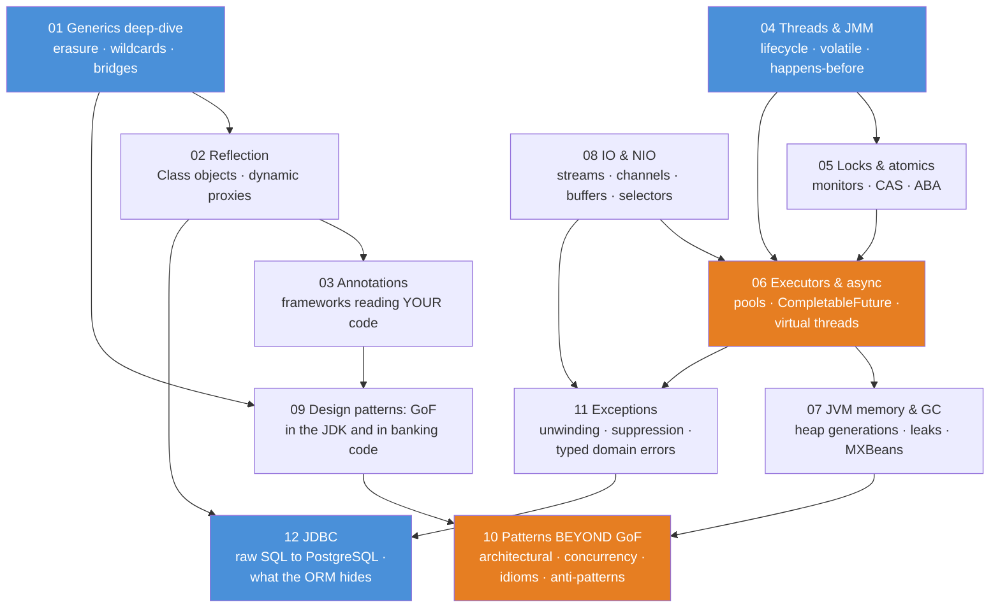
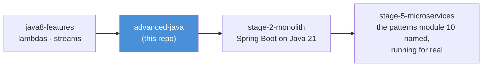

# Advanced Java — Teaching Repo

The course **after** [`java8-features`](../java8-features/README.md) and **before**
[`stage-2-monolith`](../stage-2-monolith/README.md). The first three courses taught the
language; this one teaches what happens **under** it: what the compiler throws away
(erasure), what the JVM actually runs (bytecode, monitors, the heap), what the framework
does for you (reflection, annotations, thread pools) — and the patterns that keep large
banking code readable.

Unlike the foundational courses, this repo runs on **Java 21** — the level `stage-2`
actually uses. Records, sealed types, pattern-matching `switch` and **virtual threads**
are teaching material here, not contraband.

Every explanation follows [`docs/refs/TEACHING_STYLE.md`](../docs/refs/TEACHING_STYLE.md):
plain sentence first, a numbered walkthrough for every mechanism, a **"Read the
diagram:"** bullet list under every mermaid diagram, and an **"In one sentence:"**
takeaway closing every long section. Same teaching format as the other courses:

- **demo classes** (`src/main/java`) — each has a `main()` that prints what is happening, step by step
- **JUnit tests** (`src/test/java`) — each test proves one claim and prints the evidence
- **README.md with mermaid diagrams** — the conceptual picture *before* you open the code

## The course map



**Read the diagram:** two blue foundations feed everything — 01 (how types really work)
and 04 (how threads really work). The orange modules are the heart of the course: 06 is
where day-to-day server Java lives, and 10 is where all the earlier mechanics turn into
design judgment. 02→03 is one arc (reflection is the machinery; annotations are what
frameworks point it at). 08 joins at 06 because NIO selectors and async pipelines share
the same "don't block a platform thread" idea. The last two modules collect the threads:
**11 Exceptions** is the mechanism behind every `try` you have already written — stack
unwinding, cause chains, and suppression (it hangs off 08, where try-with-resources first
appeared, and 06, where `exceptionally` is the async `catch`). **12 JDBC** (blue) is the
raw SQL layer every ORM hides; it receives from 11 (a `SQLException` is the checked
exception you translate at the boundary) and from 02 (the driver auto-registers via
reflection's `ServiceLoader`), and it lands directly on stage-2's Spring Data JPA.

## Suggested teaching order

| # | Module | The one-sentence pitch | Run the demos |
|---|--------|------------------------|---------------|
| 01 | `01-generics-deep-dive` | Generics are a compile-time illusion: the compiler checks `<String>`, erases it, and inserts casts — every generics "weird rule" follows from that one fact | `.\mvnw.cmd -pl 01-generics-deep-dive compile exec:java` |
| 02 | `02-reflection` | A `Class` object is the JVM's answer sheet about your code — and frameworks use it to call methods they only meet at runtime | `.\mvnw.cmd -pl 02-reflection compile exec:java` |
| 03 | `03-annotations` | An annotation is a sticky note on your code; alone it does NOTHING — a reader (reflection, or the compiler itself) gives it meaning | `.\mvnw.cmd -pl 03-annotations compile exec:java` |
| 04 | `04-threads-and-jmm` | Each thread gets a view of memory, not the memory — `volatile` and synchronization are how you publish changes between views | `.\mvnw.cmd -pl 04-threads-and-jmm compile exec:java` |
| 05 | `05-locks-and-atomics` | `synchronized` is a hardware-backed queue on ONE object; `Lock` sells the same guarantee à la carte; atomics skip the queue with compare-and-set | `.\mvnw.cmd -pl 05-locks-and-atomics compile exec:java` |
| 06 | `06-executors-and-async` | Stop selling threads one by one: pools rent them out, `CompletableFuture` chains the results, and virtual threads make "one per task" cheap again | `.\mvnw.cmd -pl 06-executors-and-async compile exec:java` |
| 07 | `07-jvm-memory-and-gc` | The heap is a nursery plus an old-age home; GC moves survivors between them — and a leak is an object you cannot use but the collector dare not free | `.\mvnw.cmd -pl 07-jvm-memory-and-gc compile exec:java` |
| 08 | `08-io-and-nio` | Classic IO is one-byte-at-a-time streams; NIO is blocks, buffers and one thread watching many connections — the reactor that runs every server you know | `.\mvnw.cmd -pl 08-io-and-nio compile exec:java` |
| 09 | `09-design-patterns-gof` | The GoF patterns are not recipes to memorize — they are names for solutions the JDK (and your bank) already uses daily | `.\mvnw.cmd -pl 09-design-patterns-gof compile exec:java` |
| 10 | `10-patterns-beyond-gof` | GoF is 1994's 23; real systems are built from architectural, concurrency and API patterns — plus the anti-patterns that eat banks alive | `.\mvnw.cmd -pl 10-patterns-beyond-gof compile exec:java` |
| 11 | `11-exceptions` | `throw` unwinds the stack frame by frame until a handler matches; the cause chain, suppression and a sealed typed-error hierarchy are how you never lose the origin again | `.\mvnw.cmd -pl 11-exceptions compile exec:java` |
| 12 | `12-jdbc` | Before JPA there is JDBC: a `Connection`, a parameterized `PreparedStatement` (the SQL-injection fix), and a `ResultSet` cursor — the raw SQL layer stage-2 hides *(needs the stage-1 Postgres up)* | `.\mvnw.cmd -pl 12-jdbc compile exec:java` |

## Running things

All commands run **from this folder** (`advanced-java/`), Windows PowerShell shown:

```powershell
# run one module's demo launcher (prints every demo in teaching order)
.\mvnw.cmd -pl 04-threads-and-jmm compile exec:java

# run ONE specific demo class instead of the whole launcher
.\mvnw.cmd -pl 04-threads-and-jmm compile exec:java "-Dexec.mainClass=com.evaitcs.advanced.threads.VisibilityDemo"

# run one module's tests (tests print what they prove)
.\mvnw.cmd -pl 01-generics-deep-dive test

# run everything
.\mvnw.cmd test
```

Tip for class: **plain sentence → diagram (+ "Read the diagram") → numbered walkthrough →
demo `main()` → test as proof.** The module READMEs are written in exactly that order.

If em-dashes/arrows print as garbage in a plain `cmd` window, run `chcp 65001` first
(UTF-8 code page). Windows Terminal and IDE consoles are fine as-is.

## Shared conventions

- **Java 21, modern idiom allowed**: records, sealed interfaces, pattern-matching
  `switch`, text blocks, lambdas everywhere, virtual threads in modules 04–07. Where a
  modern feature replaces a `core-java` classic idiom, the comment says so and points
  back — the contrast is still a lesson.
- **Explanations follow [`TEACHING_STYLE.md`](../docs/refs/TEACHING_STYLE.md)** — the
  clarity rubric: every term defined at first use, every diagram gets "Read the diagram:"
  bullets, every runtime mechanism gets a numbered walkthrough, every long section ends
  with "In one sentence:".
- **Domain**: the same SecureBank world as the other courses — `Account`, `Customer`,
  `Transaction` — duplicated per module on purpose, so each module stands alone on screen.
  Money is `BigDecimal` (scale 2).
- **Comments are teaching material**: they explain *why* and connect the code to the
  README's numbered walkthroughs.
- **Determinism**: concurrency demos use `CountDownLatch` start guns and `join()`;
  exact counts are asserted only where the mechanism guarantees them; GC and timing
  behavior is *observed and printed*, never asserted as a number (generous floors and
  bounded retries only, always commented).
- JVM-introspection demos use only **public management APIs** (`java.lang.management`,
  `Reference` classes) — no `--add-opens`, no reaching into `java.util` internals.
- **Module 12 (`12-jdbc`) is the one module that needs an external service and a
  third-party dependency** — the live PostgreSQL from `../stage-1-database` and the
  `org.postgresql:postgresql` driver (declared in that module's pom only, never the
  parent). It is built to **degrade gracefully**: when the database is down, its tests
  SKIP (JUnit assumptions) and its demos print the start command and return normally, so
  `.\mvnw.cmd test` for the whole course stays green with or without Docker. It is also
  strictly **non-destructive** — every write runs inside a rolled-back transaction or a
  session-local temp table, so the shared stage-1 seed data is never mutated. Start the
  DB with `cd ..\stage-1-database ; docker compose up -d`; override the connection with
  `JDBC_URL` / `JDBC_USER` / `JDBC_PASSWORD` if your Postgres is elsewhere.

## Where this course leads



**Read the diagram:** this repo is the bridge from *language* to *framework*. Module 02–03
(reflection + annotations) is literally how Spring builds beans; 06 is what
`@Async` and the Tomcat pool do underneath; 11 is the exception model that stage-2's
`@ControllerAdvice` turns into RFC 7807 responses; **12 is the raw JDBC that Spring Data
JPA / Hibernate wrap — after it, `@Query` and repositories are no longer magic**; and
09–10 name the patterns `stage-2` and `stage-5` are written in (Repository, Service Layer,
DTO, ProblemDetail, saga, circuit breaker, gateway). When students reach Spring, nothing
is magic anymore — that is the whole point of the course.
