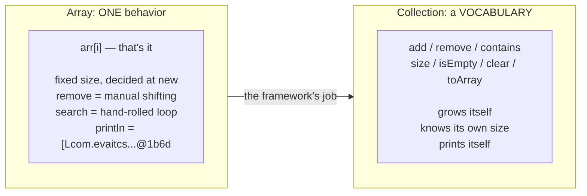
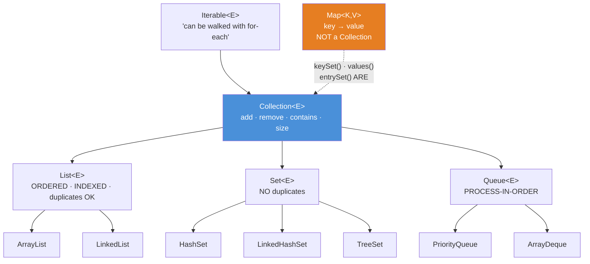

# 01 — Why Collections: Arrays Hit a Wall

**The big idea:** an array is a fixed-size block of memory with exactly one behavior of
its own — `arr[i]`. Growing, removing, searching, printing: all hand-rolled, all buggy,
all reinvented per project. The Collections Framework is the answer, and its design is
one sentence: **the interfaces are the GUARANTEES (`List`, `Set`, `Queue`, `Map`), the
classes are interchangeable IMPLEMENTATIONS** (`ArrayList`, `HashSet`, ...). You declare
with the interface and instantiate with the class. Swapping engines then becomes a
one-line change. Underneath every "find" operation (`contains`, `remove`, Set membership,
Map lookup) runs the `equals`/`hashCode` contract from `core-java` 08: equal objects must
return equal hash codes; `hashCode()` decides *where* an object is filed, `equals()`
decides *whether* it is a match. This course finally cashes that check.

**In one sentence:** an array gives you slots; a collection gives you guarantees — pick the
guarantee (the interface) first, the engine (the class) second.

Domain for the module: SecureBank's `Account` (id, owner, `BigDecimal` balance) with
`equals`/`hashCode` **by id** — deliberately, because banner 2 of `CollectionApiDemo`
proves what happens to containers whose elements *don't* have it. Compiles with
`--release 8`, classic idiom throughout.

## The wall — what an array cannot do

## The family tree — guarantees, not classes

**Read the diagram:**
- Top: `Iterable` — "can be walked with a for-each" — roots everything you can loop over.
- Second row (blue): `Collection` adds the shared vocabulary — `add`, `remove`, `contains`, `size`.
- Third row: the three big guarantees — `List` (ordered, indexed), `Set` (no duplicates),
  `Queue` (process in order).
- Fourth row: the concrete classes. One class can implement several guarantees
  (`LinkedList` is both a `List` and a `Deque`).
- The orange outsider: `Map` is NOT a `Collection` — a key-value pair is not "a bag of
  elements" — but the dashed arrow shows it hands Collections back through `keySet()`,
  `values()`, and `entrySet()`.

Two structural surprises, both printed as evidence in `HierarchyDemo`:
- **`Map` is not a `Collection`** — key-value pairs don't fit "a bag of elements". But it
  hands you Collections back via `keySet()`/`values()`/`entrySet()` (module 05).
- **One class can wear several hats** — `LinkedList` *is* a `List` **and** a `Deque` (hence
  a `Queue`). The interface you declare decides which methods you can even see.

## Array vs List — the table to photograph

| | `Account[]` | `List<Account>` |
|---|---|---|
| Size | fixed at `new`, forever | grows on `add`, shrinks on `remove` |
| Remove | `System.arraycopy` + null the tail + track size yourself | `remove(i)` / `remove(obj)` |
| Contains | hand-rolled loop | `contains(obj)` — uses `equals` |
| Print | `[Lcom.evaitcs...@1b6d` unless `Arrays.toString` | `toString` built in, always readable |
| Type safety | **covariant** — a `String[]` may be held in an `Object[]` variable (`Object[] o = stringArray` compiles); storing a wrong type crashes at RUNTIME (`ArrayStoreException`) | **invariant** — a `List<String>` may NOT be held in a `List<Object>` variable; `List<Object> o = stringList` does not compile |
| Generics | reified — the element type is kept at runtime (that's why covariance exists, and why it must be policed at every store) | erased — the type is checked at compile time, then thrown away |

## The traps, all printed as evidence in the demos

- **`Arrays.asList` hands the wall through** — it returns a *view* (a wrapper that reads
  and writes the original's storage — not a copy) over the same array. `set()` works and
  writes straight through into the array. `add()`/`remove()` throw
  `UnsupportedOperationException`. The copy idiom `new ArrayList<Account>(Arrays.asList(arr))`
  is the fix; it appears in every real codebase (`ArraysHitAWallDemo` banner 5).
- **Covariance** — `Object[] objects = stringArray; objects[0] = 42;` compiles and
  detonates at runtime. Lists refuse the same assignment at compile time; generics are
  the seatbelt (same lesson shape as the raw-list `ClassCastException` in `core-java` 10).
- **`contains` uses `equals`, not `==`** — a class without an `equals` override can only
  ever be found by identity: same data, `false`. `CollectionApiDemo` shows both worlds
  side by side. This single line is why modules 04 and 05 exist.
- **`List.equals` is order-sensitive, `Set.equals` is not** — and a `List` NEVER equals a
  `Set`, however similar the contents: `equals` checks the interface first. Students who
  know this stop "fixing" comparisons that were never broken.

## Class flow

1. Show the two diagrams above (wall first — the pain; then the tree — the design).
2. Run the demos in order: `.\mvnw.cmd -pl 01-why-collections compile exec:java`
   (this runs `WhyCollectionsDemos`, which calls each demo `main()` in teaching order).
3. Run the tests as *proof*: `.\mvnw.cmd -pl 01-why-collections test` — each test prints
   the behavior it asserts, including the deterministic failures (ArrayStoreException,
   UnsupportedOperationException).

| Demo class | What it shows |
|---|---|
| `ArraysHitAWallDemo` | fixed size, manual remove surgery, no behavior, covariance crash, the `asList` trap + copy idiom |
| `HierarchyDemo` | the family tree, `instanceof` proofs, implementation swap behind one interface, broadest-useful parameter types |
| `CollectionApiDemo` | the shared vocabulary, `equals` engine under `contains`/`remove`, collection equality rules, `toArray` bridge |

| Test | What it proves |
|---|---|
| `arraysAreFixedSize` | length never grows in place; out-of-bounds is a runtime crash |
| `removingFromArrayIsManualShifting` | arraycopy surgery == `list.remove(1)`, minus the size tracking |
| `covariantArraysFailAtRuntime` | `ArrayStoreException` on chosen values, every run |
| `asListIsAFixedSizeView` | `set` writes through; `add`/`remove` throw; the copy idiom is growable |
| `hierarchyClaims` | instanceof chain; LinkedList's two hats; Map is not a Collection |
| `swapImplementationSameCode` | ArrayList and LinkedList are `equals` as Lists |
| `containsUsesEqualsNotIdentity` | equal stranger found and removes the original; `Object` control group is not |
| `collectionEqualityRules` | List order-sensitivity, Set order-insensitivity, the cross-interface wall |
| `toArrayBridge` | typed overload vs `Object[]` |
| `oneObjectSeveralInterfaces` | the same `LinkedList` used AS a `Queue` — FIFO (teaser for module 06) |

## Where this leads

Every later module is one branch of the tree made concrete: 02 `List` (the two engines and
when each wins), 03 iteration (`Iterable` in action — and its fail-fast change-detector:
an iterator that throws the moment it notices the collection changed shape mid-walk),
04 `Set` and 05 `Map` (the `equals`/`hashCode` contract turned into data structures),
06 `Queue`/`Deque`, 07 the `Collections` toolbox, 08 the Big-O decision table, and 09–10
what happens when threads share all of the above. The hand-rolled loops in this module are
also the raw material `java8-features/04-streams-fundamentals` later deletes.
