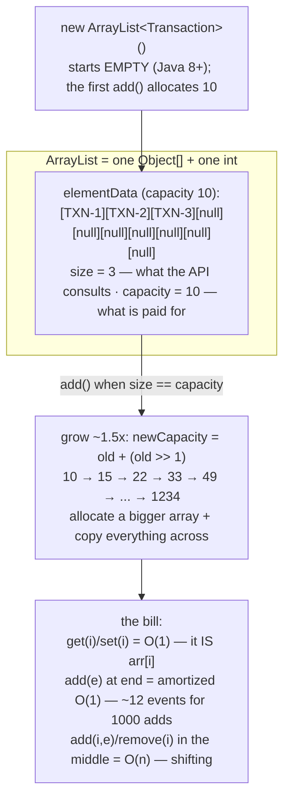
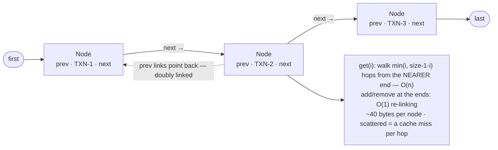
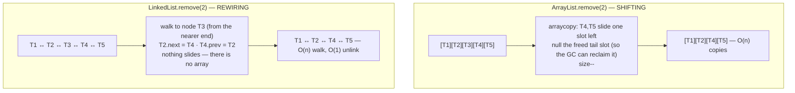
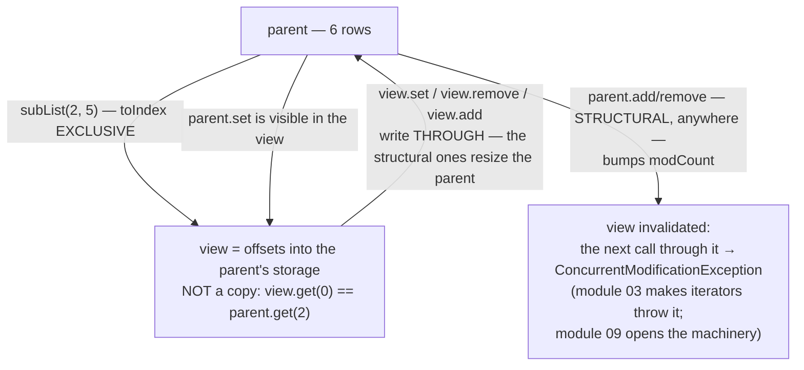

# 02 — List: ArrayList vs LinkedList

**The big idea:** the `List` you declared in module 01 is a guarantee; this module opens the
two engines behind it. `ArrayList` is a **growable array**: one contiguous `Object[]`
(`elementData`) plus a `size` counter. `get(i)` IS `arr[i]` — O(1). `add` at the end is
**amortized O(1)** — usually O(1); the occasional grow-and-copy of a full array averages
out to a constant cost per add. Every middle insert/remove must **shift** the tail — O(n).
`LinkedList` is a **chain of doubly-linked nodes**. At the two ends, add/remove is O(1)
pointer re-linking, but every positional operation first **walks** the chain — O(n). Each
element pays ~40 bytes of node overhead, and the nodes are scattered over the heap —
*cache-hostile*: the CPU cache misses on nearly every hop. Hence the punchline, measured
in the demos: **as a List, `ArrayList` wins almost always**. `LinkedList`'s real calling
is the `Deque` — module 06, where `ArrayDeque` usually beats it anyway. And because
everything is declared as `List`, the choice stays what module 01 promised: a one-line
decision.

**In one sentence:** both engines keep the same `List` promise and differ only in which
operations are cheap — indexed access on contiguous memory (`ArrayList`) versus O(1)
re-linking that only the two ends can enjoy (`LinkedList`).

Domain for the module: SecureBank's `Transaction` (id, description, `BigDecimal` amount at
scale 2 — money is never float/double, core-java 02 — and a `long` timestampMillis, because
`java.time` only arrives in `java8-features/08-java-time`), with `equals`/`hashCode` **by id**
from core-java 08: `contains`, `indexOf` and `remove(Object)` all run on that contract.
`Transaction.sampleStatement()` returns a fresh, mutable, chronologically ordered `ArrayList`
with fixed timestamps — every output is deterministic. Compiles with `--release 8`, classic
idiom throughout.

## ArrayList — one array, two numbers

**Read the diagram:**
- Top: a new `ArrayList` starts EMPTY (Java 8+); the first `add()` allocates the
  default 10-slot array.
- Middle: two numbers describe the engine — `size` (slots used; what the API consults)
  and capacity (slots paid for).
- `add()` on a full array: allocate a ~1.5x bigger array (10 → 15 → 22 → ...) and copy
  everything across — that rare copy is why end-`add` is only *amortized* O(1).
- Bottom: the bill — O(1) indexed reads/writes, amortized O(1) end-adds, O(n) middle
  insert/remove (the tail shifts).

**Walkthrough — what happens when `add(e)` meets a full array:**
1. Check: `size == capacity` — no room at the end.
2. New capacity: `newCapacity = old + (old >> 1)` — old plus half of old (~1.5x).
3. Allocate the fresh `Object[]`, copy all `size` elements across.
4. Store `e` at `elementData[size]`, then `size++`. Only this one `add` paid O(n).

## LinkedList — nodes and pointers

**Read the diagram:**
- Left to right: each node holds a `prev` pointer, the element, and a `next` pointer;
  the list itself keeps only `first` and `last`.
- The dashed arrow: `prev` links point backwards — doubly linked, walkable both ways.
- The box below: the prices — `get(i)` walks `min(i, size-1-i)` hops from the nearer end
  (O(n)); only the ends get O(1) re-linking; ~40 bytes per node; a cache miss per hop.

## The same remove(2), two physics

**Read the diagram:**
- Top half (`ArrayList`): array surgery — everything after the hole slides one slot left
  (`arraycopy`), the freed tail slot is nulled for the GC, `size--`. The sliding is the O(n).
- Bottom half (`LinkedList`): rewiring — walk to the doomed node (O(n)), point its two
  neighbors at each other (O(1)). Nothing moves in memory; there is no array.
- Same call, same resulting order: one pays in copies, the other in hops.

## subList — a window, not a copy

**Read the diagram:**
- Top: `subList(2, 5)` returns a *view* — offsets into the parent's storage, not a copy
  (`toIndex` is exclusive, so the view shows the elements at indexes 2, 3, and 4).
- The two middle arrows: reads and writes pass through in both directions — one storage,
  two names, `view.get(0)` IS `parent.get(2)`.
- The bottom arrow is the expiry date. A **structural** change to the parent — one that
  changes the collection's *shape*: `add`, `remove`, `clear` (refilling a slot with
  `set(i, e)` is not one) — bumps the parent's `modCount`, its shape-change counter. The
  view remembers the old count, so the next call through it throws
  `ConcurrentModificationException` (module 03 makes iterators throw it; module 09 opens
  the machinery).

## ArrayList vs LinkedList — the table to photograph

| Operation | `ArrayList` | `LinkedList` |
|---|---|---|
| `get(i)` / `set(i, e)` | **O(1)** — it IS `arr[i]` | O(n) — walk from the nearer end |
| `add(e)` (end) | **amortized O(1)** — ~1.5x growth | O(1) — re-link `last` |
| `add(0, e)` / `add(i, e)` | O(n) — shift the tail | O(n) walk + O(1) re-link; O(1) at the ends |
| `remove(i)` | O(n) — shift the tail | O(n) walk + O(1) unlink |
| `contains` / `indexOf` | O(n) — `equals` scan | O(n) — `equals` scan |
| Memory per element | one reference (~8 B) + spare capacity | a `Node` (~40 B: header + prev + next + element) |
| Cache locality | one contiguous block — friendly | scattered nodes — a miss per hop |
| Verdict | **the default, almost always** | as a List: essentially never; as a Deque: module 06 (and `ArrayDeque` wins there too) |

## The traps, all printed as evidence in the demos

- **Forward loop + `remove(i)` skips elements** — each removal slides the unexamined successor
  into the hole and `i++` steps right past it. `RemovePitfallsDemo` reproduces it
  deterministically (one `FEE` survives) and fixes it by iterating **backward**.
  `iterator.remove()` (module 03) is the idiomatic in-loop fix. `list.removeIf(...)` is the
  Java 8 one-liner (java8-features 01).
- **`remove(1)` on a `List<Integer>` deletes the SLOT** — a bare `int` binds to
  `remove(int index)`; only `remove(Integer.valueOf(1))` reaches `remove(Object)`. The index
  overload returns the removed element, the value overload returns a boolean
  (`RemovePitfallsDemo`, asserted in `removeIntVersusRemoveInteger`).
- **`subList` is a live window with an expiry date** — writes go through in both directions and
  structural changes resize the parent, but any structural change to the parent (even an append
  far outside the window!) invalidates the view: the next call through it throws
  `ConcurrentModificationException` — fail-fast's first appearance, dissected in module 09.
- **The regrowth ladder is real** — importing 100,000 CSV rows into `new ArrayList<Transaction>()`
  runs ~30 allocate-and-copy events; `new ArrayList<Transaction>(100_000)` runs zero. When you
  know the size, say it (`RemovePitfallsDemo` banner 3).
- **`Arrays.asList` is still a view** — module 01's wall in List clothing: `set()` writes
  through, `add()`/`remove()` throw `UnsupportedOperationException`; the copy idiom
  `new ArrayList<T>(Arrays.asList(...))` is the exit, and every demo here uses it.

## Class flow

1. Show the diagrams above (engines first — the two memory pictures; then the surgery physics;
   then the window).
2. Run the demos in order: `.\mvnw.cmd -pl 02-list compile exec:java`
   (this runs `ListDemos`, which calls each demo `main()` in teaching order — the measured
   comparison prints your machine's milliseconds; the shape, not the numbers, is the lesson).
3. Run the tests as *proof*: `.\mvnw.cmd -pl 02-list test` — each test prints the behavior it
   asserts, including the deterministic failures (the surviving FEE, the subList CME).

| Demo class | What it shows |
|---|---|
| `ArrayListVsLinkedListDemo` | elementData/size/capacity and the ~1.5x ladder, the node chain, the two removal physics, and a measured three-operation comparison (timing caveat included) |
| `ListSurgeryDemo` | the whole indexed API on a statement: append/insert `add`, `set`, `get`, both `remove`s, and `indexOf`/`lastIndexOf`/`contains` on a double posting |
| `SubListViewDemo` | the view reads the parent, writes through both ways, resizes the parent — then expires with a caught CME; the snapshot idiom |
| `RemovePitfallsDemo` | the skip bug + backward fix, `remove(int)` vs `remove(Integer)`, `initialCapacity`, the `asList` view encore |

| Test | What it proves |
|---|---|
| `growthPreservesAllElements` | 1000 adds across ~12 growths: all present, original order |
| `middleInsertShiftsCorrectly` | `add(2, e)` shifts the tail right; `remove(2)` shifts it back |
| `forwardRemovalSkipsElements` | the skip bug reproduced: exactly one FEE survives |
| `backwardRemovalRemovesAll` | the backward loop deletes every match |
| `subListWritesThroughToParent` | `set`/`remove` through the view rewrite and resize the parent |
| `parentStructuralChangeInvalidatesSubList` | a parent `add` anywhere → any view call throws CME |
| `removeIntVersusRemoveInteger` | slot vs value deletion, and the two return types |
| `linkedListBehavesIdenticallyAsList` | `ArrayList.equals(LinkedList)`, equal hashCodes — the engine is invisible |

## Where this leads

Module 03 takes the removal bug from the index loop into the walk itself — `Iterator`, for-each
sugar, and the `remove()` rule. Module 06 gives `LinkedList` its real job (`Deque` — where
`ArrayDeque` usually wins anyway); module 07 sorts and searches Lists (`Collections.sort` and
`binarySearch` want O(1) `get(i)` — another vote for `ArrayList` — and `unmodifiableList` is
another live *view*, the module 07 specialty); module 08 turns this module's measurements into
the Big-O decision table; module 09 dissects the `modCount` machinery behind the subList CME;
module 10 replaces fail-fast with fail-safe (`CopyOnWriteArrayList`). The hand-rolled filter
loops here are raw material for `java8-features`: `removeIf` and `forEach` with lambdas in
01-lambdas, `stream().filter().collect(...)` in 04-streams-fundamentals, and grouping
transactions by description with `Collectors.groupingBy` in 06-collectors. And under every
`contains`/`indexOf`/`remove(Object)` still runs the `equals` contract of core-java 08.
