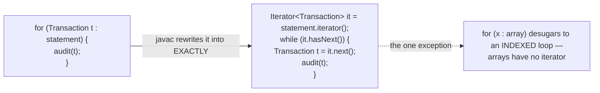
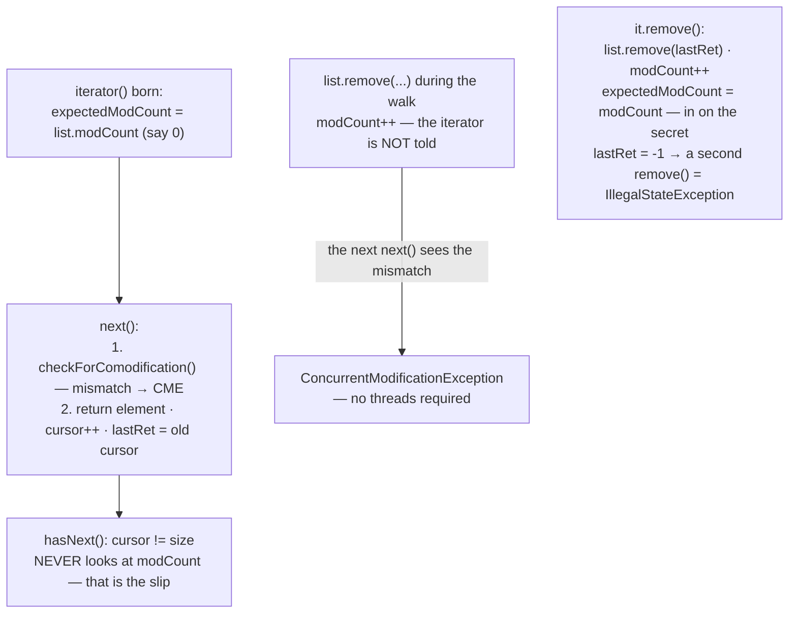
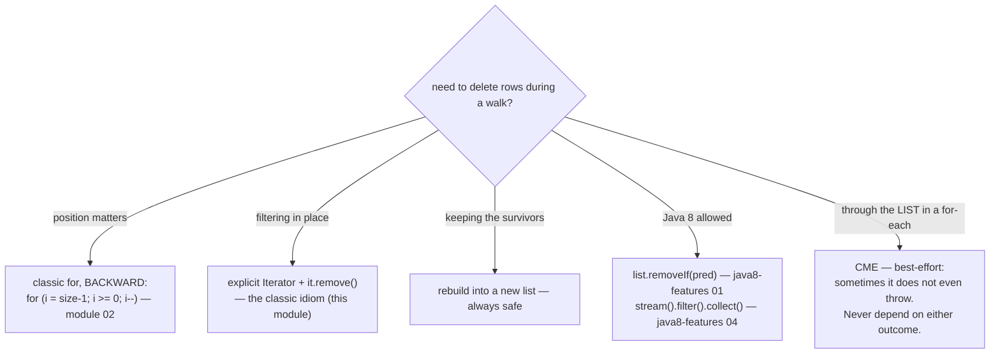
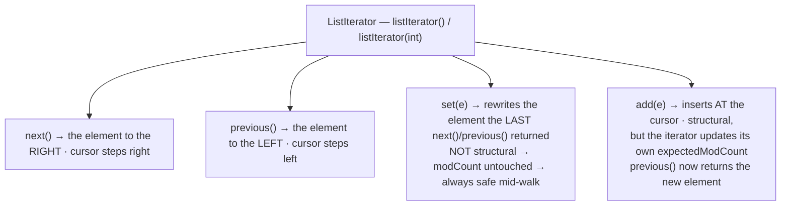

# 03 — Iteration: Iterator, for-each, and the remove() Rule

**The big idea:** module 01's family tree hangs on `Iterable<E>` — "can be walked". This module
opens the walking. Three loop shapes exist — the classic indexed `for`, the `for-each`, and the
explicit `Iterator` — and the central fact, provable line by line: **the for-each is compiled
sugar for the Iterator protocol** (`iterator()`, then `hasNext()`/`next()` until exhausted).
The iterator has exactly one mutation of its own — `remove()` — and it is **the only safe way
to delete during a walk**, because it is the only one that tells the iterator about the change.
Delete through the list instead, and the iterator's *fail-fast* check (it throws the moment it
notices the collection changed shape, rather than walking on corrupted data) detonates at the
next `next()`: `ConcurrentModificationException` (CME). The check is one comparison. Every
**structural** change — one that changes the collection's *shape*: `add`, `remove`, `clear`
(refilling a slot with `set(i, e)` is not one) — bumps the collection's `modCount`, its
shape-change counter. Every iterator copies `modCount` into `expectedModCount` at birth.
`next()` and `remove()` compare the two and throw `ConcurrentModificationException` on a
mismatch. And the module's most important sentence, from the `java.util.Iterator` javadoc
itself: that alarm rings **on a best-effort basis** — "it would be wrong to write a program
that depended on this exception for its correctness". The demos prove both halves: the
explosion *and* the silences.

Domain for the module: SecureBank's `Transaction` (id, description, `BigDecimal` amount at
scale 2 — money is never float/double, core-java 02 — and `long` timestampMillis; `java.time`
arrives in `java8-features/08-java-time`), with `equals`/`hashCode` **by id** from core-java 08
— the wrong-way removals below call `remove(Object)`, which finds the row through that
contract. `Transaction.sampleStatement()` returns a fresh, mutable, chronologically ordered
`ArrayList`; all output is deterministic. Compiles with `--release 8`, classic idiom throughout.

## for-each — what you type vs what javac emits

## The fail-fast machinery — who checks what

**Read the diagram:**
- Top two boxes: the iterator snapshots `modCount` at birth; every `next()` re-checks the
  two counters first and throws CME on a mismatch, else returns the element and advances.
- Third box, the slip: `hasNext()` is just `cursor != size` — it NEVER looks at `modCount`.
- Left box, the crime: a `list.remove(...)` during the walk bumps `modCount` without
  telling the iterator — no threads required.
- Bottom box, the sanctioned removal: `it.remove()` deletes through the list, then
  re-syncs (`expectedModCount = modCount`); a second `remove()` without an intervening
  `next()` throws `IllegalStateException`.

**Walkthrough — what happens when you call `list.remove(x)` inside a for-each:**
1. The for-each calls `list.iterator()`; the fresh iterator copies `modCount` (say 3) into `expectedModCount`.
2. Your loop body calls `list.remove(x)`: the element goes, `modCount` becomes 4, nobody tells the iterator.
3. `hasNext()` checks only `cursor != size`, so it answers `true` — the mismatch waits.
4. `next()` runs `checkForComodification()`: 4 != 3 → `ConcurrentModificationException`. One thread is enough — your own loop body is "someone else" to the iterator.
5. The sanctioned path: `it.remove()` deletes through the list and then re-syncs the snapshot, so the walk continues.

**In one sentence:** the for-each is an `Iterator` in disguise, and the only deletion it
tolerates is the one the iterator itself performs — every other removal bumps `modCount`
behind its back.

## Removing during a walk — the decision

**Read the diagram:** the top question branches into every way to delete during a walk.
Position matters → classic `for`, BACKWARD (module 02), so the shift only moves
already-examined slots. Filtering in place → explicit `Iterator` + `it.remove()`, the
classic idiom of this module. Keeping survivors → rebuild into a new list, always safe.
Java 8 allowed → `removeIf` / `stream().filter().collect()` (java8-features 01 and 04).
The last branch is the bug: deleting through the LIST in a for-each → CME — best-effort,
and because it sometimes does not even throw, never depend on either outcome.

## ListIterator — the cursor sits BETWEEN elements

**Read the diagram:** the cursor sits BETWEEN elements: `next()` returns the element to
the RIGHT and steps right; `previous()` returns the one to the LEFT and steps left.
`set(e)` rewrites the element the last `next()`/`previous()` returned — not structural, so
`modCount` never moves and it is always safe mid-walk. `add(e)` inserts AT the cursor —
structural, but the iterator updates its own `expectedModCount`, so it stays safe;
`previous()` now returns the new element.

## Every way to remove during a walk — the table to photograph

| Way | Safe? | What actually happens |
|---|---|---|
| `list.remove(i)` in a classic `for`, forward | **BUG** | skips the successor — module 02's pitfall |
| the same, backward (`i = size-1; i >= 0; i--`) | safe | the shift only moves already-examined slots |
| `list.remove(obj)` inside a for-each | **BUG** | CME — best-effort: the slip can complete silently |
| `it.remove()` after `it.next()` | **SAFE** | the only in-loop removal the iterator is in on |
| `it.remove()` before `next()` / twice per `next()` | **BUG** | `IllegalStateException` — the iterator's own contract |
| rebuild the survivors into a new list | safe | one extra list, zero surprises |
| `list.removeIf(pred)` (Java 8) | safe | bulk surgery inside the list — java8-features 01 |

## The traps, all printed as evidence in the demos

- **CME needs no threads** — the name is a half-lie: one loop, one thread, one `list.remove(...)`
  inside a for-each is enough. The iterator's `expectedModCount` snapshot disagrees with the
  list's `modCount`, and the next `next()` throws. On most JDKs the message is `null` — the
  exception's TYPE is the message. (Threads sharing collections: modules 09–10.)
- **The alarm sometimes does not ring** — `hasNext()` never checks `modCount`. Delete the
  SECOND-TO-LAST element of an `ArrayList` during for-each and `cursor == size` ends the loop
  silently; delete the LAST element of a `LinkedList` and `nextIndex < size` does the same. The
  bug happened; nothing threw. Hence the javadoc's rule, quoted in full in
  `ConcurrentModificationDemo` and pinned by `lastElementRemovalSlipsThrough`: fail-fast
  **detects bugs, it never guarantees correctness**.
- **`remove()` is legal exactly once per `next()`** — before any `next()`, or twice in a row:
  `IllegalStateException` (NOT a CME — different contract, different bug). `it.remove()` deletes
  the element the last `next()` returned and syncs `expectedModCount` — which is why it is the
  only safe in-loop removal.
- **The for-each has no index and no removal handle** — the sugar hides the iterator variable, so
  there is nothing to call `remove()` on; when the walk needs positions or deletions, spell the
  `Iterator` out (or use the classic `for` — but backward, module 02). And indexing a
  `LinkedList` with `get(i)` in a loop is O(n²) in total.
- **`set()` is always safe mid-walk; `add()` is safe on a `ListIterator`** — `set()` is not
  structural (no modCount bump); `ListIterator.add()` is structural but updates its own
  snapshot. Both demonstrated live in `ListIteratorDemo`, next to the `Enumeration` fossil.

## Class flow

1. Show the diagrams above (the desugaring first — the identity claim; then the fail-fast
   machinery; then the decision chart; the ListIterator picture last).
2. Run the demos in order: `.\mvnw.cmd -pl 03-iteration-and-iterators compile exec:java`
   (this runs `IterationDemos`, which calls each demo `main()` in teaching order — including the
   caught CME and the two silent slips).
3. Run the tests as *proof*: `.\mvnw.cmd -pl 03-iteration-and-iterators test` — each test prints
   the behavior it asserts, including the deterministic explosions (CME, two ISEs) and the
   deterministic silences.

| Demo class | What it shows |
|---|---|
| `ThreeLoopsDemo` | the classic `for` (positions), the for-each (reading), the explicit `Iterator` (control) — all three proved to print identical sequences |
| `ForEachIsSugarDemo` | the desugaring side by side; the iterator protocol driven by hand; what the sugar hides and why it matters |
| `IteratorRemoveDemo` | filtering small transactions correctly; the once-per-`next()` contract (two caught ISEs); the rebuild alternative + Java 8 forward-refs |
| `ConcurrentModificationDemo` | the CME caught with its (null) message; the ArrayList second-to-last and LinkedList last slips; the javadoc moral |
| `ListIteratorDemo` | forward+backward walk, `set()` corrects in place, `add()` inserts at the cursor, the legacy `Enumeration` one-liner |

| Test | What it proves |
|---|---|
| `cmeWhenRemovingDuringForEach` | `list.remove` in a for-each → CME, message printed |
| `lastElementRemovalSlipsThrough` | LinkedList last (and ArrayList second-to-last): no throw, element gone |
| `iteratorRemoveWorksAndListReflectsIt` | the safe filter: exactly the small rows leave, survivors pass the audit |
| `doubleRemoveThrowsIllegalState` | `remove()` twice per `next()` → ISE, list untouched |
| `removeBeforeNextThrowsIllegalState` | `remove()` on a fresh iterator → ISE |
| `listIteratorSetAddPrevious` | `set`/`add`/`previous`/`nextIndex` behaviors |
| `forEachAndIteratorPrintIdenticalSequences` | the sugar claim, asserted |

## Where this leads

Every remaining module walks something: Sets (04) and Queues (06) are `Iterable`; the Map (05)
hands out three walkable Collections (`keySet`/`values`/`entrySet`); 07's `Collections` toolbox
operates over these walks; 09 finally opens `checkForComodification` and `modCount` — the
machinery this module named — and explains what "Concurrent" is really doing in the exception's
name; 10 shows the opposite philosophy: fail-SAFE iterators (`CopyOnWriteArrayList` iterates a
snapshot — it never throws CME, and never sees your writes). The classic ceremony here is
exactly what `java8-features` deletes: `forEach` and `removeIf` with lambdas in 01-lambdas, the
rebuild loop as `stream().filter().collect(...)` in 04-streams-fundamentals, and grouping the
audited rows with `Collectors.groupingBy` in 06-collectors. The index discipline of the classic
`for` is the same as the `charAt` loops over Strings in core-java 03; the `equals` engine under
`remove(Object)` is core-java 08; and when the statement must be ordered before the walk, that
is module 07 — the harvest of core-java 10's `Comparable`/`Comparator`.
