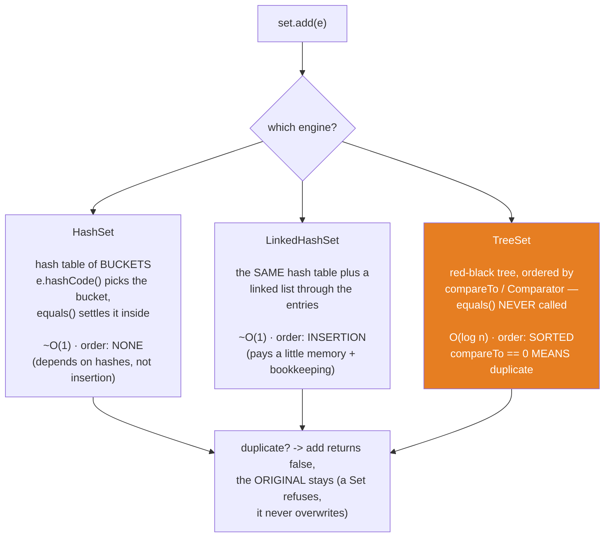
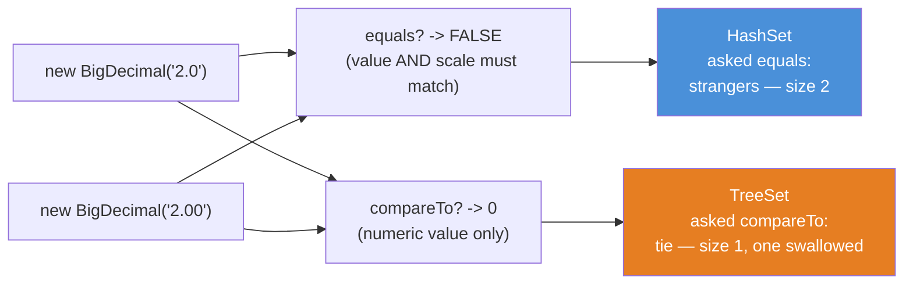
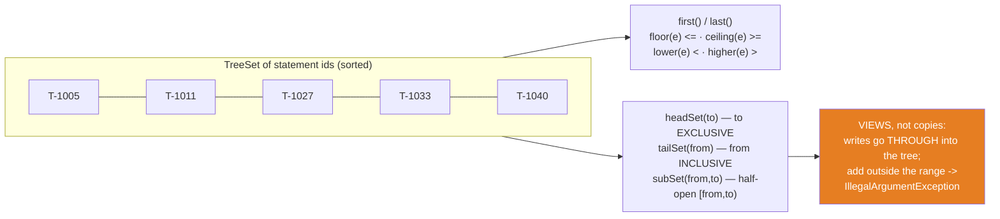

# 04 — Set: Where equals/hashCode Gets Cashed In

**The big idea:** a `Set` promises "no duplicates" — but it never defines *duplicate*
itself. It delegates the question to its engine. `HashSet` and `LinkedHashSet` ask
`hashCode()` then `equals()` — the contract from
[`core-java` 08](../../core-java/08-equals-hashcode/README.md), finally doing real work:
equal objects must return equal hash codes; `hashCode()` decides *where* an object is
filed, `equals()` decides *whether* it is a match. `TreeSet` instead asks
`compareTo()`/a `Comparator` and **never calls `equals()` at all** —
[`core-java` 10](../../core-java/10-comparable-comparator/README.md)'s consistency
warning, made concrete. The consequence is the sentence that explains this whole module:
**the same five transactions can be five elements in one Set and four in another** — and
both Sets are behaving perfectly. Choosing a Set implementation is choosing *which law
decides identity*, plus which order (if any) you get for free.

**In one sentence:** a Set is a comparison contract turned into a data structure — pick
the engine and you have picked the law that decides "duplicate".

Domain for the module: SecureBank's `Transaction` (id, description, `BigDecimal` amount,
`long` timestampMillis) carrying BOTH contracts in agreement — `equals`/`hashCode` by id
*and* `Comparable` by id — plus `Account` (equals/hashCode by id, deliberately NOT
`Comparable`: the caught `ClassCastException` in `TreeSetOrderingDemo` is the proof).
Compiles with `--release 8`, classic idiom throughout (anonymous `Comparator`, explicit
loops — the lambda rewrites wait in `java8-features/01-lambdas`).

## Three engines, three meanings of "order" and "duplicate"

**Read the diagram:**
- Top: one call — `set.add(e)` — and one question: which engine answers it?
- `HashSet` (left): a hash table of *buckets* — slots of an internal array; several
  entries can share one bucket. `e.hashCode()` picks the bucket; `equals()` settles
  duplicate-or-not inside it. ~O(1), NO order guarantee — iteration follows hashes.
- `LinkedHashSet` (middle): the SAME hash table plus a linked list threading the entries —
  ~O(1) and exact arrival order, at the cost of a little memory and bookkeeping.
- `TreeSet` (right, orange): a *red-black tree* — a self-balancing search tree — kept
  SORTED by `compareTo`/`Comparator`, O(log n) per operation. `equals()` is NEVER called;
  `compareTo == 0` MEANS duplicate.
- Bottom, the shared verdict: when the engine's law says "duplicate", `add` returns
  `false` and the ORIGINAL stays — a Set refuses, it never overwrites.

**Walkthrough — what happens when you call `hashSet.add(e)`:**
1. Compute `e.hashCode()`.
2. The hash picks the bucket — one slot of the internal array (the exact bucket math,
   including the power-of-two mask, is module 05's four-step walk).
3. Walk the entries already in that bucket, comparing with `equals()`.
4. Any entry equal to `e` → duplicate: `add` returns `false`, the original stays
   untouched. Otherwise file `e` in the bucket and return `true`.

## The BigDecimal trap — one law per engine, same two objects

**Read the diagram:**
- Left: two objects — `2.0` and `2.00`. Same value, different scale.
- Two questions, two answers: `equals()` answers FALSE (value AND scale must match);
  `compareTo()` answers 0 (it compares numeric value only).
- Right: each engine asks exactly one of those questions. `HashSet` (blue) asked `equals`:
  strangers — size 2. `TreeSet` (orange) asked `compareTo`: a tie — size 1, one silently
  swallowed.

The identical law swallows two same-id `Transaction`s in a `TreeSet` — and with a custom
`ByAmount` comparator it swallows two transactions that `equals()` would happily call
different. `TreeSetOrderingDemo` prints the crime scene: `contains()` returns `true` for
an object that was **never inserted**.

## NavigableSet: the vocabulary only an ORDERED set can offer

**Read the diagram:**
- Left: a sorted `TreeSet` of statement ids — a number line you can query.
- Middle top, neighbor vocabulary: `first()`/`last()`, and relative to any `e` —
  `floor(e)` = greatest <= e, `ceiling(e)` = smallest >= e, `lower(e)` = strictly <,
  `higher(e)` = strictly >.
- Middle bottom, range vocabulary: `headSet(to)` EXCLUDES `to`, `tailSet(from)` INCLUDES
  `from`, `subSet(from,to)` is half-open `[from,to)`.
- Right (orange): every range is a VIEW, not a copy — writes go THROUGH into the tree, and
  adding outside the view's range throws `IllegalArgumentException`.

Same lesson shape as `Arrays.asList` (module 01) and `unmodifiableList` (module 07):
a live window, not a snapshot.

## The three Sets — the table to photograph

| | `HashSet` | `LinkedHashSet` | `TreeSet` |
|---|---|---|---|
| Engine | hash table of buckets | hash table **+ linked list** | red-black tree |
| `add`/`contains`/`remove` | ~O(1) | ~O(1) | O(log n) |
| Iteration order | **none** — depends on hashes, not insertion (never rely on it!) | **insertion** order, exactly | **sorted** by `compareTo`/`Comparator` |
| "Duplicate" decided by | `hashCode()` + `equals()` | `hashCode()` + `equals()` | `compareTo`/`compare` == 0 — **`equals()` never called** |
| `null` element | one allowed (bucket 0 by convention) | one allowed | natural order: **`NullPointerException`** (it must compare) |
| Requires of elements | working `equals`/`hashCode` | working `equals`/`hashCode` | `Comparable` **or** a `Comparator` — else `ClassCastException` |
| Reach for it when | you just need fast "seen it before?" | you need dedupe **and** the order things arrived | you need sorted access or the `NavigableSet` vocabulary |

## The traps, all printed as evidence in the demos

- **`TreeSet` collapses on `compareTo() == 0`, never on `equals`** — a `ByAmount`
  comparator silently swallows a *distinct* transaction, and `contains()` then returns
  `true` for an object the Set does not hold (`TreeSetOrderingDemo`, asserted in
  `comparatorCollapseWithoutEquals`). Fix: chain the comparison down to a unique key
  (core-java 10's ladder) so a tie is impossible.
- **`BigDecimal` 2.0 vs 2.00** — `equals` false (scale differs), `compareTo` 0: `HashSet`
  keeps **both** (size 2), `TreeSet` keeps **one** (size 1). House rule: money is scale 2
  *everywhere*; anything that orders money uses `compareTo` (`bigDecimalScaleTrap`).
- **`null`** — legal in the hash Sets (at most ONE: the second is a duplicate), fatal in a
  natural-order `TreeSet` — even an empty one, because the first add self-compares as a
  type check (`NullsAndNavigableDemo`, asserted in `nullsPerEngine`).
- **The corrupted Set** — mutate an element's identity fields *after* inserting it, and the
  element is still IN the set: the size is unchanged and iteration hands it back. But it is
  UNREACHABLE. A query for the NEW id lands in the wrong bucket, because the bucket was
  chosen from the OLD hash. A query for the OLD id finds the entry but gets "I'm not that
  anymore" from `equals`. `CorruptedSetDemo` prints all four failed lookups; module 05
  replays the tragedy on a `HashMap` (`mutatingIdentityFieldsCorruptsTheSet`).
- **`headSet`/`subSet`/`tailSet` are live views** — `view.add(x)` writes into the
  original, and adding outside the view's range throws `IllegalArgumentException`
  (`navigableViewsAreLiveWindows`).
- **Bulk operations MUTATE the receiver** — `addAll`/`retainAll`/`removeAll` change *this*
  Set; there is no non-destructive union. Copy first (`new TreeSet<String>(october)`),
  then mutate the copy (`SetAlgebraDemo` banner 2, asserted in `setAlgebraIsExact`).
- **HashSet iteration order is an implementation detail** — the demos print it ONLY with
  a disclaimer, and the tests never assert it: order claims go through `LinkedHashSet`,
  `TreeSet`, or `new TreeSet<>(set)`.

## Class flow

1. Show the diagrams above (engines first, then the BigDecimal trap, then the views line).
2. Run the demos in order: `.\mvnw.cmd -pl 04-set compile exec:java`
   (this runs `SetDemos`, which calls each demo `main()` in teaching order).
3. Run the tests as *proof*: `.\mvnw.cmd -pl 04-set test` — each test prints the behavior
   it asserts, including the deterministic failures (NPE, CCE, IllegalArgumentException).

| Demo class | What it shows |
|---|---|
| `NoDuplicatesDemo` | `add()` returns false, the original survives; duplicate = `equals`, not `==`; the List→Set dedupe idiom; the no-`equals` control group |
| `ThreeSetsSameDataDemo` | the same statement in `HashSet`/`LinkedHashSet`/`TreeSet`: three orders (with the HashSet disclaimer), one unchanged `Set<Transaction>` declaration |
| `TreeSetOrderingDemo` | natural order; the no-`Comparable` `ClassCastException`; the `ByAmount` comparator swallowing a distinct transaction; `BigDecimal` 2.0 vs 2.00 side by side |
| `SetAlgebraDemo` | union/intersection/difference on two months of fraud-alert ids; copy-before-mutate discipline |
| `NullsAndNavigableDemo` | one null in `HashSet` vs the caught `TreeSet` NPE; first/last/floor/ceiling/lower/higher; head/tail/subSet as live views |
| `CorruptedSetDemo` | the mutable-identity trap: four failed lookups, unchanged size, the iterator still handing the element back |

| Test | What it proves |
|---|---|
| `duplicateByEqualsRejected` | `add` returns false, size stays, the ORIGINAL element survives |
| `linkedHashSetKeepsInsertionOrder` | iteration order == insertion order, position by position |
| `treeSetSortsAndCollapsesOnCompareToZero` | sorted by id; two same-id transactions collapse to size 1 |
| `comparatorCollapseWithoutEquals` | `equals`=false + `compare`=0 → swallowed; `contains` true for the never-inserted one |
| `bigDecimalScaleTrap` | `HashSet` size 2, `TreeSet` size 1 — on chosen values, every run |
| `setAlgebraIsExact` | union/intersection/difference contents exact; originals untouched |
| `nullsPerEngine` | `HashSet.contains(null)` true; `TreeSet.add(null)` throws NPE |
| `navigableViewsAreLiveWindows` | head/sub-set contents exact; writes go through; out-of-range add throws |
| `mutatingIdentityFieldsCorruptsTheSet` | the element is IN (size 1, iterator sees it) and UNREACHABLE (old id, new id, even itself) |

## Where this leads

Module 05 (`Map`) is the other half of this module's harvest — and the dirty secret is
that `HashSet` *is* a `HashMap` underneath (elements as keys, one shared dummy value), so
the corrupted Set of `CorruptedSetDemo` returns there as the mutable-key trap. Module 07
sorts and wraps what this module stores (`Collections.sort` on a `List`, `sortedSet`
views); module 08 folds the table above into the Big-O decision sheet; module 09 shows
what a `HashSet`'s fail-fast iterator does when someone mutates it mid-loop. The
contracts themselves live in [`core-java` 08](../../core-java/08-equals-hashcode/README.md)
(equals/hashCode) and [`core-java` 10](../../core-java/10-comparable-comparator/README.md)
(Comparable/Comparator) — re-read the "consistency with equals" trap there, then watch it
bite here. In [`java8-features` 06](../../java8-features/06-collectors/README.md), the
hand-rolled dedupe and grouping loops of this module become `Collectors.toSet()` and
`Collectors.groupingBy(...)`.
