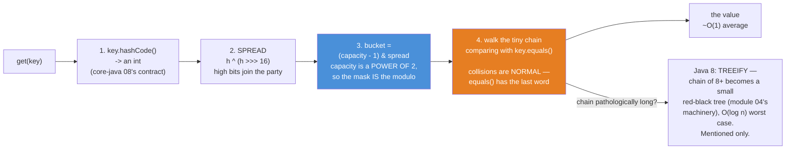
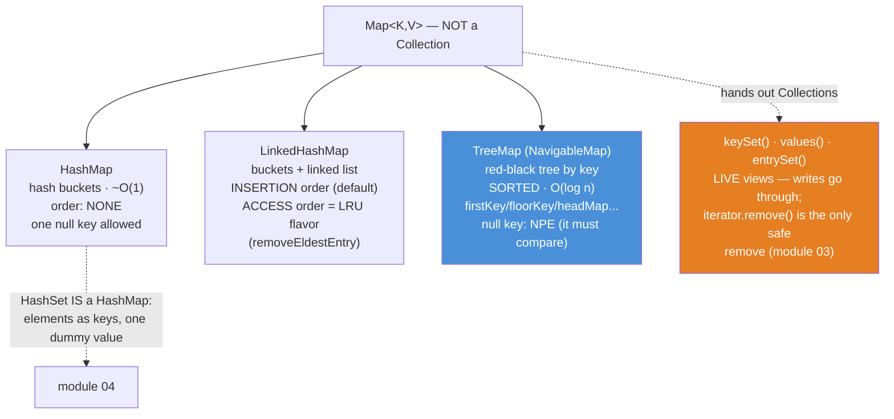

# 05 — Map: How HashMap Actually Finds Your Value

**The big idea:** one sentence explains this entire module: **`HashMap.put` hashes your
key to a bucket and walks a tiny chain, comparing candidates with `equals()`.** (A
*bucket* is one slot of the table's internal array; several entries can share one bucket.)
From that sentence everything else follows by logic:

- why keys must honor `equals`/`hashCode` — the contract from
  [`core-java` 08](../../core-java/08-equals-hashcode/README.md), cashed in: equal objects
  must return equal hash codes; `hashCode()` decides *where* an object is filed, `equals()`
  decides *whether* it is a match;
- why `get` is O(1) *on average* — the hash jumps straight to the bucket, and only the tiny
  chain there gets walked;
- what the *load factor* 0.75 is for — the fullness ratio at which the table decides it is
  too crowded: double the cabinet and *rehash* (allocate the bigger table and re-file every
  entry into its new bucket);
- why `initialCapacity` exists — do the resize math once, up front;
- why `containsValue` is stuck at O(n) — values have no hash index;
- and why mutating a key after `put` loses your value *forever* — the entry is still
  inside, you just cannot ask for it anymore.

A `Map` is **not** a `Collection` (module 01 proved it with `instanceof`), but it hands out
Collections: `keySet()`/`values()`/`entrySet()` are live views of the very same entries,
and the only way to iterate.

Domain for the module: SecureBank's `Account` (id, owner, `BigDecimal` balance — the VALUE
class, equals/hashCode by id) and `Transaction` (id, description, amount, `long`
timestampMillis; `Comparable` by id), with String ids as keys. Compiles with `--release 8`,
classic idiom throughout — `computeIfAbsent`/`merge` get a one-line forward-pointer to
[`java8-features` 01](../../java8-features/01-lambdas/README.md); the grouping loops in
`MapIterationDemo` are exactly what `Collectors.toMap`/`groupingBy` delete in
[`java8-features` 06](../../java8-features/06-collectors/README.md).

## The lookup walk — four steps, every single get



**Read the diagram:**
- Steps 1–2: `key.hashCode()` returns an int (core-java 08's contract); SPREAD mixes the
  high bits of the hash into the low ones (`h ^ (h >>> 16)`), so keys differing only in
  their high bits still land in different buckets.
- Step 3 (blue): the bucket index is `(capacity - 1) & spread`. Capacity is always a POWER
  OF 2, so this bit-mask IS the modulo — one cheap AND instead of a division.
- Step 4 (orange): walk the tiny chain in that bucket, comparing with `key.equals()`.
  Collisions — different keys sharing one bucket — are NORMAL; `equals()` has the last word.
- The two exits: chain hit → the value, ~O(1) on average. Pathological chain (8+ links) →
  Java 8 TREEIFIES: the chain becomes a small red-black tree (module 04's machinery),
  O(log n) worst case. Mentioned only — no demo reaches it.

**Walkthrough — what happens when you call `map.put(k, v)`:**
1. Compute `k.hashCode()`, then spread it: `h ^ (h >>> 16)`.
2. Pick the bucket: `(capacity - 1) & spread` — one slot of the internal array.
3. Walk that bucket's chain, comparing each entry's key with `equals()`.
4. Found the key → overwrite its value and RETURN THE OLD VALUE (the trap below). Not
   found → append a new entry; a new key is a structural change, so `modCount` moves
   (module 09).
5. After the append, check crowding: more entries than capacity x 0.75 (the load factor)?
   Double the table and re-file every entry into its new bucket.

The star witness, printed live in `HashMapInternalsDemo`: `"Aa".hashCode() == "BB".hashCode()`
(both 2112 — `'A'*31+'a' == 'B'*31+'B'`, arithmetic, not luck). Two different strings, the
SAME bucket, and the map still works — `equals()` picks the right paper out of the drawer.

**In one sentence:** the hash finds the drawer and `equals` finds the paper inside it —
break either contract and your entry gets filed where no lookup will ever look again.

## The mutable-key trap — the entry is IN the map and UNREACHABLE

```mermaid
flowchart TB
    subgraph BEFORE["put(key, v) — key.id = K-1"]
        B1["hash(K-1) -> bucket 14<br/>entry filed there"]
    end
    subgraph AFTER["key.setId(\"K-2\") — the one fatal line"]
        A1["get(key): hash(K-2) -> bucket 1 — EMPTY -> null"]
        A2["get(new Key(\"K-1\")): bucket 14 — right drawer,<br/>but the entry's equals says 'I am K-2' -> null"]
        A3["size() — UNCHANGED. entrySet() — still hands it back.<br/>In the map, unreachable: you cannot even remove it by key."]
    end
    BEFORE --> AFTER
    AFTER --> FIX["Prevention, not cure: identity fields FINAL.<br/>That is why String and Integer are the perfect keys.<br/>(Module 04's CorruptedSetDemo — same machine, Set side.)"]

    style A3 fill:#e67e22,color:#fff
```

**Read the diagram:**
- Top: at `put` time, `hash(K-1)` filed the entry in bucket 14 — the drawer is chosen
  once, from the hash the key had ON THE WAY IN, and never re-checked. The one fatal
  line, `key.setId("K-2")`, changes what `hashCode()` answers.
- Failed lookup 1: `get(key)` now computes `hash(K-2)` → bucket 1 → EMPTY → `null`.
  Failed lookup 2: `get(new Key("K-1"))` reaches the RIGHT drawer (14), but the entry's
  `equals` now says "I am K-2" → `null` again.
- Orange: `size()` unchanged, `entrySet()` still hands the entry back — IN the map,
  unreachable; you cannot even remove it by key. Prevention, not cure: identity fields FINAL.

## The family — same engines as module 04, values attached



**Read the diagram:**
- Top: `Map<K,V>` — NOT a Collection (module 01).
- The three engines mirror module 04's three Sets. `HashMap`: hash buckets, ~O(1), no
  order, one null key allowed. `LinkedHashMap`: buckets + a linked list — INSERTION order
  by default, ACCESS order for the LRU flavor (`removeEldestEntry`). `TreeMap` (blue): a
  red-black tree by key — SORTED, O(log n), `NavigableMap` vocabulary, null key is an NPE
  because it must compare.
- Orange box: every Map hands out Collections — `keySet()`, `values()`, `entrySet()` are
  LIVE views of the same entries; writes go through; `iterator.remove()` is the only safe
  remove (module 03). Dashed arrow: `HashSet` IS a `HashMap` — elements as keys, one
  shared dummy value (module 04).

## The three Maps — the table to photograph

| | `HashMap` | `LinkedHashMap` | `TreeMap` |
|---|---|---|---|
| Engine | hash table of buckets | hash table **+ linked list** | red-black tree |
| `get`/`put`/`remove` | ~O(1) | ~O(1) | O(log n) |
| Iteration order | **none** — depends on hashes (never rely on it!) | **insertion** (default) or **access** (LRU flavor) | **sorted** by key `compareTo`/`Comparator` |
| `null` key | one allowed (bucket 0) | one allowed | natural order: **NPE** — it must compare |
| Requires of keys | working `equals`/`hashCode`, **immutable identity** | same | `Comparable` keys **or** a `Comparator` |
| Extra vocabulary | `getOrDefault`, `putIfAbsent` | `removeEldestEntry` (override for LRU) | `NavigableMap`: first/last, floor/ceiling/lower/higher, head/tail/subMap |
| Reach for it when | fast lookup, order irrelevant | you iterate often / need arrival order / want an LRU | you need sorted keys or range views |

## The traps, all printed as evidence in the demos

- **`put` returns the OLD value** — a Map *replaces* on a duplicate key where a Set
  *refuses* (module 04). Silently ignoring `put`'s return is how overwrites go unnoticed
  (`MapBasicsDemo` banner 2, asserted in `putReturnsOldValue`).
- **`get() == null` is ambiguous** — absent key, or present key with a null value? Same
  answer, opposite meanings; `containsKey` tells them apart. `ConcurrentHashMap` (module
  10) bans nulls outright to kill this ambiguity where threads are involved
  (`nullKeyNullValueAndTheAmbiguity`).
- **The mutable-key trap** — mutate a key's identity field after `put` and `get` returns
  `null` while `size()` stays the same: the entry is filed under the OLD hash and every
  lookup asks for the NEW one. Deterministic proof, four ways, in `MutableKeyTrapDemo` and
  `mutableKeyUnreachableAfterMutation`. Cure is prevention: **final identity fields**.
- **`containsValue` is O(n)** — keys have a hash index; values do not. Every call walks
  every entry comparing with `equals()` (`MapBasicsDemo` banner 4,
  `containsValueUsesEqualsAndScansEverything`).
- **`keySet()` + `get()` does the bucket walk TWICE per pair** — once for the iterator,
  once for the `get`. `entrySet()` hands you the entry the iterator already stands on.
  Same output, half the hashing (`MapIterationDemo`, `keySetPlusGetMatchesEntrySet`).
- **Hash collisions are normal, not broken** — `"Aa"` and `"BB"` share bucket 0 at
  capacity 16 on every JVM (`String.hashCode` is specified); `equals()` settles it. The
  *worst* case (everything colliding) degrades to O(n) — which is why Java 8 treeifies
  long chains, and why `HashMapInternalsDemo` prints the math instead of trusting vibes.
- **Views are live windows, not copies** — `keySet().remove(k)` deletes the real entry,
  `headMap().put(...)` writes through, and putting outside a view's range throws
  `IllegalArgumentException` (`NavigableMapDemo` banner 3). Same lesson shape as
  `Arrays.asList` (module 01), `headSet` (module 04), `unmodifiableList` (module 07).
- **Map equality ignores order AND implementation** — a reversed `LinkedHashMap` equals a
  `TreeMap` with the same entries (`mapEqualsIsOrderInsensitive`), while their `keySet()`
  *lists* differ: order-insensitivity belongs to `Map.equals`, not to the views.

## Class flow

1. Show the diagrams above (lookup walk first — the machine; then the trap it explains;
   then the family).
2. Run the demos in order: `.\mvnw.cmd -pl 05-map compile exec:java`
   (this runs `MapDemos`, which calls each demo `main()` in teaching order).
3. Run the tests as *proof*: `.\mvnw.cmd -pl 05-map test` — each test prints the behavior
   it asserts, including the collision arithmetic and the four failed mutable-key lookups.

| Demo class | What it shows |
|---|---|
| `MapBasicsDemo` | put/get/remove and their honest return values; replace semantics; getOrDefault/putIfAbsent; containsKey O(1) vs containsValue O(n); the null ambiguity |
| `HashMapInternalsDemo` | the four-step lookup walk with the ASCII table; the `"Aa"`/`"BB"` collision with printed hashCodes and bucket math; load factor, resize, the `expected/0.75+1` hint; treeification (mention only) |
| `MutableKeyTrapDemo` | the classic bug staged: get→null, containsKey→false, size unchanged, entrySet still handing the entry back |
| `ThreeMapsSameDataDemo` | the same registry in `HashMap`/`LinkedHashMap`/`TreeMap`: three orders (with the HashMap disclaimer); Map.equals across engines; access-order LRU via `removeEldestEntry` |
| `MapIterationDemo` | entrySet vs keySet+get vs values(), classic loops; iterator.remove() as the only safe remove (module 03, on a Map) |
| `NavigableMapDemo` | TreeMap on the dated statement: firstKey/lastKey, floor/ceiling/lower/higher, headMap/tailMap/subMap as live views |

| Test | What it proves |
|---|---|
| `putReturnsOldValue` | the replaced value comes back; size unchanged; get shows the new value |
| `getOrDefaultAndPutIfAbsentSemantics` | default on absence; putIfAbsent refuses to overwrite and says so via its return |
| `nullKeyNullValueAndTheAmbiguity` | one null key + null values legal; get()==null twice for opposite reasons; containsKey disambiguates |
| `stringCollisionSameBucketEqualsSavesTheDay` | equal hashCodes AND equal bucket index (computed in the open); both entries retrievable; remove leaves the bucket-mate |
| `mutableKeyUnreachableAfterMutation` | get(key)=null, containsKey=false, size=1, remove fails — entrySet still sees the entry |
| `linkedHashMapKeepsInsertionOrder` | keySet order == sampleAccounts order, exactly |
| `treeMapSortsAndNavigates` | sorted keys; firstKey/lastKey/floor/ceiling/lower; headMap exclusive, subMap half-open |
| `entrySetCoversEveryPairExactlyOnce` | every pair once (no key arrives twice); a Map is NOT Iterable |
| `keySetPlusGetMatchesEntrySet` | identical content, double the cost — the idiom difference is price, not result |
| `mapEqualsIsOrderInsensitive` | reversed-order and cross-implementation maps are equal; one extra entry breaks it |
| `containsValueUsesEqualsAndScansEverything` | equal stranger found by id; absent id not; O(n) because values have no index |

## Where this leads

Module 04 in hindsight: `HashSet` *is* a `HashMap` (elements as keys, one shared dummy
value) — the corrupted Set and the mutable-key trap are the same machine misused. Module
06 moves from "look things up" to "process things in order" (`Queue`/`Deque`); module 07
adds the `Collections` toolbox over everything built so far; module 08 folds this module's
table into the Big-O decision sheet; module 09 shows the fail-fast `modCount` machinery
that makes "someone mutated the map during my loop" a `ConcurrentModificationException`;
and module 10's `ConcurrentHashMap` locks ONE BUCKET of the table you drew in
`HashMapInternalsDemo` — the internals narrative pays off exactly there, and its null ban
is this module's ambiguity trap, solved by refusing to play. The keys' contract lives in
[`core-java` 08](../../core-java/08-equals-hashcode/README.md); sorted-map ordering is
[`core-java` 10](../../core-java/10-comparable-comparator/README.md) applied to keys; and
the registry-building loops here become `Collectors.toMap`/`groupingBy` in
[`java8-features` 06](../../java8-features/06-collectors/README.md).
