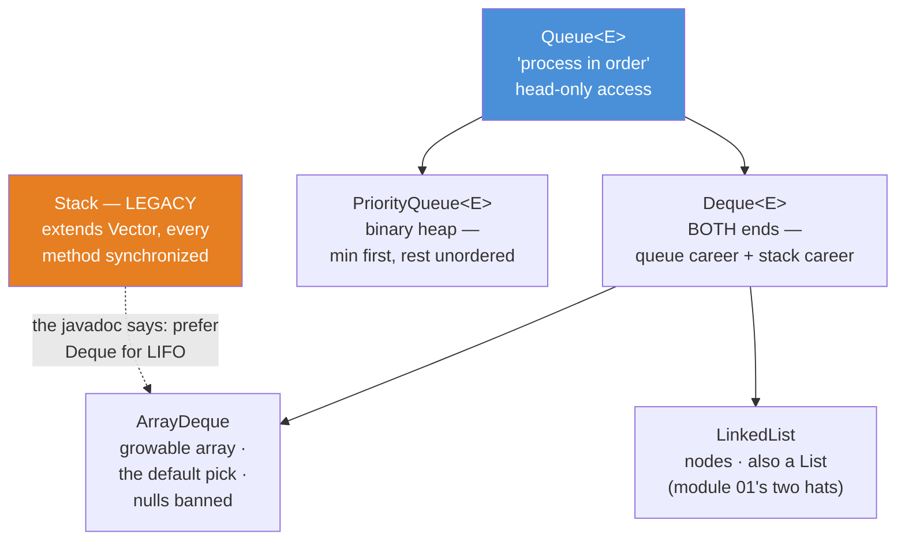
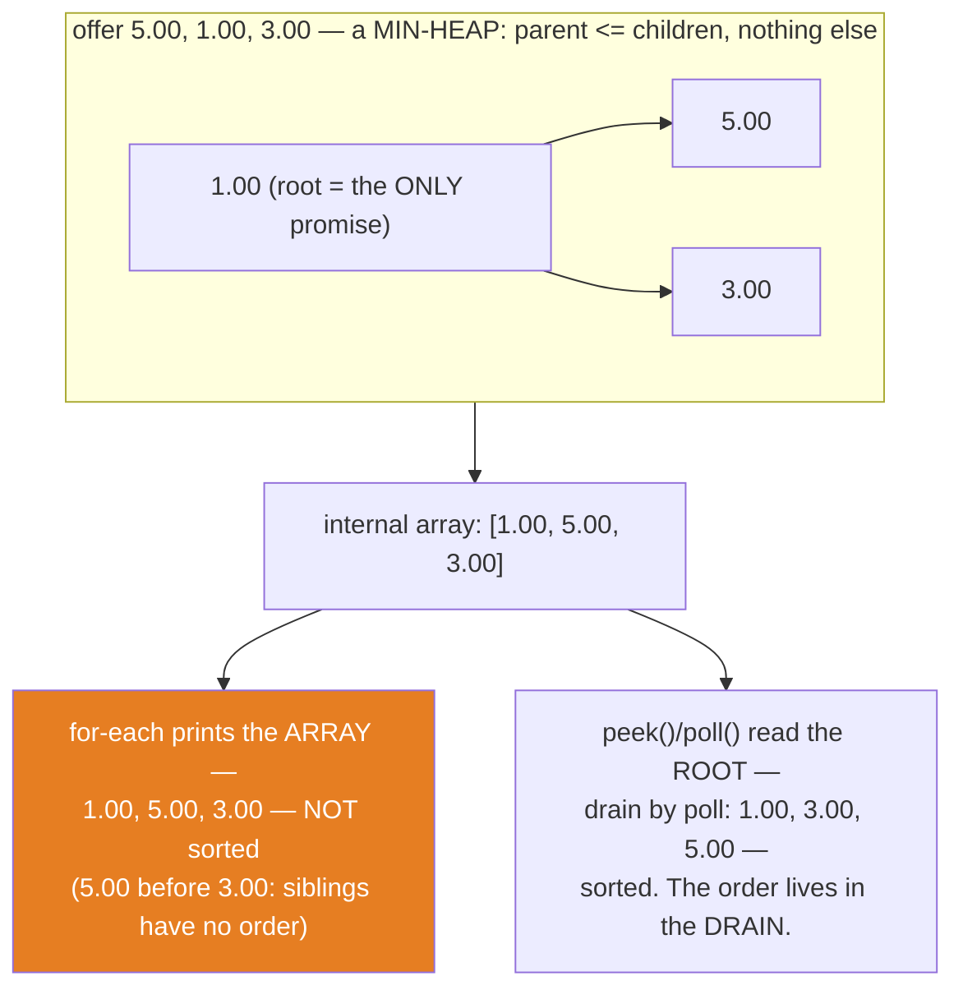
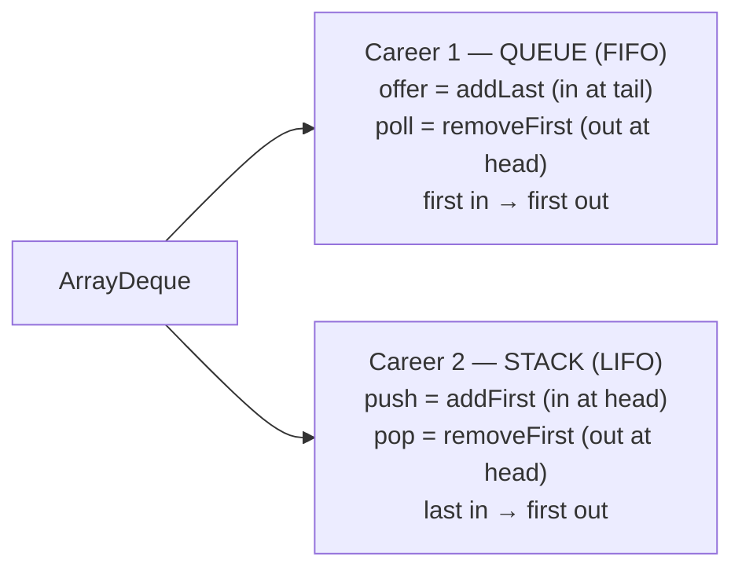

# 06 — Queue & Deque: Lines, Heaps, and Two-Ended Things

**The big idea:** a `List` promises "elements in order, reachable by index". A `Queue`
promises something narrower and more useful: **"process these in an order the container
decides."** It *takes away* `get(i)`, because you were never supposed to reach in. Two
careers live behind that idea. `Queue` is the **line at the teller**: first in, first out
(FIFO), one head you may look at and take. `Deque` ("deck", double-ended queue) adds the
other end and becomes **both** the line (`offer` at the tail, `poll` at the head) and the
undo history (`push`/`pop`, LIFO — last in, first out). Sitting beside them,
`PriorityQueue` breaks the line on purpose. It is a **binary heap** — a tree packed into
an array where every parent is <= its children — so it always hands you the minimum next,
and *never* promises the rest is in order. Every operation in this family comes in **two
API flavors** (throw vs special-value), and that duality has one famous consequence:
`null` is the "empty" signal, so these containers **ban null elements**.

Domain for the module: SecureBank's `Transaction` (id, description, `BigDecimal` amount,
`long` timestampMillis), `Comparable` and `equals`/`hashCode` **by id** — duplicated per
module on purpose. `sampleStatement()` is the FIFO arrival line; `sampleFees()` is a
chosen insertion sequence whose heap layout proves the PriorityQueue trap. Compiles with
`--release 8`, classic idiom throughout (anonymous `Comparator`, explicit loops).

## The family — one interface, two careers, one heap

**Read the diagram:**
- Top (blue): `Queue<E>` — "process in order", head-only access. Its subinterface
  `Deque<E>` adds the other end: one interface, two careers (queue + stack).
- `PriorityQueue<E>` is a `Queue` on a binary-heap engine: min first, rest unordered.
- The implementations: `ArrayDeque` (growable array, the default pick, nulls banned) and
  `LinkedList` (nodes; also a `List` — module 01's two hats).
- Orange box: `Stack` is LEGACY — it extends `Vector`, every method synchronized. The
  dashed arrow is the javadoc's own advice: prefer a `Deque` (here `ArrayDeque`) for LIFO.

## The two API flavors — the table to photograph

| operation | **throws** on failure | **special value** on failure | the special value |
|---|---|---|---|
| insert | `add(e)` | `offer(e)` | `false` — only if it doesn't fit (never on unbounded `ArrayDeque`) |
| remove head | `remove()` | `poll()` | `null` when empty |
| inspect head | `element()` | `peek()` | `null` when empty |

`Deque` doubles the table: every verb exists at both ends (`addFirst`/`offerFirst`/
`removeFirst`/`pollFirst`/`getFirst`/`peekFirst`, and the `…Last` mirror), plus
`push` = `addFirst` and `pop` = `removeFirst` for the stack career. **Prefer the
special-value flavor**: an empty queue is a normal state, not an error — `while
((x = q.poll()) != null)` beats try/catch as control flow. And because `null` now MEANS
"empty", it can never be an element: `offer(null)` → `NullPointerException`.

## PriorityQueue — the heap that lies to for-each

**Read the diagram:**
- Top: offering 5.00, 1.00, 3.00 builds a MIN-HEAP — every parent <= its children. The
  root (1.00) is the ONLY positional promise; siblings 5.00 and 3.00 have no order between them.
- Middle: that heap is stored as a plain array: `[1.00, 5.00, 3.00]`.
- Bottom-left (orange): for-each prints the ARRAY — 1.00, 5.00, 3.00 — NOT sorted.
- Bottom-right: `peek()`/`poll()` read the ROOT — draining by `poll` gives 1.00, 3.00,
  5.00, sorted. The order lives in the DRAIN.

Costs: `offer`/`poll` are O(log n) (sift up / sift down), `peek` is O(1), but
`contains`/`remove(Object)` are **O(n)** — a heap knows its top, not an index.

**Walkthrough — what happens when `poll()` runs on a `PriorityQueue`:**
1. The root (the minimum) is saved as the return value.
2. The array's LAST element moves into the root — the hole is now at the top.
3. Sift down: while that element is greater than one of its children, swap it with the
   smaller child.
4. When parent <= children holds again, the heap is repaired — O(log n) in total.
5. Every `poll()` repeats this, which is why the drain comes out fully sorted.

**In one sentence:** a PriorityQueue promises only that the *next* element is the minimum
— the sorted order lives in the drain, never in the storage.

## Deque — one class, two careers

## The traps, all printed as evidence in the demos

- **A PriorityQueue is NOT sorted** — for-each walks the internal heap ARRAY, so the fee
  demo prints amounts in heap layout (`12.50` before `8.00`), not ascending. The sorted
  order exists only in the **drain**: `poll()` gives the min every time. Printing a
  PriorityQueue and concluding "it's broken" is this module's most common bug report
  (`PriorityQueueDemo` banners 1 and 5; the test asserts contains-all, never the sequence).
- **null is the sentinel — a reserved special value that means "nothing here" — so nulls
  are banned**: `poll()`/`peek()` answer "empty" with `null`. If `null` could also be an
  element, that answer would be ambiguous. Hence `offer(null)` → NPE in `ArrayDeque` and
  `PriorityQueue` (`QueueTwoFlavorsDemo` banner 5, `DequeDemo` banner 5, asserted twice).
- **The legacy `Stack` extends `Vector`** — every operation pays a *monitor* lock (the
  monitor is the built-in lock every Java object carries; `synchronized` acquires it), and
  pays it even single-threaded. The proof is `Modifier.isSynchronized` on the public
  `Stack.pop`/`Vector.get` methods — reflection on modifiers only, never into internals.
  Callers can also legally `add(0, ...)` into the middle, breaking LIFO. The JDK's own
  `Deque` javadoc says to prefer a `Deque` for LIFO. Use `ArrayDeque`
  (`StackVsArrayDequeDemo`; modules 09/10 for what real thread safety takes).
- **`pop()` throws, `pollFirst()` returns null** — the two flavors coexist on the same
  deque; draining with `pop()` until null never terminates politely, it explodes with
  `NoSuchElementException` (`DequeDemo` banner 1 catches it on purpose).
- **Giving up `get(i)` is the POINT** — a `Queue` has no index access because reaching
  into the middle would break the ordering guarantee you picked it for. Need indexes and
  order? That's a `List` (module 02). Need "smallest next"? PriorityQueue. Need both ends?
  Deque. Interfaces document what you may do (module 01).
- **`BlockingQueue` is the teaser you came for** — a queue that can *block* on
  `put`/`take` is the backbone of every producer/consumer pipeline. Module 10 builds one
  that works; `offer(e, timeout, unit)` returning `false` (the bounded case from the
  table) finally earns its keep there.

## Class flow

1. Show the diagrams above (family first, then the two-flavors table — photograph it —
   then the heap, then the two careers).
2. Run the demos in order: `.\mvnw.cmd -pl 06-queue-and-deque compile exec:java`
   (this runs `QueueDemos`, which calls each demo `main()` in teaching order).
3. Run the tests as *proof*: `.\mvnw.cmd -pl 06-queue-and-deque test` — each test prints
   the behavior it asserts, including the deterministic failures (NoSuchElementException,
   NullPointerException) and the heap-order disclaimer.

| Demo class | What it shows |
|---|---|
| `QueueTwoFlavorsDemo` | the six methods on an empty queue — caught exceptions vs `null`/`true`; why nulls are banned |
| `FifoLineDemo` | the transaction line: `offer` at the tail, `peek` then `poll` at the head, the null-checked drain loop |
| `PriorityQueueDemo` | heap layout vs sorted drain (offer 5, 1, 3 → for-each `[1.00, 5.00, 3.00]`); natural order vs anonymous `Comparator` by amount; O(n) `contains`; the null ban |
| `DequeDemo` | undo history `push`/`pop` (LIFO); `addFirst`/`addLast`/`peekFirst`/`peekLast`; `offerFirst`/`offerLast`; ArrayDeque vs LinkedList engines; `pop()` on empty throws |
| `StackVsArrayDequeDemo` | `Stack instanceof Vector`; `add(0,…)` breaking LIFO legally; `Modifier.isSynchronized` proof; ArrayDeque as the recommended stack |

| Test | What it proves |
|---|---|
| `twoFlavorsOnEmptyQueue` | `element()`/`remove()` throw `NoSuchElementException`; `peek()`/`poll()` return `null`; `offer()` returns `true` (unbounded) |
| `fifoDrainsInOfferOrder` | the statement line drains in exact arrival order; past the end, `null` |
| `priorityQueueDrainsSortedButIteratesHeapOrder` | `peek` = min; drain by `poll` = sorted; iteration = same multiset, order NOT asserted |
| `priorityQueueUsesComparatorWhenGiven` | fees drain cheapest-first (`T-2004, T-2002, T-2001, T-2003`), by amount not by id |
| `dequePushPopIsLifo` | undo history pops in reverse push order; `pop()` on empty throws |
| `nullIsBannedAsAnElement` | `add(null)`, `offerFirst(null)`, `offer(null)` → `NullPointerException` — the sentinel rule |
| `stackIsLegacyVector` | `Stack instanceof Vector`, `add(0,…)` legal; `ArrayDeque` is not a `Vector` |

## Where this leads

Module 07 sorts the `List`s you *didn't* pick when you picked a queue (`Collections.sort`,
`binarySearch`, and the view wrappers); module 08 puts `ArrayDeque` and `PriorityQueue` in
the Big-O decision table next to everything from modules 02–05; modules 09 and 10 take the
`Stack`-vs-`ArrayDeque` synchronization argument seriously — `BlockingQueue`,
`ConcurrentLinkedDeque`, and a working producer/consumer. The anonymous `Comparator` in
`PriorityQueueDemo` is straight out of `core-java/10-comparable-comparator` (natural order
vs custom order), and its lambda form waits in `java8-features/01-lambdas`; the drain loops
here are exactly what `java8-features/04-streams-fundamentals` would rewrite — and exactly
what module 10 hands to worker threads.
