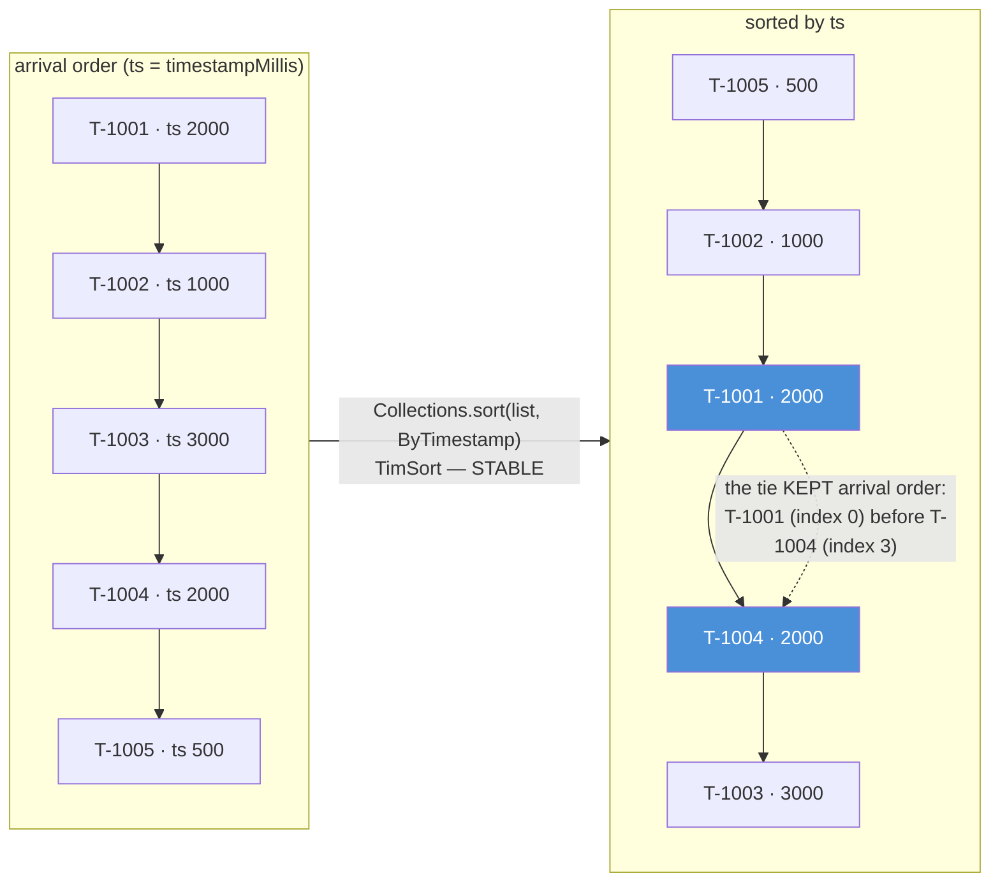
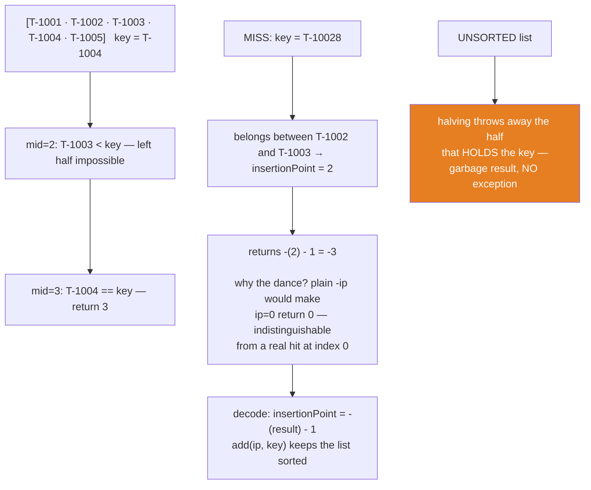
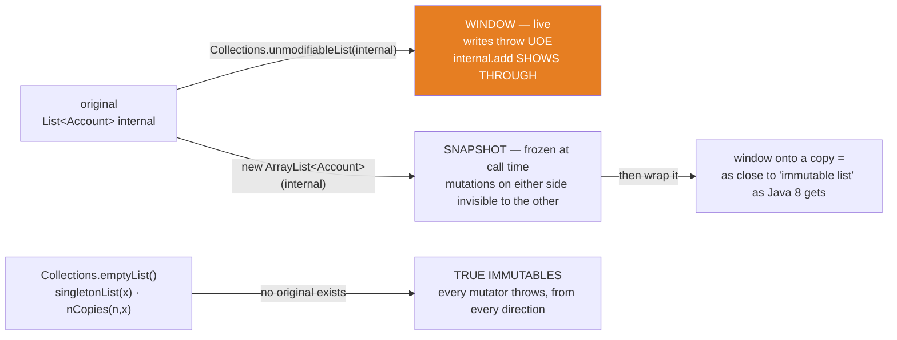

# 07 — Sorting & the Collections Toolbox

**The big idea:** `java.util.Collections` is a class of **static verbs for everybody's
containers** — `sort`, `binarySearch`, `shuffle`, `min`/`max`/`frequency`/`disjoint`,
`reverse`, and the wrapper factories. Two of those verbs carry the module's weight.
`sort` delegates to the list's own `sort` and runs **TimSort**, which is **stable**: when
the comparator says "tie", arrival order survives. That is where the free multi-key sort
comes from — sorting by day AFTER sorting by id produces "by day, then by id within each
day". `binarySearch` is the O(log n) halving search. Its contract has a price: **the list
must be sorted first**. And its miss is not an error but a *number*:
`-(insertionPoint) - 1` — an encoding that tells you exactly where the key belongs. Then
the trap that gives this module its second name: `unmodifiableList` is a **live window,
not a copy** — writes through it throw, but anyone holding the original mutates your
"read-only" data in plain sight.

Domain for the module: SecureBank's `Transaction` (id, description, `BigDecimal` amount,
`long` timestampMillis — `Comparable` and `equals`/`hashCode` by id), whose
`sampleStatement()` is chosen with a **timestamp tie** (T-1001 and T-1004 both at
ts=2000) because stability is only observable where elements tie; plus `Account` with
`sampleAccounts()` for the wrapper demos. Comparable vs Comparator and the subtraction
trap are NOT re-taught here — that is `core-java/10-comparable-comparator`; every custom
order below is an anonymous `Comparator` using `Long.compare` (its lambda form waits in
`java8-features/01-lambdas`). Compiles with `--release 8`, classic idiom throughout.

## Stable sort — the tie you can watch survive

**Read the diagram:**
- Top row: the arrival order, with timestamps — T-1001 and T-1004 BOTH have ts 2000, the
  deliberate tie this module watches.
- The arrow: `Collections.sort(list, ByTimestamp)` — TimSort, which is STABLE.
- Bottom row: sorted by ts. The two blue boxes are the tied pair — T-1001 (arrival index 0)
  is still before T-1004 (arrival index 3). The dashed arrow marks the tie that kept
  arrival order.

## binarySearch — halving, and the two ways it answers

**Read the diagram:**
- Left column, a HIT: searching for T-1004. At mid=2, T-1003 < key — the left half cannot
  hold it, so that half is thrown away. At mid=3, T-1004 == key — return 3.
- Middle column, a MISS: T-10028 belongs between T-1002 and T-1003, so insertionPoint = 2
  and the call returns -(2) - 1 = -3. Why the dance? A plain -ip would make ip=0 return 0
  — indistinguishable from a real hit at index 0. Decode with insertionPoint = -(result) - 1;
  then `add(ip, key)` keeps the list sorted.
- Right column (orange), the trap: on an UNSORTED list, halving can throw away the half
  that HOLDS the key — garbage result, NO exception.

**Walkthrough — what happens when you call `binarySearch(list, key)`:**
1. Precondition: the list is sorted by the same order the search uses — else the answer is
   garbage with no warning (right column above).
2. Compare the key with the MIDDLE element: equal → return that index; done.
3. Middle < key → the key can only be in the RIGHT half; repeat step 2 on that half.
4. Middle > key → the key can only be in the LEFT half; repeat step 2 on that half.
5. A half turns empty → the key is absent: return `-(insertionPoint) - 1`, where
   insertionPoint is the index where the key would keep the list sorted.

**In one sentence:** `binarySearch` trades one hard precondition (a sorted list) for
O(log n) speed, reports a hit as the index and a miss as the encoded insertion point —
and on an unsorted list reports confident garbage.

## Wrappers — window vs snapshot vs frozen

**Read the diagram:**
- Top path, WINDOW (orange): `unmodifiableList(internal)` wraps the LIVE list. Writes
  through the wrapper throw `UnsupportedOperationException` (UOE), but `internal.add`
  shows right THROUGH — the wrapper forwards every read to the same storage.
- Middle path, SNAPSHOT: `new ArrayList<Account>(internal)` copies — frozen at call time;
  later mutations on either side are invisible to the other.
- Bottom path: wrap the COPY and you get a frozen window — as close to an "immutable
  list" as Java 8 gets.
- Last row: `emptyList()`, `singletonList(x)`, `nCopies(n,x)` have no original at all —
  TRUE IMMUTABLES, where every mutator throws from every direction.

## The Collections toolbox — the table to photograph

| call | what it does | the fine print |
|---|---|---|
| `sort(list)` | sorts by natural order (`compareTo`, core-java 10) | delegates to `list.sort(null)`; TimSort; **stable** |
| `sort(list, c)` | sorts by your `Comparator` | ties keep arrival order — sort minor key first, major second |
| `binarySearch(list, key)` | O(log n) search | **list must be sorted first** — else garbage, silently; miss = `-(ip)-1` |
| `reverse(list)` | flips end-for-end, mutates | no comparisons at all |
| `reverseOrder()` | a **Comparator** that inverts | different tool from `reverse` — back-ref core-java 10 |
| `shuffle(list, new Random(42))` | random permutation | seeded = reproducible (this course always seeds) |
| `min` / `max(list[, c])` | one O(n) scan | right tool for a one-off question; `TreeSet` for repeated ones |
| `frequency(list, o)` | counts by **equals()** | absent = 0, never an error |
| `disjoint(a, b)` | no shared element? | `true` = nothing in common |
| `unmodifiableList/Set/Map(c)` | read-only **VIEW** | writes throw UOE; **original changes show through** |
| `emptyList()` / `singletonList(x)` / `nCopies(n,x)` | true immutables | every mutator throws; `nCopies` = ONE instance n times |
| `synchronizedList(list)` | locked view | teaser only — module 09 owns the conversation |

## The traps, all printed as evidence in the demos

- **`unmodifiableList` is a WINDOW, not a copy** — `readOnly.add(...)` throws
  `UnsupportedOperationException`, yet `internal.add(...)` makes `readOnly.size()` grow:
  the wrapper forwards reads to the *same* list. "Unmodifiable" describes the view, never
  the data. Snapshot fix: wrap a COPY — `unmodifiableList(new ArrayList<Account>(internal))`
  (`UnmodifiableIsAViewDemo` banners 2–3, asserted both ways). Module 08 turns this into
  the three-getter encapsulation lesson.
- **`binarySearch` on an unsorted list is silent garbage** — no exception, no warning:
  the halving discards the half that holds the key. The demo's chosen list reports
  `T-1003` (index 4) as "not found" and decodes insertion point 5 for the element at
  index 0 (`BinarySearchDemo` banner 3, asserted exactly). Sort first — by the SAME order
  the search uses.
- **The miss encoding is a feature** — `-(insertionPoint)-1` is negative always (a hit at
  index 0 returns 0; a plain `-ip` couldn't tell those apart), and it decodes to where the
  key BELONGS: `list.add(ip, key)` keeps the list sorted. The test verifies the formula
  against a manual scan, then proves the insert.
- **Stability is invisible until something ties** — that is why `sampleStatement()` gives
  T-1001 and T-1004 the same ts=2000: after sorting by timestamp, T-1001 (arrival index 0)
  is still before T-1004 (arrival index 3). Unstable sorts may swap them; TimSort never
  does. Consequence: sort by the minor key first, then the major key — free multi-key sort.
- **`reverse(list)` vs `reverseOrder()`** — one MUTATES end-for-end (no comparisons), the
  other is a **Comparator** you can hand to any sort or `TreeMap`. Same result only on an
  already-sorted list (`StableSortDemo` banner 3; back-ref core-java 10).
- **`singletonList`'s only slot cannot even be `set`** — and `nCopies(3, x)` holds the
  SAME instance three times (`get(0) == get(2)`): immutable elements hide it, mutable ones
  make "changing one" change all (`ImmutableHelpersDemo`, asserted).
- **Unseeded `shuffle` is untestable** — `Collections.shuffle(list)` builds a fresh random
  number generator per call: a different permutation every run. Fine for card games, fatal
  for proof; this course always passes `new Random(42)` (`ShuffleAndGamesDemo` banner 1).

## Class flow

1. Show the diagrams above (stability first — the tie survives; then binarySearch's two
   answers; then window vs snapshot vs frozen).
2. Run the demos in order: `.\mvnw.cmd -pl 07-sorting-and-collections-utility compile exec:java`
   (this runs `SortingUtilityDemos`, which calls each demo `main()` in teaching order).
3. Run the tests as *proof*: `.\mvnw.cmd -pl 07-sorting-and-collections-utility test` — each
   test prints the behavior it asserts, including the deterministic failures (UOE) and the
   silent garbage (unsorted binarySearch).

| Demo class | What it shows |
|---|---|
| `StableSortDemo` | natural order vs anonymous `Comparator`; the ts=2000 tie keeping arrival order; `reverseOrder()` vs `reverse(list)` |
| `BinarySearchDemo` | found → index; miss → `-(ip)-1` decoded by hand and verified by inserting; unsorted → silent garbage; the `Arrays` toolbox (sort/binarySearch/toString/equals/copyOf/fill) |
| `ShuffleAndGamesDemo` | seeded `Random(42)` shuffle replaying identically; `min`/`max` (natural + by timestamp); `frequency` by equals; `disjoint` both ways |
| `UnmodifiableIsAViewDemo` | wrapper writes throw; `internal.add` shows THROUGH the wrapper; the copy-then-wrap snapshot fix; `unmodifiableSet/Map`; the `synchronizedList` teaser |
| `ImmutableHelpersDemo` | `emptyList`/`singletonList`/`nCopies`: true immutables; `nCopies` holds one instance n times; the leak/snapshot/window/frozen taxonomy |

| Test | What it proves |
|---|---|
| `sortIsStableOnTies` | natural order exact; by-timestamp order exact — T-1001 before T-1004 on the tie |
| `binarySearchFindsExactIndex` | index 3 for T-1004; index 0 for T-1001 is a HIT, not a miss |
| `missEncodingIsInsertionPointMinusOne` | result = `-(ip)-1` against a manual scan (ip=2, result=-3); inserting there keeps the list sorted |
| `binarySearchOnUnsortedIsSilentGarbage` | -1 for a present element; -6 (ip=5) for the element at index 0 — no exception |
| `seededShuffleIsReproduciblePermutation` | two `Random(42)` shuffles identical; result is a pure rearrangement (same multiset) |
| `unmodifiableIsALiveWindowNotACopy` | `add`/`remove` throw; parent mutation visible through the wrapper; copy-then-wrap freezes |
| `immutableHelpersAreFrozen` | `emptyList.add`, `singletonList.set`, `nCopies.set` throw; `nCopies` slots are `==` the same instance |
| `gamesGiveExactAnswers` | `min`/`max` exact (by id and by timestamp); `frequency`=3 and 0; `disjoint` true and false |

## Where this leads

Module 08 collects every container from modules 02–07 into the Big-O decision table — and
reuses the window-vs-snapshot distinction as the three-getter encapsulation lesson.
Module 09 takes `synchronizedList` seriously (what the lock does and does not buy, and why
fail-fast iterators throw anyway); module 04's `TreeSet`/module 05's `TreeMap` are the
"sorted all the time" answer to the one-off `sort`/`binarySearch` here. The comparators
come from `core-java/10-comparable-comparator` (this module is its harvest), the lambda
forms from `java8-features/01-lambdas`, and the hand-rolled scan-and-count loops from
`frequency`/`min`/`max` are exactly what `java8-features/04-streams-fundamentals` deletes
next.
