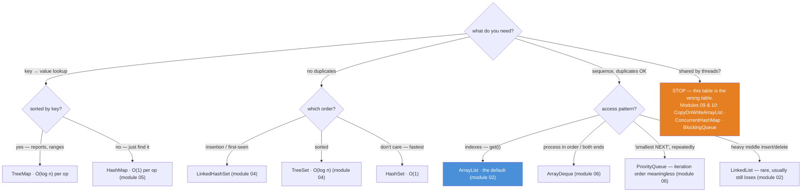
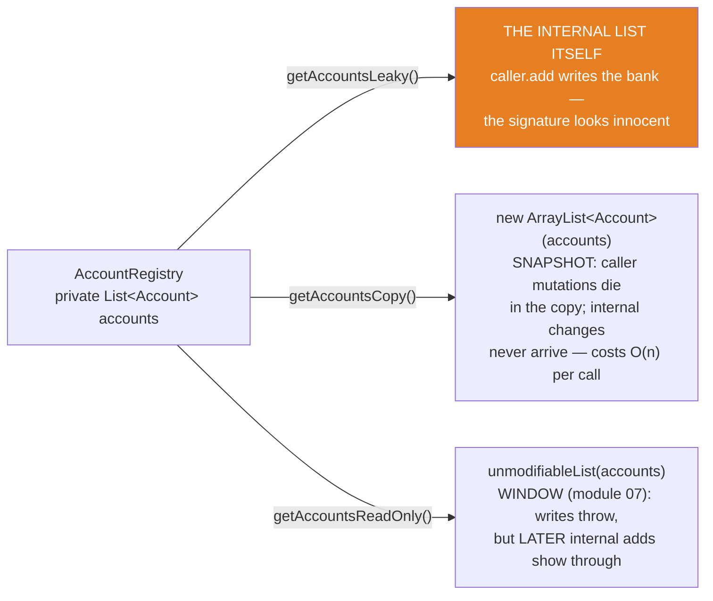

# 08 — Choosing the Right Collection: the Big-O Decision Table

**The big idea:** by now every container in `java.util` has had its module. The question
is no longer "what does a `TreeSet` do?" but **"which one do I need, and what does it
cost?"** This module compresses the whole course into two artifacts you will actually use
at a whiteboard: a **Big-O cheat sheet** (nine rows: what each container charges for
lookup, contains, add, remove — and what order it iterates in) and a **decision
flowchart** (four questions: key→value? duplicates? indexes? sortedness? — then one
escape hatch: shared by threads?). The method: pick the **interface by the guarantee you
owe**, pick the **implementation by the access pattern you have** (module 01's design
rule, cashed in). Around the table sit the traps that the table cannot encode:

- the **legacy corner** — `Vector`/`Hashtable`/`Stack`/`Enumeration`: why they survive,
  and why not to start with them;
- the **boxing traps** — *boxing* is the automatic wrapping of a primitive `int` in its
  object form, `Integer`. The `Integer` cache makes `==` work at 127 and fail at 128, and
  `remove(int)` deletes the slot while `remove(Integer)` deletes the value;
- **capacity hints** — the cheapest performance win in Java;
- **encapsulation** — three getters for one internal list, three different contracts, one
  of them a bug.

Domain for the module: SecureBank's `Account` (id, owner, `BigDecimal` balance —
`equals`/`hashCode` by id) and `Transaction` (id, description, `BigDecimal` amount, `long`
timestampMillis — `Comparable` by id), plus `AccountRegistry`: one private
`List<Account>`, three getters, the subject of the encapsulation lesson. Duplicated per
module on purpose. Compiles with `--release 8`, classic idiom throughout (anonymous
`Comparator`, explicit loops).

## The decision flowchart — four questions and one escape hatch

**Read the diagram:**
- Start at the top question — what do you need? Each branch narrows with one follow-up
  question (a diamond); every leaf names a class and its cost.
- "key → value lookup" → sorted by key? Yes (reports, ranges) → `TreeMap`, O(log n). No
  (just find it) → `HashMap`, O(1).
- "no duplicates" → which order? Insertion/first-seen → `LinkedHashSet`. Sorted →
  `TreeSet`. Don't care, fastest → `HashSet`.
- "sequence, duplicates OK" → access pattern? Indexes → `ArrayList` (blue: the default).
  Process in order / both ends → `ArrayDeque`. "Smallest NEXT", repeatedly →
  `PriorityQueue` (its iteration order is meaningless). Heavy middle insert/delete →
  `LinkedList` — rare, and it usually still loses.
- The escape hatch (orange): "shared by threads?" → STOP. This is the wrong table; modules
  09 and 10 own that world.

## The Big-O cheat sheet — THE table to photograph

| class | lookup / get | contains | add | remove | iteration order |
|---|---|---|---|---|---|
| `ArrayList` | `get(i)` **O(1)** | O(n) | **O(1)\*** at the tail | O(n) in the middle | insertion |
| `LinkedList` | `get(i)` O(n) | O(n) | O(1) at the ends | O(n) to find the node, then O(1) to unlink | insertion |
| `ArrayDeque` | peek at either end, O(1) | O(n) | **O(1)\*** at the ends | **O(1)** at the ends | FIFO / LIFO (06) |
| `PriorityQueue` | `peek()` O(1) | O(n) | O(log n) | `poll` O(log n) / `remove(obj)` O(n) | **NONE — heap order** (06) |
| `HashSet` | — no `get(i)` | **O(1)** | O(1) | O(1) | unspecified (04) |
| `LinkedHashSet` | — no `get(i)` | **O(1)** | O(1) | O(1) | insertion (04) |
| `TreeSet` | floor/ceiling O(log n) | O(log n) | O(log n) | O(log n) | **sorted** (04) |
| `HashMap` | `get(key)` **O(1)** | `containsKey` O(1) | `put` O(1) | O(1) | unspecified (05) |
| `TreeMap` | `get(key)` O(log n) | `containsKey` O(log n) | `put` O(log n) | O(log n) | **sorted by key** (05) |

\* amortized — usually O(1); one grow-and-copy every so often keeps the average constant.
Read the table by your **hottest operation**: `contains` in a loop rules out the O(n) rows
(`EmpiricalContainsDemo` times that mistake on 100,000 elements). And the last column is a
guarantee you choose like any other — "unspecified" means the order may differ between runs.

**In one sentence:** pick the interface by the guarantee you owe, the implementation by
your hottest operation — and if threads share it, stop and turn to modules 09–10.

## Encapsulation — one internal list, three getters

**Read the diagram:**
- Center: `AccountRegistry` with one private `List<Account>`.
- Top path (orange), THE LEAK: `getAccountsLeaky()` returns the internal list itself —
  `caller.add` writes the bank's state, while the signature looks innocent.
- Middle path, THE COPY: `getAccountsCopy()` returns `new ArrayList<Account>(accounts)` —
  caller mutations die in the copy, and internal changes never arrive; it costs O(n) per call.
- Bottom path, THE WINDOW: `getAccountsReadOnly()` returns `unmodifiableList(accounts)` —
  writes through it throw, but LATER internal adds show through (module 07).

Reports want the snapshot (freeze the world while rendering), live dashboards want the
window (and must tolerate motion), and the leak is a bug, not an option.

## The traps, all printed as evidence in the demos

- **The `Integer` cache makes `==` a time bomb** — `Integer.valueOf(127) ==
  Integer.valueOf(127)` is `true` (shared cached object; cache = −128..127) while
  `Integer.valueOf(128) == Integer.valueOf(128)` is `false` (two objects, equal values).
  Every small-number test passes; the first balance over 127 fails. Never compare boxed
  values with `==` — unbox or use `equals()` (`BoxingAndIdentityDemo`; core-java 02,
  asserted in `integerCacheIdentityTrap`).
- **`List<Integer>.remove(0)` removes the SLOT** — the `int` literal binds to
  `remove(int index)`; removing the *value* 0 needs `remove(Integer.valueOf(0))`. The
  compiler picks by static type and never warns (`BoxingAndIdentityDemo`, asserted).
- **Unboxing a map miss is an NPE at the wrong line** — `int x = map.get("absent")`
  dereferences `null`; the stack trace blames the assignment, not the missing key.
  Receive into `Integer`, or check `containsKey` (module 05).
- **The legacy corner charges a lock you never ordered** — `Vector.get`/`add(E)` are
  `synchronized` (proven by `Modifier.isSynchronized` on the public methods — reflection
  on flags only, never into internals). `Hashtable` adds a **null ban**: NPE on null keys
  *and* values, where `HashMap` accepts both. `Stack` inherits all of it plus `get(i)`
  side doors (module 06). `Enumeration` has no `remove()` (module 03). They survive
  because decades of APIs still return them — swap table printed in `LegacyCornerDemo`.
- **Raw types unbuckle the seatbelt** — a raw `List` accepts anything and the
  `ClassCastException` arrives at the cast, at runtime (same lesson shape as module 01's
  covariant arrays). The `unchecked` warning is the compiler begging you to put the type
  argument back (`LegacyCornerDemo` banner 5).
- **`return accounts;` is the leak** — the internal list itself walks out the door and
  the caller's `add()` writes the bank's state. Defensive copy
  (`new ArrayList<Account>(internal)`) severs the wire both ways; `unmodifiableList`
  only throws on writes *through the wrapper* — internal changes still show through
  (`EncapsulationDemo`, all three asserted in `defensiveCopyVsWindowVsLeak`).
- **Default capacities waste the O(1)** — `ArrayList` starts at 10 and grows by copying
  (module 02); `HashMap` starts at 16 buckets and rehashes everything at load factor 0.75
  (module 05). If you know the size, pass it: `new ArrayList<Integer>(expectedSize)`,
  `new HashMap<K,V>((int)(expected / 0.75f) + 1)`.
- **Timings are demo material, never test material** — `EmpiricalContainsDemo` prints
  milliseconds with the caveat attached: absolute numbers are your machine's, the RATIO
  (three orders of magnitude and growing with n) is the claim. No test in this course
  asserts a timing.

## Class flow

1. Show the flowchart first (the four questions), then the Big-O table — photograph it —
   then the three-getter diagram.
2. Run the demos in order: `.\mvnw.cmd -pl 08-choosing-the-right-collection compile exec:java`
   (this runs `ChoosingDemos`, which calls each demo `main()` in teaching order).
3. Run the tests as *proof*: `.\mvnw.cmd -pl 08-choosing-the-right-collection test` — each
   test prints the behavior it asserts, including the deterministic failures (NPE, CCE,
   UnsupportedOperationException) and the reflection evidence.

| Demo class | What it shows |
|---|---|
| `BigOCheatSheetDemo` | the nine-row table printed as text; how to read it by hottest operation; capacity hints for `ArrayList`/`HashMap` |
| `DecisionFlowchartDemo` | the flowchart as text, then five SecureBank scenarios walked through it: statement lines → `ArrayList`, unique customer ids → `LinkedHashSet`, id→Account → `HashMap`, task line → `ArrayDeque`, cheapest fee first → `PriorityQueue` — each with the reason and a live proof; closes with the threads question → modules 09/10 |
| `LegacyCornerDemo` | `Vector`'s lock tax via `Modifier.isSynchronized` (including the honest `add(int,E)` delegation nuance); `Hashtable`'s null ban vs `HashMap`; `Stack instanceof Vector`; `Enumeration` with no `remove()`; raw-type `ClassCastException`; the swap table |
| `BoxingAndIdentityDemo` | the cache at the 127/128 boundary; `remove(0)` vs `remove(Integer.valueOf(20))`; the unboxed map-miss NPE |
| `EncapsulationDemo` | `AccountRegistry`'s three getters: the leak mutates the bank, the copy severs both wires, the window throws yet grows — taxonomy printed |
| `EmpiricalContainsDemo` | `contains` on 100k elements, `ArrayList` vs `HashSet`, timed with `System.nanoTime` after JIT warmup, ratio printed, caveat printed — demos time, tests never do |

| Test | What it proves |
|---|---|
| `vectorIsSynchronizedArrayListIsNot` | `Modifier.isSynchronized`: `Vector.get/add(E)/insertElementAt` true, `ArrayList.get/add` false, `add(int,E)` delegates |
| `hashtableBansNullsHashMapAllowsThem` | NPE on null key AND null value in `Hashtable`; both legal in `HashMap`, plus the `get()==null` ambiguity |
| `integerCacheIdentityTrap` | `valueOf(127)` same instance, `valueOf(128)` different instances, `equals` true for both; cache bounds −128..127 |
| `removeOverloadsOnListOfInteger` | `remove(0)` returns the slot-0 value; `remove(Integer.valueOf(0))` removes the value 0 |
| `defensiveCopyVsWindowVsLeak` | leaky getter mutates the registry; copy mutations die; window throws on `add` yet shows later internal adds |
| `scenarioPicksBehaveAsPromised` | `LinkedHashSet` keeps first-seen order exactly (`C-07, C-03, C-11`); `HashMap` finds Bo by id and a stranger `Account` key by equals-by-id |

## Where this leads

Modules 09 and 10 answer the flowchart's escape hatch: what actually happens when two
threads share an `ArrayList` (`modCount`, the fail-fast smoke detector, CME anatomy), and
the real fixes in `java.util.concurrent` (`CopyOnWriteArrayList`, `ConcurrentHashMap`,
`BlockingQueue` — where the legacy corner's swap table finally lands). Everything this
module chose gets streamed in `java8-features/04-streams-fundamentals` and collected in
`06-collectors` (`groupingBy` builds the `Map<K, List<V>>` this module picks by hand), and
the whole table is what `stage-2-monolith` services consult when they choose between a
`List`, a `Set`, and a `Map` DTO field. Looking back: module 01's "interfaces are
guarantees, classes are implementations" is the sentence that makes this table readable —
the rows are classes, but you choose between them by the guarantee columns.
