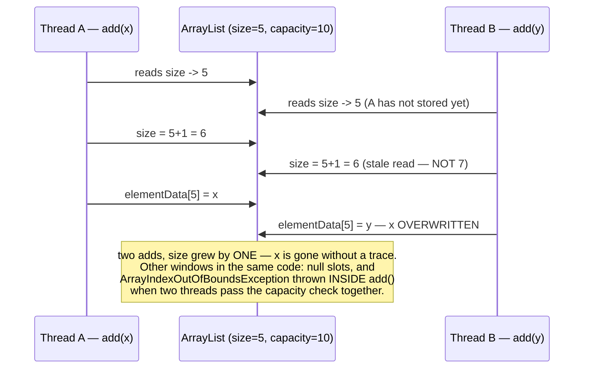
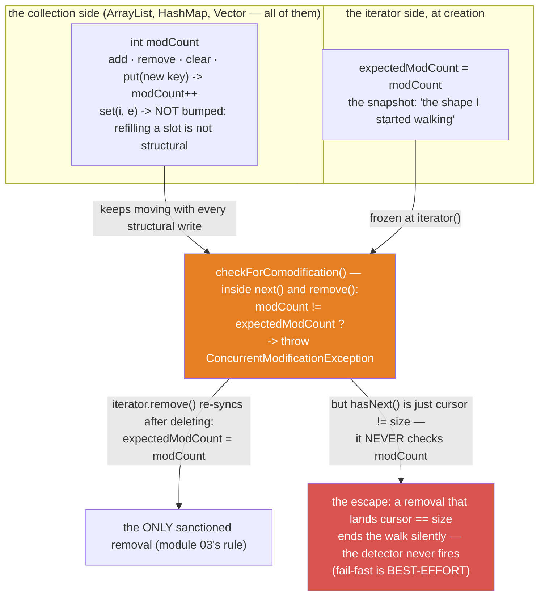
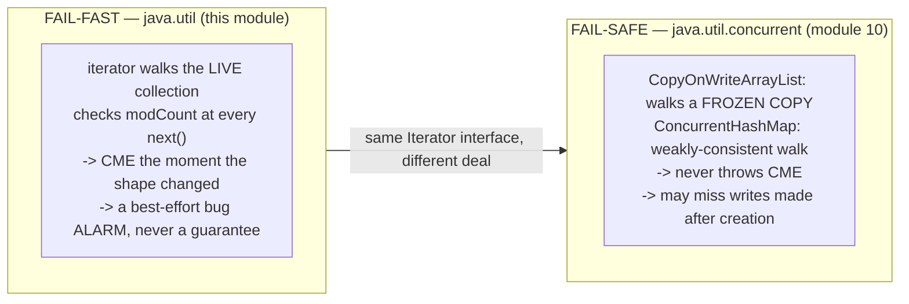
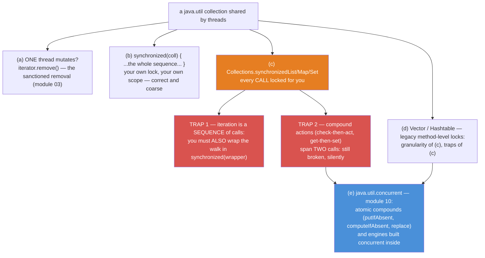

# 09 — Thread Safety & Fail-Fast: Anatomy of a ConcurrentModificationException

**The big idea:** `java.util` collections are **not synchronized — by design**, not by
oversight. A lock on every `add()` would tax the overwhelming majority of collections that
are never shared between threads. And only the caller knows the lock scope a *sequence* of
operations needs (a bank transfer touches TWO accounts under ONE lock). So the framework
hands the choice to you. Sharing a plain collection across threads fails in exactly
**two ways**:

1. **Corrupted state** — concurrent structural writes interleave inside `add()`/`put()`:
   lost updates, null slots, even exceptions thrown from *inside* the collection.
2. **`ConcurrentModificationException`** — the fail-fast smoke detector, driven by one
   `int`. Every **structural** change — one that changes the collection's *shape*: `add`,
   `remove`, `clear` (refilling a slot with `set(i, e)` is not one) — bumps the
   collection's `modCount`, its shape-change counter. Every iterator copies `modCount`
   into `expectedModCount` at birth. `next()` and `remove()` compare the two and throw
   `ConcurrentModificationException` on a mismatch.

Module 03 taught the CME *rule*; this module opens the *machine*. And the trap that eats
everyone: the `Collections.synchronizedX` wrappers lock **calls**, not **sequences**. A
*compound action* — also called *check-then-act*: two calls that must succeed as one unit,
where you first CHECK a fact, then ACT on it — stays broken, because another thread can
change the fact between your check and your act. Iteration is the same story: it is a
sequence of calls. Both stay broken until YOU hold one lock around the whole thing...
which is exactly the price module 10's engines were built to remove.

Domain for the module: SecureBank's `Account` (id, owner, `BigDecimal` balance) and
`Transaction` (id, description, `BigDecimal` amount, `long` timestampMillis) — equals/
hashCode **by id** (`core-java` 08: every `containsKey` here runs on that contract) and
`Transaction` is `Comparable` by id (`core-java` 10). Compiles with `--release 8`, classic
idiom throughout: anonymous `Runnable`s, explicit type arguments, no lambdas outside the
tests (`java8-features` 01 shortens every one of them).

**Determinism is the design rule of this module.** Every demo and test produces the same
VERDICT every run: races are choreographed with `CountDownLatch` *start guns* — a latch
that holds every thread at the same starting line and releases them all at once, so the
race genuinely overlaps — and `join()`ed before anything is counted; exact numbers are
asserted ONLY where a lock guarantees them
(wrappers, `Vector`); the plain-list race asserts the safe direction (`size <= expected`)
and PRINTS the observed loss; and the compound-action bugs are **scripted** — the doomed
interleaving is played step by step on one thread instead of racing real threads and
hoping. A test that races and hopes is flaky; a test that scripts the interleaving is a
proof.

## Failure mode #1 — the race, one `int` wide

**Read the diagram:** read the arrows top to bottom as time.
- Thread A and thread B run `add` on one plain `ArrayList` (size=5, capacity=10) at the
  same moment: A reads `size` → 5, and B reads `size` → 5 too — stale, because A has not
  stored yet. Both write size = 6 — not 7 — then both store at `elementData[5]`, so y
  overwrites x. One increment and one element are lost.
- The note is the verdict: two adds, size grew by ONE. Other windows in the same code
  produce null slots, or an `ArrayIndexOutOfBoundsException` thrown INSIDE `add()` when
  two threads pass the capacity check together.

`ArrayList.add` is three steps — capacity check, store element, bump `size` — and none of
them know the others exist. `RaceCorruptionDemo` fires 4 threads x 25,000 adds through a
start gun at one plain `ArrayList` and prints the aftermath (a recent run: 27,007 adds
lost, 87 null slots, zero exceptions — silent corruption), then runs the **same race**
through `Collections.synchronizedList`: **exactly 100,000, every run** — a promise, not a
measurement.

## Failure mode #2 — the modCount machinery

**Read the diagram:**
- Top box: every collection carries one `int modCount`. `add`, `remove`, `clear`,
  `put(new key)` bump it; `set(i, e)` does NOT — refilling a slot is not structural.
- Second box: the iterator freezes a copy at creation — `expectedModCount = modCount`,
  "the shape I started walking".
- Orange box: `checkForComodification()`, inside every `next()` and `remove()`, compares
  the moving counter with the frozen snapshot: mismatch → throw CME.
- The sanctioned exit: `iterator.remove()` re-syncs after deleting
  (`expectedModCount = modCount`) — module 03's rule, now explained.
- Red box, the escape: `hasNext()` is just `cursor != size` and NEVER checks `modCount` —
  a removal that lands `cursor == size` ends the walk silently. Fail-fast is BEST-EFFORT.

**Walkthrough — what happens, mechanically, when a for-each meets a `list.remove()`:**
1. `iterator()` runs: `expectedModCount = modCount` (say 0).
2. Your loop body calls `list.remove(x)`: the shape changes, `modCount++` (now 1).
   Nothing writes that 1 back into `expectedModCount` — the iterator is not told.
3. The next `next()` calls `checkForComodification()`: 1 != 0 →
   `ConcurrentModificationException`, thrown in the very thread that removed.
4. The sanctioned version: `it.remove()` deletes the element AND re-syncs
   (`expectedModCount = modCount`), so the walk continues legally.

One `int` explains everything module 03 could only demonstrate: why `list.remove()` inside
a for-each explodes, why `iterator.remove()` doesn't, why `set()` mid-iteration is
invisible, and why CME needs **no second thread at all** — your own loop body is "someone
else" to the iterator.

**In one sentence:** one int — bumped by every structural write, snapshotted by every
iterator, compared at every `next()` — is the whole smoke detector: it reports bugs, it
never prevents them.

## Fail-fast vs fail-safe

Two words to pin down now, because module 10 is built on them. A *snapshot iterator*
walks a frozen copy taken at creation: later writes are invisible to it, and it can never
throw CME. A *weakly consistent* iterator walks the live structure: it never throws CME
either, but shows the collection's state at some point at or after its creation — it may
miss later writes.

## The fix ladder

**Read the diagram:**
- Top: the situation — a `java.util` collection shared by threads. Each branch is one
  level of fix, cheapest discipline first.
- (a) ONE thread mutates → `iterator.remove()`, the sanctioned removal (module 03).
  (b) Your OWN lock around the WHOLE sequence — `synchronized(coll) { ... }`: correct,
  and coarse.
- (c, orange) `Collections.synchronizedList/Map/Set` locks every CALL for you — and the
  two red boxes are its price: iteration is a SEQUENCE of calls, so you must ALSO wrap
  the walk in `synchronized(wrapper)` (trap 1); and compound actions span TWO calls, so
  they stay silently broken (trap 2).
- (d) `Vector`/`Hashtable`: legacy method-level locks — granularity of (c), traps of (c).
- (e, blue) the exit: `java.util.concurrent` (module 10) — atomic compounds and engines
  built concurrent inside.

**In one sentence:** wrappers lock calls, not sequences — only one lock around the whole
sequence, or module 10's engines, makes iteration and compound actions safe. That sentence
is the safety matrix below, drawn as a table.

## The safety matrix — the table to photograph

| what you do | plain `ArrayList`/`HashMap` | `Collections.synchronizedX` | `synchronized(coll)` around the WHOLE sequence | `Vector`/`Hashtable` | module 10 engines |
|---|---|---|---|---|---|
| single call, single thread | safe | safe | safe | safe | safe |
| concurrent single calls (`add`, `put`) | **BROKEN** — lost updates, null slots, throws inside `add()` | exactly correct — the lock serializes every call | exactly correct | exactly correct | exactly correct |
| iterate while someone writes | CME — *usually*; best-effort, so some slips pass silently | **CME anyway** — the wrapper locks calls, not the walk | safe — while everyone honors the lock | **CME** — Vector's iterator is fail-fast too | never CME — snapshot or weakly-consistent iterators |
| compound action (check-then-act, get-then-set) | **lost update** | **lost update** | safe — if the logic re-reads INSIDE the lock | **lost update** | ONE atomic call does check-and-act together: `putIfAbsent`, `compute`, `replace(k,old,new)` |
| what it costs | nothing extra | one GLOBAL mutex — readers queue too | your discipline: one lock scope around the whole sequence | one GLOBAL mutex | fine-grained locks / lock-free reads |

## The traps, all printed as evidence in the demos

- **The wrapper locks CALLS, not SEQUENCES** — `synchronizedMap.put()` mid-iteration
  succeeds perfectly... and the *next* `next()` throws CME anyway, because the for-each
  released the lock between calls and the keySet iterator is raw (`WrapperIsNotEnoughDemo`
  banner 2 — single-threaded, 100% reproducible).
- **The javadoc's "imperative" sentence** — "It is imperative that the user manually
  synchronize on the returned map when iterating over any of its collection views." The
  mutex to synchronize on IS the wrapper itself: `synchronized(map)` acquires the map's
  *monitor* — the built-in lock every Java object carries. Banners 3–4 prove it live: a
  second thread's puts park on that monitor until the locked walk finishes — joined, exact.
- **CME does not need a second thread** — one thread, one for-each, one `list.remove()`:
  the shape changed under a live iterator, and the iterator's own loop body counts as
  "someone else" (`ModCountAnatomyDemo` banner 2, with the stack line that names
  `checkForComodification` — the exception points at its own machinery).
- **Fail-fast detects, never prevents — and sometimes doesn't even detect** — `hasNext()`
  is `cursor != size` and never looks at `modCount`, so removing the second-to-last element
  ends the walk silently: no exception, element gone, and the next element never visited.
  The javadoc's own words: fail-fast behavior "should be used only to detect bugs". Never
  catch CME as control flow (`ModCountAnatomyDemo` banner 4).
- **The race can throw from INSIDE `add()`** — `size++` happens before the slot is written,
  so two threads slipping through the capacity check together can push `size` past the
  array end: `ArrayIndexOutOfBoundsException` from deep in `java.util`, null slots, and a
  list whose own `size` disagrees with its array (`RaceCorruptionDemo` banner 2 counts all
  three corruption marks).
- **Compound actions survive every lock granularity below "whole sequence"** — wrappers,
  `Vector`, `Hashtable` all lose the update in check-then-act and get-then-set
  (`CheckThenActDemo`: 350.00 owed, 250.00 stored; `VectorRevisitedDemo`: 180.00 owed,
  130.00 stored — both scripted interleavings, deterministic). The only single-call fixes
  are `java.util.concurrent`'s atomic compounds — module 10.
- **`set()` is not structural** — replacing a slot leaves the shape untouched, so
  `modCount` never moves and the iterator never notices. One distinction explains every
  "why did THIS loop explode but that one didn't" in the wild (`ModCountAnatomyDemo`
  banner 5).

## Class flow

1. Show the diagrams above (the race first — the pain; then the modCount machine; then
   fail-fast vs fail-safe; the ladder last — it is the module's roadmap).
2. Run the demos in order: `.\mvnw.cmd -pl 09-thread-safety-and-fail-fast compile exec:java`
   (this runs `ThreadSafetyDemos`, which calls each demo `main()` in teaching order).
3. Run the tests as *proof*: `.\mvnw.cmd -pl 09-thread-safety-and-fail-fast test` — each
   test prints the behavior it asserts, including the deterministic failures (CME,
   UnsupportedOperationException-free escapes) and the scripted lost updates.

| Demo class | What it shows |
|---|---|
| `RaceCorruptionDemo` | why `java.util` is unsynchronized by design; the start-gun race on a plain `ArrayList` (loss/nulls/throws counted, safe direction asserted); the same race through `synchronizedList` — exact every run |
| `ModCountAnatomyDemo` | the machinery narrated; for-each + `remove` -> CME with the `checkForComodification` stack line; `iterator.remove()`; the second-to-last escape; `set()` invisibility |
| `WrapperIsNotEnoughDemo` | 20,000 concurrent puts exact through the wrapper; CME THROUGH the wrapper mid-iteration; the locked walk; a live writer parking on the monitor (joined) |
| `CheckThenActDemo` | the lost update scripted step by step (containsKey/put interleaving); Fix 1 live — one lock around the sequence; Fix 2 previewed — module 10's atomic calls |
| `VectorRevisitedDemo` | Vector adds exact (joined); get-then-set loses a deposit (scripted); Vector's iterator is fail-fast too — legacy locks buy nothing new |

| Test | What it proves |
|---|---|
| `plainArrayListRaceOnlyPromisesTheSafeDirection` | `size <= expected` always; the loss is printed (machine-dependent), never asserted |
| `synchronizedListRaceIsExact` | the same race, joined: EXACTLY 100,000 — a promise, not a measurement |
| `removeDuringForEachThrowsCme` | single-thread CME, with the stack frame that names the modCount check |
| `secondToLastRemovalEscapesTheDetector` | the escape: no throw, element gone, next element silently skipped — best-effort |
| `iteratorRemoveIsTheSanctionedWay` | the walk completes, the element is gone, the snapshot re-synced |
| `setDuringIterationTripsNothing` | replacing is not restructuring: no CME, every element visited |
| `wrapperDoesNotProtectIteration` | put THROUGH a `synchronizedMap` mid-iteration -> CME anyway; the put itself succeeded |
| `lockedIterationSurvivesAConcurrentWriter` | `synchronized(map)` walk sees exactly the seeded keys while a writer parks (joined) |
| `checkThenActLosesUpdateUnderWrapper` | the scripted interleaving: final balance is B's 250.00 — A's write is gone |
| `vectorConcurrentAddsAreExact` | Vector = 1997 wrapper granularity: exact count, joined |
| `vectorCompoundActionStillLosesUpdate` | get-then-set scripted: 130.00 stored, A's +50.00 vanished |

## Where this leads

The ladder's top rung is a door: **module 10** (`10-java-util-concurrent`) replaces "hold
a global lock yourself" with engines that carry their own concurrency — fail-SAFE
iterators that can never throw CME (`CopyOnWriteArrayList`), a map that locks one bucket
instead of the world (`ConcurrentHashMap`, the per-bucket answer to module 05's bucket
machinery), and the atomic compound calls (`putIfAbsent`, `computeIfAbsent`, `replace`)
that delete this module's lost update in ONE call. Backwards: module 03's remove() rule is
now *explained* (`java8-features` 01's `removeIf` carries the very same fail-fast
semantics), and module 05's `HashMap` internals are why an unlocked concurrent `put` can
corrupt a resize. The anonymous `Runnable`s in every demo here are exactly what
`java8-features` 01 turns into lambdas — same object, less ceremony. And when SecureBank
becomes a Spring Boot app (`stage-2-monolith`), every request is a thread: this module is
the difference between a bug report and a non-event.
