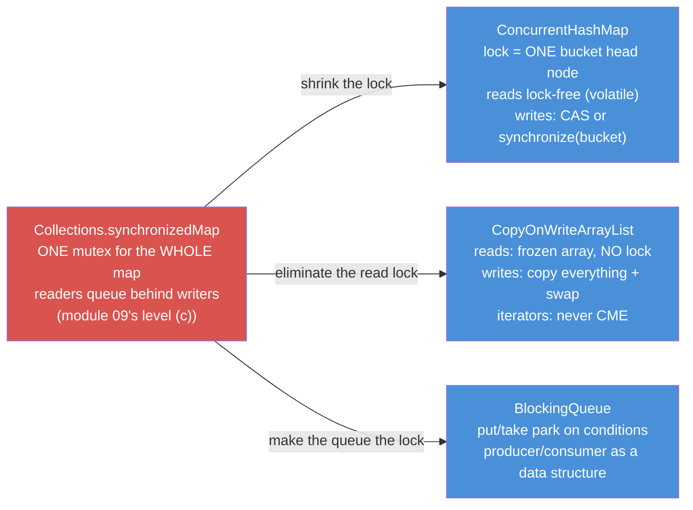
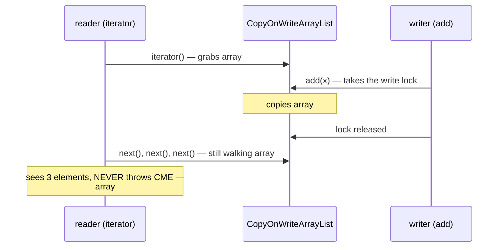
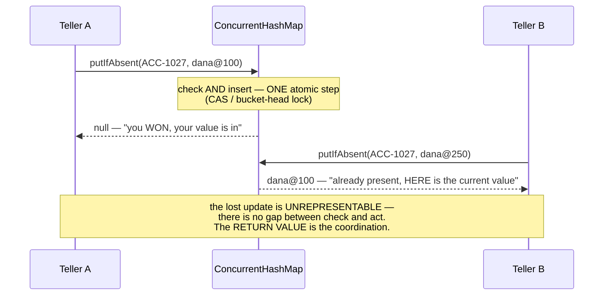
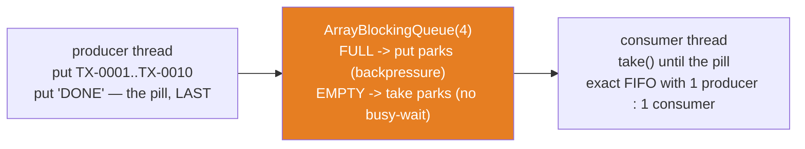

# 10 — java.util.concurrent: Collections That Don't Need Your Lock

**The big idea:** module 09's fix ladder ended at "hold a global lock yourself" — correct,
and a throughput killer: one mutex means every reader waits for every writer, even when
they touch different accounts, different buckets, different ends of a queue.
`java.util.concurrent` inverts the design: **the concurrency is built INTO the structure.**

- `CopyOnWriteArrayList` hands readers a frozen array — reads take no lock, ever — and
  makes writers pay a full copy. Its iterator is a *snapshot iterator*: it walks a frozen
  copy taken at creation, so it never throws CME and never sees later writes.
- `ConcurrentHashMap` locks ONE BUCKET HEAD, not the map. Since Java 8 there are no
  *segments* (the coarse lock stripes older versions split the table into). Reads are
  lock-free over *volatile* nodes — a volatile field's latest write is visible to every
  thread immediately, Java's happens-before guarantee at work. A write *CAS*-es an empty
  bucket — CAS = compare-and-swap, one atomic step that writes a new value only if the old
  one is unchanged — or synchronizes on that bucket's head only.
- `BlockingQueue` turns producer/consumer from `wait()`/`notify()` ceremony into a data
  structure: `put` parks when full, `take` parks when empty. That parking is
  *backpressure* — a full queue stalls the producer instead of piling up in memory — and
  the hand-off is included.
- The **atomic compound operations** — `putIfAbsent`, `computeIfAbsent`,
  `replace(k, old, new)` — delete module 09's check-then-act lost update in ONE call: the
  gap between check and act stops existing, so the bug becomes unrepresentable.

The price is precision: iterators are snapshot or weakly consistent (never CME, but they
may miss concurrent writes), `size()` is often an estimate or an O(n) walk, and nulls are
**banned** wherever `get()==null` must have exactly one meaning.

Domain for the module: SecureBank's `Account` (id, owner, `BigDecimal` balance) and
`Transaction` (id, description, `BigDecimal` amount, `long` timestampMillis) — equals/
hashCode **by id** (`core-java` 08) does visible work here: `CopyOnWriteArraySet`'s dedupe
runs on it, and the `putIfAbsent` race test must compare by IDENTITY (`assertSame`) exactly
because equals-by-id cannot tell the racers' values apart. `Transaction` is `Comparable`
by id (`core-java` 10); `PriorityBlockingQueue` deliberately ignores that natural order and
takes a named `ByAmount` comparator — classic idiom throughout (anonymous `Runnable` and
`Function`, explicit type arguments); `java8-features` 01 shortens every one of them to a
lambda, and `java8-features/03-optional` is the honest package for "maybe no value".

**Determinism, the module's rule:** snapshot semantics are STRUCTURAL (no timing at all);
races are choreographed with `CountDownLatch` *start guns* — a latch that holds every
thread at the same starting line and releases them all at once — and `join()`ed before
asserting; exact counts are asserted only where the engine guarantees them (one
`putIfAbsent` winner, exactly 100,000 increments, exact FIFO); and the single timing
claim (`take()` blocks) pairs a guaranteed ~300ms park with a 150ms verdict floor — a 2x
margin that cannot flip.

## Why not just wrap everything? Lock granularity

**Read the diagram:**
- Left (red): the baseline — `Collections.synchronizedMap`: ONE mutex for the WHOLE map;
  readers queue behind writers (module 09's level (c)). Each arrow is one way to shrink
  that cost.
- Right, top to bottom: `ConcurrentHashMap` shrinks the lock to ONE bucket head node
  (reads lock-free over volatile; writes CAS or synchronize on that bucket only);
  `CopyOnWriteArrayList` eliminates the read lock (reads walk a frozen array; writes copy
  + swap; iterators never throw CME); `BlockingQueue` makes the queue the lock (`put`/
  `take` park on conditions — producer/consumer as a data structure).

## CopyOnWriteArrayList — the write path, and why the iterator cannot CME

**Read the diagram:** read the arrows top to bottom as time.
- The reader's `iterator()` grabs the reference to array #1 (3 elements) — no lock taken.
- The writer's `add(x)` takes the write lock; under it, the list copies array #1 into
  array #2 (4 elements) and swaps the internal reference. Then the lock is released.
- The reader keeps calling `next()` — still walking array #1. It sees 3 elements and NEVER
  throws CME; array #2 is invisible to this iterator forever.
- The final note: `iterator.remove()` throws `UnsupportedOperationException` — the
  snapshot is not the list, so removing from it would be a lie.

**Walkthrough — what happens when `add(x)` runs on a `CopyOnWriteArrayList`:**
1. The writer takes the list's single lock — other writers wait; readers never do.
2. The whole internal array is copied, and `x` is appended to the copy.
3. The internal reference is swapped to the new array — readers created from now on see `x`.
4. The lock is released. Any iterator created BEFORE the swap keeps walking the old
   array: no CME, and no `x` either.

**In one sentence:** CopyOnWriteArrayList buys lock-free reads and never-CME iterators by
making every write a full array copy — a bargain only for write-rare, read-heavy lists.

## putIfAbsent — module 09's doomed interleaving, sealed

**Read the diagram:** read the arrows top to bottom as time.
- Teller A calls `putIfAbsent(ACC-1027, dana@100)`: the map checks AND inserts in ONE
  atomic step (CAS or the bucket-head lock) — no gap for Teller B to slip into.
- A's reply is `null`, which means "you WON: the key was absent and your value is now in".
- Teller B then calls `putIfAbsent(ACC-1027, dana@250)`: the key is present, so nothing is
  stored; B's reply is the current value `dana@100` — "already present, HERE it is".
- The bottom note is the lesson: the lost update is unrepresentable, and the RETURN VALUE
  is the coordination — `null` means you won, non-null means someone else did.

## The producer/consumer pipeline (poison pill)

The last element is a *poison pill* — a reserved final value that tells the consumer "no
more work is coming; finish and shut down".

**Walkthrough — how one element travels from producer to consumer:**
1. The producer calls `put(e)`: a slot is free → `e` enters the queue, and a consumer
   parked in `take()` is woken with it.
2. The queue is FULL (all 4 slots) → the producer parks inside `put` until a slot frees.
   That is the backpressure.
3. The consumer calls `take()`: the queue is empty → it parks (no busy-wait, no CPU burn);
   otherwise it removes the head element.
4. Every removal frees a slot and wakes the parked producer — that wake-up IS the hand-off.
5. The producer puts the pill ('DONE') LAST. The consumer checks each taken element for
   the sentinel BEFORE processing it, and exits when the pill arrives.

## Which concurrent collection, when — the table to photograph

| class | shape / order | writes cost | iterator | nulls | choose it when |
|---|---|---|---|---|---|
| `CopyOnWriteArrayList` | List, insertion order | copies the WHOLE array, then swaps (under lock) | frozen snapshot — never CME, misses later adds, `remove()` throws UnsupportedOperationException | allowed | rare writes, many reads: listener/observer lists |
| `CopyOnWriteArraySet` | Set, dedupe by `equals` | same copy engine (`addIfAbsent`) | same frozen snapshot | allowed | a deduplicated watcher list |
| `ConcurrentHashMap` | Map, unordered | CAS or lock on ONE bucket head | weakly consistent — never CME | **NEITHER key NOR value** | the default shared map — use its ATOMIC compounds |
| `ConcurrentSkipListMap` | Map, SORTED (natural/Comparator) | O(log n); touches a few nodes | weakly consistent — never CME | none | shared map + sorted/navigable views (`firstEntry`, `headMap`) |
| `ConcurrentLinkedQueue` | Queue, FIFO | lock-free CAS on links | weakly consistent — never CME | none | high-throughput unbounded FIFO; ask `isEmpty()`, not `size()` |
| `ArrayBlockingQueue` | Queue, FIFO, BOUNDED | one lock, two wait conditions (not-full / not-empty) | — | none | fixed buffer + backpressure; optional FAIR mode |
| `LinkedBlockingQueue` | Queue, FIFO, bounded (optional) | TWO locks (puts vs takes) | — | none | high-throughput hand-off — ALWAYS pass a capacity |
| `PriorityBlockingQueue` | Queue, by Comparator/Comparable | binary heap, locked | — | none | "most urgent first", across threads — NOT FIFO |

## The traps, all printed as evidence in the demos

- **Concurrent does NOT mean atomic compounds** — `ConcurrentHashMap`'s individual calls
  are safe; `if (!map.containsKey(k)) map.put(...)` is still module 09's lost update, with
  a lock per bucket instead of per map. The fix is ONE of the atomic calls: `putIfAbsent`,
  `computeIfAbsent`, `compute`, `merge`, `replace(k,old,new)` (`ChmAtomicDemo` banners 1–4;
  the two-racer test proves exactly one `null` is handed out, every run).
- **No nulls in CHM — on purpose** — single-threaded, `get()==null` is disambiguated by
  `containsKey`; under concurrency that second question is a check-then-act compound that
  arrives too late. `NullPolicyDemo` scripts the interleaving: `exists:true` and
  `value:null` — individually correct, jointly impossible. Ban nulls and `get()==null`
  means exactly one thing: absent.
- **`size()` lies by design** — CHM sums counter cells after the fact (an estimate);
  `ConcurrentLinkedQueue.size()` is an O(n) walk that can be stale mid-count (its javadoc
  says so). `isEmpty()` is the O(1) question; never gate logic on `size()`.
- **COW iterators are frozen — and read-only** — you may be iterating over history (an add
  mid-iteration is invisible), and `iterator.remove()` throws
  `UnsupportedOperationException`. That is the deal you accepted for lock-free reads
  (`CopyOnWriteDemo` banners 1–2). Write-heavy + COW = a full array copy per write:
  ruinous for a ledger, perfect for a listener list (banner 4's arithmetic).
- **`LinkedBlockingQueue`'s default capacity is `Integer.MAX_VALUE`** — an unbounded queue
  is an `OutOfMemoryError` with a delay when producers outrun consumers. Always pass a
  capacity in production (`BlockingFlavorsDemo` banner 4).
- **`PriorityBlockingQueue` is not FIFO** — `poll()` returns the MINIMUM by comparator, and
  elements must stay immutable: mutating a queued element corrupts the heap order (the
  comparator contract, `core-java` 10 — `ConcurrentTourDemo` banner 4).
- **Weakly-consistent iterators never CME but promise nothing about freshness** — module
  09's fail-fast teaser, cashed. *Weakly consistent* means: never throws CME, but shows
  the collection's state at some point at or after the iterator was created — it may miss
  later writes. `ConcurrentModificationException` is extinct in this package; the price is
  that "what did I just iterate?" has a fuzzier answer.
- **The pill rules** — one poison pill PER consumer thread, offered LAST; the consumer
  checks the sentinel BEFORE processing, or it posts "DONE" to the ledger
  (`ProducerConsumerDemo` traces both sides).

## Class flow

1. Show the diagrams above (lock granularity first — why module 09's top rung is a
   throughput killer; then the COW snapshot; then `putIfAbsent` sealing module 09's gap;
   the pipeline last).
2. Run the demos in order: `.\mvnw.cmd -pl 10-java-util-concurrent compile exec:java`
   (this runs `ConcurrentDemos`, which calls each demo `main()` in teaching order).
3. Run the tests as *proof*: `.\mvnw.cmd -pl 10-java-util-concurrent test` — each test
   prints the behavior it asserts, including the deterministic failures
   (UnsupportedOperationException, NullPointerException) and the choreographed races.

| Demo class | What it shows |
|---|---|
| `CopyOnWriteDemo` | the snapshot freeze (mid-iteration add invisible, no CME); `iterator.remove()` -> UOE; reader/writer truly overlapping with latch-choreographed EXACT counts (joined); the write-cost arithmetic |
| `ChmAtomicDemo` | the engine (no segments; CAS + bucket-head lock; lock-free reads); module 09's lost update replayed through `putIfAbsent`; two REAL racers — exactly one winner; `computeIfAbsent` + `AtomicInteger` — exactly 100,000; `replace(k,old,new)` CAS-style; what CHM does NOT promise |
| `NullPolicyDemo` | HashMap's three meanings of null; CHM's two NPEs; the ambiguity interleaving scripted; the null law across the whole package |
| `ProducerConsumerDemo` | the full pipeline: `put`/`take`, backpressure, poison pill, per-thread traces replayed after join, exact FIFO verdict |
| `BlockingFlavorsDemo` | `offer`/`poll` vs `put`/`take` vs the timed pair on one capacity-2 queue; proof `take()` parks (300ms-late offer, 150ms verdict floor); the family one line each |
| `ConcurrentTourDemo` | `ConcurrentLinkedQueue` FIFO + the `size()` trap; `ConcurrentSkipListMap` sorted + `firstEntry`/`headMap`; `CopyOnWriteArraySet` equals-dedupe; `PriorityBlockingQueue` poll=min; the decision table, printed |

| Test | What it proves |
|---|---|
| `cowIteratorWalksAFrozenSnapshot` | mid-iteration add invisible to the open iterator, walk completes with no CME, live list grew |
| `cowIteratorRemoveIsUnsupported` | `iterator.remove()` -> UnsupportedOperationException; the list itself untouched |
| `putIfAbsentRaceHasExactlyOneWinner` | two racers, start gun, joined: exactly one `null` returned; map holds the winner's very object (`assertSame` — equals-by-id cannot tell them apart) |
| `computeIfAbsentCounterIsExact` | factory ran EXACTLY once; 4 x 25,000 increments -> exactly 100,000 (joined) |
| `chmRejectsNullKeysAndValues` | NPE on null key and null value; HashMap control group allows both — and `containsKey` only disambiguates single-threaded |
| `producerConsumerDeliversExactFifo` | 10 ids + pill through `ArrayBlockingQueue(4)`: processed list equals exact FIFO order; queue empty at the end |
| `arrayBlockingQueueRespectsCapacity` | third `offer()` on a full 2-queue is `false`; a `poll()` opens the slot |
| `takeBlocksUntilAnElementArrives` | consumer parked ~300ms (floor 150ms, 2x margin), woke with the delayed offer's value |
| `skipListMapKeepsKeysSorted` | scrambled insert -> sorted `keySet()`; exact `firstEntry`/`lastEntry`; exclusive `headMap` |
| `concurrentLinkedQueueDrainsFifoAndReportsEmpty` | FIFO drain; `poll()` on empty is `null`; `isEmpty()` true — the O(1) question |

## Where this leads

This module closes the course — and re-answers its oldest questions. Sideways to **module
09**: every guarantee here is the top rung of that ladder — fail-SAFE iterators instead of
best-effort fail-fast, atomic compounds instead of guarded sequences, per-bucket locks
instead of one global mutex. Backwards to **module 05**: `ConcurrentHashMap` is the
`HashMap` bucket machinery you already know, with a lock per bucket head instead of per
map. `ConcurrentSkipListMap` is `TreeMap`'s contract on a skip-list engine. **Module
06**'s `Queue` vocabulary (`offer`/`poll`/`peek`) is exactly what `BlockingQueue` extends
with `put`/`take`. **Module 03**'s first-encounter CME is the exception this whole package
was designed to make impossible. And **module 08**'s habit — pick by guarantee, then by
access pattern — is how the decision table above is meant to be read. `core-java` 08's
equals/hashCode runs the dedupe and the map lookups; `core-java` 10's Comparator orders the
priority queue and the skip list. Forward: the anonymous `Function` in `ChmAtomicDemo` and
the named `ByAmount` comparator are precisely what `java8-features/01-lambdas` compresses,
and `04-streams-fundamentals`/`06-collectors` will pour the results into these very
collections. And when SecureBank becomes a Spring Boot app (`stage-2-monolith`, then the
`stage-5-microservices`), every request is a thread sharing caches, queues and registries:
modules 09 and 10 together are the difference between a bug report and a non-event.
