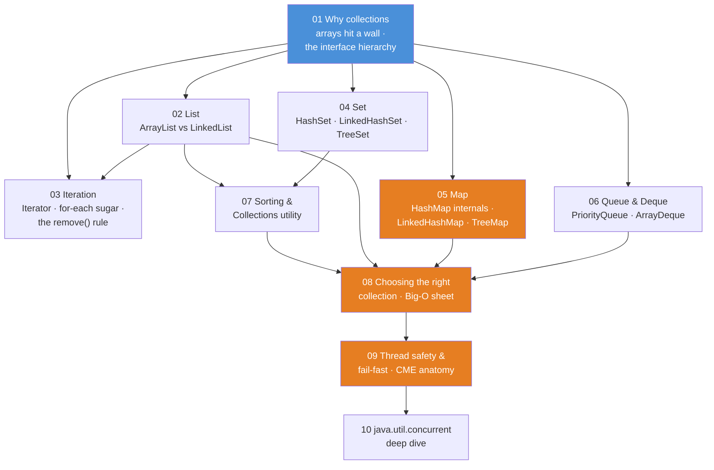
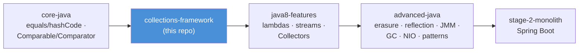

# Collections Framework — Teaching Repo

The course between [`core-java`](../core-java/README.md) and
[`java8-features`](../java8-features/README.md). `core-java` builds the *contracts*
(`equals`/`hashCode` in module 08, `Comparable`/`Comparator` in module 10). This course
shows what `java.util` **does with them**. It answers five questions: how a `HashSet`
"knows" a duplicate, how a `HashMap` finds your value in one hop, why `TreeSet` silently
swallows elements, why removing inside a for-each explodes, and what actually happens when
two threads share an `ArrayList`.

Same format as the other two courses, built for stand-up-and-point teaching:

- **demo classes** (`src/main/java`) — each has a `main()` that prints what is happening, step by step
- **JUnit tests** (`src/test/java`) — each test proves one behavior and prints the evidence
- **README.md with mermaid diagrams** — the conceptual picture *before* you open the code

Everything compiles with `--release 8` and deliberately teaches the **classic idiom**
(explicit loops, `Iterator`, anonymous inner classes). Where Java 8 improves on something,
the code says so and points forward to the matching `java8-features` module.

## The course map



**Read the diagram:**
- An arrow means "read this first". Module 01 (blue) is the foundation: every other module
  hangs off it, directly or through 02.
- The middle band tours the families one at a time: List (02), iteration (03), Set (04),
  Map (05), Queue (06).
- 07 adds the `Collections` toolbox; 08 gathers everything into the decision table.
- The last two go where threads enter: 09 explains what breaks, 10 hands you the engines
  that don't break.

The orange modules are the heart of the course:
- **05 Map** — how hashing actually works; the harvest of `core-java` 08.
- **08 Choosing** — the Big-O decision table students photograph.
- **09 Thread safety** — the machinery behind every `ConcurrentModificationException` (CME)
  they will ever meet. *Fail-fast* is the behavior behind that exception: an iterator
  notices the collection changed shape underneath it and throws immediately, instead of
  silently misbehaving.

## Suggested teaching order

| # | Module | The one-sentence pitch | Run the demos |
|---|--------|------------------------|---------------|
| 01 | `01-why-collections` | Arrays are fixed-size, dumb containers; the Collections Framework is a hierarchy of *interfaces* — you program to `List`, not `ArrayList` | `.\mvnw.cmd -pl 01-why-collections compile exec:java` |
| 02 | `02-list` | `ArrayList` is a growable array (fast middle-gets, slow middle-inserts); `LinkedList` is chain nodes (the mirror image) — and `ArrayList` still wins almost always | `.\mvnw.cmd -pl 02-list compile exec:java` |
| 03 | `03-iteration-and-iterators` | for-each is compiled sugar over `Iterator`; the *only* safe remove during iteration is `iterator.remove()` — everything else throws `ConcurrentModificationException` | `.\mvnw.cmd -pl 03-iteration-and-iterators compile exec:java` |
| 04 | `04-set` | A `Set` is the `equals`/`hashCode` contract turned into a data structure: `HashSet` = O(1) & unordered, `LinkedHashSet` = insertion order, `TreeSet` = sorted but compares, never equals | `.\mvnw.cmd -pl 04-set compile exec:java` |
| 05 | `05-map` | `HashMap.put` hashes your key to a bucket (one slot of the internal array) and walks a tiny chain — that one sentence explains the contract, load factor, capacity, and every "my map lost the key" bug | `.\mvnw.cmd -pl 05-map compile exec:java` |
| 06 | `06-queue-and-deque` | `Queue` = "process these in order" (`offer`/`poll`/`peek`); `Deque` = two-ended queue; use `ArrayDeque`, not the legacy `Stack` | `.\mvnw.cmd -pl 06-queue-and-deque compile exec:java` |
| 07 | `07-sorting-and-collections-utility` | `Collections` is the toolbox: sort, binarySearch, reverse — plus the *view* wrappers (`unmodifiableList`) that are live windows, not copies | `.\mvnw.cmd -pl 07-sorting-and-collections-utility compile exec:java` |
| 08 | `08-choosing-the-right-collection` | One Big-O table and one decision flowchart: pick the interface by the *guarantee* you need, the implementation by the *access pattern* you have | `.\mvnw.cmd -pl 08-choosing-the-right-collection compile exec:java` |
| 09 | `09-thread-safety-and-fail-fast` | `modCount` — the collection's shape-change counter — is the smoke detector: fail-fast iterators throw CME to report "someone else mutated this" — and CME is a *bug alarm*, never a synchronization strategy | `.\mvnw.cmd -pl 09-thread-safety-and-fail-fast compile exec:java` |
| 10 | `10-java-util-concurrent` | The real fixes live in `java.util.concurrent`: `CopyOnWriteArrayList`, `ConcurrentHashMap` (locks a bucket, not the map), `BlockingQueue` and a working producer/consumer | `.\mvnw.cmd -pl 10-java-util-concurrent compile exec:java` |

## Running things

All commands run **from this folder** (`collections-framework/`), Windows PowerShell shown:

```powershell
# run one module's demo launcher (prints every demo in teaching order)
.\mvnw.cmd -pl 05-map compile exec:java

# run ONE specific demo class instead of the whole launcher
.\mvnw.cmd -pl 05-map compile exec:java "-Dexec.mainClass=com.evaitcs.collections.maps.HashMapInternalsDemo"

# run one module's tests (tests print what they prove)
.\mvnw.cmd -pl 09-thread-safety-and-fail-fast test

# run everything
.\mvnw.cmd test
```

Tip for class: **mermaid diagram first** (concept), then the demo `main()` (behavior),
then the test (proof).

If em-dashes/arrows print as garbage in a plain `cmd` window, run `chcp 65001` first
(UTF-8 code page). Windows Terminal and IDE consoles are fine as-is.

## Shared conventions

- **Classic idiom on purpose**: explicit `Iterator` loops instead of `forEach(...)`,
  anonymous `Comparator` classes instead of lambdas, `new ArrayList<String>()` with the
  type argument written out (matching the `core-java` house style). Comments mark the
  moments where Java 8 replaces the ceremony and point at the corresponding
  `java8-features` module (that contrast is itself a lesson).
- **Domain**: the same tiny SecureBank world as `core-java` — `Account`, `Customer`,
  `Transaction` — duplicated per module on purpose, so each module stands alone on screen.
  `Transaction` implements `Comparable` and `equals`/`hashCode` **by id**, exactly as built
  in `core-java` 08 and 10.
- **Money is `BigDecimal`** (scale 2); timestamps here are `long` millis (still no
  `java.time` — that arrives in `java8-features/08-java-time`).
- **Comments are teaching material**: they explain *why*, connect the diagram to the code,
  and call out the traps ("students often ask...", "this line is the whole idea").
- Demo output uses plain `System.out.printf`/`println` so it's readable from the back of the room.
- Concurrency demos print **deterministic** evidence (joined threads, counted outcomes,
  caught exceptions) — never "run it ten times and hope".

## Where this course leads



**Read the diagram:** left to right, one arrow per course. `core-java` builds the contracts,
this course (blue) puts them to work, `java8-features` deletes the ceremony with lambdas
and streams, `advanced-java` opens the machine underneath (the JVM, the memory model, the
reflection that frameworks run on), and `stage-2-monolith` ships it all as a Spring Boot app.

Every "classic vs modern" note here is a hook for the next course: the explicit `Iterator`
loop in module 03 becomes `list.removeIf(...)` and `forEach` in `java8-features/01-lambdas`;
the hand-rolled "filter transactions into a new list" loops become `stream().filter().collect()`
in `04-streams-fundamentals`; the manual grouping loops in module 05 become
`Collectors.groupingBy` in `06-collectors`.
