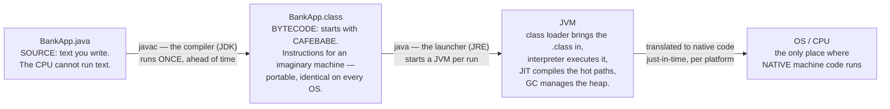
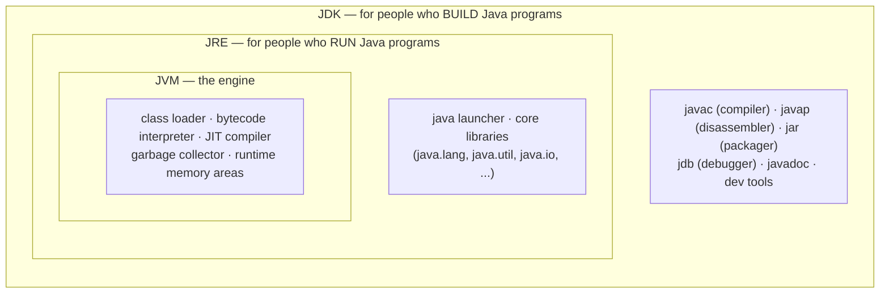
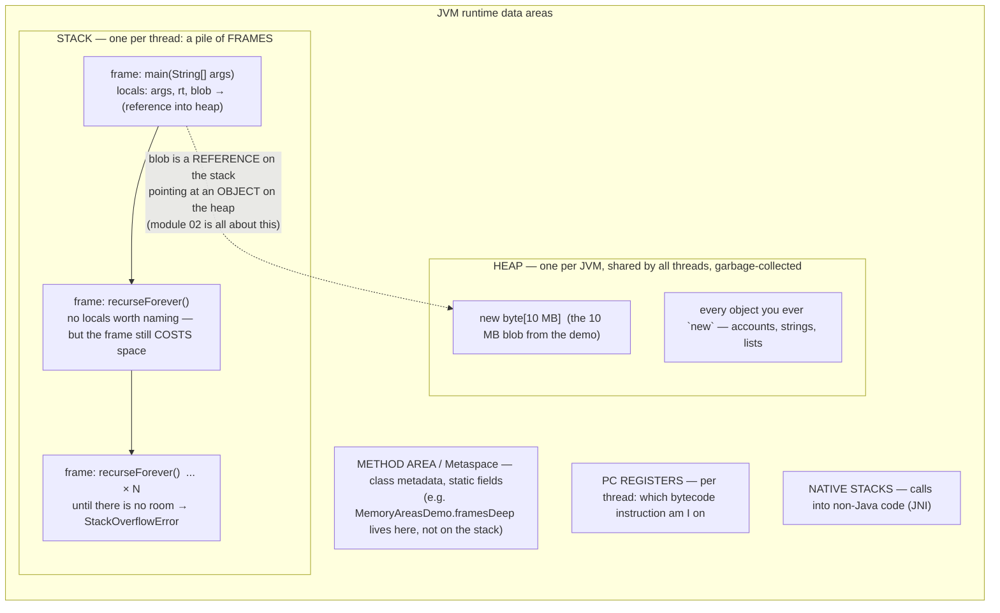

# 01 — JVM, JRE & JDK

**The big idea:** your code never runs on the CPU directly. `javac` translates your `.java`
text into `.class` **bytecode** — instructions for an *imaginary* machine — and the **JVM**
executes it. The three acronyms — JVM (Java Virtual Machine), JRE (Java Runtime Environment),
JDK (Java Development Kit) — are not competitors. They are **nested boxes**, and this module
takes all three apart from the inside, with proof printed by the running program.

This is the most conceptual module of the course, so the diagrams below carry it:
**show them first**, then run the demos, then the tests as proof.

## (a) The pipeline: source → bytecode → execution



**Read the diagram:** left to right — one trip from text to running program.

- `javac` (the JDK's compiler) runs ONCE, ahead of time: source text becomes bytecode —
  identical on every OS, `CAFEBABE` first.
- `java` (the JRE's launcher) starts a fresh JVM per run. Inside: the class loader brings the
  `.class` in, the interpreter executes it, the JIT (just-in-time) compiler translates hot
  paths to native code, and the GC (garbage collector) manages the heap. Native machine code
  runs only in the last box — the OS/CPU.

`CompileRunPipelineDemo` proves this **from inside the running program**: it prints its own
code source (`target/classes` — javac's output, never your `.java`), then reads the first four
bytes of `BankApp.class` back off disk: `CAFEBABE`, the magic number every class file starts
with. Bytecode is the *instruction set of an imaginary machine* — that is why one `.class`
runs on Windows, Linux and Mac alike.

## (b) The nested boxes: JDK ⊃ JRE ⊃ JVM



**Read the diagram:** the boxes nest — each one contains the next.

- **JDK** = JRE + the dev tools (`javac`, `javap`, `jar`, `jdb`, `javadoc`): you BUILD with it.
- **JRE** = JVM + the `java` launcher + the core libraries: you RUN with it.
- **JVM** = the engine itself: loader, interpreter, JIT, garbage collector, memory areas.

Say it out loud in class: **you need a JDK to build, only a JRE to run, and the JVM is the part
that actually executes.** Since Java 9 there is no separate `jre/` folder: `java.home` points at
the JDK, and *having the tools* is what makes it one. `JvmKnowsItselfDemo` prints the JVM's whole
self-description — `java.home`, `java.version`, `java.vendor`, `os.name`, `os.arch`,
`java.class.path`, "everything the JVM knows about itself" — then checks `java.home/bin` for
`javac`/`javap`/`jar`/`jdb` to prove which box this machine has.

**Write once, run anywhere — the fine print:** every `.class` file carries a *major version*
(ours is 52 = Java 8, because the parent pom compiles with `--release 8`). A JVM accepts a class
file only if the file's major version ≤ what that JVM supports: a newer JVM runs older class
files, never the reverse. And bytecode is first *interpreted*; the **JIT** compiler translates
hot methods to native code while the program runs — which is why the first pass of a loop is
the slowest. `JitWarmupDemo` runs the same loop five times and prints the collapse in time
(print-only: timings are never asserted, wall clocks are not reproducible).

**In one sentence:** one `.class` runs on any JVM new enough for its version — but the first
moments run interpreted.

## (c) Runtime memory areas: heap vs stack



**Read the diagram:** five memory areas; two of them huge in practice.

- The two big areas: **HEAP** (one per JVM, shared — every object you ever `new`) and
  **STACK** (one pile of *frames* per thread; one frame = one in-flight method call and its
  locals). Each `recurseForever` call adds a frame; when the room runs out, the JVM throws
  `StackOverflowError`.
- The small-print areas: **METHOD AREA / Metaspace** (class metadata, static fields),
  **PC REGISTERS**, **NATIVE STACKS** (JNI, the Java Native Interface — non-Java calls).
- The dashed arrow is module 02 in one line: a stack REFERENCE pointing at a heap OBJECT.

**Walkthrough — what `MemoryAreasDemo` does:**

1. Recurses without a base case until a `StackOverflowError` is thrown — and **caught** ("the
   stack is FINITE — each call adds a frame").
2. Reads the `Runtime.getRuntime()` numbers before and after a 10 MB array — watch
   `used = total − free` jump.
3. Sets `blob = null` and calls `System.gc()` — a **hint, never a command**.

## Two more short stops

- **Class loading is lazy** (`ClassLoadingDemo`): a class is initialized on *first active use*
  — the first time code really touches it, e.g. `new` — exactly once. Watch the nested
  `LazyVault`'s static initializer print *between* two ordinary `println`s. Deeper reflection
  (`Class.forName`, class loaders) comes later.
- **`main()` is a contract** — a fixed promise the JVM relies on (`MainMethodDemo`):
  `public` (the JVM calls from outside your class), `static` (no instance exists yet — see
  module **11** for static), `void` (nobody receives a result), `String[] args` (the words
  typed after the program name; Maven `exec:java` passes none by default).

## Class flow

1. Show the diagrams above (concept).
2. Run the demos in order: `.\mvnw.cmd -pl 01-jvm-jre-jdk compile exec:java`
   (this runs `JvmJreJdkDemos`, which calls each demo `main()` in teaching order).
3. Run the tests as *proof*: `.\mvnw.cmd -pl 01-jvm-jre-jdk test` — each test prints the
   evidence it asserts (CAFEBABE bytes, version numbers, a caught `StackOverflowError`,
   live heap measurements, one-and-only-one static initializer, the exact `main` signature).

| Demo class | What it shows |
|---|---|
| `BankApp` | "your program" — the tiny `.java` whose `.class` we inspect and execute |
| `CompileRunPipelineDemo` | the pipeline with proof: prints its own code source (`target/classes`) and the magic bytes `CAFEBABE` |
| `JvmKnowsItselfDemo` | the nested boxes: System properties, JDK tools in `java.home/bin`, class file version |
| `JitWarmupDemo` | interpreted vs JIT-compiled: the same loop five times, and the first pass is the slowest |
| `MemoryAreasDemo` | the stack is finite (caught `StackOverflowError`); the heap measured with `Runtime` numbers |
| `ClassLoadingDemo` | lazy class initialization: static block runs once, on first touch |
| `MainMethodDemo` | why `public static void main(String[] args)` — each keyword earns its place |
| `JvmJreJdkDemos` | the launcher: every demo `main()` in teaching order, with section banners |

## Run commands

```powershell
# from the core-java folder:
.\mvnw.cmd -pl 01-jvm-jre-jdk compile exec:java   # all demos, teaching order
.\mvnw.cmd -pl 01-jvm-jre-jdk test                # tests that print their evidence
```

Where this leads: module **02** picks up the heap-vs-stack reference story (`blob` on the
stack pointing at bytes on the heap). Module **03** adds the String pool (method area).
Module **11** gives `static` — the keyword that let `main()` exist before any object did —
a whole module of its own.
