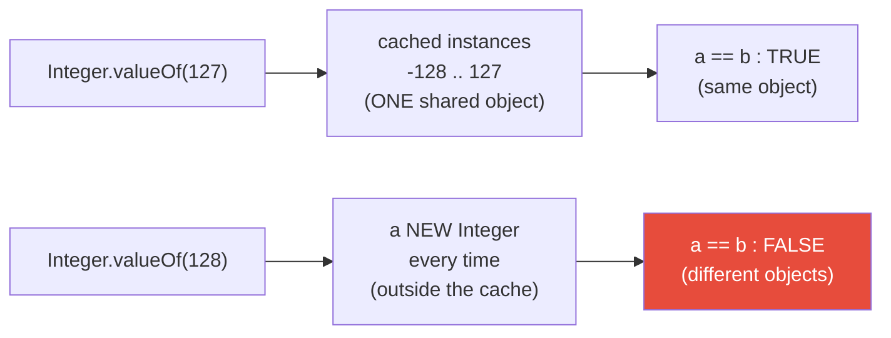

# 02 — Primitives vs References

**The big idea:** a variable is a small named slot. For a **primitive** (`int`, `double`, ...) the
slot holds the *value itself*. For a **reference** (`Account`, `String`, any object) the slot holds a
*pointer* — the address of an object that lives elsewhere, on the **heap** (the shared memory area
where all objects live). Almost every early "wait, *WHAT*?" moment in Java — aliasing (two
variables pointing at one object), `==` vs `equals`, pass-by-value confusion, the `Integer`
cache — falls straight out of that one sentence. This is the mental model the rest of the course
stands on.

## Stack vs heap — the picture to burn into your brain

```mermaid
flowchart LR
    subgraph STACK["STACK — this method's locals"]
        direction TB
        P1["int balance = 100<br/><i>the VALUE lives right here</i>"]
        R1["Account a1<br/>=&gt; &#9679;"]
        R2["Account a2<br/>=&gt; &#9679;"]
    end
    subgraph HEAP["HEAP — all objects, shared"]
        direction TB
        O1["Account @1a2b<br/>id=A-1 owner=Ada<br/>balance=150.00"]
    end
    R1 --> O1
    R2 --> O1
    style P1 fill:#4a90d9,color:#fff
    style R1 fill:#e67e22,color:#fff
    style R2 fill:#e67e22,color:#fff
    style O1 fill:#7b68ee,color:#fff
```

**Read the diagram:** blue = a primitive slot, orange = reference slots, purple = the one object
on the heap.

- The blue slot (`int balance`) holds its **value directly** — copy it and you copy the number.
- The orange slots (`a1`, `a2`) hold **arrows**. `a2 = a1` copies the *arrow*, **not** the object, so
  both point at the **same** purple `Account` on the heap. Mutating through `a2` "changes" `a1`
  because there is only ever one object. (This is the runtime memory the `01-jvm-jre-jdk`
  `MemoryAreasDemo` introduced.)

## The 8 primitives — cheat sheet

| Type | Size (bits) | Range / Values | Default (fields only) | Example literal |
|---|---|---|---|---|
| `byte` | 8 | -128 .. 127 | `0` | `(byte) 42` |
| `short` | 16 | -32,768 .. 32,767 | `0` | `(short) 1000` |
| `int` | 32 | -2,147,483,648 .. 2,147,483,647 | `0` | `42`, `2_000_000` |
| `long` | 64 | -9,223,372,036,854,775,808 .. 9,223,372,036,854,775,807 | `0L` | `42L`, `2_147_483_648L` |
| `float` | 32 | about ±3.4E38 (≈7 significant digits) | `0.0f` | `1.5f`, `1.0f/3.0f` |
| `double` | 64 | about ±1.8E308 (≈15–16 significant digits) | `0.0d` | `1.5`, `0.1` |
| `char` | 16 | 0 .. 65,535 (one UTF-16 code unit) | `'\u0000'` | `'A'`, `65` |
| `boolean` | (not specified) | `true` / `false` | `false` | `true` |

Defaults apply **only to instance fields** — a fresh object gets them for free. A **local** variable
has **no default**: reading it before assigning is a *compile error*
(`variable x might not have been initialized`). Traps to name out loud:

- `Float.MIN_VALUE` / `Double.MIN_VALUE` are the smallest **positive** values (near zero), **not** the most negative.
- Integer types **wrap silently** on overflow: `Integer.MAX_VALUE + 1 == Integer.MIN_VALUE` — no exception.
- `char` is a number: `'A' + 1 == 'B'`, and `'B' - 'A' == 1`.

## Money — why this whole repo uses `BigDecimal`

`double` is binary floating point. It cannot represent most decimal fractions exactly, so
`0.1 + 0.2` comes out as `0.30000000000000004`, and a chain of deposits silently loses cents.
`BigDecimal` built **from a String** is exact. One more trap: compare money with `compareTo`
(it compares values), **not** `equals` — `equals` also checks the scale, so `2.0` is *not*
`equals` to `2.00`.

## Java is pass-by-value — always

```mermaid
flowchart TB
    subgraph CALLER["caller"]
        C1["int a = 1, b = 2"]
        C2["Account acc = &#9679;(Ada)"]
    end
    subgraph MA["(a) swap(int x, int y)"]
        X["x, y are COPIES of the ints<br/>swapping them can't touch a or b"]
    end
    subgraph MB["(b) reassignToNew(Account acc)"]
        Y["acc = new Account(Bob)<br/>repoints the LOCAL copy only"]
    end
    subgraph MC["(c) mutate(Account acc)"]
        Z["acc.deposit(50)<br/>follows the copied pointer<br/>to the SAME object"]
    end
    C1 --> X
    C2 --> Y
    C2 --> Z
    X -. "caller unchanged" .-> R1["a=1 b=2"]
    Y -. "caller unchanged" .-> R2["still Ada"]
    Z -. "caller SEES it" .-> R3["Ada balance +50"]
    style Z fill:#e67e22,color:#fff
    style R3 fill:#e67e22,color:#fff
```

**Read the diagram:** three calls, three outcomes.

- (a) `swap(x, y)` receives copies of the two ints. Swapping the copies cannot touch `a` or `b`.
- (b) `reassignToNew(acc)` receives a copy of the pointer. Repointing the copy at Bob leaves the
  caller's variable on Ada.
- (c) `mutate(acc)` receives a copy of the pointer too — but the copy aims at the SAME object, so
  `deposit(50)` lands there and the caller SEES it.

**The one rule:** you always pass a **copy of the bits in the variable**. For an `int` the bits *are*
the value; for a reference the bits are the **address**.

**In one sentence:** a method can never repoint *your* variable, but it *can* mutate the object
you both point at.

## The `Integer` cache trap (autoboxing)

*Autoboxing* is Java's automatic wrapping between `int` and `Integer`; *unboxing* is the
unwrapping back.

**Read the diagram:** `Integer.valueOf(127)` returns a shared object from a cache covering
−128 .. 127, so `a == b` is TRUE. `valueOf(128)` falls outside the cache and builds a NEW
object every time, so `a == b` is FALSE (the red box — the trap).

`Integer a = 127, b = 127;` makes `a == b` **true** (both point at the one cached object), but
`128, 128` makes it **false** (two fresh objects). So **never** use `==` on boxed numbers — use
`.equals`. And unboxing a `null` (`Integer x = null; int y = x;`) throws `NullPointerException`.

## Class flow

1. Show the diagrams above first (concept): stack/heap, then pass-by-value, then the cache.
2. Run the demos in order: `.\mvnw.cmd -pl 02-primitives-vs-references compile exec:java`
   (runs `PrimitivesVsReferencesDemos`, which calls each demo `main()` in teaching order).
3. Run the tests as *proof*: `.\mvnw.cmd -pl 02-primitives-vs-references test` — each test prints
   the behavior it asserts.

| Demo class | What it shows |
|---|---|
| `PrimitiveTourDemo` | all 8 primitives: size, range, defaults (fields vs locals), `L`/`F` suffixes, `char` is a number |
| `OverflowDemo` | `int` wraps silently (`MAX_VALUE + 1 == MIN_VALUE`); the cents bug; `long` and `Math.addExact` as fixes |
| `MoneyDoubleVsBigDecimalDemo` | `0.1 + 0.2 != 0.3`; a double chain that loses cents; the exact `BigDecimal` version; `compareTo` vs `equals` |
| `ReferenceSemanticsDemo` | a variable holds a pointer; aliasing one object; `==` vs `equals`; `null` and the `NullPointerException` |
| `PassByValueDemo` | the three definitive cases — swap fails, reassign fails, mutate succeeds |
| `BoxingAndCacheDemo` | why wrappers exist, boxing/unboxing sugar, the `Integer` cache trap, unboxing `null` |

## Where this leads

- **Module 03 (Strings):** the String *pool* is this same "two references, one object" idea with a
  twist — the JVM reuses one shared object for equal literals, which is why `"ab" == "a" + "b"`
  surprises people.
- **Module 08 (equals/hashCode):** we finally override `Account.equals` so it compares *content*
  instead of falling back to `==`.
- **Module 01 (JVM/JRE/JDK)** `MemoryAreasDemo`: the stack and heap drawn here are the same runtime
  data areas that module introduced.
