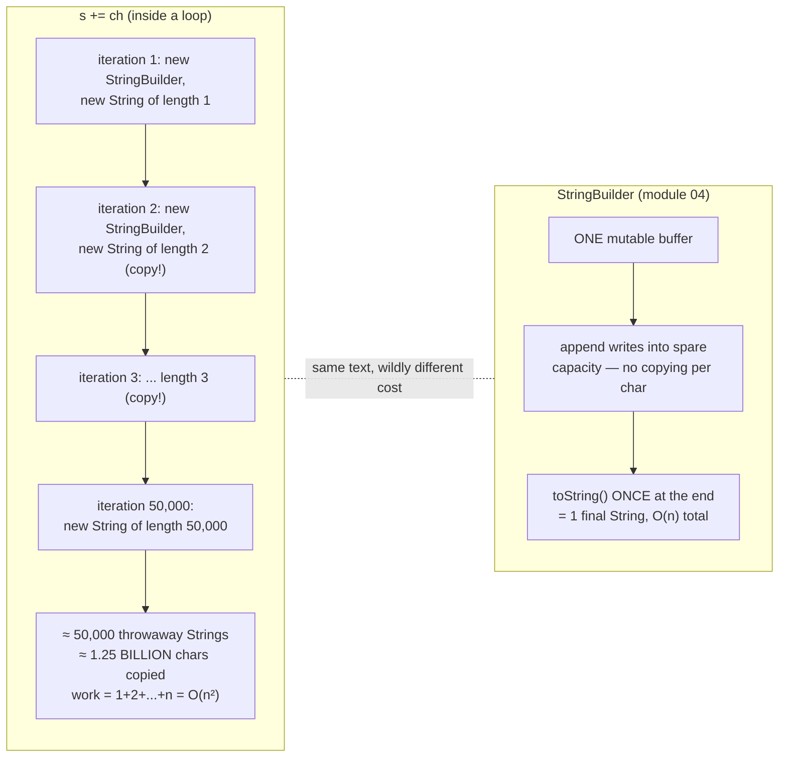

# 03 — Strings: Immutability & the Pool

**The big idea:** a `String` object is **immutable** — it can never change after it is
created — and the JVM keeps one shared object per literal text in the **string pool**, a
reuse cache for literals. Those two facts explain everything students find weird about
Strings: why `==` "sometimes works" (and why that is a trap), why `"a" + b` is fine but
`s += "a"` in a loop is quadratic (the work grows as n² — double the loop, quadruple the
work), and why passwords belong in `char[]`.

## Heap vs pool — the picture behind every `==` surprise

```mermaid
flowchart TB
    subgraph STACK["variables (stack)"]
        A["a = \"ACC\""]
        B["b = \"ACC\""]
        C["c = new String(\"ACC\")"]
        R["runtime = customerPrefix() + \"-1001\""]
        F["folded = \"ACC\" + \"-1001\""]
    end

    subgraph POOL["STRING POOL (one shared object per literal text)"]
        P1["\"ACC\"<br/>the ONE object for this text<br/>(same identityHashCode for a and b)"]
        P2["\"ACC-1001\"<br/>(javac FOLDED the constant<br/>\"ACC\" + \"-1001\" into this literal<br/>before the program ran)"]
    end

    subgraph HEAP["ordinary heap"]
        H1["new String(\"ACC\")<br/>a FRESH object — `new` means<br/>'I want my own'"]
        H2["\"ACC-1001\" built at RUNTIME<br/>(StringBuilder inside `+`)"]
    end

    A -->|"points at"| P1
    B -->|"points at the SAME object"| P1
    C -->|"points at"| H1
    R -->|"points at"| H2
    F -->|"points at"| P2

    P1 -. "a == b : TRUE (same pooled object)" .- P1
    H1 -. "c == a : FALSE  /  c.equals(a) : TRUE<br/>c.intern() == a : TRUE" .- P1
    H2 -. "runtime == \"ACC-1001\" : FALSE  /  equals : TRUE" .- P2
```

**Read the diagram:** top row = five variables on the stack; middle = the pool; bottom =
the ordinary heap.

- `a` and `b` are both the literal `"ACC"`, so they share the ONE pooled object.
- `c` uses `new`, so it points at a fresh heap object instead of the pooled one.
- `runtime` is built at RUNTIME by `customerPrefix() + "-1001"` — the `+` uses a
  StringBuilder inside (module 04) — so it lands on the ordinary heap.
- `folded`'s pieces are all literals, so javac glues them at COMPILE time — *constant
  folding*, done before the program ever runs — and it points at the pooled `"ACC-1001"`.

Outcomes to read off the diagram (`StringPoolDemo` prints `System.identityHashCode`
for each, so "same object" becomes a visible number):

| Expression | `==` | `.equals` | Why |
|---|---|---|---|
| `"ACC" == "ACC"` | **true** | true | one pooled object shared by every literal |
| `new String("ACC") == "ACC"` | **false** | **true** | explicit `new` forces a fresh heap object |
| `new String("ACC").intern() == "ACC"` | **true** | true | `intern()` returns the pooled instance |
| `("ACC" + "-1001") == "ACC-1001"` | **true** | true | javac folds constants at COMPILE time |
| `customerPrefix() + "-1001" == "ACC-1001"` | **false** | **true** | a method call can never be folded — built at runtime |

Trap to name out loud: `final String PREFIX = "ACC"; PREFIX + "-1001"` **also folds**
(a `final` String initialized with a literal is a compile-time constant, JLS 15.28).
One keyword changes whether `==` "works" — which is exactly why the rule is:

> **For text, ALWAYS use `equals` / `equalsIgnoreCase`. Never `==`.**
> And put the constant first — `"ACTIVE".equals(status)` — so a `null` status
> gives you `false` instead of a `NullPointerException`.

## The concat-in-loop trap — 50,000 throws vs 1 buffer

`ConcatCostDemo` builds the same 50,000-character statement line twice.



**Read the diagram:** left = the `+=` loop — a fresh throwaway String per iteration,
quadratic total work. Right = one `StringBuilder` — appends write into spare capacity and
ONE `toString()` at the end builds the single final String, linear work.

**Walkthrough — what javac + the JVM do with `s += ch`, every iteration:**

1. javac compiles String `+` into StringBuilder calls — `append(...)`, then `toString()`.
   One expression like `"a" + b + "c"` = one builder total: fine.
2. The loop *body* gets the same translation, so the `StringBuilder` is re-created
   **every iteration**.
3. Strings are immutable, so each `+=` must allocate a new String holding a full copy of
   everything so far — that is where the O(n²) comes from.

Module 04 takes the builder apart properly; here it is one block, just enough to feel the
difference. Timings are printed, never asserted — the test only proves both produce
**equal** strings.

**In one sentence:** `+=` in a loop rebuilds the whole string every iteration (O(n²)); one
StringBuilder only appends (O(n)).

## substring returns a NEW string (end-exclusive)

```mermaid
flowchart TB
    S["\"ACC-1001\"<br/>indices: A=0 C=1 C=2 -=3 1=4 0=5 0=6 1=7"]
    S -->|"substring(0, 3)<br/>begin INCLUSIVE, end EXCLUSIVE<br/>= indices 0,1,2"| N1["NEW String \"ACC\""]
    S -->|"substring(4)<br/>= index 4 to the end"| N2["NEW String \"1001\""]
    S -.->|"the original object"| S2["\"ACC-1001\" — untouched, always"]
```

**Read the diagram:** `substring(0, 3)` copies indices 0, 1, 2 into a NEW String `"ACC"`
— begin INCLUSIVE, end EXCLUSIVE. `substring(4)` copies index 4 to the end into `"1001"`.
The original `"ACC-1001"` object is never touched.

Mnemonic: `substring(a, b).length()` is always `b - a`. And the original never
changes — there is no way to "cut" an immutable object, only to build a smaller one.

## Why immutable at all? (say these four out loud)

1. **Safe to share** — the pool can hand one object to everyone *because* nobody can
   change it under anybody's feet.
2. **Cached hash** — `hashCode` is computed once and stored, making Strings ideal
   `HashMap` keys (plant the flag: the equals/hashCode contract is **module 08**).
3. **Thread-safe** — no state to race over; two threads can read the same String.
4. **Security** — validate a path/URL/account id, then pass it onward: it *cannot*
   change after validation. A mutable String would let `"/safe/report.txt"` be
   rewritten to `"/etc/passwd"` after the check but before the open.

## `char[]` vs `String` for passwords

A `String` password **cannot be wiped** — immutability cuts both ways. After login the
characters linger in the heap (or in the pool, for literals/`intern()`ed text) until the GC
— the garbage collector — reclaims the object. Any heap dump (`jmap`, a profiler, an
attacker with the crash dump) shows them in plain text. A `char[]` can be overwritten with
`Arrays.fill(pin, '\0')` the *instant* authentication finishes — deterministic, not
"whenever GC feels like it". This is exactly why Swing's `JPasswordField` deprecates
`getText()` (returns `String`) in favor of `getPassword()` (returns `char[]`). Honest
caveat for class: `char[]` is *best effort*. Anything that already became a `String` is
back under String rules; the array shrinks the exposure window, it does not eliminate it.
`PasswordCharArrayDemo` prints the char codes before and after the wipe — the row of zeros
is the evidence.

## Note on newer APIs (Java 11+, NOT available here)

This module compiles with `--release 8`. `String.isBlank()` (empty *or whitespace*),
`strip()`, and `repeat(n)` arrive in Java 11 — do not use them here; the classic
idioms are `!s.trim().isEmpty()`, `trim()`, and a loop (or `String.join`, which IS
Java 8 — see [`java8-features/09-api-upgrades`](../../java8-features/09-api-upgrades)).

## Class flow

1. Show the diagrams above (concept first — pool picture, then concat churn).
2. Run the demos in order: `.\mvnw.cmd -pl 03-strings compile exec:java`
   (this runs `StringsDemos`, which calls each demo `main()` in teaching order).
3. Run the tests as *proof*: `.\mvnw.cmd -pl 03-strings test` — each test prints
   the behavior it asserts.

| Demo class | What it shows |
|---|---|
| `ImmutabilityDemo` | every "mutator" ignored, `s` unchanged; why immutability exists (4 reasons) |
| `StringPoolDemo` | literal sharing, `new String`, `intern()`, constant folding vs runtime building |
| `EqualsVsDoubleEqualsDemo` | `==` vs `equals` definitively, `equalsIgnoreCase`, the null-safe idiom (caught `NullPointerException`) |
| `ConcatCostDemo` | 50k-char line with `+=` (timed, quadratic) vs `StringBuilder` (teaser for module 04) |
| `StringApiTourDemo` | the everyday API in 7 groups; traps named: end-exclusive, split's regex, Turkish-i |
| `PasswordCharArrayDemo` | why passwords belong in `char[]`; the zeroed array printed as evidence |
