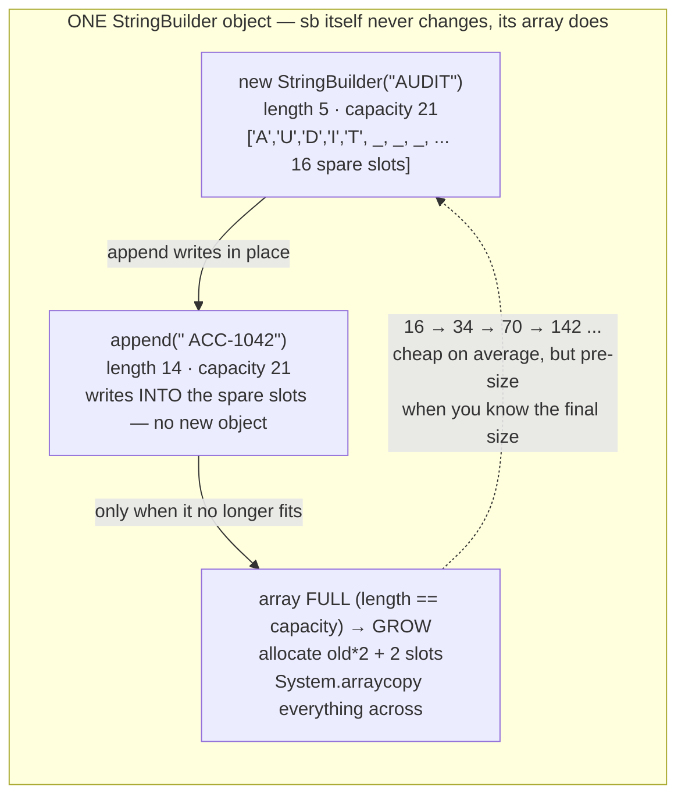
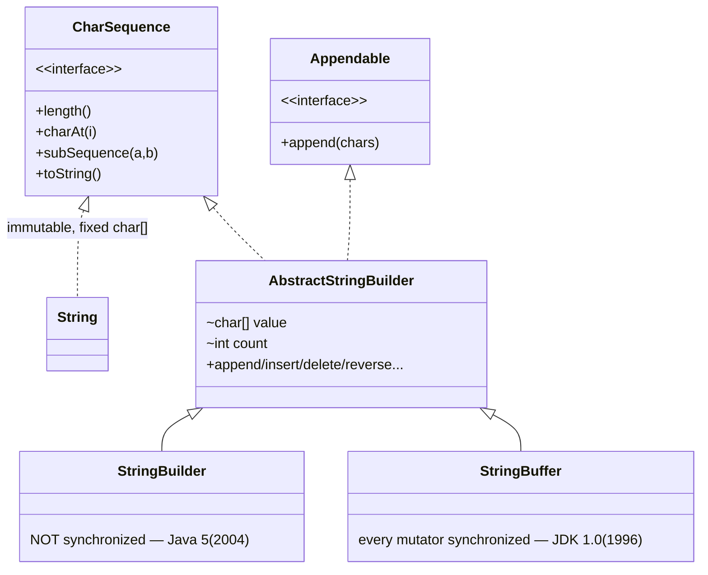
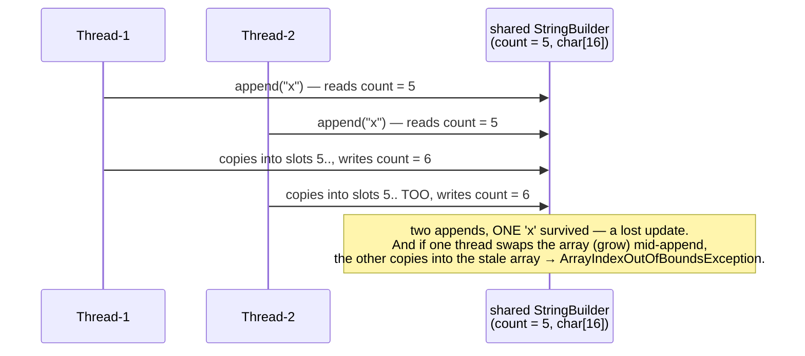

# 04 — StringBuilder & StringBuffer

**The big idea:** a `String` is immutable, so building one piece-by-piece with `+`
creates a **throwaway String per piece** (module 03's trap). A `StringBuilder` is
**ONE mutable object**: a `char[]` that grows as you keep appending into it.
`toString()` freezes the result into a real String only at the very end.
`StringBuffer` is the older twin: identical API, but every *mutator* (a method that
changes the object) is `synchronized` — one thread at a time inside its lock. That is
needed only when one instance is genuinely shared across threads.

## The mental picture: same object, growing array

**Read the diagram:**

- `length()` = chars used; `capacity()` = slots in the array. `append` writes into the
  spare slots — no new object.
- When length reaches capacity, the array GROWS and everything is copied across; the
  dashed loop shows the growth chain.

The growth rule is **newCapacity = old × 2 + 2** — `CapacityGrowthDemo` prints every
growth and the test pins it down: 16 → 34 → 70.

## The class family

**Read the diagram:** solid triangle = *extends*, dashed triangle = *implements*. Top:
two capability interfaces; middle: `AbstractStringBuilder` (implements both); bottom:
the two public subclasses (extend it).

All the real work (the `char[] value` + `int count`, the growth rule, every
mutator) lives in **AbstractStringBuilder**. The two subclasses add almost
nothing — `StringBuffer` just re-declares the mutators `synchronized`.
Buffer came **first**; Builder was added in Java 5 for the common case where
nobody shares the object and the locks are pure overhead.

## Lost updates: why sharing a Builder across threads breaks

**Read the diagram:** two threads, one shared builder, one unlucky moment.

- Both threads read `count = 5` before either writes.
- Both copy 'x' into slot 5; both write `count = 6`.
- Two appends, ONE 'x' survived: a *lost update* (one write overwritten by another). The
  Note adds the worse case: a mid-append grow → `ArrayIndexOutOfBoundsException`.

**Walkthrough — what one `append("x")` does inside:**

1. Read `count` — how many chars are used.
2. Ensure room for one more char (grow if needed).
3. Copy 'x' into slot `count`.
4. Write `count + 1` back.

That is **check-then-act**: read the state, then act on what you read, with an unguarded
gap between. `StringBuffer`'s lock makes it atomic — one thread at a time;
`StringBuilder` lets threads interleave inside it.

**In one sentence:** the lock does not make `append` smarter — it makes check-then-act
indivisible, exactly what a shared Builder lacks.

## Builder vs Buffer — the decision table

| Situation | Use | Why |
|---|---|---|
| Building text inside a **loop** | `StringBuilder` | one mutable buffer; `+=` makes N throwaway Strings (O(n²)) |
| **Local** variable, single thread (99% of real code) | `StringBuilder` | a local cannot be reached by other threads — locking buys nothing |
| One instance genuinely **shared across threads** | `StringBuffer` — or better: give each thread its own builder and merge | every mutator is `synchronized`: correct, slightly slower |
| **Single-expression** concat `"a" + b + "c"` | plain `+` | the compiler turns it into a StringBuilder anyway (PerformanceDemo §2) |
| Readable one-liner with placeholders | `String.format` | clarity beats micro-optimization outside hot loops |

## Class flow

1. Show the diagrams above (concept first — before opening any code).
2. Run the demos in order: `.\mvnw.cmd -pl 04-stringbuilder-stringbuffer compile exec:java`
   (runs `StringBuilderBufferDemos`, which calls each demo `main()` in teaching order).
3. Run the tests as *proof*: `.\mvnw.cmd -pl 04-stringbuilder-stringbuffer test` —
   each test prints the behavior it asserts. **No test ever asserts a timing**
   (JIT — the just-in-time compiler — needs warmup, see module 01; GC, garbage
   collection, and machine load also make timings flaky); the builder race is
   asserted *leniently* and printed as evidence.

| Demo class | What it shows |
|---|---|
| `WhyBuildersDemo` | module 03's `+=` trap in five lines; same object, growing array; identityHashCode proof |
| `BuilderApiTourDemo` | append (all overloads, chaining = `return this`), insert/delete/deleteCharAt/replace, reverse, charAt/setCharAt, setLength trap, length vs capacity, toString snapshot |
| `CapacityGrowthDemo` | the three constructors, the 2n+2 growth rule (16 → 34 → 70), ensureCapacity, why pre-sizing wins |
| `BufferVsBuilderThreadDemo` | the `synchronized` flag via reflection; 8 threads × 5000 appends racing a shared Buffer (exact) vs a shared Builder (damaged, caught) |
| `PerformanceDemo` | 100k-part statement line timed three ways (print-only); when you DON'T need a builder |
| `StringBuilderBufferDemos` | launcher — runs everything above in order |

## Traps to name out loud

- `setLength(longer)` pads with `'\u0000'` — **not spaces**. Invisible in logs,
  fatal to file formats and `equals()`.
- `append` returns `this` — the same builder — which is ALL *fluent chaining*
  (`sb.append(a).append(b)`) is; no new object anywhere.
- `toString()` **copies**: the String snapshot stays valid even as the builder mutates on.
- `capacity()` is not `length()`: room vs content. Pre-size from an estimate
  (`rows × average line width`) to skip every grow-and-copy.
- Never assert timings in tests — measure, print, explain (module 01's JIT warmup).
