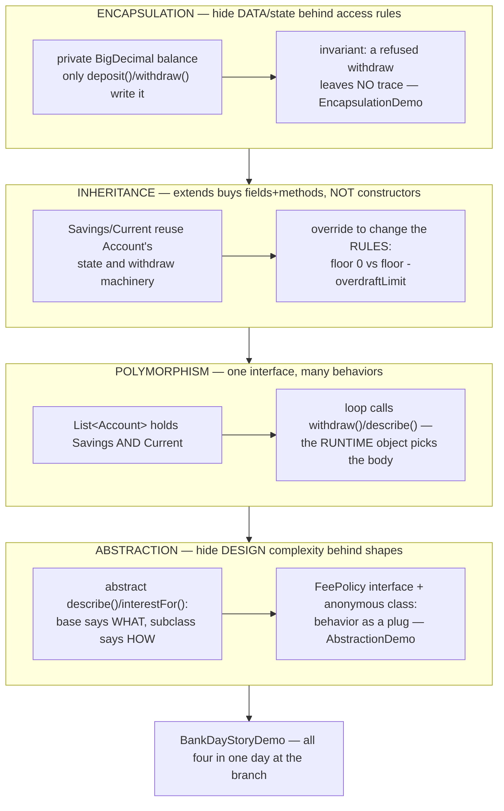
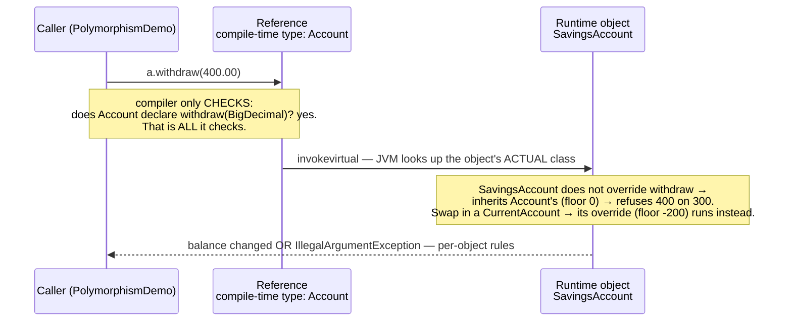
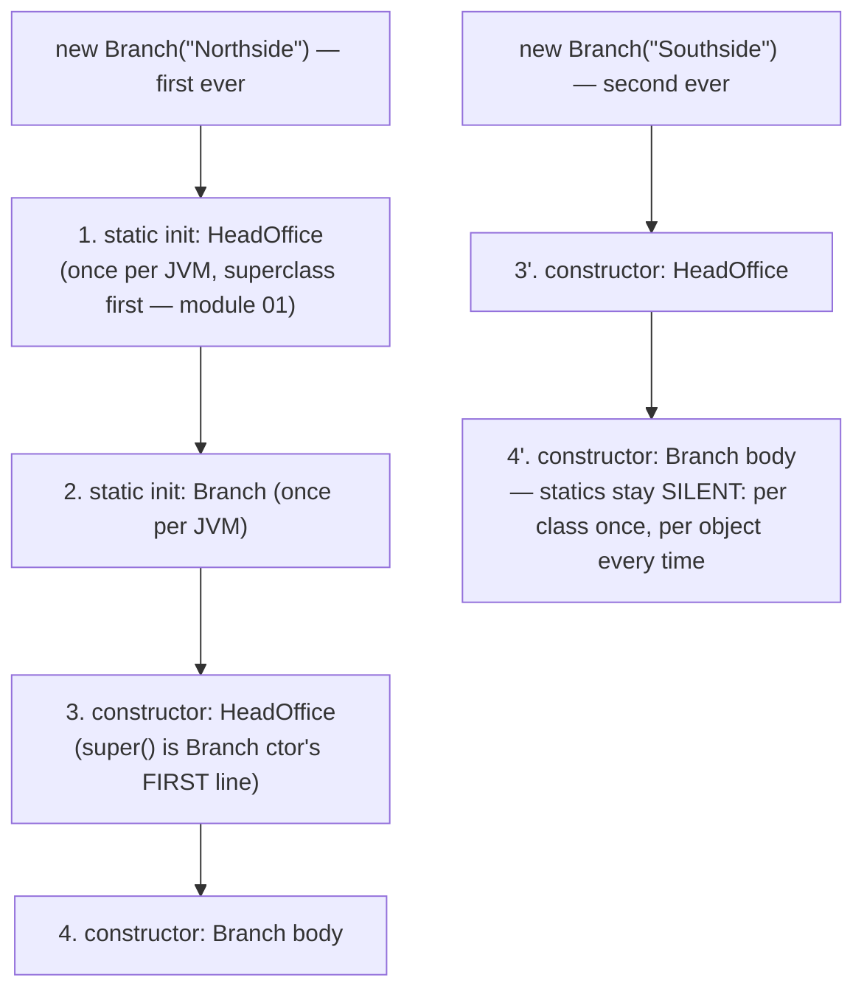

# 05 — The OOP Pillars

**The big idea:** four words everyone can recite and almost nobody can point at.
This module makes each pillar **physical**, using ONE tiny bank: `Account` and its
two subclasses, a `Customer`, and a one-method `FeePolicy` interface. Encapsulation
guards the balance, inheritance shares the machinery, polymorphism makes one loop
work on many kinds, abstraction lets the loop be written before the kinds exist.
The story peaks in `BankDayStoryDemo` — a full day at the branch where all four
run together.

## The four pillars, one bank



**Read the diagram:** each box = one pillar, with the bank code that makes it physical.

- ENCAPSULATION: `balance` is private; only deposit()/withdraw() write it.
- INHERITANCE: Savings/Current reuse Account's machinery; overrides change the RULES.
- POLYMORPHISM: one `List<Account>` holds both kinds; the RUNTIME object picks the body.
- ABSTRACTION: base says WHAT (abstract `describe()`), subclass says HOW; `FeePolicy` is
  behavior as a plug.

Teaching order matters: encapsulation makes an object trustworthy, inheritance
makes objects share machinery, polymorphism pays that sharing back to the caller,
abstraction is the design habit underneath all three. (Abstraction vs encapsulation
— the exam distinction — is printed at the end of `AbstractionDemo`: one hides the
*shape of the machine*, the other *locks the cabinet*.)

## The bank class hierarchy

```mermaid
classDiagram
    class Account {
        &lt;&lt;abstract&gt;&gt;
        -String id
        -String owner
        -BigDecimal balance
        #Account(id, owner, openingBalance)
        +deposit(BigDecimal)
        +deposit(String) overload!
        +withdraw(BigDecimal) floor 0
        #withdrawWithFloor(amount, floor)
        +describe()* abstract
        +interestFor(amount)* abstract
        +getBalance() — NO setBalance()
    }
    class SavingsAccount {
        -BigDecimal annualInterestRate
        +describe() override
        +interestFor() 4% — override
        +applyInterest()
    }
    class CurrentAccount {
        -BigDecimal overdraftLimit
        +withdraw() override — floor -limit
        +describe() override
        +interestFor() ZERO — override
    }
    class FeePolicy {
        &lt;&lt;interface&gt;&gt;
        +feeFor(amount)
    }
    class Customer {
        -static int nextNumber
        -String id
        -String name
        +Customer() this(...)-chain
        +greet()
    }
    Account <|-- SavingsAccount : extends (depth 2)
    Account <|-- CurrentAccount : extends (depth 2)
    FeePolicy <|.. AnonymousFeePolicy : anonymous inner class<br/>(lambdas: java8-features/01)
```

**Read the diagram:** a solid triangle = *extends*; a dashed triangle = *implements*.

- `Account` (abstract) sits on top; `SavingsAccount` and `CurrentAccount` extend it —
  each adds exactly one idea (interest / overdraft).
- `FeePolicy` is a one-method interface, implemented by an anonymous inner class.
- `Customer` stands alone: it shows the `this(...)` constructor chain and a static counter.

Inheritance depth is deliberately **2**. Every subclass adds exactly one idea
(interest / overdraft), so there is always a single line to point at when asking
"where did that behavior come from?"

## Dynamic dispatch — what actually runs

*Dynamic dispatch* — the JVM picks which method body to run at runtime, from the
object's ACTUAL class.



**Read the diagram:**

- The caller's reference has compile-time type `Account`; the actual object is a
  `SavingsAccount`. The call is `a.withdraw(400.00)`.
- The compiler only CHECKS: does `Account` declare `withdraw(BigDecimal)`? Yes — that is
  ALL it checks.
- At runtime the JVM (`invokevirtual`) looks up the object's ACTUAL class.
  `SavingsAccount` does not override `withdraw`, so the inherited `Account` body runs
  (floor 0) and refuses 400 on 300. A `CurrentAccount` would run its override (floor −200).
- Outcome: balance changed OR `IllegalArgumentException` — per-object rules.

The one-liner to recite: **the compile-time type decides what you may CALL; the
runtime type decides what RUNS.** That is also why `Account ref = savings;
ref.applyInterest();` does not compile even though the object *is* a
SavingsAccount — `applyInterest` is not on the reference's type. The classic
escape is `instanceof` + cast (ask, then cast). Java 16 merges the two into
pattern matching — `if (a instanceof SavingsAccount s)` — noted here for
completeness only; this module drills the classic form on purpose.

## Construction order — the printout students photograph



**Read the diagram:** two timelines.

- The FIRST `new Branch("Northside")` triggers everything: static initializers first —
  HeadOffice, then Branch (once per JVM, superclass first) — then constructors:
  HeadOffice's body (`super()` is the Branch ctor's FIRST line), then Branch's body.
- The SECOND `new Branch("Southside")` repeats only the constructor steps; statics stay
  SILENT — per class once, per object every time.

`ConstructionOrderDemo` records every step into a log the test reads back — the
order is asserted, not just admired.

**In one sentence:** static initializers run once per class, superclass first;
constructors run again for every object, superclass first.

## Overloading vs overriding — the contrast table

| | OVERLOADING | OVERRIDING |
|---|---|---|
| Lives in | one class (or family) | subclass vs superclass |
| Signature | must **differ** | must **match** |
| Decided | **compile time** (static) | **runtime** (dynamic dispatch) |
| Decided by | argument's *declared* type | object's *actual* class |
| Purpose | convenience names (`deposit(BigDecimal)` / `deposit(String)`) | change behavior per type (`withdraw` floor) |
| Annotation | none exists | `@Override` — wear it or the typo'd signature silently becomes an overload (`InheritanceDemo`'s `SneakyLogger`) |

## Class flow

1. Show the diagrams above (concept first — before opening any code).
2. Run the demos in order: `.\mvnw.cmd -pl 05-oop-pillars compile exec:java`
   (runs `OopPillarsDemos`, which calls each demo `main()` in teaching order).
   *If the parent pom lists later modules that don't exist on disk yet, use
   `.\mvnw.cmd -f 05-oop-pillars\pom.xml compile exec:java` instead.*
3. Run the tests as *proof*: `.\mvnw.cmd -pl 05-oop-pillars test` — each test
   prints the behavior it asserts.

| Demo class | What it shows |
|---|---|
| `ClassVsObjectDemo` | blueprint vs house; what `new` does step-by-step; field-init order; default vs explicit ctors, `this(...)` chaining |
| `EncapsulationDemo` | the invariant says NO (caught `IllegalArgumentException`); no `setBalance()`; `LeakyAccount` — what a public field costs |
| `InheritanceDemo` | what IS inherited (fields+methods) vs what ISN'T (constructors); the `log(Object)` typo trap; `@Override`; `super.method()` extends, doesn't replace |
| `ConstructionOrderDemo` | parent static init → child static init → parent ctor → child ctor, printed and logged; statics run once |
| `PolymorphismDemo` | one `List<Account>`, many behaviors; compile-time vs runtime type; `instanceof` + cast downcast idiom |
| `OverloadVsOverrideDemo` | compile-time overload choice (the `Object mystery` cast proof) vs runtime dispatch; the side-by-side table |
| `AbstractionDemo` | abstract WHAT/HOW split; `new Account(...)` compile error; abstract classes DO have constructors; `FeePolicy` via anonymous inner class; abstraction vs encapsulation |
| `BankDayStoryDemo` | a full day at the branch — payroll, rent day (one refusal, one overdraft), interest run, fee desk, end-of-day report |
| `OopPillarsDemos` | launcher — runs everything above in order |

## Common exam questions

| Question | Answer | Where it's proven |
|---|---|---|
| Overload vs override? | Overload: same class, different signature, **compile-time**. Override: inheritance, same signature, **runtime** dispatch. | `OverloadVsOverrideDemo`, `overloadPicksCompileTimeType` / `overrideDispatchPicksRuntimeType` tests |
| Can an abstract class have a constructor? | **Yes** — it can't be instantiated, but its constructor runs via `super(...)` to build the parent half of every subclass object. | `InheritanceDemo` §1, `abstractClassIsConstructibleButNotInstantiable` test |
| Can you `new` an abstract class? | No — compile error "abstract; cannot be instantiated". | `AbstractionDemo` §2 (error shown in comment + `Modifier.isAbstract` at runtime) |
| Is Java pass-by-reference? | **No** — always pass-by-value; objects pass a *copy of the reference*. | module 02 (`02-primitives-vs-references`) |
| What is inherited? | Fields (yes, even private ones — they ride inside the object) and methods. **Not** constructors. | `InheritanceDemo` §1 |
| Why `@Override`? | A typo'd signature silently becomes an overload that compiles and never runs; the annotation makes the compiler reject it. | `InheritanceDemo` §2 (`SneakyLogger`) |
| Must `super(...)`/`this(...)` be the first line? | Yes — parent (or sibling ctor) builds first; you can't touch a half-built `this`. | `SavingsAccount`, `ConstructionOrderDemo` |
| Construction order? | parent static init → child static init (once per class) → parent ctor → child ctor (per object). | `ConstructionOrderDemo`, `superConstructorOrder` test |
| Compile-time type vs runtime type? | Compile-time type decides what you may CALL; runtime type decides what RUNS. | `PolymorphismDemo`, dispatch sequence diagram above |
| Downcast safely? | `instanceof` first, then cast (pattern-matching `instanceof` arrived in Java 16 — not in this `--release 8` module). | `PolymorphismDemo` §4 |
| Abstraction vs encapsulation? | Abstraction hides **design** complexity behind shapes; encapsulation hides **data/state** behind access rules. | `AbstractionDemo` §4 |

## Traps to name out loud

- A **public field** is an invariant hole with an address: any caller can write
  `balance = -999999` and no method ever runs to object (`EncapsulationDemo` §3).
- A **setter that accepts anything** is the same hole with a polite name — that's
  why `Account` has `getBalance()` and no `setBalance()`.
- A typo'd override signature (`log(Object)` for `log(String)`) **compiles clean
  and never runs**. `@Override` is the alarm bell, not decoration.
- Overload choice reads the argument's **declared** type: an `Object` holding a
  `String` does not reach `deposit(String)` without a cast.
- `instanceof` before every downcast — casting first is how
  `ClassCastException` happens.
- Static initializers run **once per class**; constructors run **once per object**.
  Confusing the two is a module-11 problem waiting to happen — flag it now.

## Where this leads

- `06-access-modifiers` — the full public/protected/private ladder (`withdrawWithFloor`'s `protected` gets its justification there).
- `07-interfaces-vs-abstract-classes` — when `FeePolicy` should have been an abstract class, and vice versa.
- `11-static-and-class-vs-instance` — the `nextNumber` counter and the static-init lines, unpacked properly.
- `../java8-features/01-lambdas` — the anonymous `FeePolicy` becomes one arrow.
