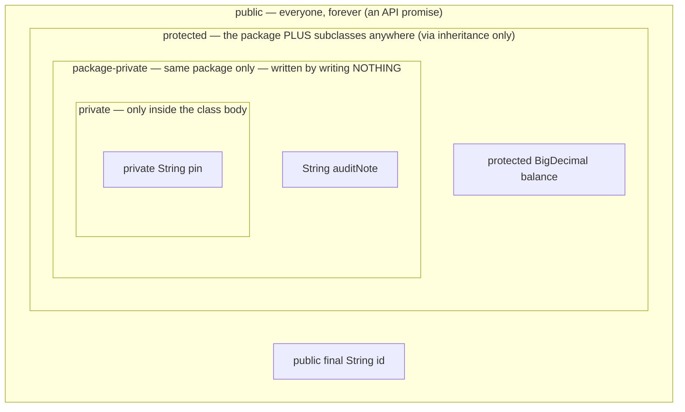
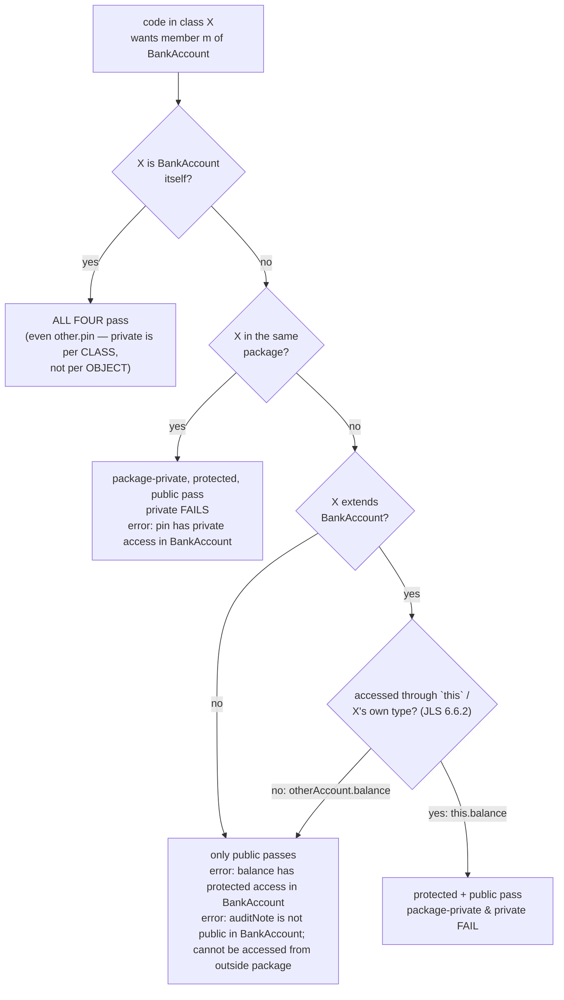

# 06 — Access Modifiers

**The big idea:** access modifiers are not about hiding secrets — they are about
**limiting coupling**: how much other code depends on your internals. Every `public`
member is a promise other code will build on,
a promise you keep forever. The narrower the modifier, the more freedom you keep to
change the implementation. Module 05 said "protect the invariant"; this module is the
language feature that **enforces** it.

The dial has four settings, applied to **members** (fields/methods) and, with two
settings only, to **top-level classes**. One class carries all four levels so every
demo looks at the same code from a different seat:

```java
public class BankAccount {
    public final String id;      // everyone, everywhere
    protected BigDecimal balance; // package + subclasses anywhere (through inheritance)
    String auditNote;             // package-private — NO KEYWORD (the accident)
    private String pin;           // this class body only
}
```

## Visibility is concentric — each ring contains the ones inside it



**Read the diagram:** the rings, outermost to innermost, are `public` → `protected` →
package-private (no keyword) → `private`. Read them as *who can touch what*: anything
that can reach a ring can reach every ring inside it —
`private ⊂ package-private ⊂ protected ⊂ public`.

## "Can X see member m?" — the decision a compiler makes



**Read the diagram:** start at the top and answer each diamond in turn.

- X **is** `BankAccount` itself → ALL FOUR pass — even `other.pin`, because private is
  per CLASS, not per OBJECT.
- X is in the same package → package-private, protected and public pass; private fails.
- X neither, and X does not extend `BankAccount` → only public passes.
- X is a subclass in another package → one more question: is the member reached through
  `this` / X's own type? Yes → protected + public pass. No (`otherAccount.balance`) →
  public only.

## The 4×4 matrix (rows = where the accessing code lives, cols = the member's modifier)

| Access from ↓ / member is → | `private` | package-private *(no keyword)* | `protected` | `public` |
|---|---|---|---|---|
| **Same class** | YES | YES | YES | YES |
| **Same package** (different class) | no | YES | YES | YES |
| **Different package, subclass** (through inheritance: `this.m`) | no | no | YES — own inherited copy only | YES |
| **Different package, non-subclass** (everywhere else) | no | no | no | YES |

Two cells students get wrong, both proven by tests in this module:

1. **Same package + `private` = still no.** `private` is class-level, not package-level.
2. **Subclass + `protected` = yes, but only on `this`** (or a reference typed as the
   subclass itself). `someOtherAccount.balance` is `error: balance has protected access
   in BankAccount` — even inside the subclass. Protection is about **your inherited
   copy**: without this rule, any class anywhere could `extends BankAccount` and read
   every balance in the bank.

## The protected subtlety — the exam favorite

```java
public class SubclassInOtherPackage extends BankAccount {   // other package!

    public BigDecimal readMyOwnBalanceDirectly() {
        return this.balance;            // COMPILES — my inherited copy
    }

    public void nope(BankAccount other) {
        // BigDecimal b = other.balance;
        //   javac: error: balance has protected access in BankAccount
    }

    public BigDecimal peek(SubclassInOtherPackage sibling) {
        return sibling.balance;         // COMPILES — receiver typed as OUR OWN subclass
    }
}
```

Same field, three lines, two verdicts — the difference is the **receiver's type** (the
expression in front of the dot), not the object. `ProtectedViaSubclassDemo` and
`ProtectedViaInheritanceTest` walk all three.

**In one sentence:** across packages, `protected` opens only through your own inherited
copy — `this`, or a reference typed as your own subclass.

## Modifiers on classes

| Level | Top-level class | Nested class |
|---|---|---|
| `public` | YES — exported API | YES |
| package-private (no keyword) | YES — module-internal (how the JDK hides impl classes) | YES |
| `protected` | **compile error:** `modifier protected not allowed here` | YES |
| `private` | **compile error:** `modifier private not allowed here` | YES — e.g. `BankAccount.Vault`, holding the pin checks |

A top-level class has no enclosing class and no inheritance chain to give
`private`/`protected` a meaning — so the dial loses two settings. Nested classes keep
all four: `Vault` is a private static nested class no outsider can even name
(`error: Vault has private access in BankAccount`), while `checkPin()` uses it freely.

## Getters/setters — the controlled door

`private pin` + `public boolean checkPin(String)` = **capability, not just visibility**:
the method hands out an *answer* ("is this the pin?") instead of the *secret*. A door
can validate (`deposit` rejects negatives), demand proof (`rotatePin` requires the
current pin), log, or copy; a public field can only be assigned. That is the whole
encapsulation argument from module 05, now with teeth.

## Common misconceptions

| Misconception | Reality |
|---|---|
| "Forgetting a modifier gives you private." | It gives you **package-private** — silent, legal, wider than you meant. Name the accident. |
| "private members are not inherited." | They **are** — the field physically exists in every subclass instance's memory (proved via `getDeclaredField("pin")` on a `SubclassInOtherPackage` object). What subclasses never get is access **by name**. |
| "protected means subclasses can read the field on any object." | Only on `this` / their own subclass type. `otherAccount.balance` is a compile error (JLS 6.6.2). |
| "private means one object can't see another's privates." | Private is per **class**: `BankAccount.samePinAs(other)` legally reads `other.pin`. |
| "Reflection can't break private." | `setAccessible(true)` breaks it — that's an escape hatch for frameworks/tests/debuggers, **not a design tool**. If your code needs it, the API is missing a method. |
| "package-private is sloppy / avoid it." | It's the **module-internal** tool: `java.util`'s implementation helpers are hidden exactly this way. |

## Design guidance

- **Start private, widen deliberately.** Every widening is a permanent API promise.
- **Package-private is your module boundary** — everything inside a package is a trust
  zone; everything outside gets the public API. (Java 9 modules, `module-info.java`,
  add one more wall *outside* packages: a package can be public in source yet
  unexported at runtime. README-level note only — this course stays on `--release 8`.)
- **`protected` is for extension points** — designed-in hooks for subclasses
  (`HttpServlet.doGet`, `balance` here), not "a bit more public".
- **`public` is forever.** You can always add; removing or narrowing breaks callers
  that already exist.

## Class flow

1. Show the diagrams + matrix above (concept first, code second).
2. Run the demos in order: `.\mvnw.cmd -pl 06-access-modifiers compile exec:java`
   (runs `AccessModifiersDemos`, which calls each demo `main()` in teaching order).
3. Run the tests as *proof*: `.\mvnw.cmd -pl 06-access-modifiers test` — each test
   prints the access it proves, including the forbidden lines' real javac messages.

| Class | Package | Role |
|---|---|---|
| `BankAccount` (+ private nested `Vault`) | `…access.bank` | the library: one field/method per modifier level |
| `SamePackageClass` | `…access.bank` | same-package vantage point; reads/writes `auditNote` directly |
| `PackagePrivateHelper` | `…access.bank` | top-level class with **no** modifier — invisible outside the package |
| `UnrelatedClass` | `…access.other` | other package, non-subclass: public-only vantage point |
| `SubclassInOtherPackage` | `…access.other` | other package, subclass: `this.balance` yes, `other.balance` no |
| `FromInsideTheClassDemo` | `…access` | vantage point 1: inside the class — all four visible; one `BankAccount` may legally read another's private `pin` |
| `SamePackageDemo` | `…access` | vantage point 2: borrows same-package eyes (the demo itself is outside!) |
| `OtherPackageDemo` | `…access` | vantage point 3: the outside world — public or nothing |
| `ProtectedViaSubclassDemo` | `…access` | vantage point 4: the protected subtlety, both verdicts |
| `ClassLevelModifiersDemo` | `…access` | modifiers on classes: top-level 2 settings, nested 4 |
| `ReflectionEscapeHatchDemo` | `…access` | `setAccessible(true)`; private fields live in subclass memory |
| `AccessModifiersDemos` | `…access` | launcher — runs all demos in order with section banners |

Every forbidden access in the source is a **commented-out line beside its real javac
error message** — compile errors can't run, so the errors are the exhibit.
