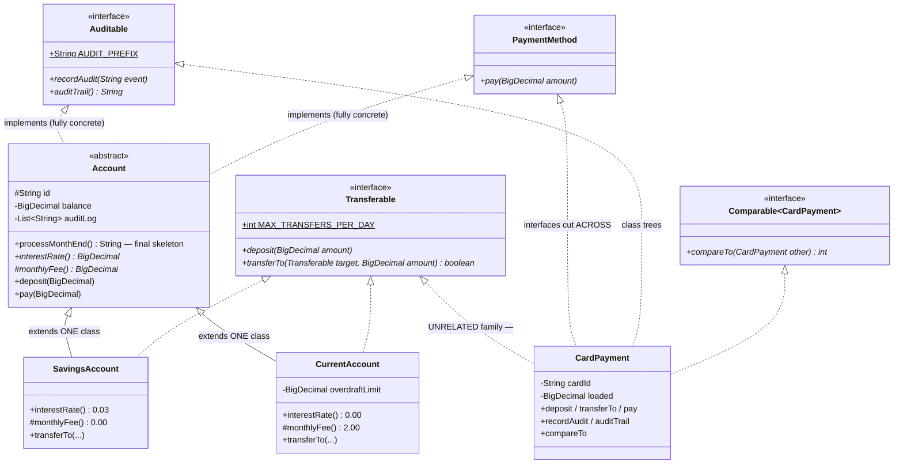
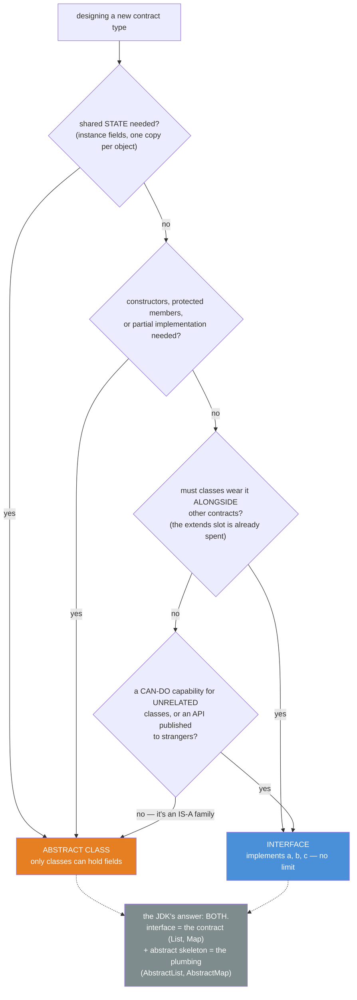
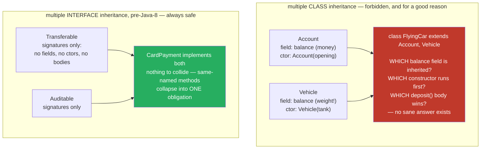

# 07 — Interfaces vs Abstract Classes

**The big idea:** Java gives you exactly two ways to define a *contract type* — a type that
says what a class must be able to do, so callers can rely on it. Pre-Java-8 the choice is a
decision, not a taste. An **interface** says **CAN-DO**: signatures only, no state (instance
fields — data each object holds), no code, no constructors — and a class may wear as many as
it likes. An **abstract class** says **IS-A (with shared plumbing)**, where *plumbing* means
implementation code written once that every subclass inherits: per-object state,
constructors, partial implementation, protected members — and a class gets exactly ONE.

> Everything in this module teaches the **pre-Java-8 rules** on purpose. Java 8 gave
> interfaces `default`/`static` methods and rewrote two rows of the table below — that
> story lives in [`java8-features/02-interface-evolution`](../../java8-features/02-interface-evolution/README.md),
> with a clearly-marked teaser at the end of this README. The STATE row never changes.

## The bank contracts (class diagram first, code second)



**Read the diagram:** a dashed triangle = *implements*; a solid triangle = *extends*.
Point at the two halves of the picture:

- **Top-left family:** `Account` is the IS-A family — shared state (`balance`, `auditLog`),
  a `protected` constructor reached via `super(...)`, plumbing written once
  (`deposit`/`pay`/audit), two abstract **blanks** (`interestRate`, `monthlyFee`).
- **Right column:** `CardPayment` has NO common ancestor with `Account` — it shares only
  the *capabilities*. Four interfaces, one (implicit) class slot spent on `Object`.

## Interface or abstract class? (decision flowchart)



**Read the diagram:** start at the top; answer each diamond in turn.

- Shared STATE needed (instance fields, one copy per object)? YES → ABSTRACT CLASS — only
  classes can hold fields.
- Constructors, protected members, or partial implementation needed? YES → ABSTRACT CLASS.
- Must classes wear it ALONGSIDE other contracts (the one `extends` slot is already spent)?
  YES → INTERFACE — `implements a, b, c`, no limit.
- A CAN-DO capability for UNRELATED classes, or an API published to strangers? YES →
  INTERFACE; no (it's an IS-A family) → ABSTRACT CLASS.

`DecisionWalkthroughDemo` walks this chart twice on our own types: `Account` answers YES
at the first question (state!), `Transferable` falls all the way through to interface
(unrelated families, four contracts on one card).

## Why ONE class but MANY interfaces — the diamond with state



**Read the diagram:**

- Top half — forbidden: a `FlyingCar` extending both `Account` and `Vehicle` faces the
  node's unanswerable questions: which `balance`? which constructor first? which
  `deposit()` wins?
- Bottom half — safe: `CardPayment` implements both `Transferable` and `Auditable`, and
  because pre-Java-8 interfaces carry signatures only, there is nothing to collide.

Classes carry **state and constructors** — two parents means two answers to every question.
Pre-Java-8 interfaces carry **neither**, so there is literally nothing to collide.
(Java 8 `default` methods reintroduce a *mild* version of the diamond — two unrelated
defaults for one name is a compile error, fixed with `InterfaceName.super.method()`.
That is `DiamondConflictDemo` in `java8-features/02-interface-evolution`.)

**In one sentence:** multiple CLASS inheritance is forbidden because two parents means two
answers; multiple INTERFACE inheritance was safe because pre-Java-8 interfaces had nothing
to collide.

## Capability table (pre-Java-8 — printed live by `DecisionWalkthroughDemo`)

| Capability | `interface` (pre-Java 8) | `abstract class` |
|---|---|---|
| Instance fields (**state**) | **NO** — constants only (`public static final`, one shared copy, *not* per-object) | **YES** — one copy per object, any visibility |
| Constructors | **NO** | **YES** — `protected` by convention, reached via `super(...)` |
| Method bodies | **NO** — every method is implicitly `public abstract` | **YES** — concrete + abstract mixed freely |
| Member visibility | `public` only (implicit — `private int x = 1;` is `error: modifier private not allowed here`) | all four levels, incl. `protected` blanks (`monthlyFee`) |
| Static members | constants only (static final **fields**) | anything static |
| Multiple inheritance | **MANY** per class (`implements a, b, c`) | exactly **ONE** (`extends x`) |
| Directly instantiable | never (`new Account(...)` → `error: Account is abstract; cannot be instantiated`) | never — same error |
| When to choose | CAN-DO capability; unrelated classes share it; API for strangers; needed alongside other contracts | IS-A family; shared state/constructors/protected plumbing; template method |
| **Java 8 changes this row?** | **YES** — + `default` methods, + `static` methods (see teaser below) | unchanged |

**Rule of thumb:** *interfaces for CAN-DO contracts, abstract classes for IS-A families
with shared plumbing.* And the JDK's own move — **interface + abstract skeleton = best of
both**: `List` (the contract strangers code against) + `AbstractList` (free plumbing for
friends); same for `Map`/`AbstractMap`. `DecisionWalkthroughDemo` proves the pattern on
`java.util` itself, by reflection.

## The template method — the abstract class killer app

A **template method** is a `final` skeleton method: it fixes the order of the steps once
and calls abstract *blanks* that subclasses fill in. `Account.processMonthEnd()` is
exactly that, and it is `final`: **interest → fee → audit**, always in that order,
written once. Subclasses fill the *blanks* (`interestRate()`, `monthlyFee()`), never touch
the *skeleton*. `final` here means **subclasses may not break the skeleton** — a
`GreedyAccount` that tries gets, word for word:

```text
error: processMonthEnd() in GreedyAccount cannot override processMonthEnd() in Account
overridden method is final
```

Interfaces can *declare* the blanks; pre-Java-8 they can never *ship* the skeleton.

## Callbacks — the last ceremony before lambdas

A *callback* is a piece of code you hand to a method, for that method to call back at the
time of its choosing. `FeeCalculator` (one abstract method) is passed to
`AnonymousCallbackDemo.totalOf(...)`: the callee decides *when* to call back, the caller
decides *what runs*. Pre-Java-8 the only way to write one on the spot is the **anonymous
inner class** — a class written inline, with no name of its own — five lines and its own
`$1.class` file per idea. Both anonymous classes in this module carry the same forward
pointer: `java8-features/01-lambdas` deletes the wrapping and keeps the interface as the
target type — *this becomes one arrow*.

## TEASER (prints only — no default-method code in this module)

> **In Java 8, interfaces grow `default` and `static` methods** — `Predicate.and()` exists
> *because* of this: pre-8, adding any method to a published interface broke every
> implementor on earth; a `default` method saves them all. That **breaks two rows of the
> capability table above** (method bodies, static members) — but NOT the state or
> constructor rows, so this module's decision flowchart survives.
> `Java8TeaserDemo` prints exactly which rows move; the whole story is
> [`java8-features/02-interface-evolution`](../../java8-features/02-interface-evolution/README.md).

## Class flow

1. Show the three diagrams above (concept first, code second).
2. Run the demos in order: `.\mvnw.cmd -pl 07-interfaces-vs-abstract-classes compile exec:java`
   (this runs `ContractsDemos`, which calls each demo `main()` in teaching order).
3. Run the tests as *proof*: `.\mvnw.cmd -pl 07-interfaces-vs-abstract-classes test` — each
   test proves ONE claim and prints the evidence it asserts.

*(Tip: while sibling modules are still being written, `-pl` from the repo root can fail on
missing module folders — use `.\mvnw.cmd -f 07-interfaces-vs-abstract-classes\pom.xml test`
and `... compile exec:java` instead. Same thing, scoped straight to this module.)*

| Demo class | What it shows |
|---|---|
| `InterfaceAnatomyDemo` | reflection proves `int MAX = 3;` in an interface is silently `public static final`, methods are `public abstract`; constants are shared, not per-object; implement-all-or-be-abstract |
| `AbstractAccountDemo` | per-object STATE, constructor ordering via `super(...)`, concrete + abstract + protected + **final** members side by side, plumbing written once |
| `TemplateMethodDemo` | the skeleton-vs-blanks story, exact month-end arithmetic, `final` = policy (with the override error word for word) |
| `MultipleInheritanceDemo` | one class slot vs four interface slots (reflection), the same object through five type-lenses, account + card in one `List<Transferable>`, the diamond with state |
| `DecisionWalkthroughDemo` | the capability table printed live, two decision walk-throughs, `List`/`AbstractList` skeletal pattern proven on `java.util` |
| `AnonymousCallbackDemo` | `FeeCalculator` as a callback contract, two anonymous inner classes (the module's only two), the one-arrow forward pointer |
| `Java8TeaserDemo` | PRINTS ONLY: which table rows Java 8 rewrites, why `Predicate.and()` exists, pointers to `java8-features` 01 and 02 |
