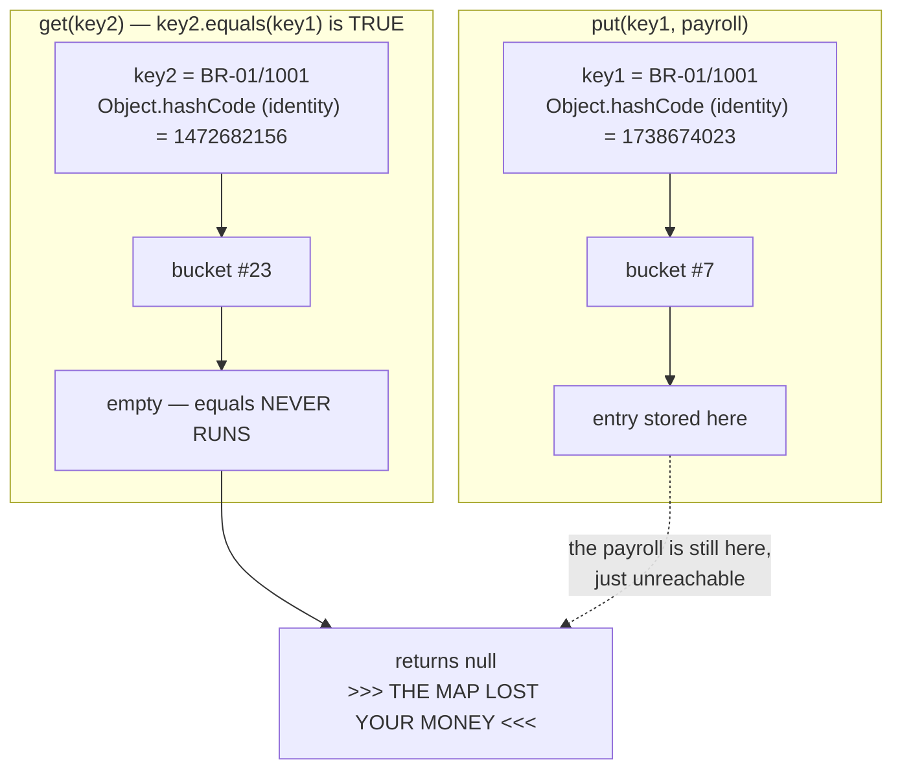

# 08 — equals & hashCode: The Contract

**The big idea:** `equals` and `hashCode` are one deal, not two methods. `HashMap` finds
the **bucket** — one slot in its internal array — with `hashCode`, and only then searches
**within** the bucket with `equals`.
Override one without the other and equal objects land in different buckets — `equals` never
even runs, and your lookups return `null` while the data sits right there in the map. Every
`HashSet`, `HashMap`, `Hashtable`, and the "distinct" corner of the collections library
silently assumes you kept the **contract** — the documented promise about how the two
methods must behave together.

Domain for the module: SecureBank's `AccountKey` (branchCode + accountNumber) — a VALUE
used as a `HashMap` key / `HashSet` element — plus `Transaction` (a `BigDecimal` amount) as
the stored value. Two versions of the key live side by side so the damage is printable:
`BrokenAccountKey` (equals only) and `AccountKey` (equals + hashCode, immutable).

## The HashMap journey — hash picks the bucket, equals searches inside it

```mermaid
flowchart TB
    K["key = new AccountKey(\"BR-01\", \"1001\")"] --> H["1. key.hashCode()<br/>-> an int"]
    H --> I["2. spread & mod<br/>-> bucket index"]
    I --> B0["bucket[0]"]
    I --> B1["bucket[1]<br/>entry: hash, keyA, value<br/>-> next: keyB ..."]
    I --> B2["bucket[2]"]
    B1 --> W["3. walk the chain in THIS bucket only:<br/>for each entry, compare hash first,<br/>then key.equals(entry.key)"]
    W -->|"equals true"| HIT["found -> return value"]
    W -->|"no entry matches"| MISS["not found -> null"]
    B0 -.->|"never even looked at"| X[" "]
    B2 -.->|"never even looked at"| X
```

**Read the diagram:** one `get` (steps 1–3) above, the bucket array below. The dashed
arrows are the point: only the selected bucket is searched.

**Walkthrough — what `map.get(key)` actually invokes:**

1. `key.hashCode()` → an int.
2. HashMap spreads the int's bits and reduces them to a bucket index ("spread & mod").
3. Walk the chain in THAT bucket only: for each entry, compare the stored hash first
   (cheap), then `key.equals(entry.key)`.
4. `equals` true → return that entry's value. Chain exhausted with no match → `null`.

Point at this while saying: **a wrong `hashCode` sends the lookup to the wrong bucket, and
`equals` — however perfect — is never called.** That single sentence explains every
"my HashMap lost the value" bug ever filed.

## What breaks when hashCode is missing (BrokenEqualsOnlyDemo)



**Read the diagram:**

- Left, `put`: `key1` uses the default `Object.hashCode` — identity-based, here
  1738674023 — so the entry is stored in bucket #7.
- Right, `get`: `key2` has equal CONTENTS (`key2.equals(key1)` is TRUE), but its identity
  hash is 1472682156, so HashMap looks in bucket #23.
- Bucket #23 is empty — `equals` NEVER RUNS — so `get` returns `null`, while the payroll
  entry still sits in bucket #7, unreachable.

The failure is **deterministic**, not flaky: the default `Object.hashCode` is identity-based,
so two distinct objects virtually never share a bucket. That reliability is why the test can
`assertNull(map.get(equalKey))`.

## Optional third picture — the mutable key moves buckets (MutableKeyTrapDemo)

```mermaid
flowchart LR
    A["put(key, payroll)<br/>key.hashCode() = 1968149315<br/>-> filed in bucket #11"] --> M["key.setBranchCode(\"BR-02\")<br/>MUTATE the stored key"]
    M --> B["key.hashCode() = 1968149346<br/>-> now 'belongs' in bucket #19"]
    B --> G["get(key) hashes AGAIN -> looks in #19<br/>entry is sitting in #11 -> null"]
```

The entry never moved; the key's hash did. **Keys must be immutable** — which is exactly why
`AccountKey` is `final` with `final` fields, and why `String` (immutable, hash CACHED after
first use — module 03) is the canonical map key.

## The FIVE-part equals contract

| # | Property | Rule | Broken if... | AccountKey |
|---|---|---|---|---|
| 1 | **Reflexive** | `x.equals(x)` is `true` | the field comparison is so sloppy that x against itself fails | the `this == other` fast path |
| 2 | **Symmetric** | `x.equals(y)` is true exactly when `y.equals(x)` is true | you use `instanceof` across a hierarchy (`SymmetryTrapDemo`: `p.equals(e)` is true, `e.equals(p)` is false) | the `getClass()` check — symmetric by construction |
| 3 | **Transitive** | if x equals y and y equals z, then x must equal z | instanceof and getClass are mixed in one hierarchy | follows from getClass + field equality |
| 4 | **Consistent** | repeated calls return the same answer | equals/hashCode are built from **mutable** state | `final` fields only — nothing can change |
| 5 | **False for null** | `x.equals(null)` returns `false` and never throws | the null guard is missing and the call throws a `NullPointerException` | an explicit `other == null` guard |

## The hashCode rules

| Rule | Status | Where shown |
|---|---|---|
| if two objects are equal, their hashCodes MUST be equal | MANDATORY | `HashCodeFixDemo` §2; asserted in `consistent` test |
| unequal objects MAY share a hash — a **collision**; that is fine, because the bucket walk compares with `equals` | allowed | `HashCodeFixDemo` §4: `"Aa".hashCode() == "BB".hashCode()`, both stored |
| every call must return the same result during one execution | MANDATORY | broken by mutation — `MutableKeyTrapDemo` |
| use the SAME fields equals uses, and no others | the golden rule | `AccountKey.hashCode` = `Objects.hash(branchCode, accountNumber)` |

## equals, line by line (AccountKey — the classic idiom)

```java
@Override
public boolean equals(Object other) {
    if (this == other) return true;                  // 1. identity fast path (reflexive, free)
    if (other == null) return false;                 // 2. null guard (rule 5: false, never throws)
    if (getClass() != other.getClass()) return false; // 3. EXACT type check (symmetry-safe)
    AccountKey that = (AccountKey) other;            // 4. now the cast is provably safe
    return Objects.equals(branchCode, that.branchCode)   // 5. field-by-field, null-safe
        && Objects.equals(accountNumber, that.accountNumber);
}

@Override
public int hashCode() {
    return Objects.hash(branchCode, accountNumber);  // SAME fields as equals — the rule
}
```

Traps named in the demos:

- **The overload trap** — `public boolean equals(AccountKey other)` is NOT an override; it
  overloads. Collections call `equals(Object)`, so your method is dead code and identity
  wins. `ProperEqualsDemo` §2 prints both: direct typed call `true`, through `Object` /
  `HashMap` `false`. **Always write `@Override`** — the compiler then catches this.
- **instanceof vs getClass** — `instanceof` lets a subclass equal a superclass instance and
  breaks symmetry the moment the subclass adds a field (`SymmetryTrapDemo`); `getClass()`
  forbids cross-type equality and keeps symmetry automatic. For value classes, `getClass()`
  is the safe default. (One comment block in `AccountKey` has the full debate.)
- **BigDecimal** — `2.0.equals(2.00)` is **false** (scale is part of equals) but
  `compareTo == 0` is **true** (module 02 callback). If money equality means compareTo,
  hashCode must ignore scale too (`stripTrailingZeros`). Decide consciously; `Transaction`
  carries the comment.
- **31\*result+field** — `HashCodeFixDemo` §3 prints the manual classic loop next to
  `Objects.hash` (identical results). 31 is an odd prime, and `31*i == (i<<5)-i` — a shift
  and a subtract, which the JVM does cheaply. In the real world the IDE generates this
  loop. **Read what it generates** — you own the field list it picked.
- **compareTo consistency** — sorted collections (`TreeSet`/`TreeMap`) decide "same
  element" with `compareTo`, **never** `equals`. `CompareToConsistencyTeaserDemo`:
  `HashSet<BigDecimal>` keeps `2.0` and `2.00` (size 2), `TreeSet` "loses" one (size 1).
  Flag planted for **module 10**.

**In one sentence:** write equals and hashCode together, over the same fields, on an
immutable class, always with `@Override`.

## The checklist (say it at the end of class)

1. **Overriding equals? Then hashCode too** — same fields, always, as one edit.
2. **Using the class as a HashMap key? Make it immutable** — final class, final fields, no setters.
3. **IDE-generated one? READ it** — check the field list and the type-check style it chose.
4. Always `@Override` — it turns the overload trap into a compile error.

> **Forward note:** Java 16 `record`s generate correct `equals`, `hashCode`, AND `toString`
> from the component list — the contract kept for you by the compiler. This module compiles
> with `--release 8`, so we write it by hand first; the record is the payoff waiting later.

## Class flow

1. Show the diagrams above (concept first — bucket journey, then the broken-hash failure).
2. Run the demos in order: `.\mvnw.cmd -pl 08-equals-hashcode compile exec:java`
   (this runs `EqualityDemos`, which calls each demo `main()` in teaching order).
3. Run the tests as *proof*: `.\mvnw.cmd -pl 08-equals-hashcode test` — each test prints the
   behavior it asserts, including the broken class failing deterministically.

| Demo class | What it shows |
|---|---|
| `DefaultIdentityDemo` | `Object.equals` IS `==`; equal-content keys not equal; identityHashCodes differ |
| `ProperEqualsDemo` | equals line by line; the overload trap; BigDecimal equals-vs-compareTo |
| `ContractWalkDemo` | the five contract properties, each printed true/false |
| `SymmetryTrapDemo` | Person/Employee `instanceof` asymmetry — both directions, plus order-dependent Set size |
| `BrokenEqualsOnlyDemo` | equals WITHOUT hashCode: `get` → null ("the map lost your money"), Set takes "duplicates" |
| `HashCodeFixDemo` | the fix works; the three hashCode rules; manual 31-pattern == `Objects.hash`; "Aa"/"BB" collision |
| `MutableKeyTrapDemo` | mutate a stored key → hash changes → entry unreachable; keys must be immutable |
| `CompareToConsistencyTeaserDemo` | `TreeSet` uses compareTo, not equals — HashSet size 2 vs TreeSet size 1 (module 10 teaser) |
