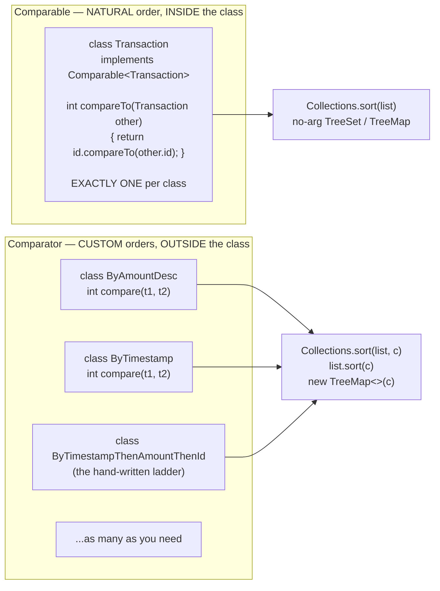
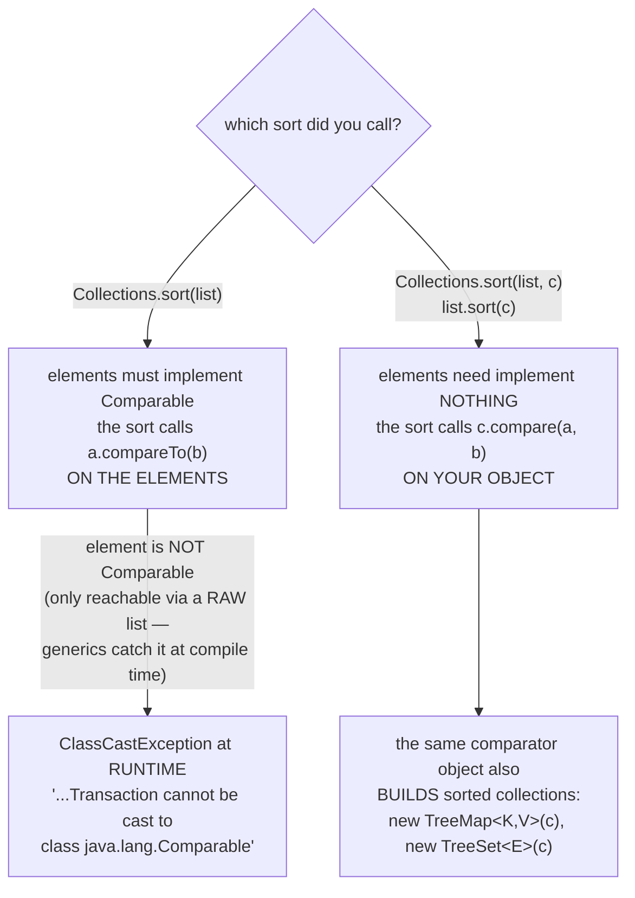
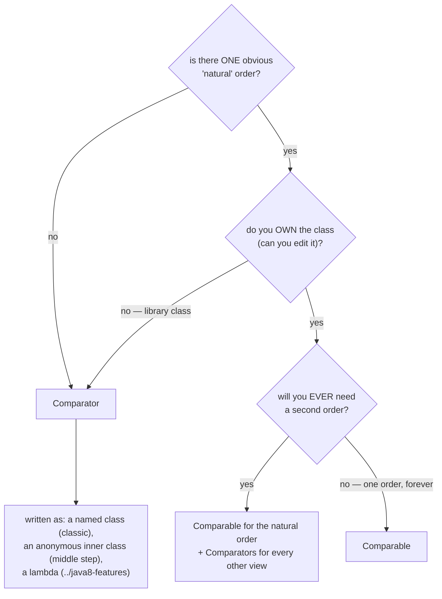

# 10 — Comparable & Comparator: Giving Objects an Order

**The big idea:** `Collections.sort` cannot guess your business. Sort a list of your own
objects with no ordering defined, and Java throws a `ClassCastException` **at runtime**.
The sort machinery tries to treat each element as `Comparable`, and the JVM says: it
isn't one. Java offers exactly two ways to teach it the order: **`Comparable`** — the
NATURAL order, defined **inside** the class, exactly one per class — and **`Comparator`**
— CUSTOM orders, defined **outside**, as many as you like, passed in at the call site.

Domain for the module: SecureBank's `Transaction` (id, description, `BigDecimal` amount,
`long` timestampMillis — deliberately *core*, no `java.time` yet), plus `Account`
(nullable owner — the null grenade) and `Customer` (small `int` age — the subtraction bait).
This module compiles with `--release 8` and teaches the CLASSIC idiom: named comparator
classes and anonymous inner classes. The lambda forms are the payoff waiting in
`../java8-features` — the launcher closes with one clearly-labeled glimpse of them.

## Comparable = INSIDE, Comparator = OUTSIDE

**Read the diagram:**

- Left: the natural order lives INSIDE — `Transaction implements Comparable<Transaction>`:
  exactly ONE `compareTo` per class (here: order by id).
- Right: custom orders live OUTSIDE — as many comparator classes as you need.

## Who calls what — the dispatch picture

**Walkthrough — what `Collections.sort(list)` actually invokes:**

1. The sort machinery repeatedly compares pairs of elements.
2. No comparator argument → it calls `a.compareTo(b)` on the ELEMENTS themselves; every
   element must implement `Comparable`.
3. With `Collections.sort(list, c)` or `list.sort(c)` → it calls `c.compare(a, b)` on YOUR
   comparator object; the elements need implement nothing.
4. An element that is not `Comparable` fails at RUNTIME with `ClassCastException` — only a
   RAW list gets that far; generics catch it at compile time.

## Which tool? The decision, as a flowchart

**Read the diagram:** answer the three diamonds top to bottom.

- ONE obvious natural order? No → Comparator.
- Do you OWN the class (can you edit it)? No — a library class → Comparator.
- EVER need a second order? Yes → Comparable for the natural order PLUS Comparators for
  every other view. No — one order, forever → Comparable.

## Comparable vs Comparator — the table to photograph

| | `Comparable` | `Comparator` |
|---|---|---|
| Defined | **INSIDE** the class itself | **OUTSIDE** — separate class / anonymous class |
| How many orders | exactly **ONE** (the "natural order") | **as many as you want** |
| Method | `int compareTo(T other)` | `int compare(T a, T b)` |
| Return value | **the SIGN** of the result: negative if `this` sorts before `other`, zero on a tie, positive if after — never promise exactly `-1`/`0`/`1` | the same sign contract, on two arguments |
| Coupling | the class must know its own order, and you must be able to edit the class | **zero coupling** — works on library classes |
| Used by | `Collections.sort(list)`, no-arg `TreeSet`/`TreeMap` | `list.sort(c)`, `Collections.sort(list, c)`, `new TreeMap<>(c)` |
| Missing it | `ClassCastException` at runtime — reachable only via a raw list; generics catch it at compile time | not applicable — you always pass the comparator explicitly |

**In one sentence:** `Comparable` gives a class its ONE natural order; every other order
is a `Comparator` you pass in at the call site.

## The traps, all printed as evidence in the demos

- **The subtraction trap** — `return (int)(t1.getTimestampMillis() - t2.getTimestampMillis())`
  computes a correct `long` difference. Then the `(int)` cast throws away the high bits,
  **sign included**. Two timestamps ~24.9 days apart differ by `2150000000`, greater than
  `Integer.MAX_VALUE` (`2147483647`); after the cast the difference reads `-2144967296`.
  The comparator lies, and the sort silently produces the WRONG order (`SubtractionTrapDemo`,
  asserted in `subtractionComparatorOverflows`). Ages are small, so `(age1 - age2)` "works" —
  that is the bait. Fixes: `Long.compare` / `Integer.compare` (Java 7+),
  `a < b ? -1 : (a == b ? 0 : 1)`, or delegate to `compareTo` (`String`, `BigDecimal`).
- **Consistency with equals (module 08's flag, harvested)** — sorted collections
  (`TreeSet`/`TreeMap`) decide "same element" with `compareTo`, **never** `equals`.
  `BigDecimal`: `2.0.equals(2.00)` is `false` but `compareTo` says `0` — `HashSet` keeps both
  (size 2), `TreeSet` "loses" one (size 1). Same law with `Transaction`: two same-id
  transactions collapse in a `TreeSet`, and a `TreeMap(ByAmountDesc)` replaces the value when
  a same-amount key arrives. Rule: `compareTo() == 0` exactly when `equals()` is true — or
  decide consciously that the id IS the identity.
- **Descending by negation** — `-compare(a, b)` breaks when the result is `Integer.MIN_VALUE`
  (negating it overflows). Swap the arguments instead: `t2.getAmount().compareTo(t1.getAmount())`
  (`ByAmountDesc`).
- **`reverseOrder()` vs `reverse(list)`** — `Collections.reverseOrder()` is a **Comparator**
  that inverts the comparison during a sort; `Collections.reverse(list)` **mutates** an
  existing list end-for-end without comparing anything. Same result only when you reverse an
  already-sorted list. Different tools (`ReverseAndNullsDemo`).
- **Nulls** — `a1.getOwner().compareTo(...)` throws `NullPointerException` deep inside
  `java.util` when owner is null. The stack trace blames the sort, not the field. Pre-8 fix:
  an explicit, **symmetric** null policy inside `compare()` (`ByOwnerNullSafe`: nulls first).
  Java 8 packages it as `Comparator.nullsFirst(...)` — forward-ref only, taught in
  `../java8-features`.
- **Lexicographic ids (module 03)** — *lexicographic* means dictionary order: Strings
  compare character by character, not numerically. `"T-10".compareTo("T-9")` is negative,
  so `T-10` sorts BEFORE `T-9`. Zero-pad ids.

> **Java 8 preview (one line, as promised):** the whole ten-line ladder in
> `ByTimestampThenAmountThenId` collapses to
> `Comparator.comparing(Transaction::getTimestampMillis).thenComparing(Transaction::getAmount)` —
> `Java8PreviewDemo` shows it once at the end of the launcher; `../java8-features/01-lambdas`
> is where that course starts.

## Class flow

1. Show the diagrams above (concept first — inside/outside, then the dispatch picture,
   then the decision flowchart).
2. Run the demos in order: `.\mvnw.cmd -pl 10-comparable-comparator compile exec:java`
   (this runs `OrderingDemos`, which calls each demo `main()` in teaching order).
3. Run the tests as *proof*: `.\mvnw.cmd -pl 10-comparable-comparator test` — each test
   prints the behavior it asserts, including the deterministic failures
   (`ClassCastException`, overflow, `NullPointerException`).

| Demo class | What it shows |
|---|---|
| `SortingProblemDemo` | `Collections.sort` on a class without `Comparable`: caught `ClassCastException`, exact message; why Java cannot guess |
| `CompareToContractDemo` | the SIGN is the contract (real values like -4, not -1/0/1); antisymmetry (if a sorts before b, then b sorts after a); `TreeSet` uses `compareTo`, not `equals` — it "loses" a transaction |
| `ComparableNaturalOrderDemo` | natural order lives INSIDE the class; delegates to `String.compareTo` (module 03); exactly ONE per class — the limitation |
| `ComparatorCustomOrderDemo` | the same list three ways: named class, anonymous inner class (the middle step), by date; comparator as a `TreeMap` constructor argument; key collapse |
| `SubtractionTrapDemo` | `(int)(a - b)` overflow on timestamps and cents — WRONG sort printed as evidence; the three correct idioms |
| `ChainedOrderDemo` | primary key + tie-breaks as a hand-written if-ladder; why the last rung must be the unique key |
| `ReverseAndNullsDemo` | `reverseOrder()` vs `reverse(list)`; a caught `NullPointerException` on a null owner; the pre-8 null-policy fix |
| `Java8PreviewDemo` | ONE glimpse, print-only: `comparing(...).thenComparing(...).reversed()` — where `../java8-features` starts |
