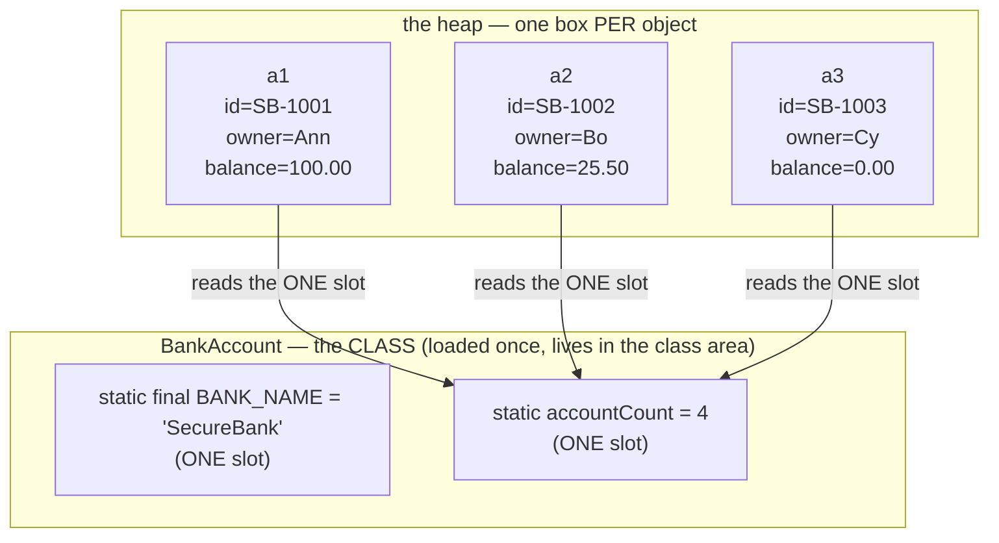
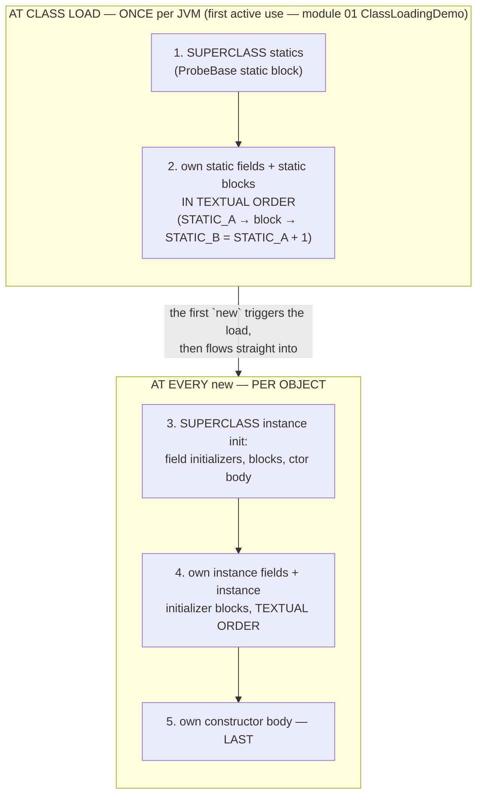
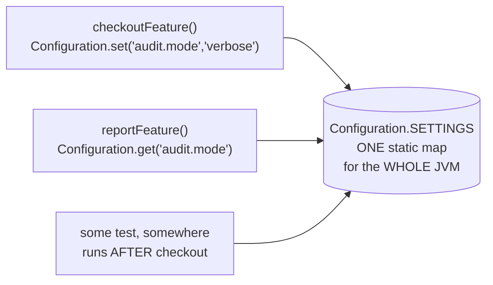
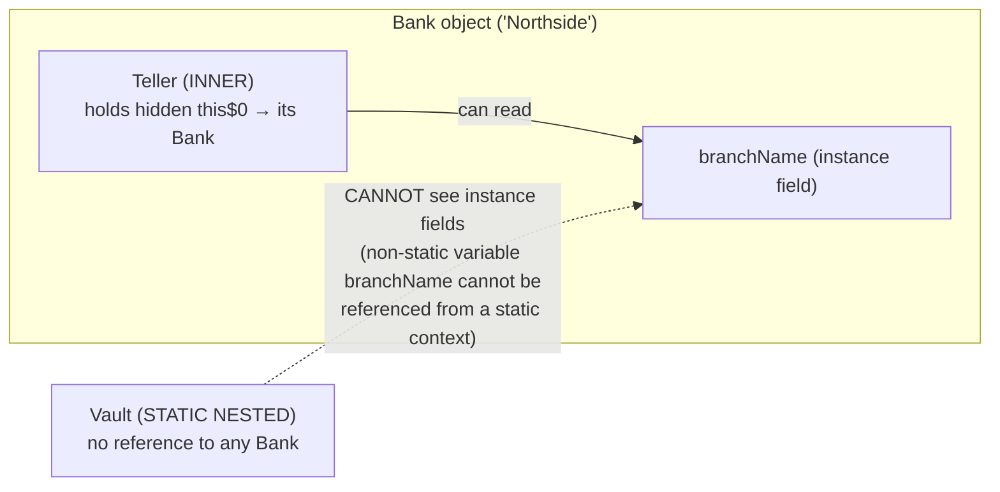

# 11 — Static & Class vs Instance Members

**The big idea:** every member of a class answers one question first — does it belong
to the **CLASS** (exactly one copy, shared, alive from *class load* — the moment the JVM
first reads the class into memory, module 01) or to **EACH OBJECT** (one copy per `new`,
alive only as long as that object)? `static` is the keyword that says *per class*.
Everything this module demos — the shared counter, the "static method can't see
`balance`" error, the initialization order, the global-state bug, hiding vs
overriding — falls out of that one distinction.

## THE memory picture (the signature diagram of this module)

**Read the diagram:** the top box is the CLASS itself (loaded once, living in the class
area) with the TWO static slots; the bottom boxes are heap objects, each with its own
instance fields.

Point at it and say: **there is no `accountCount` inside a1, a2 or a3.** The arrows are
*access paths*, not copies. Build a fourth account and the single slot changes — all
three old objects "see" it instantly because they were all looking at the same slot all
along (`SharedStaticStateDemo`). Instance fields are the opposite: one slot per object,
independent, private to that object's story.

**Style rule the diagram makes obvious:** access statics through the **class name** —
`BankAccount.getAccountCount()`, not `a1.getAccountCount()`. The instance form compiles
and behaves identically, but it *lies* about what is happening (nothing about `a1` is
involved — `a1` could even be `null` and it would still work). IDEs warn:
*"static member accessed via instance reference"*.

## Class member vs instance member

| | `static` (class-level) | instance (per-object) |
|---|---|---|
| Belongs to | the class itself | each object |
| How many copies | **exactly ONE** | one per `new` |
| Exists before any object? | yes — from class load | no — born with the object |
| Is `this` available? | **NO** (there is no instance) | yes — `this` is the object |
| Can it touch the other kind? | can **never** touch instance members — compile error, unless a reference is given as a parameter | can always touch statics |
| Accessed via (style) | `ClassName.member` | `reference.member` |
| Methods: bound at | **compile time**, from the reference's declared type — *hidden*, never overridden (module 05 contrast) | runtime, from the object's actual class — overridden, polymorphic |
| Examples here | `BankAccount.BANK_NAME`, `BankUtils.formatMoney(..)`, `main()` | `acct.deposit(..)`, `acct.getBalance()` |

What **cannot** be static (real javac messages in `StaticHidingDemo`): top-level classes,
constructors, local variables. In each of those places the idea "one slot per class, no
object" is either meaningless or already served by a better tool (static factories, below).

## Initialization order — class load vs every `new`

The exam-favorite timeline, printed step by step by `InitOrderDemo` from a dedicated
`InitOrderProbe` (fresh class, so the once-per-JVM steps are pristine):

**Read the diagram:** two timelines — the top box happens ONCE, the bottom box at EVERY `new`.

- At class load (once per JVM, on first active use — module 01's `ClassLoadingDemo`):
  step 1, the SUPERCLASS statics; step 2, own static fields and static blocks IN TEXTUAL
  ORDER.
- Per object: step 3, the superclass instance init (field initializers, blocks, ctor body);
  step 4, own fields and instance blocks in textual order; step 5, own constructor body LAST.
- The arrow between the boxes: the first `new` triggers the class load, then flows straight
  into the per-object steps.

Two counters make it physical: `staticInitRuns` stays at **1** after three `new`s, while
the instance log grows by six steps per object. (Module 05 `ConstructionOrderDemo`
showed the constructor half; this module adds the static half and the textual-order
details.)

**In one sentence:** statics initialize once per class — superclass first, textual order;
instance fields and constructor bodies run afresh for every object.

## Static methods — no `this`, and that is a feature

- **Cannot touch instance fields** — the exact error, kept as the exhibit:
  `error: non-static variable balance cannot be referenced from a static context`.
  Reason: `balance` lives in one *particular* object; a static method has no object —
  which balance would it mean? The mirror image (instance method reads static) is
  always fine: every object knows its class.
- **Run before any object exists** — utilities (`Math`, `BankUtils`), and `main()`
  itself: the JVM calls `main` before any of *your* objects exist (module 01 callback —
  that is *why* `main` must be static).
- **Static factories** (`BankAccount.createSavings(..)`) beat constructors when you want
  a *name*, *caching* (`Integer.valueOf` — module 02), *subtypes* (module 07), or *no new
  object at all*.

## Utility class done right — and the `static final` trap

`BankUtils`: `final` class, all-static members, **private constructor** (instantiating a
utility class is meaningless — and the private ctor also blocks subclassing, since a
subclass ctor must call `super()`). `UtilityClassDemo` proves via reflection that the
ctor exists but throws `IllegalAccessException`, and that `setAccessible(true)` walks
straight into its `AssertionError` guard (module 06).

The trap sibling: **`static final` freezes the reference, not the object.**
`BankUtils.SUPPORTED_CURRENCIES.add("GBP")` is perfectly legal; re-assigning the field is
`error: cannot assign a value to final variable`. Same split as effectively-final
captures in `java8-features/01-lambdas`. Want real immutability:
`Collections.unmodifiableList(..)` (or `List.of` in modern Java — not on `--release 8`).

## Static state = GLOBAL state (the caution section)

**Read the diagram:** three unrelated pieces of code — checkout, report, some test — all
read and write ONE static map (`Configuration.SETTINGS`) shared by the whole JVM.

Neither caller's *signature* admits the coupling — that is the real-world bug: **tests
pass alone, fail together**, hidden dependencies, and (with threads) *data races* — two
threads writing the same state with no lock, so timing decides the outcome. The rules:
prefer `static final` immutable; if a mutable static is unavoidable — **encapsulate +
synchronize + document**; give tests a `reset()`. Forward note: the Stream API's ban on
**stateful lambdas** is this same principle (`java8-features/07-parallel-streams`).

## Static nested vs inner — the naming trap

**Read the diagram:**

- `Teller` is an INNER class: every Teller holds a hidden reference (`this$0`) to the Bank
  it was created from, so it CAN read `branchName`.
- `Vault` is a STATIC NESTED class: no reference to any Bank, so reading `branchName`
  fails with the real javac error on the dashed arrow.

| | `static` nested (`Bank.Vault`) | inner (`bank.new Teller(..)`) |
|---|---|---|
| Needs an outer instance? | **no** | yes — `outer.new Inner()` |
| Sees outer instance fields? | no (statics only) | yes — via invisible `this$0` (`Outer.this`) |
| Memory | independent | **pins the outer object alive** — the outer cannot be garbage-collected while the inner lives: the classic leak |
| Rule | **default to this** | only when each instance truly serves ONE outer object |

## Statics are HIDDEN, not overridden

A subclass static method with the same signature **hides** the parent's — *hiding* is the
static look-alike of overriding: same shape, but no dispatch. `AccountBase ref = new
SavingsSub();` — `ref.describe()` runs the *subclass* version
(runtime dispatch, module 05), but `ref.whoAmI()` runs the **superclass** version:
a static call is bound at *compile time* from the reference's declared type. No object,
no `this`, nothing to dispatch on. `StaticHidingDemo` prints both verdicts side by side.

## Class flow

1. Show the diagrams above (concept first, code second) — the memory picture is THE one.
2. Run the demos in order: `.\mvnw.cmd -pl 11-static-and-class-vs-instance compile exec:java`
   (runs `StaticsDemos`, which calls each demo `main()` in teaching order).
3. Run the tests as *proof*: `.\mvnw.cmd -pl 11-static-and-class-vs-instance test` — each
   test prints the evidence it asserts, including the full init-order timeline.

| Class | What it shows |
|---|---|
| `BankAccount` | the model: static `BANK_NAME` + counter beside instance `id`/`owner`/`balance`; static factory `createSavings` |
| `BankUtils` | utility class done right: `final`, private ctor, constants, the `static final` mutable-List trap |
| `Configuration` | mutable static map — the global-state caution exhibit |
| `SharedStaticStateDemo` | 3 accounts, ONE counter; mutate → all see it; class-name access style rule |
| `StaticMethodsAndFactoriesDemo` | no `this`, exact compile errors, factories, why `main()` is static |
| `UtilityClassDemo` | private ctor proven via reflection; constants; final reference vs mutable contents |
| `InitOrderLog` / `ProbeBase` / `InitOrderProbe` | the probe: every init position records itself, in textual order |
| `InitOrderDemo` | class load vs each `new`, printed step by step; statics run ONCE for 3 objects |
| `StaticStateCautionDemo` | two unrelated features interfere through one static map — the flaky-test mechanism |
| `NestedVsInnerDemo` | `Bank.Vault` vs `bank.new Teller(..)`; the invisible `this$0` made visible |
| `StaticHidingDemo` | hiding vs overriding through one reference; what cannot be static (real javac messages) |
| `ClassVsInstanceSummaryDemo` | the closing table: member kind · where stored · copies · accessed via · example |
| `StaticsDemos` | launcher — runs all demos in order with section banners |

Every forbidden line in the source is a **commented-out statement beside its real javac
error message** — compile errors can't run, so the errors are the exhibit (module 06's
format).
