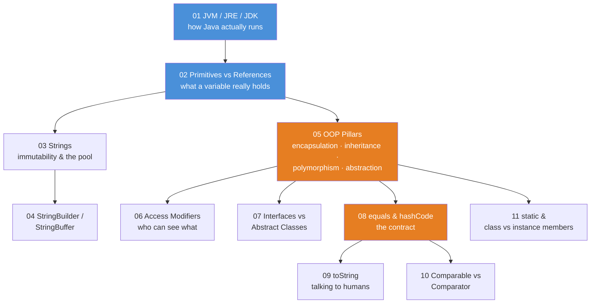
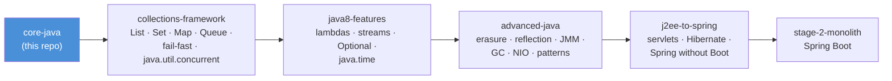

# Core Java — Teaching Repo

The foundations course. A student must own everything here **before** the
[`collections-framework`](../collections-framework/README.md) and
[`java8-features`](../java8-features/README.md) courses make sense. The syllabus: how Java
actually runs, what variables really hold, why Strings are *immutable* (an immutable object
can never change after it is created), the OOP pillars, and the contracts
(`equals`/`hashCode`, `Comparable`) that the collections library is built on. A *contract*
is a documented promise about how methods must behave — other code relies on it without
checking. The `collections-framework` course then harvests those contracts, one data
structure at a time.

Same format as `java8-features`, built for stand-up-and-point teaching:

- **demo classes** (`src/main/java`) — each has a `main()` that prints what is happening, step by step
- **JUnit tests** (`src/test/java`) — each test proves one behavior and prints the evidence
- **README.md with mermaid diagrams** — the conceptual picture *before* you open the code

Everything compiles with `--release 8` and deliberately teaches the **classic idiom**
(anonymous inner classes, explicit loops). Where Java 8 improves on something, the code
says so and points forward to the matching `java8-features` module.

## The course map



**Read the diagram:** each arrow means "teach this one first".

- The course starts at **01** (how Java runs) and moves to **02** (what a variable holds).
- **02** forks into two branches: **03 Strings → 04 StringBuilder**, and **05 OOP pillars**.
- **05** feeds four modules: **06** access modifiers, **07** interfaces, **08** equals/hashCode,
  and **11** static.
- **08** feeds two more: **09** toString and **10** Comparable/Comparator.

The orange modules (**05 OOP pillars**, **08 equals/hashCode**) are the heart of the course —
05 is the mindset shift, 08 is the contract everything in `java.util` silently relies on.

## Suggested teaching order

| # | Module | The one-sentence pitch | Run the demos |
|---|--------|------------------------|---------------|
| 01 | `01-jvm-jre-jdk` | Your code never runs on the CPU directly: `javac` compiles it into bytecode (the `.class` file's instructions), a JVM executes that, and the three acronyms are nested boxes | `.\mvnw.cmd -pl 01-jvm-jre-jdk compile exec:java` |
| 02 | `02-primitives-vs-references` | A primitive variable holds the value; a reference variable holds a *pointer* to an object on the heap | `.\mvnw.cmd -pl 02-primitives-vs-references compile exec:java` |
| 03 | `03-strings` | Strings are immutable and pooled (the JVM reuses one shared object per literal text) — that one sentence explains `==` vs `equals`, `intern()`, and concat performance | `.\mvnw.cmd -pl 03-strings compile exec:java` |
| 04 | `04-stringbuilder-stringbuffer` | When you need to *build* a string, mutate one buffer instead of creating a thousand throwaway Strings | `.\mvnw.cmd -pl 04-stringbuilder-stringbuffer compile exec:java` |
| 05 | `05-oop-pillars` | Encapsulation, inheritance, polymorphism, abstraction — four ideas, one bank | `.\mvnw.cmd -pl 05-oop-pillars compile exec:java` |
| 06 | `06-access-modifiers` | `public`/`protected`/package-private/`private` is a visibility dial, not a security feature | `.\mvnw.cmd -pl 06-access-modifiers compile exec:java` |
| 07 | `07-interfaces-vs-abstract-classes` | Interfaces say *can-do*, abstract classes say *is-a (with shared state)* — and Java 8 blurred the line | `.\mvnw.cmd -pl 07-interfaces-vs-abstract-classes compile exec:java` |
| 08 | `08-equals-hashcode` | Override one without the other and `HashMap`/`HashSet` silently break — here's the proof | `.\mvnw.cmd -pl 08-equals-hashcode compile exec:java` |
| 09 | `09-tostring` | `println` calls `toString`; the default one is noise, a good one is documentation | `.\mvnw.cmd -pl 09-tostring compile exec:java` |
| 10 | `10-comparable-comparator` | `Comparable` = the object's *natural* order; `Comparator` = every *other* order | `.\mvnw.cmd -pl 10-comparable-comparator compile exec:java` |
| 11 | `11-static-and-class-vs-instance` | `static` members belong to the *class* (one copy), instance members belong to *each object* | `.\mvnw.cmd -pl 11-static-and-class-vs-instance compile exec:java` |

## Running things

All commands run **from this folder** (`core-java/`), Windows PowerShell shown:

```powershell
# run one module's demo launcher (prints every demo in teaching order)
.\mvnw.cmd -pl 03-strings compile exec:java

# run ONE specific demo class instead of the whole launcher
.\mvnw.cmd -pl 03-strings compile exec:java "-Dexec.mainClass=com.evaitcs.corejava.strings.StringPoolDemo"

# run one module's tests (tests print what they prove)
.\mvnw.cmd -pl 08-equals-hashcode test

# run everything
.\mvnw.cmd test
```

Tip for class: **mermaid diagram first** (concept), then the demo `main()` (behavior),
then the test (proof).

If em-dashes/arrows print as garbage in a plain `cmd` window, run `chcp 65001` first
(UTF-8 code page). Windows Terminal and IDE consoles are fine as-is.

## Shared conventions

- **Classic idiom on purpose**: anonymous inner classes instead of lambdas, explicit loops
  instead of streams. Comments mark the moments where Java 8 will replace the ceremony and
  point at the corresponding `java8-features` module (that contrast is itself a lesson).
- **Domain**: a tiny SecureBank-style world — `Account`, `Customer`, `Transaction` — duplicated
  per module on purpose, so each module stands alone on screen.
- **Money is `BigDecimal`** (scale 2) — module 02 shows exactly *why* `double` loses money.
- **Comments are teaching material**: they explain *why*, connect the diagram to the code,
  and call out the traps ("students often ask...", "this line is the whole idea").
- Demo output uses plain `System.out.printf`/`println` so it's readable from the back of the room.

## Where this course leads



**Read the diagram:** left to right, each arrow means "the next course assumes this one":
core-java → collections-framework → java8-features → advanced-java → j2ee-to-spring →
the stage-2 Spring Boot monolith.

Every "classic vs modern" note in this repo is a hook for the next course: the anonymous
`Comparator` in module 10 becomes `Comparator.comparing(Account::getBalance)` in
`java8-features/01-lambdas`, and the hand-rolled grouping loops become `Collectors.groupingBy`.
