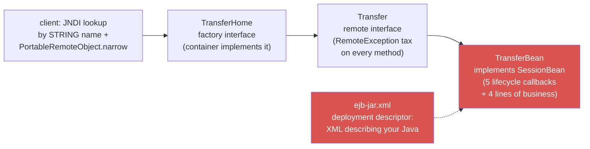
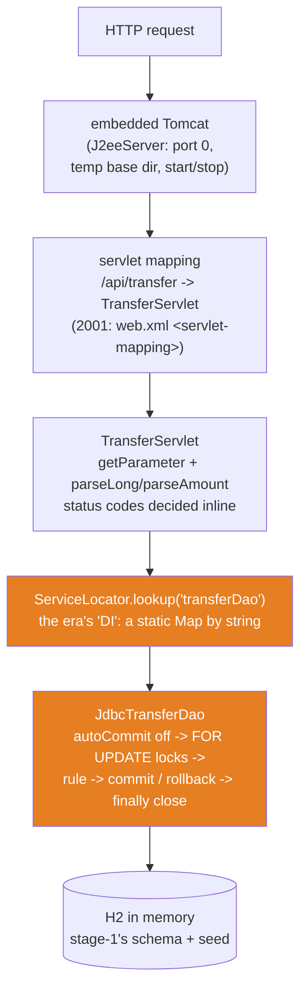

# 01 — J2EE: The World Before Spring

**The big idea:** a servlet is just a Java class with `doGet`/`doPost` — the container
calls it per request, and that part was genuinely great in 1998. The pain was everything
*around* the servlet: getting its dependencies (no injection — you looked them up in a
global registry by string), running transactions (no `@Transactional` — you hand-cranked
`setAutoCommit(false)`/`commit`/`rollback`/`close`), mapping rows to objects (no ORM —
you read `ResultSet` columns by hand), and deciding error responses (no advice layer —
you wrote `setStatus(409)` inline). The EJB alternative was *worse*: two interfaces, a
bean class, and an XML deployment descriptor to move money once. This module runs the
whole era for real — embedded Tomcat, a real servlet, real HTTP — so every convenience of
modules 02–04 and stage-2 has a "before" picture to delete.

**In one sentence:** J2EE gave you a request dispatcher and then charged you a ceremony
tax on everything else — Spring was written to collect that tax refund.

## The one database, four eras

Every module in this course runs against the **same SecureBank world**: `customer`,
`app_user`, `account` (with the `version` optimistic-lock column), `transactions` (the
append-only ledger where a transfer writes a DEBIT+CREDIT pair sharing one `reference`),
and `loan`. It is stage-1's PostgreSQL schema translated to **H2 in memory**
(`DemoDb.java` — `TIMESTAMPTZ` becomes `TIMESTAMP WITH TIME ZONE`, constraints kept),
seeded identically: Alice (accounts 1 and 2: 1500.00 / 5200.00), Bob (account 3: 300.00),
Carol (no accounts). Each demo and test class calls `DemoDb.freshDatabase()` and gets a
brand-new copy — no shared state, no cleanup, deterministic ids.

## The problem: peak ceremony (EJB 2.x, c. 2001)

**Read the diagram:**
- To expose ONE method (`moveMoney`), you wrote five artifacts: a home interface, a remote
  interface, the bean class, an XML descriptor, and a lookup dance on the client side.
- Red marks the two artifacts with no business content at all: the bean's five empty
  lifecycle callbacks, and the XML that merely *describes* Java classes to the server.
- Every remote-interface method throws `RemoteException` — even for a local call, because
  the container assumes distribution by default. That is the "contract tax".
- `TheCeremonyDemo` prints all five exhibits verbatim-shaped, then counts: ~45 lines of
  artifact, ~4 lines of money.

## The servlet track: what you hand-wired instead

**Read the diagram:**
- Top to bottom is one real `POST /api/transfer` in this module — every box is code you
  can open: `J2eeServer` (the container), `TransferServlet` (HTTP handling), the orange
  boxes (the two pieces of plumbing Spring will delete).
- The **ServiceLocator** (orange) is how a servlet got dependencies before injection: a
  static registry, lookup by string, cast on the way out. It works; it is also the
  anti-pattern `advanced-java/10` names — invisible, untyped, globally shared.
- The **DAO** (orange) owns the transaction by hand. Its `transfer()` javadoc has the
  six-step walkthrough; the code below it is the exhibit.

**Walkthrough — what happens when `transfer(1, 3, 100.00)` runs:**
1. Open a connection; `setAutoCommit(false)` — from here on, nothing is visible to anyone
   else until commit.
2. `SELECT balance ... FOR UPDATE` on **both** accounts, always in **id order** — the row
   locks serialize concurrent transfers, and the fixed lock order prevents deadlocks
   (stage-1 `queries/04` acts out the deadlock you get without that rule).
3. Compare the source balance to the amount — **this is the only business logic**.
4. Two `UPDATE account SET balance = ?` statements and two `INSERT INTO transactions`
   ledger rows (DEBIT + CREDIT sharing one fresh `reference` UUID — stage-1's
   reconciliation rule).
5. `commit()` — all four writes become visible atomically. Any exception instead hits the
   catch block: `rollback()` erases the partial work (the refused-transfer demo proves it).
6. `finally`: restore auto-commit and **close the connection** — the line everyone forgot
   exactly once, leaking pool connections until the server died.

**In one sentence:** the DAO is ~130 lines of which ~4 are banking, and every remaining
line is a job that a framework era took over: connection provisioning (pools),
transaction demarcation (`@Transactional`), and resource cleanup (try-with-resources,
then containers).

## The table to photograph — who did the plumbing, by era

| Job | 2001 (this module) | 2004+ (modules 02–04) | stage-2 (Boot 4) |
|---|---|---|---|
| Servlet gets its dependencies | `ServiceLocator.lookup("name")` + cast | Spring constructor injection | same, auto-wired |
| URL → handler mapping | `web.xml` / `addServletMappingDecoded` | `@RequestMapping` on a controller | same |
| Transaction boundaries | `setAutoCommit`/`commit`/`rollback`/`finally close` | `@Transactional` on a service method | same |
| Row → object mapping | `rs.getBigDecimal("balance")` by hand | Hibernate entities (module 02) | Spring Data repositories |
| Error → HTTP status | `resp.setStatus(409)` inline per method | `@ControllerAdvice` (module 04) | same + `ProblemDetail` |
| Running the server | install a vendor server, deploy a WAR | embedded Tomcat in `main()` (module 04) | one starter, one `main()` |

## The traps, all printed as evidence in the demos/tests

- **The Service Locator fails at RUNTIME, not compile time** — a typo'd key
  (`"transferDAO"`) compiles and then explodes on first use; `serviceLocatorFailsAtRuntime`
  catches the exact `IllegalStateException`. Spring's container fails at STARTUP instead:
  an unsatisfied constructor dependency stops the context before the first request.
- **Forgetting `close()`** — the demo DAO closes in `finally` and says why: in the pooled
  world, a leaked connection eventually starves the server. (Try-with-resources arrived in
  Java 7 and absorbed this trap — `advanced-java/08` and `/11`.)
- **Rollback is only total if you wrote it** — the refused-transfer demo (`ManualJdbcPainDemo`
  banner 3 and two tests) shows balances *unchanged* after a mid-transaction failure.
  Miss the `catch → rollback` and a partial transfer lands: money debited, never credited.
- **Parameters are data only if you keep them out of SQL text** — `injectionAttemptIsJustData`
  fires `1 OR 1=1` and `1; DROP TABLE account;--` at the servlet: both die as 400s at
  `parseLong`, and the DAO's `PreparedStatement` bind slots would have neutralized them
  anyway (`advanced-java/12`'s lesson, enforced twice here).
- **EJB's RemoteException tax** — exhibit B: checked exceptions that exist only because the
  container assumed your bean might live on another machine. Spring's proxy-based approach
  keeps the interface you actually wrote (module 03's AOP demo).

## Java 21 corner

The era is reproduced faithfully, but the *surroundings* are modern: the EJB exhibits are
**text blocks**; the DAO's failure path uses **`addSuppressed`** (rollback failure attached
to the primary exception — `advanced-java/11`); the server is `AutoCloseable` so demos use
**try-with-resources** (`try (J2eeServer server = J2eeServer.start())`); and HTTP clients
are `java.net.http`. In 2001 each of those was another library or another ceremony.

## Class flow

1. Show the two diagrams above (the museum first — *why* revolt; then the servlet track —
   *what* the revolt still had to hand-write). Read the "Read the diagram" bullets aloud.
2. Run the demos in order: `.\mvnw.cmd -pl 01-j2ee-the-world-before-spring compile exec:java`
   (this runs `J2eeDemos`, which calls each demo `main()` in teaching order — the last one
   starts a REAL server; point at the port line, then at "server stopped; port released").
3. Run the tests as *proof*: `.\mvnw.cmd -pl 01-j2ee-the-world-before-spring test` — 8
   tests over real HTTP, each printing its evidence (ledger rows, rollback-unchanged
   balances, the 409, the injection 400s).

| Demo class | What it shows |
|---|---|
| `TheCeremonyDemo` | the five EJB 2.x artifacts as exhibits; ~45 lines of ceremony around ~4 lines of money; the 2002 revolt in one paragraph |
| `ManualJdbcPainDemo` | the hand-cranked transaction, live: good transfer (balances + two-row ledger), refused transfer (total rollback), the line-count lesson |
| `LiveServletDemo` | the whole stack on real HTTP: health check, GET balance, POST transfer, second GET proves persistence, 409 refusal, then the five hand-wired jobs listed against their Boot counterparts |

| Test | What it proves |
|---|---|
| `healthCheck` | the embedded container answers on an ephemeral port |
| `getBalanceReadsSeedData` | servlet → locator → DAO → SQL returns the seeded 1500.00 |
| `postTransferMovesMoneyAndWritesLedger` | balances move; exactly two ledger rows share one reference (stage-1's reconciliation rule) |
| `insufficientFundsRollsBack` | HTTP 409 AND every balance byte-identical to the seed |
| `badInputReturns400` | missing/negative amount → 400; unknown account → 404 |
| `injectionAttemptIsJustData` | `1 OR 1=1` and `DROP TABLE` come back as 400s; the table survives |
| `daoRollbackIsTotal` | one cent over the balance is refused; nothing lands |
| `serviceLocatorFailsAtRuntime` | the typo'd key explodes at runtime — the anti-pattern, demonstrated |

## Where this leads

The two orange boxes in the second diagram are the course's targets. **Module 02** takes
the DAO's row-mapping and hands it to Hibernate: `Account` becomes an entity, the ledger
pair becomes a mapped collection, and the `version` column becomes `@Version` optimistic
locking. **Module 03** takes the ServiceLocator and the transaction plumbing and replaces
both with a Spring context: constructor injection and `@Transactional` — the same transfer
as a ~15-line service. **Module 04** rebuilds this exact servlet as Spring MVC with JSON
and `ProblemDetail`, wired by hand onto the same embedded Tomcat — and names the Boot
auto-configuration that deletes each remaining line in stage-2.
