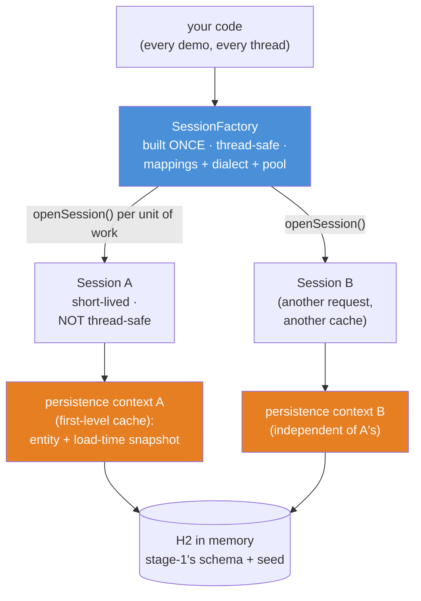
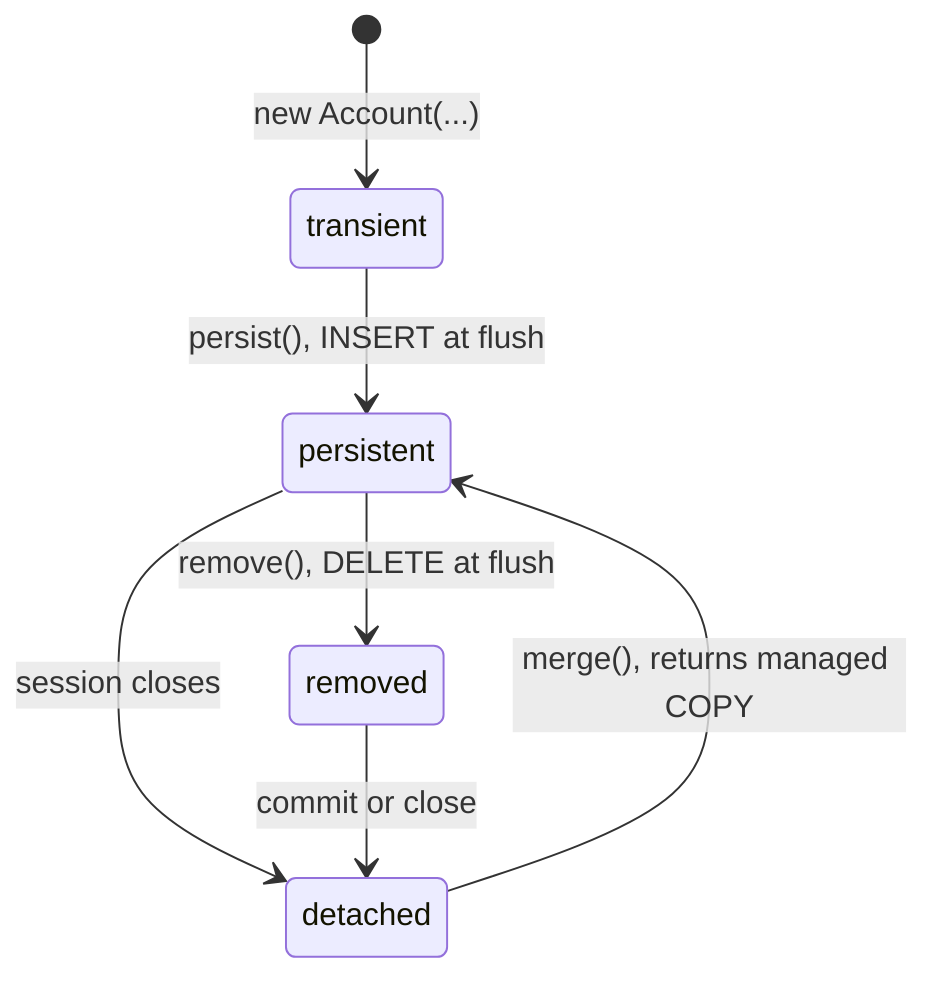
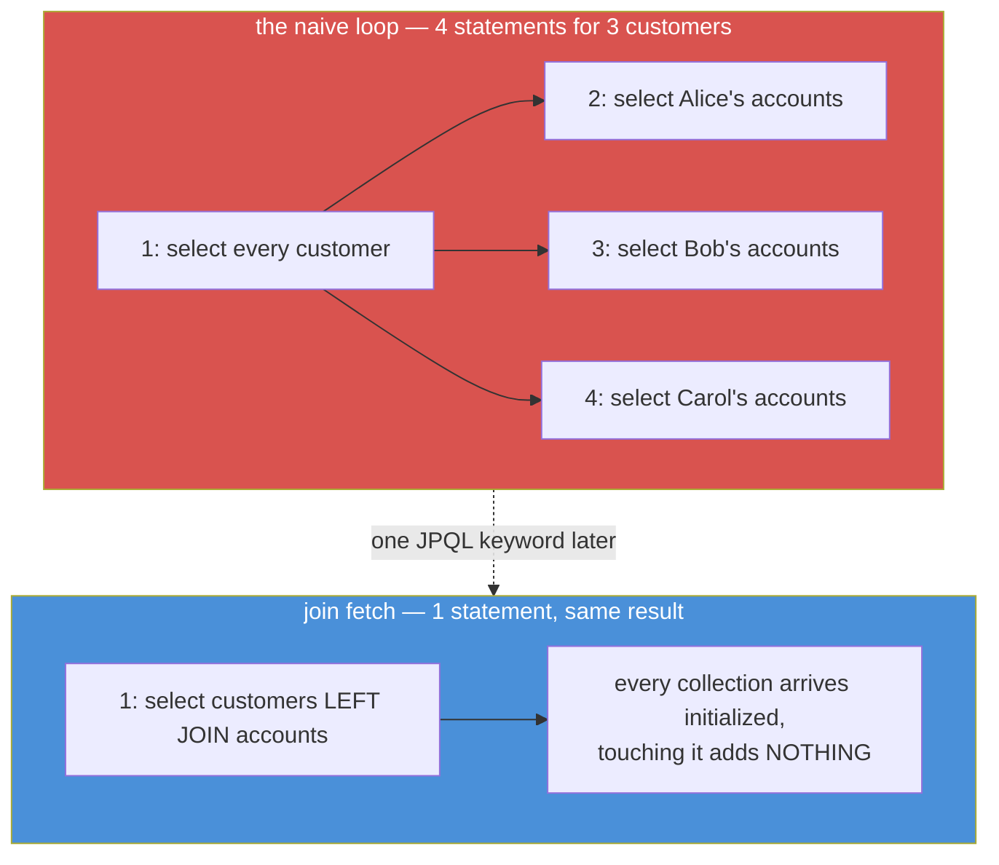

# 02 — Hibernate & the ORM Idea

**The big idea:** an ORM — an *object-relational mapper* — kills hand-written row
mapping, the boilerplate module 01's DAO drowned in (`rs.getBigDecimal("balance")`, once
per column per entity). You describe the mapping ONCE, as annotations on a class, and
Hibernate writes the SELECTs, INSERTs, UPDATEs and DELETEs. It even writes the UPDATE you
never touch: change one field of a managed object inside a transaction, commit, and the
database follows — *dirty checking*. The price is this module's real subject: the objects
Hibernate returns are **managed**. They belong to a `Session`, they move through four
lifecycle states, their collections load later than you think, and they carry an
optimistic lock. Know that state machine and Hibernate is the most productive layer in
Java; ignore it and you will meet its most famous exception within a week. History's
verdict: Hibernate (2001) won so completely that J2EE standardized it as JPA (2006) — the
`jakarta.persistence` annotations below ARE the standard, and stage-2's Boot
auto-configuration wraps this exact `SessionFactory`.

**In one sentence:** Hibernate reads and writes your objects for you — in exchange, every
object it hands back has a lifecycle, and your mutations reach the database only while the
object is *persistent* and its session is open.

## The one database, four eras

Same world as module 01 (`DemoDb.java`, copied unchanged into this module's package):
stage-1's PostgreSQL schema translated to **H2 in memory**, seeded identically — Alice
(accounts 1 and 2: 1500.00 / 5200.00), Bob (account 3: 300.00), Carol (no accounts), the
opening ledger rows in `transactions`, one `loan` APPLIED. Every demo and every test
method calls `DemoDb.freshDatabase()` and gets a brand-new copy: no shared state, no
cleanup, deterministic ids. What is new in this module is the layer ON TOP of those
tables: four entity classes (`Customer`, `Account`, `LedgerEntry`, `Loan`) — and the
`version` column stage-1 planted finally gets its annotation: `@Version`.

## Bootstrap: one heavyweight, many cheap sessions

Two terms, defined before the diagram. A **SessionFactory** is the heavyweight object
Hibernate builds once per application: it holds the parsed mappings, the SQL dialect, and
the connection pool, and it is thread-safe. A **Session** is the cheap, short-lived,
NOT-thread-safe object you open per *unit of work* (one request, one transaction); it
owns a **persistence context** — the *first-level cache* holding every entity it has
loaded, with the snapshot dirty checking diffs against. In JPA vocabulary: the
SessionFactory IS the `EntityManagerFactory`, and the Session IS the `EntityManager`
(Hibernate's `Session` literally extends both).



**Read the diagram:**
- Blue is built once and shared by every thread — in 2006 you declared it in
  `persistence.xml`; here `BootstrapDemo.newFactory(dbUrl)` builds it in about ten lines;
  in stage-2 Boot auto-configures it as the `EntityManagerFactory` bean.
- Each `openSession()` is one teller window: cheap, private to one unit of work, and
  closed when the work is done. Two sessions never share a persistence context — that
  separation is exactly what demo 5 (optimistic locking) exploits.
- Orange is the first-level cache: within one session, `find(Account.class, 1L)` twice
  returns the SAME object instance and runs ONE select (BootstrapDemo banner 3 proves it).

In 2006, bootstrapping JPA meant shipping this file in `META-INF` (exhibit printed by
`BootstrapDemo`, which builds the identical wiring in Java):

```xml
<?xml version="1.0" encoding="UTF-8"?>
<persistence xmlns="https://jakarta.ee/xml/ns/persistence" version="3.0">
  <persistence-unit name="securebank">
    <provider>org.hibernate.jpa.HibernatePersistenceProvider</provider>
    <class>com.evaitcs.evolution.hibernate.Customer</class>
    <class>com.evaitcs.evolution.hibernate.Account</class>
    <class>com.evaitcs.evolution.hibernate.LedgerEntry</class>
    <class>com.evaitcs.evolution.hibernate.Loan</class>
    <properties>
      <property name="jakarta.persistence.jdbc.url"      value="jdbc:postgresql://localhost:5432/securebank"/>
      <property name="jakarta.persistence.jdbc.user"     value="postgres"/>
      <property name="jakarta.persistence.jdbc.password" value="(never commit real ones)"/>
      <property name="hibernate.show_sql"                value="true"/>
    </properties>
  </persistence-unit>
</persistence>
```

**Walkthrough — what happens when `buildSessionFactory()` runs:**
1. A `StandardServiceRegistryBuilder` collects the settings — the same property names the
   XML uses (`jakarta.persistence.jdbc.url`, `hibernate.show_sql`).
2. `build()` creates the service registry: connection provider, transaction coordinator,
   JDBC services (our `StatementInspector` counter plugs in here).
3. `MetadataSources` parses the four annotated classes into metadata: tables, columns,
   associations — no XML, no classpath scanning, just the explicit class list.
4. `buildSessionFactory()` probes the database once for its dialect (H2 here) and returns
   the thread-safe heavyweight. Closing the factory releases the registry and the pool.

**In one sentence:** the factory is the bank's vault infrastructure (built once, shared by
everyone); a session is one teller window per unit of work (opened, used, closed).

## The ORM bargain: dirty checking

`find(Account.class, 3L)` returns a **managed entity** — not a dead copy of a row, but an
object the session *watches*. Module 01 needed a hand-written `UPDATE` with every column
bound by index; here you call one setter and commit. `show_sql` (on in the demos) prints
the SQL Hibernate emits, and you write none of it.

**Walkthrough — what happens when `commit()` meets a changed entity (the flush):**
1. `commit()` triggers a **flush** — Hibernate synchronizes the persistence context to
   the database — and walks every managed entity in the session.
2. For each entity it diffs the CURRENT field values against the SNAPSHOT taken at load
   time. That snapshot is why the persistence context keeps more than just the object.
3. Changed fields become an `UPDATE`. With `@Version` present it reads:
   `update account set balance=?, ..., version=? where id=? and version=?` — the version
   guard rides along for free (demo 5).
4. The JDBC transaction commits: all statements become visible atomically — the same
   atomicity module 01 hand-cranked with `setAutoCommit(false)`.

Flush also happens at two other moments: **before any query runs** (so your queries see
your own pending writes) and on an **explicit `session.flush()`**. Until one of those
three, a setter change lives only in memory.

**In one sentence:** dirty checking turns "remember to write the UPDATE" into "forget it —
Hibernate remembers", and the flush is the moment memory becomes database.

## Entity lifecycle: the four states

Every entity is in exactly one of four states, and what a setter DOES depends on which:



**Read the diagram:**
- **transient**: a plain `new` object. No identity, no snapshot, no session. Setting
  fields is just Java; nothing reaches the database.
- **persistent**: managed by an OPEN session. `persist()` gets you here (with
  `GenerationType.IDENTITY` the INSERT runs immediately, because Hibernate needs the
  database-generated key back); `find()` and queries land here directly. Setters are
  tracked and flushed.
- **detached**: the session closed. The object still holds its id and values, but setters
  are now SILENTLY IGNORED — no exception, no SQL. This is the trap.
- **removed**: `remove()` was called on a persistent entity; the DELETE fires at flush.
- The arrow back from detached is `merge()` — and note its label: merge RETURNS the
  managed copy.

**Walkthrough — what happens when you call `merge(detached)`:**
1. Hibernate looks at the argument's id and loads (or finds in the session) the managed
   instance for that row.
2. It COPIES the detached object's field values onto that managed instance.
3. It RETURNS the managed instance. Your argument is untouched and still detached —
   the classic gotcha: `Account m = session.merge(a);` and then keep working with `m`,
   never with `a`.
4. At commit, dirty checking flushes whatever the copy changed (LifecycleStatesDemo
   banner 4: the detached `setBalance(999.99)` that went nowhere suddenly lands).

**In one sentence:** mutations reach the database only from the persistent state — every
other state is either not yet, no longer, or about to stop being watched.

## Lazy loading and N+1

`Customer.getAccounts()` is declared `fetch = LAZY`, so loading a customer runs ONE
select and hands you a **proxy-backed collection** — a placeholder (a `PersistentBag`)
that OWES you a select the first time code touches it. Lazy loading is a promise.



**Read the diagram:**
- Red is the **N+1 SELECT problem**: 1 query for the list, then N queries — one per row's
  lazy collection. Three customers cost 4 trips; a thousand customers cost 1001.
- The killer detail: nothing in the loop LOOKS like database access. `c.getAccounts()`
  reads like a field access; it is actually a round trip.
- Blue is the fix: `select c from Customer c left join fetch c.accounts` — one statement,
  every collection pre-initialized. LEFT matters: an inner `join fetch` would silently
  drop Carol, who has zero accounts.
- Both paths are COUNTED, not eyeballed: a `StatementInspector`
  (`hibernate.session_factory.statement_inspector`) records every SQL string Hibernate
  prepares, so the test asserts `4` and `1` exactly.

**Walkthrough — what happens when you touch `getAccounts()`:**
1. The getter returns the placeholder collection Hibernate installed at load time — no
   SQL yet, and the object's class name (`PersistentBag`) gives the game away.
2. The first real use — `size()`, iteration, `isEmpty()` — asks the owning SESSION to
   initialize the collection.
3. Session still open: Hibernate runs the promised
   `select ... from account where customer_id=?` and fills the bag.
4. Session closed: there is no connection to load through — Hibernate throws
   `LazyInitializationException`, the most famous error in its history (and the root of
   stage-2's `spring.jpa.open-in-view` debate: keep sessions open into the view layer, or
   don't; both answers cost something).

**In one sentence:** lazy is a promise, and a fetch join is keeping every promise in one
trip.

## Optimistic locking: @Version

Stage-1 gave `account` a `version` column; module 01's DAO bumped it by hand inside
`UPDATE ... SET version = version + 1`. Here it becomes one annotation, `@Version`, and
Hibernate does the rest: every flush that changes the row increments the version, and
every UPDATE guards with `WHERE id = ? AND version = ?` using the version THIS session
loaded. Nobody locks anything in advance — hence *optimistic*: the system assumes
conflicts are rare and detects them at write time instead of preventing them with locks.

**Walkthrough — what happens when the second session commits (OptimisticLockingDemo):**
1. Sessions s1 and s2 both `find` account 1: both snapshots say version 0. (One thread,
   scripted order — deterministic by house rule.)
2. s1 sets 1600.00 and commits: `UPDATE ... SET version = 1 WHERE id = 1 AND version = 0`
   matches one row. The database is now at version 1.
3. s2 — still holding its version-0 snapshot — sets 1700.00 and commits: its UPDATE says
   `WHERE id = 1 AND version = 0`, which now matches ZERO rows.
4. Hibernate checks the affected-row count, sees 0 instead of 1, and raises
   `StaleObjectStateException` — surfaced through the JPA layer as
   `jakarta.persistence.OptimisticLockException` (Spring renames it again in module 03:
   `ObjectOptimisticLockingFailureException`). The transaction rolls back.
5. s1's write survives. The **lost update** — s2 overwriting a balance it never saw —
   never happens.

| | pessimistic locking (module 01) | optimistic locking (this module) |
|---|---|---|
| Mechanism | `SELECT ... FOR UPDATE` locks the row | `@Version` guards the UPDATE's WHERE clause |
| The second writer | waits until the first transaction finishes | fails fast with `OptimisticLockException` |
| The cost | held locks; deadlocks unless lock order is fixed | you must write the retry-or-refuse path |
| Choose it when | conflicts are common and waiting is cheap | conflicts are rare; never hold row locks across a web request |

**In one sentence:** pessimistic locking makes the second writer WAIT; optimistic locking
makes it FAIL — and failing loudly beats overwriting money silently.

## Queries: four ways to ask

`QueryTourDemo` runs all four against the seed data:
1. **JPQL** — `from Account a where a.balance > :min order by a.balance desc`: the query
   speaks ENTITIES and FIELDS, not tables and columns; Hibernate generates the SQL per
   dialect. Parameters are bound (`setParameter`), never concatenated — the
   `advanced-java/12` injection lesson survives the ORM (banner 4 fires
   `alice@securebank.dev' OR '1'='1` and matches zero customers).
2. **Criteria** — the same question built as typed objects instead of a string; verbose,
   but composable at runtime without string surgery.
3. **Native SQL** — the escape hatch, which STILL returns managed entities
   (`createNativeQuery(sql, Account.class)` — the classic API called this `addEntity`),
   so dirty checking applies to hand-tuned selects too.
4. **Constructor expression** — `select new com.evaitcs.evolution.hibernate.AccountSummary(a.id, a.balance)`:
   JPQL projecting straight into a Java 21 **record**. Projections are data, not
   entities: no session needed afterwards, no lazy surprises.

**In one sentence:** ask in entities (JPQL), ask in objects (Criteria), ask in raw SQL
when you must — but always bind parameters, and reach for a record when you want data
instead of lifecycle.

## The table to photograph — the four lifecycle states

| State | How the entity got there | Does flush write SQL for it? | Do setters reach the database? |
|---|---|---|---|
| transient | `new Account(...)` — no session has seen it | no — Hibernate does not know it exists | there is no path to the database |
| persistent | `persist()`, `find()`, or a query, session open | yes — INSERT, UPDATE or DELETE as needed | yes — that is dirty checking |
| detached | its session closed | no session, no flush, no SQL | NO — the change is silently lost |
| removed | `remove()` on a persistent entity | the DELETE runs at the next flush | it is being deleted; setters are moot |

## The traps, all printed as evidence in the demos/tests

- **`LazyInitializationException`** — touching a lazy collection after its session closed:
  `Cannot lazily initialize collection of role '...Customer.accounts' ... (no session)`.
  Demo 4 banner 2 catches it; `lazyCollectionThrowsAfterClose` asserts it. Fixes: touch it
  inside the session, or `join fetch` it, or (stage-2's debate) `open-in-view`.
- **Detached mutations are SILENTLY lost** — no exception, no SQL, no mercy. Demo 3 banner 3
  sets 999.99 on a detached account; the database stays at 100.00 until `merge()` runs.
- **`merge()` does not mutate its argument** — it returns the managed COPY
  (`managed == scratch` prints `false`). Keep the return value or your "saved" object was
  never saved.
- **N+1 hides behind innocent getters** — `c.getAccounts().size()` in a loop is a database
  round trip per iteration. The `StatementCounter` makes it a number (4 vs 1), not a vibe.
- **Inner `join fetch` drops the childless** — an inner join would silently lose Carol
  (zero accounts) from the result list. `left join fetch` keeps her with an empty bag.
- **The first-level cache returns the SAME instance** — `find` twice in one session gives
  one select and `first == second`. Convenient; but it also means a session never sees
  what another session committed after its own loads — the exact staleness demo 5 turns
  into a feature.
- **A `toString()` that touches lazy associations explodes after close** — `Account.toString()`
  deliberately prints only identity fields; printing `accounts` from a detached object is
  trap #1 wearing a debugger's clothes.

## Java 21 corner

Records **cannot be entities**: Hibernate instantiates entities by reflection (no-arg
constructor) and mutates their fields in place (dirty checking diffs snapshots) — records
are final and immutable, and JPA still says no. But records are PERFECT for projections:
`AccountSummary` is a two-component record filled by a JPQL constructor expression, and
`QueryTourDemo` destructures it with a **record pattern**
(`rows.getFirst() instanceof AccountSummary(Long id, BigDecimal balance)`). Before Java 16
that projection was a 40-line DTO class; before Java 21 the destructuring was four getter
calls. The era's museum piece (`persistence.xml`) is a **text block**; demos lean on `var`
and `List.getFirst()`; entities keep the classic JavaBean shape on purpose — the ceremony
being taught is the SUBJECT, and the language around it is modern.

## Class flow

1. Show the three diagrams above in order (bootstrap, lifecycle states, N+1) and read the
   "Read the diagram" bullets aloud. The lifecycle state diagram is THE picture of this
   module; the table to photograph is its tabular twin.
2. Run the demos in order: `.\mvnw.cmd -pl 02-hibernate-orm compile exec:java` (this runs
   `HibernateDemos`, which calls each demo `main()` in teaching order — the `Hibernate:`
   lines are `show_sql` output and ARE the lesson; point at the UPDATE nobody wrote, the
   four counted selects, and the zero-row UPDATE that triggers the lock exception).
3. Run the tests as *proof*: `.\mvnw.cmd -pl 02-hibernate-orm test` — 11 tests over a
   real SessionFactory, each printing its evidence (exact balances, exact statement
   counts, the caught exceptions).

| Demo class | What it shows |
|---|---|
| `BootstrapDemo` | registry → metadata → SessionFactory by hand; the `persistence.xml` museum exhibit; factory-once vs session-per-unit-of-work; the first-level cache returning the same instance |
| `DirtyCheckingDemo` | the bargain: one setter + commit, and Hibernate writes the UPDATE (show_sql proves it); the three moments a flush happens |
| `LifecycleStatesDemo` | all four states live: persist (INSERT), detach (mutation lost — proved via SQL), merge (the gotcha), remove (DELETE) |
| `LazyAndNPlusOneDemo` | the lazy promise and its deadline (`LazyInitializationException` caught); N+1 counted at 1+3, then join-fetched down to 1 |
| `OptimisticLockingDemo` | two sessions, one row: the second committer's UPDATE matches zero rows → `OptimisticLockException`; the pessimistic contrast |
| `QueryTourDemo` | JPQL, Criteria, native SQL with a managed result, injection-as-data, and a constructor expression into a Java 21 record |

| Test | What it proves |
|---|---|
| `findReturnsSeededAccount` | `find` maps the seeded row exactly: 300.00 at scale 2, version 0, type CHECKING |
| `dirtyCheckingPersistsAfterCommit` | setter + commit lands in the database — proved via raw SQL AND a second factory |
| `detachedMutationLostMergePersists` | the detached 999.99 goes nowhere; merge carries it across (and returns a different instance) |
| `persistAssignsIdentityAndInserts` | transient → persistent: the id appears at persist, the row appears in SQL |
| `lazyCollectionThrowsAfterClose` | `assertThrows(LazyInitializationException.class, ...)` on a closed session's promise |
| `nPlusOneStatementCountsAreExact` | inspector counts: naive loop = 4 statements, join fetch = 1 — exact |
| `secondCommitterHitsOptimisticLock` | scripted two-session interleaving: second commit throws, first writer's balance survives |
| `versionIncrementsAfterUpdate` | `@Version` goes 0 → 1 in the entity AND in the column |
| `jpqlOrderedResultExactIds` | `order by a.balance desc` returns ids [2, 1, 3] exactly |
| `constructorExpressionProjectsToRecord` | the record arrives with id 1 and balance 1500.00 — fields exact |
| `nativeQueryReturnsManagedEntity` | raw SQL still lands in the persistence context (`session.contains` is true) |

## Where this leads

Module 01's two orange boxes were the ServiceLocator and the hand-cranked transaction;
this module deleted the third job — row mapping. **Module 03** points Spring at exactly
this `SessionFactory`: it becomes a bean in the container, `@Transactional` opens the
session, commits, flushes and closes it for you, and Hibernate's
`OptimisticLockException` gets translated at the proxy boundary — the transaction plumbing
of module 01 and the session lifecycle of this module collapse into one annotation.
**Module 04** rebuilds the bank transfer in its Hibernate-era shape on the capstone
server. And in **stage-2**, `spring-boot-starter-data-jpa` auto-configures everything
this module built by hand: `spring.datasource.url` is the registry line, `@EntityScan` is
the `addAnnotatedClass` list, Spring Data repositories wrap demo 6's queries — and the
`spring.jpa.open-in-view` flag you will inevitably meet is demo 4's banner 2, still
arguing about who keeps the session alive.
