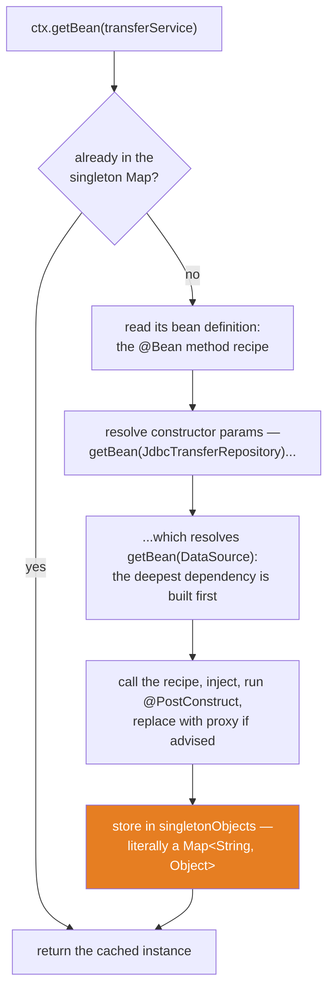
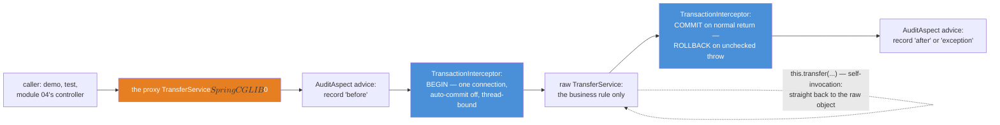

# 03 — Spring Framework Core: The Container That Ends the Ceremony

**The big idea:** Spring is a `Map<String, Object>` with extraordinary discipline. That is
not a slogan — `MiniContainerDemo` builds a working container in ~25 lines (a Map of
recipes, a Map of singletons, one `getBean()` that creates-on-demand and caches) and then
shows `AnnotationConfigApplicationContext` running the same algorithm with 20 years of
discipline added. Once the container is demystified, everything else in this module is a
consequence: it *builds* your objects and calls their constructors (**dependency
injection**), so module 01's `ServiceLocator` dies; it *wraps* them in proxies at creation
time, so `@Transactional` and your own `@Aspect` advice are the same mechanism; it
*translates* every `SQLException` at the JDBC boundary, so `JdbcTemplate` deletes module
01's DAO plumbing banner by banner. No Boot here, on purpose: every bean stage-2 will
auto-configure is wired by hand once, in public.

**In one sentence:** module 01 hand-cranked the wiring, the transaction and the error
handling around four lines of banking; this module hands all three to a container — and
shows you the Map it keeps them in.

## The one database, four eras

Same world as every module: `DemoDb` (copied from module 01, unchanged except its package)
builds stage-1's SecureBank schema in **H2 in memory** — Alice (accounts 1 and 2:
1500.00 / 5200.00), Bob (account 3: 300.00), Carol (no accounts), the `transactions`
ledger where a transfer writes a DEBIT+CREDIT pair sharing one `reference`, and the
`uq_customer_email` constraint this module's exception-translation demo trips on purpose.
Every demo and every test method calls `DemoDb.freshDatabase()` and gets a brand-new copy;
every context is opened with `SpringApp.start(dbUrl)` and closed with try-with-resources.
No server, no ports: the container is a library, not a process.

## The container from first principles

Two terms, in plain words, before anything else:

- **IoC** — *inversion of control*: you stop calling `new` on your collaborators; the
  container decides when they are built. Control of object creation inverted: you → it.
- **DI** — *dependency injection*: the container hands each object its collaborators
  through its constructor (house rule: constructors, never fields). It calls *your*
  constructor, for you, with beans it built.

Why it exists — the failure you already felt: module 01's servlet could not receive
dependencies (the servlet container created it), so it looked them up at runtime in a
static registry by string. `ServiceLocator` compiled, deployed, and died at 2 a.m. on a
typo. A container that builds the whole graph at **startup** turns that 2 a.m. runtime
failure into a `BeanCreationException` before the first request is ever served
(`BeanLifecycleDemo` banner 5 prints both sides of that comparison).

**Read the diagram:**
- The top diamond is the singleton rule: cache hit returns the one shared instance — this
  is why `getBean()` twice is `==` (test `singletonBeanIsOneInstancePerContext`).
- Creation cascades *down* the constructor parameters: the datasource exists before the
  repository, the repository before the service. Nobody declares that order; the graph does.
- The orange box is the whole thesis: the finished bean lands in a Map. Real Spring splits
  this into two maps — bean *definitions* (`DefaultListableBeanFactory`) and bean
  *instances* (`singletonObjects` in `DefaultSingletonBeanRegistry`) — and `MiniContainer`
  mirrors both in 25 lines.
- "Replace with proxy if advised" is where `@Transactional` and `@Aspect` get their power;
  two sections below, that step gets its own diagram.

**Walkthrough — what happens when you call `context.refresh()` (the one method that builds
the world; `MiniContainerDemo` banner 4 prints this live):**
1. **Parse config** — `ConfigurationClassPostProcessor` reads the `@Configuration` class:
   every `@Bean` method becomes a *bean definition* (a recipe: class, scope, init method).
   `@EnableTransactionManagement` is itself an import that registers *more* definitions —
   you can see `transactionInterceptor` appear in the printed list.
2. **Register post-processors** — the machines that act on beans later: `@Value`/
   `@Autowired` resolution, `@PostConstruct` callbacks, the auto-proxy creator.
3. **Instantiate singletons** — for each definition, the recipe is called (your `@Bean` method).
4. **Inject** — each method parameter is resolved by type; recursion builds dependencies first.
5. **Initialize** — `@PostConstruct` fires; then post-processors get the last word: the
   auto-proxy creator swaps advised beans for their proxies *right here*.
6. **Cache** — each finished singleton lands in `singletonObjects`. From now on `getBean()`
   is a lookup. Any failure in steps 3–5 aborts startup — the ServiceLocator upgrade.

**In one sentence:** you stop calling `new`, the container calls your constructor, and the
proof that it is "just" disciplined map-building is that you can write the core in 25 lines.

## The wiring era, in three languages

`XmlEraDemo` loads `src/main/resources/beans.xml` — a real 2004-style wiring file — and
then builds the **same graph** from `AppConfig`. The mapping is 1:1:

| beans.xml (2004) | AppConfig (today) |
|---|---|
| `<bean id="dataSource" class="...DriverManagerDataSource">` | the `@Bean DataSource dataSource(...)` method |
| `<constructor-arg ref="dataSource"/>` | the `@Bean` method's *parameter* — typed, refactor-safe |
| `<property name="url" value="${db.url}"/>` | `@Value("${db.url}")` on the parameter |
| a `PropertySourcesPlaceholderConfigurer` bean, declared by hand | resolved against the `Environment` by default |

The timeline, stated once: **2004** XML `<bean>` files (Spring 1.0); **2007** `@Autowired`
annotations move wiring into the classes and shrink XML to one `<context:component-scan/>`;
**2009+** `@Configuration` Java config makes the wiring plain, compiler-checked code;
**2014+** Boot (stage-2) deletes most of the file: starters and auto-configuration *pick*
the beans — `spring.datasource.url` builds the `DataSource` this module declares by hand.
Where the database URL comes from here: `SpringApp` adds a property source to the
`Environment` before `refresh()` — the explicit, hand-wired ancestor of `application.properties`.

**In one sentence:** the eras never changed *what* wiring is — bean definitions in a
container — only where the definitions live: XML file, annotations, Java, then defaults.

## Beans, scopes, lifecycle

- **Singleton** (the default) is a *scope*, not the GoF pattern: one instance **per
  context**, shared by every collaborator — which is why beans stay stateless and
  thread-safe. Proof: `getBean()` twice, `assertSame`.
- **Prototype** (`@Scope("prototype")`, the `Receipt` bean) is the opposite: a fresh
  instance per `getBean()`, and the container stops tracking it after hand-off — no
  `@PreDestroy` for prototypes; that lifetime job becomes the caller's.
- **Lifecycle callbacks**: `@PostConstruct` fires once, after construction *and* injection
  (step 5 of the walkthrough); `@PreDestroy` fires on `context.close()` — which every demo
  reaches through try-with-resources. Both annotations come from `jakarta.annotation-api`:
  they left the JDK in Java 11 with the rest of Java EE.
- **Failure timing**, the module's favorite comparison: an unsatisfied dependency (a
  `@Bean` parameter no definition can fill) throws `BeanCreationException` — root cause
  `NoSuchBeanDefinitionException` — *during* `refresh()`. Module 01's ServiceLocator threw
  `IllegalStateException` on first unlucky lookup, in production, at night.

**In one sentence:** the container owns the bean's whole life — build, inject, initialize,
cache, destroy — and it refuses to start at all if any of that cannot be honored.

## JdbcTemplate deletes the DAO plumbing

Open module 01's `JdbcTransferDao` next to this module's `JdbcTransferRepository`: same
SQL, same `BigDecimal(scale 2)` discipline, ~130 lines down to ~40. `JdbcTemplateRewriteDemo`
banner 1 prints the deletion list; here it is as the table to photograph's warm-up:

| Module 01 wrote, by hand | Module 03 keeps | What deleted it |
|---|---|---|
| `getConnection` / `try` / `finally` / `close` in every method | nothing — zero resource code | `JdbcTemplate` + `DataSourceUtils` (which also finds the thread-bound transactional connection) |
| `ps.setLong(1, ...)` per parameter | the argument itself | `update(sql, args...)` binds by position and type |
| `ResultSet` reading + `if (!rs.next())` guard | one lambda | `queryForObject` + `RowMapper`: `(rs, n) -> rs.getBigDecimal("balance")` |
| `throws SQLException` on every signature, caller re-wraps | nothing — all unchecked | exception translation (below) |
| `setAutoCommit(false)` / `commit` / `rollback` / restore (~25 lines) | nothing — not this class's job | `@Transactional`'s proxy (next section) |

**Walkthrough — what happens when a duplicate email hits the repository (banner 3 catches
it red-handed):**
1. The INSERT violates `uq_customer_email`; H2 throws `SQLException` with SQLState `23505`
   (the SQL standard's integrity-constraint class `23`, unique violation `505`).
2. `JdbcTemplate` catches it at the boundary — no checked exception ever escapes.
3. Its `SQLExceptionTranslator` reads SQLState and vendor code.
4. It throws the matching `DataAccessException` subclass: `DuplicateKeyException` —
   unchecked, typed, and portable across databases. Callers catch *what happened*, never
   *which driver reported it*.

That is `advanced-java/11`'s boundary translation, productized: the same "translate at the
edge into your own vocabulary" move, shipped as a hierarchy. (An unknown account gets the
same treatment: `EmptyResultDataAccessException`.)

**In one sentence:** `JdbcTemplate` keeps your SQL and deletes everything around it —
resources, parameter binding, row mapping, and the checked-exception tax.

## @Transactional: the proxy owns the transaction

`TransferService.transfer()` is the whole business rule: check funds, throw
`InsufficientFundsException` if short, two balance updates, two ledger rows sharing a fresh
UUID `reference`, one published event. Not one line about connections, auto-commit, commit,
rollback or close — module 01 wrapped ~50 such lines around the same four banking lines.
Where did they go? Into a **proxy**: because `@EnableTransactionManagement` is on, the
container replaces the bean at refresh() step 5 with a generated CGLIB subclass whose
methods run a `TransactionInterceptor` before delegating to your code.

**Read the diagram:**
- The orange box is what `getBean()` actually returned — `AopAndEventsDemo` prints its
  class name; the `$$SpringCGLIB$$` marker is the receipt.
- The blue boxes are module 01's hand-cranked transaction, now framework-owned: BEGIN once
  per annotated call, COMMIT or ROLLBACK at the boundary. Every `JdbcTemplate` call inside
  silently joins the thread-bound connection (`DataSourceUtils`) — that is why the
  repository never mentions transactions, and why the same code works with or without one.
- The `AuditAspect` rings are *your* advice riding the *same* proxy — the point of the
  next section.
- The dotted self-loop is the trap: an inner `this.transfer(...)` never re-enters the proxy.

**Walkthrough — what happens when a caller invokes `transfer(1, 3, 100.00)`:**
1. The call lands on the proxy. The interceptor chain runs outside-in (`@Order(0)` puts the
   audit advice outside the transaction advisor, whose default order is lowest precedence).
2. `TransactionInterceptor` asks the `DataSourceTransactionManager` to BEGIN: one
   connection, auto-commit off, bound to the current thread.
3. The business rule executes; all five SQL statements share that one connection.
4. The event is published — still inside the transaction (nuance below).
5. Normal return → COMMIT makes all writes visible at once. `RuntimeException`/`Error`
   crossing the boundary → ROLLBACK erases them, then rethrows.
6. The connection is unbound and released. Nothing in steps 1–2 and 5–6 appears in your code.

**The default rollback rule, stated exactly** (the interview question, the outage report):
`RuntimeException` and `Error` roll back; **checked exceptions DO NOT** — the proxy lets
them through and COMMITS. `TransactionalTransferDemo` banner 4 proves it live: a debit
executes, an `Exception` fires, the money stays gone. The fixes:
`@Transactional(rollbackFor = Exception.class)`, or the house rule — domain failures are
unchecked, like `InsufficientFundsException` already is. Banner 3 shows the honest rollback
for contrast: a *completed* `UPDATE` erased by an unchecked throw.

**In one sentence:** `@Transactional` is not a keyword the compiler understands — it is a
proxy installed at bean-creation time that owns BEGIN/COMMIT/ROLLBACK around your method,
and its rollback rule says "unchecked only" unless you say otherwise.

## AOP: the same proxy, your advice

**AOP** — *aspect-oriented programming*: behavior that many beans share (auditing,
transactions, security checks) declared once, woven into them by the container. The three
words, in plain terms, as `AuditAspect` uses them: the **aspect** is the class; the
**pointcut** is the where (`execution(public * TransferService.*(..))`); the **advice** is
the what (`@Around`: code that runs around the call and decides when — or whether — to
`proceed()`). Nothing here is exotic: it is `advanced-java/02`'s dynamic proxy wearing a
declarative suit. `TransferService` implements no interface, so Spring generates a CGLIB
*subclass*; had there been an interface, the default would be a JDK proxy (Boot standardizes
on CGLIB everywhere).

**Walkthrough — why self-invocation bypasses everything (the trap, proven by counts):**
1. The proxy holds a reference to the **raw target** object it wraps.
2. An *external* call hits the proxy: advice and transaction interceptors run, then it
   delegates to the target.
3. Inside the target, `this` IS the raw object — never the proxy.
4. So `this.transfer(...)` is a plain Java method call: no interceptor chain — **no audit
   entry, and no transaction**. Each statement auto-commits alone.
5. The money still moves, which is what makes the trap dangerous: it fails silently.
   `AopAndEventsDemo` banner 3 asserts the counts: outer method advised once, inner
   `transfer` advised zero times.

Same mechanism, same trap for `@Transactional` and `@Async` in stage-2. The fixes: split
the bean, call through an injected self-reference, or `@Bean(selfInjection = true)`
(Spring Framework 6.2+).

**In one sentence:** `@Transactional` was never special — it is one interceptor in a chain
that your own aspects ride, and the chain only exists on calls that enter through the proxy.

## Events: the container's in-process message bus

`TransferService` publishes a `TransferExecutedEvent` (a record — any object can be an
event since Spring 4.2); `TransferEventListener`'s `@EventListener` method hears it, wired
by parameter type at refresh. Synchronous by default: same thread, inside the publisher's
transaction. The refused path publishes nothing — the throw precedes the publish — which
the tests assert both ways. Two production nuances, named not hidden: a plain
`@EventListener` fires *before* COMMIT, so listeners that must not act on rolled-back work
use `@TransactionalEventListener(phase = AFTER_COMMIT)`; and the value of the pattern is
openness — a notification feature tomorrow is a new listener bean, zero edits to the
service. **stage-5** grows this exact shape into Kafka events crossing service boundaries;
the record travels almost unchanged.

**In one sentence:** events turn "a transfer happened" from a method call into a fact, and
facts can have any number of subscribers the publisher never meets.

## The table to photograph — who did the plumbing

| Job | Module 01 (2001, by hand) | Module 03 (Spring core) | stage-2 (Boot 4) |
|---|---|---|---|
| Getting dependencies | `ServiceLocator.lookup("name")` plus a cast | constructor parameter, filled by the container | same, auto-wired |
| Building the object graph | `J2eeServer.start()` registers the DAO by hand | `@Bean` methods in one `@Configuration` class | auto-configuration picks the beans |
| Transaction boundaries | `setAutoCommit`, `commit`, `rollback`, `finally close` | `@Transactional` on the service method | same annotation |
| Row-to-object mapping | `rs.getBigDecimal("balance")` by hand | a `RowMapper` lambda | Spring Data repositories |
| SQL failure handling | caller inspects `SQLException` and its SQLState | automatic `DataAccessException` translation | same translation |
| Connection lifecycle | every caller closes in `finally` | `JdbcTemplate` and `DataSourceUtils` close | a managed pool from `spring.datasource.url` |

## The traps, all printed as evidence in the demos/tests

- **Checked exceptions do not roll back by default** — the exact rule is
  `RuntimeException`/`Error` only; banner 4 of `TransactionalTransferDemo` commits a debit
  through a thrown `Exception`, and `checkedExceptionDoesNotRollBackByDefault` asserts the
  balance moved anyway. Fix: `rollbackFor`, or throw unchecked.
- **Self-invocation bypasses the proxy** — `this.transfer(...)` gets no advice and no
  transaction; the counts in `adviceFiresExternallyButNotOnSelfInvocation` are 1 outside,
  0 inside. Identical trap for `@Async` in stage-2.
- **Singleton scope ≠ GoF singleton** — it is "one per context"; two contexts, two
  instances. Shared beans must be stateless (this module's beans hold only final fields).
- **Field injection is the anti-pattern exhibit, shown once** (`BeanLifecycleDemo` banner 4):
  it works inside a container and NPEs outside one, because the dependency is invisible in
  the class's API. House rule: constructor injection everywhere.
- **An event is heard before COMMIT** — a plain `@EventListener` runs inside the publisher's
  transaction; a listener that must see only committed work needs
  `@TransactionalEventListener(phase = AFTER_COMMIT)`.
- **`DriverManagerDataSource` is not a pool** — a fresh connection per call, fine for
  deterministic demos; production uses HikariCP, which Boot configures from the same property.

## Java 21 corner

The era's ceremony (XML bean files) is reproduced faithfully as the *subject*; everything
around it is modern: events and value types are **records** (`TransferExecutedEvent`,
`Receipt`, `AdviceEntry`), the ledger INSERT is a **text block**, `RowMapper` and
`ApplicationEventPublisher` are single-abstract-method interfaces satisfied by **lambdas**
(the mini-container's no-op publisher is one line), and the translation demo uses
**pattern matching for instanceof** (`e.getCause() instanceof SQLException sql`) to reach
the SQLState. `var` appears where the right-hand side already says the type.

## Class flow

1. Show the two diagrams above (the container's getBean cascade first — *what it is*; the
   proxy chain second — *where the power lives*). Read the "Read the diagram" bullets aloud.
2. Run the demos in order: `.\mvnw.cmd -pl 03-spring-framework-core compile exec:java`
   (this runs `SpringCoreDemos`, which calls each demo `main()` in teaching order — point
   at demo 1's 25-line container, then at demo 6's printed `$$SpringCGLIB$$` class name).
3. Run the tests as *proof*: `.\mvnw.cmd -pl 03-spring-framework-core test` — 12 tests,
   fresh database and fresh context per method, each printing its evidence (ledger pairs,
   unchanged balances, advice counts, event receipts).

| Demo class | What it shows |
|---|---|
| `MiniContainerDemo` | IoC/DI from first principles: a hand-built 25-line container, the same graph from `AppConfig`, and the six-step `refresh()` walkthrough |
| `XmlEraDemo` | 2004's `beans.xml` loaded live; the same graph as Java config; the XML → annotations → Java config → Boot timeline |
| `BeanLifecycleDemo` | singleton vs prototype, `@PostConstruct`/`@PreDestroy` flags, the field-injection anti-pattern, and startup failure vs the ServiceLocator's runtime failure |
| `JdbcTemplateRewriteDemo` | module 01's DAO plumbing deleted banner by banner; `DuplicateKeyException` translation caught red-handed with its SQLState |
| `TransactionalTransferDemo` | commit with a two-row ledger; rollback on refusal; a completed write erased; the checked-exception-commits trap |
| `AopAndEventsDemo` | the proxy's real class name; the audit trail; the self-invocation trap by advice counts; event received on success, none on refusal |

| Test | What it proves |
|---|---|
| `singletonBeanIsOneInstancePerContext` | `getBean` twice returns the same cached instance (`assertSame`) |
| `prototypeBeanIsFreshEveryLookup` | `@Scope("prototype")` mints a new instance per lookup (`assertNotSame`) |
| `lifecycleCallbacksFire` | `@PostConstruct` ran at refresh; `@PreDestroy` ran at close — recorded flags |
| `xmlAndAnnotationContextsExposeTheSameGraph` | `beans.xml` and `AppConfig` yield the identical bean types |
| `unsatisfiedDependencyAbortsStartup` | a missing dependency throws `BeanCreationException` during refresh — the ServiceLocator upgrade |
| `jdbcTemplateReadsSeededBalancesExactly` | the repository reads 1500.00 / 5200.00 / 300.00 with scale 2 intact |
| `duplicateEmailBecomesTypedDuplicateKeyException` | `DuplicateKeyException`, unchecked, with SQLState 23505 visible on the cause |
| `transactionalTransferCommitsWithLedgerPair` | balances move; exactly one DEBIT + one CREDIT share the reference |
| `insufficientFundsRollsBackEverything` | one cent over the balance: exception, byte-identical balances, zero new ledger rows |
| `checkedExceptionDoesNotRollBackByDefault` | the trap: a checked throw leaves the debit committed |
| `adviceFiresExternallyButNotOnSelfInvocation` | proxy identity (`$$SpringCGLIB$$`); advice counts 1 external, 0 self-invoked |
| `listenerHearsSuccessAndNotFailure` | one event per committed transfer; none after a refused one |

## Where this leads

Everything this module declared by hand has a name in stage-2's auto-configuration report:
the `DataSource` is `DataSourceAutoConfiguration` reading `spring.datasource.url`; the
transaction manager and `@EnableTransactionManagement` are `TransactionAutoConfiguration`;
the proxy machinery is `AopAutoConfiguration` (Boot's `spring-boot-starter-aspectj`).
**Module 04** puts this container behind a servlet: the same `TransferService`, now called
by a hand-wired Spring MVC `@RestController` on embedded Tomcat, with `@ControllerAdvice` +
`ProblemDetail` replacing module 01's inline status codes — the same transfer, three eras,
one server. Then stage-2 deletes module 04's wiring one starter at a time, and stage-5
grows `TransferExecutedEvent` into Kafka.
