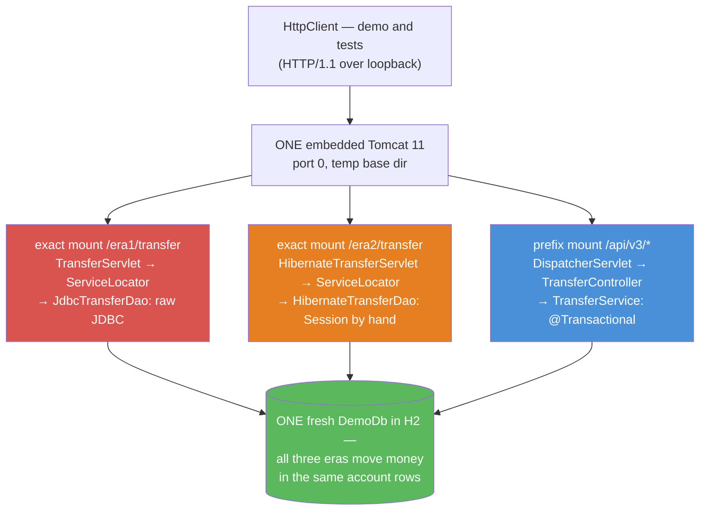

# 04 — The Evolution App: One Transfer, Three Eras, One Server

**The big idea:** the SAME bank transfer — move 250.00 from account 1 to account 3, write
the DEBIT+CREDIT ledger pair, refuse when funds run short — built THREE ways and mounted on
ONE embedded Tomcat against ONE in-memory database. Era 1 is module 01's raw servlet with
hand-cranked JDBC. Era 2 is the same servlet silhouette with standalone Hibernate behind it.
Era 3 is hand-wired Spring MVC: a `DispatcherServlet` mapped by hand, a `@Configuration`
class instead of Boot, JSON via Jackson 3, and errors as RFC 7807 `ProblemDetail` — stage-2's
house style reached WITHOUT `spring.mvc.problemdetails.enabled`. There is no Boot anywhere in
this module, on purpose: every piece of plumbing Boot later automates is a line you can
point at, and the closing ledger names the exact Boot 4.1.1 auto-configuration class that
deletes each line (all names verified against the jars stage-2 actually runs).

**In one sentence:** stage-2 is this module minus every line you are about to read, plus
starters.

## The one database, three eras

Same world as every module: `DemoDb` (copied from module 01, unchanged except its package)
builds stage-1's SecureBank schema in **H2 in memory** — Alice (accounts 1 and 2:
1500.00 / 5200.00), Bob (account 3: 300.00), Carol (no accounts), the `transactions` ledger
where a transfer writes a DEBIT+CREDIT pair sharing one `reference`, and the `version`
column that era 1 bumps by hand, era 2 gets from `@Version`, and era 3 gets from one SQL
string. `EvolutionServer.start()` builds ONE fresh copy; all three eras read and write it,
which is what lets the demo move the same 250.00 three times and watch one cumulative
balance — proof that only the plumbing changed, never the banking.

## One server, three mounts

`EvolutionServer` generalizes module 01's `J2eeServer`: one embedded Tomcat 11 on an
ephemeral port (port 0 — the OS picks), one temp base dir, one `start()`, one `close()`
that stops Tomcat, closes the Spring context and the Hibernate `SessionFactory`, deletes
the temp dir and clears the `ServiceLocator`. The three mounts differ in exactly one
dimension — what sits behind the servlet API:

**Read the diagram:**
- The colors are the course timeline: red (2001, module 01), orange (2006, module 02),
  blue (today-without-Boot, module 03's container behind a servlet). Green is the constant:
  one database, so the three columns are a controlled experiment — same data, same money,
  only the stack differs.
- Eras 1 and 2 are **exact** servlet mappings (`/era1/transfer`): the servlet spec's most
  specific match wins, so those URLs never reach Spring.
- Era 3 is a **prefix** mapping (`/api/v3/*`): Tomcat's mapper routes everything under
  `/api/v3/` into the `DispatcherServlet`, and Spring matches controller paths *within*
  the mapping — that is why `TransferController` declares the RELATIVE paths `/transfers`
  and `/accounts/{id}`. (Boot maps its dispatcher to `/` instead, which is why stage-2's
  controller carries the full `/api/transfers` — same mechanism, different mount point.)
- Eras 1 and 2 both get their dependency from the SAME `ServiceLocator` — era 2 fixed
  row-mapping, not wiring. Era 3's dependencies arrive through constructors, injected by
  the `AnnotationConfigWebApplicationContext` that the `DispatcherServlet` refreshes during
  Tomcat startup.

**Walkthrough — how the era-3 context gets built without Boot (EvolutionServer step 5-6):**
1. An `AnnotationConfigWebApplicationContext` is created and gets a `MapPropertySource`
   carrying `db.url` — module 03's `SpringApp` move, verbatim; `WebAppConfig`'s
   `@Value("${db.url}")` reads it. This property source is the hand-cranked ancestor of
   `application.yml`.
2. `WebAppConfig.class` is registered; the context is **not** refreshed yet.
3. It is handed unrefreshed to `new DispatcherServlet(context)`. During `tomcat.start()`,
   `FrameworkServlet.init()` sets the `ServletContext` on it and refreshes it — exactly
   what Spring's own `AbstractDispatcherServletInitializer` does in a web.xml-less WAR.
4. `setLoadOnStartup(1)` forces that refresh to happen at server start, so a wiring
   mistake fails loudly before the first request (module 03's startup-vs-2-a.m. lesson).
5. One Tomcat line deserves a trap of its own: `tomcat.getEngine().setParentClassLoader(...)`.
   Tomcat gives each webapp its own (here empty) classloader whose default parent is the
   SYSTEM classloader, and binds it to the starting thread — fine under `mvnw test`, where
   the system classloader IS the project classpath, but fatal under `mvnw exec:java`,
   where it is Maven's. This module hit that bug for real; Boot's embedded-server
   auto-configuration sets the same parent classloader for you, invisibly.

**In one sentence:** one Tomcat, one database, three mounts — the servlet spec's mapping
rules keep the eras apart, and everything else they share.

## Era 1 (/era1/transfer): the stack you already read

Copied and condensed from module 01 — `TransferServlet` (parameter parsing, inline status
codes), `ServiceLocator` (the global string-keyed registry), `JdbcTransferDao` (connection,
auto-commit off, `SELECT ... FOR UPDATE` in id order, commit/rollback/close by hand). The
capstone adds nothing to it except CONTEXT: you have read this code once already, and now
you watch it mounted next to its successors, moving the same money in the same table. Form
parameters in, `text/plain` out, a 409 decided inline in a catch block. Its full walkthrough
lives in `01-j2ee-the-world-before-spring`; nothing here repeats it.

## Era 2 (/era2/transfer): Hibernate fixed the SQL, not the plumbing

Same servlet silhouette, same form parameters, same text responses — and behind the same
`ServiceLocator` lookup sits `HibernateTransferDao`. Read it next to era 1's DAO and the
deletion list is concrete.

**What DIED between era 1 and era 2:**
- every SQL string — `session.find(Account.class, id)` emits the SELECT;
- `ps.setLong/setBigDecimal` — the object graph IS the parameter binding;
- `rs.getBigDecimal` row-mapping — the entity comes back populated;
- `version = version + 1` by hand — `@Version` on `Account` makes Hibernate write AND guard
  the column (the test asserts the bump with zero code mentioning it);
- `throws SQLException` — Hibernate exceptions are unchecked.

**What SURVIVED — era 3's deletion list, exactly:**
- one `Session` per request, opened and closed by hand (try-with-resources);
- `beginTransaction()` / `commit()` / `rollback()` by hand, on every path;
- wiring through a global registry (`ServiceLocator`, reused verbatim from era 1);
- the error policy still inline in the servlet's catch blocks.

`HibernateBootstrap.newFactory(dbUrl)` is module 02's programmatic bootstrap
(registry → metadata → `SessionFactory`); only the three entities the transfer touches are
registered — an unmapped table is simply invisible to Hibernate. The entities themselves
(`Customer`, `Account`, `LedgerEntry`) are module 02's copies, plus one addition:
`LedgerEntry` gained a constructor because the capstone WRITES ledger rows through
Hibernate, where module 02 only read them.

**In one sentence:** era 2 is the README promise of ORM made literal — the SQL and the
row-mapping are gone, and what remains (session, transaction, wiring, error policy) is
precisely what era 3 deletes.

## Era 3 (/api/v3/*): hand-wired Spring MVC, JSON, RFC 7807

The pieces, each with its stage-2 counterpart named in the wiring ledger below:

- `WebAppConfig` — `@Configuration @EnableWebMvc @EnableTransactionManagement
  @ComponentScan`: two `@Bean` methods (`DriverManagerDataSource` on `${db.url}`,
  `DataSourceTransactionManager`) and three switches. This ~25-line class plus
  `EvolutionServer`'s Tomcat block IS the deployment: no Boot, no web.xml, no YAML file.
- `TransferController` — `@RestController`; POST `/transfers` takes a `TransferRequest`
  record via `@RequestBody` and returns a `TransferResponse` record; GET `/accounts/{id}`
  returns an `AccountView` record. No parsing, no `setStatus`, no `getWriter`, no lookup.
- `TransferService` — module 03's business rule unchanged: check funds →
  `InsufficientFundsException`; debit/credit; two ledger rows sharing a UUID `reference`;
  `@Transactional`'s proxy owns begin/commit/rollback. It returns a `TransferReceipt`
  (reference + both new balances, read INSIDE the transaction — so they are exact).
- `JdbcTransferRepository` — module 03's `JdbcTemplate` repository, now a `@Repository`
  component; "no such row" is translated from `EmptyResultDataAccessException`
  (infrastructure word) to `AccountNotFoundException` (domain word) at the boundary.
- `BankApiAdvice` — `@RestControllerAdvice`: `InsufficientFundsException` → 409,
  `AccountNotFoundException` → 404, `IllegalArgumentException` /
  `HttpMessageNotReadableException` / `MethodArgumentTypeMismatchException` → 400. Every
  handler returns `ResponseEntity<ProblemDetail>` with `APPLICATION_PROBLEM_JSON` pinned
  as the content type — deterministic and assertable, not left to content negotiation.

**JSON, verified not assumed:** `tools.jackson.core:jackson-databind` 3 is on the classpath,
and spring-webmvc 7.0.9's `@EnableWebMvc` auto-registers the Jackson-3 converter —
`WebMvcConfigurationSupport` delegates to `HttpMessageConverters.forServer()
.registerDefaults()`, which instantiates `JacksonJsonHttpMessageConverter` when
`tools.jackson.databind.ObjectMapper` is present (confirmed in the jar's bytecode, then
confirmed again by this module's JSON round-trip tests). **No manual converter
registration is needed**; `WebMvcConfigurer#extendMessageConverters` is the hook if a
project ever lacks Jackson 3.

**Walkthrough — what happens when `POST /api/v3/transfers` arrives:**
1. **Connector**: Tomcat's connector accepts the bytes on the ephemeral port and builds
   the request/response objects.
2. **Mapper**: Tomcat's mapper matches the URI against the mount table — exact mounts
   `/era1/transfer`, `/era2/transfer` do not match; prefix `/api/v3/*` does → the
   `DispatcherServlet` (servletPath `/api/v3`, pathInfo `/transfers`).
3. **`DispatcherServlet.doDispatch`**: the front controller takes over — from here on,
   Tomcat is just the transport.
4. **HandlerMapping**: `RequestMappingHandlerMapping` matches the lookup path
   `/transfers` (the prefix is stripped — the mapping-choice payoff) + method POST to
   `TransferController.transfer(...)`.
5. **Argument resolver**: `RequestResponseBodyMethodProcessor` sees `@RequestBody`,
   picks the Jackson-3 converter by `Content-Type: application/json`, and deserializes
   the body into the `TransferRequest` record. Malformed JSON throws here — the
   controller never runs (step 9 catches it instead).
6. **Interceptor chain**: `HandlerInterceptor`s run — ours is empty; this is where
   stage-2's security filter chain would already have authenticated the caller.
7. **Controller → service proxy**: `transfer(...)` calls the injected
   `TransferService` — which is the CGLIB proxy: `TransactionInterceptor` BEGINs one
   connection, auto-commit off, thread-bound (module 03's diagram, live).
8. **JdbcTemplate**: the five statements (read balance, debit, credit, two ledger rows)
   silently join that thread-bound connection via `DataSourceUtils`.
9. **Return or throw**: normal return → the proxy COMMITs and the `TransferReceipt`
   travels back up; a `RuntimeException` → ROLLBACK, and the exception escapes the
   controller into `BankApiAdvice`, which builds the `ProblemDetail`.
10. **Message converter**: on success the returned record is serialized by the same
    Jackson-3 converter to `application/json`; on failure the advice's explicit
    `contentType(APPLICATION_PROBLEM_JSON)` wins.
11. **Response out**: bytes back through the connector; the connection is unbound and
    released. Steps 3-11 are what `spring-boot-starter-webmvc` delivers untouched —
    Boot changes WHO WIRES THEM, not what they do.

**In one sentence:** era 3 is stage-2 with the auto-configuration removed — same
`DispatcherServlet`, same annotations, same `ProblemDetail`, all of it plugged in by hand
so you can see every socket.

## Code size, counted honestly

Code lines with comments and blanks excluded, counted by script (2026-10, this module):

| The stack that moves the money | Files | Code lines |
|---|---|---|
| Era 1: servlet + ServiceLocator + raw-JDBC DAO | 3 | 233 |
| Era 2: servlet + ServiceLocator + Hibernate DAO + bootstrap | 3 | 173 |
| Era 2's entities (Customer, Account, LedgerEntry) — a shared ASSET that replaced row-mapping | 3 | 179 |
| Era 3: config + controller + service + repository + advice + 4 records | 9 | 247 |
| `EvolutionServer` — mounts all three eras (Boot's embedded-server job, by hand) | 1 | 194 |
| **stage-2's transfer slice**: `TransferController` + 2 DTO records | 3 | **59** |

Read the numbers before quoting them:
- Era 2 looks small because its cost MOVED: the 179 entity lines are written once and
  replace per-query row-mapping forever. Era 1 pays per statement; era 2 pays per table.
- Era 3 is not "bigger than era 1" by accident of counting: ~25 of its lines are
  `WebAppConfig` (pure wiring — Boot deletes exactly these), ~59 are `BankApiAdvice`
  (stage-2's shared `GlobalExceptionHandler` is 38 lines for the WHOLE app, plus one YAML
  line for framework errors), and 30 are the four records. The transfer logic itself is
  the same ~20 lines it has been since era 1.
- The stage-2 number (59) excludes wiring entirely — because there is none: a 9-line main
  class, `spring.datasource.url` + `spring.mvc.problemdetails.enabled` in
  `application.yml`, and starters in the pom do the other three rows of this table.

**In one sentence:** the business rule never changed size; every era's line count is just
the plumbing that era makes you carry.

## The table to photograph — the Boot counterpart ledger

Every hand-wired piece in this module, next to the Boot 4.1.1 class or property that
deletes it in stage-2. Every Boot name was verified against the jars stage-2 actually
resolves (`org.springframework.boot:*-4.1.1.jar`) — Boot 4 moved these classes out of
`spring-boot-autoconfigure` into per-technology modules, which is why the packages below
look unfamiliar next to Boot 3 blog posts. The demo prints this same ledger live.

| Hand-wired here | Deleted in stage-2 by |
|---|---|
| `pom.xml`: 8 separate dependencies | `spring-boot-starter-webmvc` (+ `-data-jpa` for the JPA era): one starter picks the jars |
| `EvolutionServer`: Tomcat baseDir, port 0, parent classloader, start | `TomcatServletWebServerAutoConfiguration` + `ServletWebServerConfiguration`; `server.port` in `application.yml` (Boot 3 called it `ServletWebServerFactoryAutoConfiguration`) |
| `new DispatcherServlet(context)` + `addServletMappingDecoded("/api/v3/*")` | `DispatcherServletAutoConfiguration` — registers it, mapped to `/` |
| `WebAppConfig`: `@EnableWebMvc` and its defaults | `WebMvcAutoConfiguration` |
| Jackson-3 converter found via the classpath; `JsonMapper` built per use | `JacksonAutoConfiguration`: one `tools.jackson.databind.json.JsonMapper` bean |
| `@Bean DataSource` + the `db.url` property source (no pool) | `DataSourceAutoConfiguration` reading `spring.datasource.url` — HikariCP pooled |
| `new JdbcTemplate(dataSource)` inside the repository | `JdbcTemplateAutoConfiguration` |
| `@Bean DataSourceTransactionManager` + `@EnableTransactionManagement` | `TransactionAutoConfiguration` |
| Era 2: `HibernateBootstrap` builds the `SessionFactory` by hand | `HibernateJpaAutoConfiguration` via `spring-boot-starter-data-jpa` (`spring.jpa.*`) |
| Eras 1-2: `ServiceLocator`, a global string-keyed registry | no auto-config — constructor injection (module 03); an anti-pattern has no Boot counterpart because it must not exist |
| `BankApiAdvice` handlers, including for framework errors | `spring.mvc.problemdetails.enabled=true` + `GlobalExceptionHandler extends ResponseEntityExceptionHandler` |
| `EvolutionServer` + `WebAppConfig` as deployment code | `application.yml` as the only configuration |

**In one sentence:** point at any line of this module and this table names the Boot class
that makes it disappear — that table IS the course.

## The traps, all printed as evidence in the demo/tests

- **The parent-classloader line is load-bearing** — without
  `tomcat.getEngine().setParentClassLoader(...)`, the Spring refresh inside Tomcat's start
  thread cannot see Spring's own classes under `mvnw exec:java` (the failure reads
  `AutoProxyRegistrar.class ... does not exist`), while `mvnw test` passes happily — the
  system classloader differs between the two. This module caught that bug for real; Boot
  hides the fix inside its embedded-server auto-configuration.
- **Prefix mapping changes what controller paths mean** — with the dispatcher on
  `/api/v3/*`, `@PostMapping("/transfers")` is the FULL story; writing
  `@PostMapping("/api/v3/transfers")` instead yields a 404, because the lookup path is the
  request URI MINUS the servlet prefix. Boot's `/` mapping is why stage-2 controllers
  carry full paths and nobody thinks about it.
- **`@Transactional` still rides a proxy** — everything module 03 proved holds here:
  self-invocation (`this.transfer(...)`) bypasses the transaction, and checked exceptions
  do NOT roll back by default. The controller calls the service through the injected
  proxy; that is the only reason step 7-9 of the walkthrough works. See 03's
  `AopAndEventsDemo` for the live proof; the capstone deliberately does not re-stage it.
- **Jackson 3 coordinates** — the artifacts moved to `tools.jackson.*` (annotations keep
  the OLD `com.fasterxml.jackson.annotation` package), the entry class is `JsonMapper`
  (not `ObjectMapper`), and record support is native. Money note: re-reading JSON as a
  tree turns `999999.00` into a double unless you enable
  `DeserializationFeature.USE_BIG_DECIMAL_FOR_FLOATS` — the demo does.
- **`problem+json` is not automatic here** — returning a bare `ProblemDetail` lets content
  negotiation choose the media type; `BankApiAdvice` pins
  `APPLICATION_PROBLEM_JSON` on every response so the contract is assertable. stage-2's
  YAML switch (`spring.mvc.problemdetails.enabled=true`) is what makes the FRAMEWORK's own
  errors obey the same contract without handlers.
- **`DriverManagerDataSource` is not a pool** — a fresh connection per call, fine for a
  deterministic demo; production (and Boot) use HikariCP from the same property.

## Java 21 corner

The eras' ceremony is reproduced faithfully as the SUBJECT; everything around it is
modern: the API contracts are **records** (`TransferRequest`, `TransferResponse`,
`AccountView`, `TransferReceipt`, `HttpResult`), Jackson 3 deserializes them with zero
annotations, the repository projects a row into a **nested record** (`AccountRow`) instead
of an entity, the ledger INSERT is a **text block**, and the demo re-serializes bodies
through `JsonMapper`'s fluent builder.

## Class flow

1. Show the server diagram above; read the bullets aloud — especially the mount table
   (two exact mounts, one prefix mount, one database).
2. Run the demo: `.\mvnw.cmd -pl 04-the-evolution-app compile exec:java`. Watch: the three
   identical 250.00 transfers and the cumulative balances between them (banner 3-5); the
   409 problem+json pretty-printed (banner 6); the malformed-JSON 400 (banner 7); and the
   wiring ledger (banner 8) — pause on the VERDICT line.
3. Run the tests as proof: `.\mvnw.cmd -pl 04-the-evolution-app test` — 9 tests, ONE
   server for the whole class, order-independent by construction (deltas everywhere;
   account 1 is never written).
4. Close by opening `stage-2-monolith/pom.xml` side by side with this module's: eight
   dependencies and 194 lines of server code versus starters — then walk the counterpart
   table one row at a time.

| Demo class | What it shows |
|---|---|
| `EvolutionServerDemo` | one server, three mounts, one database; the same 250.00 transfer through all three eras with running balances; 409 + 400 as pretty-printed RFC 7807; the wiring ledger with verified Boot 4.1.1 names; the verdict |

| Test | What it proves |
|---|---|
| `era1FormPostMovesMoneyThroughRawJdbc` | module 01's stack, mounted: form POST moves money, response carries the reference |
| `era2FormPostMovesMoneyThroughHibernate` | Hibernate moves the same money: deltas, the DEBIT+CREDIT pair, and `@Version` bumped with no code touching the column |
| `era3PostJsonMovesMoneyAndReturnsExactBalances` | 200 + `application/json`; the `TransferResponse` record round-trips through Jackson 3 with exact post-transfer balances |
| `era3WritesExactlyTwoLedgerRowsSharingTheReference` | stage-1's reconciliation rule survives HTTP: exactly two `transactions` rows share the returned reference |
| `era3InsufficientFundsIs409ProblemJson` | 409 + `application/problem+json`; title/status/detail name the account and both amounts; balances prove the rollback |
| `era3UnknownAccountIs404ProblemJson` | GET on account 999 → 404 problem+json — the advice owns the status code, no controller does |
| `era3MalformedJsonIs400ProblemJson` | `{oops: not json` → 400 problem+json — the converter's failure becomes a clean contract |
| `era3GetAccountReturnsTheSeededBalance` | `AccountView` for account 1 is the seeded 1500.00 CHECKING — order-independent because no test writes account 1 |
| `allThreeErasAgreeOnTheSameDeltas` | the capstone claim: three identical 10.00 transfers land three identical deltas — the plumbing changed, the banking did not |

## Where this leads

Open `stage-2-monolith` next to this module — literally, in two editor panes. Its
`TransferController` is this module's `TransferController` plus a JWT; its
`GlobalExceptionHandler` is `BankApiAdvice` with the framework-error handlers replaced by
one YAML switch; its pom is this module's dependency list collapsed into starters; and
every auto-configuration named in the ledger above is a class in the jars it resolves.
Because you wired each piece once by hand, `@SpringBootApplication` now reads as a
*summary* instead of a spell. Then `stage-5-microservices`: the transfer outgrows one
database and one transaction, and this module's `@Transactional` transfer grows into a
saga — but the ledger discipline (two rows, one reference) is the same rule you watched
all three eras obey here.
