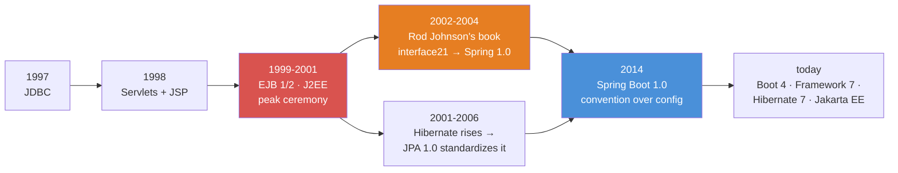
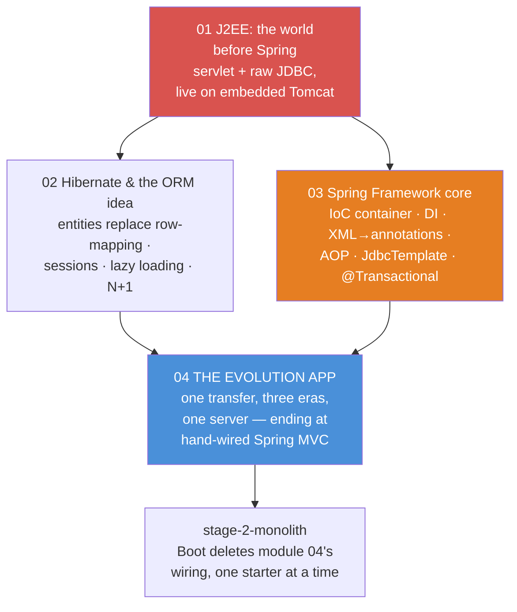
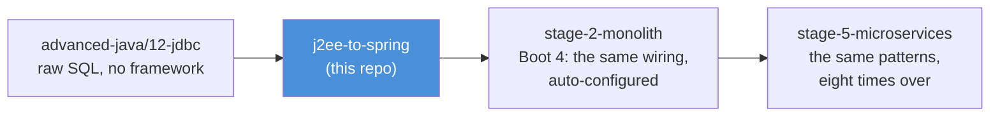

# J2EE to Spring — The Evolution Teaching Repo

The missing chapter between [`advanced-java/12-jdbc`](../advanced-java/12-jdbc/README.md)
(raw SQL over a `Connection`) and [`stage-2-monolith`](../stage-2-monolith/README.md)
(Spring Boot, where the database is "just there" behind `@Autowired` repositories).

**The question this course answers:** Boot hands you a running, transactional,
JSON-speaking web app in about ten lines. *What exactly is it doing for you, and why does
it exist?* You cannot feel the answer until you have carried the plumbing yourself. So
this repo carries it — era by era — and the capstone builds **the same bank transfer
three ways**, from 2001-style ceremony to hand-wired Spring MVC, on one server.

Every explanation follows [`docs/refs/TEACHING_STYLE.md`](../docs/refs/TEACHING_STYLE.md):
plain sentence first, numbered walkthroughs for every mechanism, **"Read the diagram:"**
bullets under every mermaid diagram, **"In one sentence:"** takeaways.

- **demo classes** (`src/main/java`) — each has a `main()` that prints what is happening, step by step
- **JUnit tests** (`src/test/java`) — each test proves one claim and prints the evidence
- **README.md with mermaid diagrams** — the conceptual picture *before* you open the code

**Zero setup:** the database is H2, in memory, created fresh by the code (same schema and
seed world as stage-1's PostgreSQL — Alice/Bob/Carol, the same balances). No Docker, no
ports to free, runs anywhere `mvnw test` runs. Web demos start **embedded Tomcat on an
ephemeral port inside the JVM** and stop it again — nothing lingers after a demo or test.

## The evolution timeline



**Read the diagram:**
- Red (1999–2001) is the *problem*: J2EE "solved" enterprise Java with containers,
  deployment descriptors and EJB ceremony so heavy that a simple transfer needed
  interfaces, XML and a vendor server to run.
- Orange (2002–2004) is the *reaction*: Rod Johnson's *Expert One-on-One J2EE Design
  and Development* argued the container was optional — a plain Java object plus a wiring
  factory (the IoC container, born as `interface21`) beat an EJB for most jobs. That code
  became Spring.
- The Hibernate branch is the *same reaction* one layer down: hand-written JDBC row
  mapping was the boilerplate everyone hated, so an object-relational mapper killed it —
  and won so completely that J2EE absorbed it as JPA.
- Blue (2014) is Boot: not new ideas, but *defaults* — the embedded server and
  auto-configuration this repo wires by hand, so students meet `stage-2` with no magic left.

## The course map



**Read the diagram:** module 01 (red) is the pain that motivated everything — a real
servlet doing real JDBC, runnable today. Modules 02 and 03 are the two historical answers:
Hibernate answered "mapping rows is tedious", Spring answered "wiring objects is tedious".
Module 04 (blue) is the capstone where both answers meet in one app, and the arrow out of
it is literally `stage-2`: every wiring class in 04 has a Boot auto-configuration with its
name on it.

## Suggested teaching order

| # | Module | The one-sentence pitch | Run the demos |
|---|--------|------------------------|---------------|
| 01 | `01-j2ee-the-world-before-spring` | A servlet is just a Java class with `doGet`/`doPost` — but in J2EE everything around it (wiring, transactions, mapping) was yours to hand-crank, and the EJB "help" made it worse | `.\mvnw.cmd -pl 01-j2ee-the-world-before-spring compile exec:java` |
| 02 | `02-hibernate-orm` | An ORM maps rows to objects so the object graph becomes your API — and in exchange you must learn its session, its lifecycles, and its lazier-than-you-think loading | `.\mvnw.cmd -pl 02-hibernate-orm compile exec:java` |
| 03 | `03-spring-framework-core` | Spring is a Map<String, Object> with extraordinary discipline: it builds your objects, injects their dependencies, wraps them in proxies, and owns their transactions | `.\mvnw.cmd -pl 03-spring-framework-core compile exec:java` |
| 04 | `04-the-evolution-app` | The SAME `POST /transfer` built three ways on ONE server — 2001 servlet+JDBC, Hibernate-era, and Spring MVC wired by hand — with the Boot counterpart named for every line | `.\mvnw.cmd -pl 04-the-evolution-app compile exec:java` |

## Running things

All commands run **from this folder** (`j2ee-to-spring/`), Windows PowerShell shown:

```powershell
# run one module's demo launcher (prints every demo in teaching order)
.\mvnw.cmd -pl 04-the-evolution-app compile exec:java

# run one module's tests (tests print what they prove)
.\mvnw.cmd -pl 02-hibernate-orm test

# run everything
.\mvnw.cmd test
```

If em-dashes/arrows print as garbage in a plain `cmd` window, run `chcp 65001` first
(UTF-8 code page). Windows Terminal and IDE consoles are fine as-is.

## Shared conventions

- **Java 21, modern idiom** — records, sealed types, pattern matching, text blocks. The
  *era ceremony* being taught (verbose JDBC, XML bean files) is reproduced faithfully as
  the SUBJECT; the code around it is modern.
- **Versions mirror stage-2's stack** — Spring Framework 7.0.x, Tomcat 11 (Servlet 6.1,
  `jakarta.*` packages), Hibernate ORM 7, Jackson 3 (`tools.jackson.*` — see
  `docs/refs/BOOT4_CHEATSHEET.md`). When this course says "Boot automates this", it is the
  same majors stage-2 actually runs.
- **H2 in memory, fresh per demo/test class** — the schema and seed mirror stage-1's
  PostgreSQL exactly (same tables, same Alice/Bob/Carol world), so the SQL knowledge from
  stage-1 transfers unchanged.
- **Servers are embedded and ephemeral** — demos/tests start Tomcat on port 0 (the OS
  picks a free port), use it, and stop it in the same run. Nothing binds a fixed port;
  nothing outlives the JVM.
- **Determinism** — HTTP tests talk to an in-process server over loopback; seeded ids and
  balances are fixed; no test asserts timings (demos may print them with a caveat).
- **Comments are teaching material** — they explain WHY, name the era, and point at the
  Boot counterpart ("stage-2: `spring.datasource.url` does this line for you").

## Where this course leads



**Read the diagram:** `advanced-java/12` taught the JDBC that every era here stands on;
this repo makes the plumbing visible; stage-2 then deletes that plumbing with starters —
and because students built each piece once by hand, `@SpringBootApplication` reads as a
*summary* instead of a spell. Stage-5 reuses the same transaction and repository patterns
across eight services, where the saga in `stage-5` is module 04's transfer grown up.
