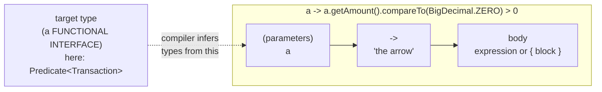
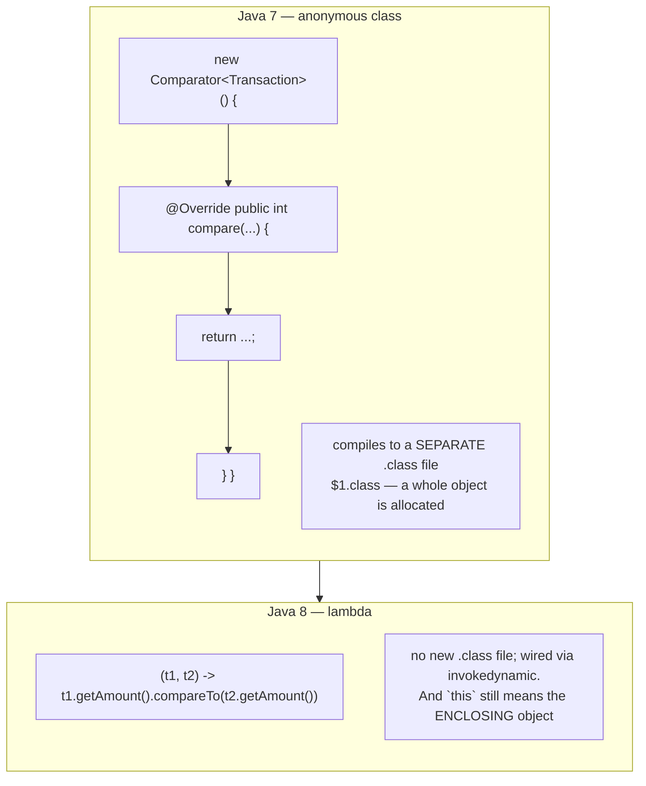
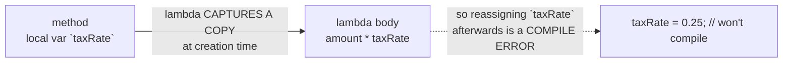
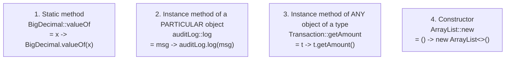

# 01 — Lambdas & Method References

**The big idea:** before Java 8, the only way to hand *behavior* to another piece of code
was to wrap it in an *object* (an anonymous class). A lambda is behavior as a value —
you can store it in a variable, pass it as an argument, and return it, with no class ceremony.

Two terms carry this module:

- *functional interface* — an interface with exactly **one** abstract method, called a **SAM**
  (**s**ingle **a**bstract **m**ethod). It is the only kind of type a lambda can have.
  `Comparator`, `Runnable` and `Predicate<Transaction>` are all functional interfaces.
- *target type* — the functional interface a lambda is assigned or passed to. Inferring
  parameter types from that context is *target typing*, which is why you can omit them.

**In one sentence:** a lambda is behavior as a value, and its type comes from where you put it.

## Anatomy of a lambda

**Read the diagram:**
- The box reads left to right: parameters, arrow, body. The arrow separates input from work.
- The dotted arrow is the point. The target type is *not* written inside the lambda — the
  compiler lifts it from the surrounding code and infers the parameter types from it.

**Walkthrough — how the compiler types that lambda** (point at `LambdaSyntaxDemo` as you go):

1. Find the target type. Here the lambda lands where a `Predicate<Transaction>` is expected.
2. Read its SAM: `boolean test(Transaction t)`. So the lambda takes one `Transaction` and `a`
   needs no declaration — this is why parameter types are almost always **omitted**.
3. Check the body yields a `boolean`. It does, so the lambda compiles. Aim the same lambda at a
   `Function<Transaction,String>` and this step fails: `incompatible types`.
4. Note the body shape: a single **expression** returns its value with no `return` keyword, while
   a **block** `{ ... }` behaves like a method body. And the gate underneath all of it: a lambda
   only compiles where a **functional interface** is expected.

## Anonymous class vs lambda (the "before" picture)

**Read the diagram:**
- Top: the Java 7 way — five lines of class syntax for one comparison rule, plus a real
  `$1.class` file to hold it.
- Bottom: the Java 8 way — one line, no new class file, the call site wired up at runtime.

**Walkthrough — what a lambda compiles into:**
1. javac moves the lambda body into a private *synthetic* method on the enclosing class, named
   like `lambda$main$0`.
2. At the call site it writes one `invokedynamic` instruction — a call whose target is not
   decided until the JVM first reaches it.
3. On first execution a JDK bootstrap method builds an object implementing the target interface
   and wires the call site to it. Later runs reuse that wiring.
4. Nothing else is generated: no extra `.class` file, no anonymous class to name or find in a
   stack trace.

The `this` difference is the classic gotcha — `ThisMeaningDemo` shows that inside an anonymous
class `this` is the anonymous object, inside a lambda `this` is the enclosing instance.

**In one sentence:** an anonymous class is a real object with its own file and its own `this`;
a lambda is a method body wired to an interface at runtime, keeping the surrounding `this`.

## Captured variables must be *effectively final*

Two more terms. A local variable a lambda body refers to is **captured**: the lambda takes a
*copy* of it when the lambda is created. A variable is **effectively final** if you never assign
to it after declaring it, even without the word `final`.

**Read the diagram:**
- Left is a local variable inside a method; middle is the lambda copying that value, so two
  separate places hold it.
- Right (dotted) is the consequence: reassigning the original would leave the two copies
  disagreeing, so the compiler refuses and points at the assignment.

**Walkthrough — why the rule exists:**
1. A lambda can outlive its method: you can store it, return it, or run it on another thread.
2. Method locals die with the method, so the lambda keeps a copy — and two copies can disagree
   about "what is `taxRate` now?".
3. Java forbids that instead of picking a side: captured locals must be effectively final.
   Instance *fields* are exempt, because a field lives on the heap as one shared copy.
   `EffectivelyFinalDemo` shows both cases.

## Method references — lambdas with a name

A method reference `X::y` is just shorthand for a lambda that calls an existing method.
Four shapes (all in `MethodReferenceDemo`):

**Read the diagram:** one box per shape, in order. Each shows the `::` form, then the lambda it
means. The shapes differ only in *where the object comes from*: nowhere (static), an object you
already hold, whichever object arrives as the first parameter, or a new object (constructor).

Shape 3 confuses people: the *first parameter* of the functional interface becomes the
*receiver* of the call. `Comparator.comparing(Transaction::getAmount)` reads as "compare
transactions by the result of calling `getAmount()` on each one". The transaction is not an
argument to `getAmount` — it is the object `getAmount` is called *on*.

## Functional interfaces you will actually use

| Interface | Shape | Reads as | Typical use |
|---|---|---|---|
| `Function<T,R>` | `T -> R` | turn one thing into another | `map` in streams |
| `Predicate<T>` | `T -> boolean` | answer yes or no about a thing | `filter` in streams |
| `Consumer<T>` | `T -> void` | use a thing up, return nothing | `forEach` |
| `Supplier<T>` | `() -> T` | produce a thing from nothing | lazy defaults, factories |
| `UnaryOperator<T>` | `T -> T` | turn a thing into another of itself | `replaceAll` on lists |
| `BiFunction<T,U,R>` | `(T,U) -> R` | combine two things into a third | `merge` on maps |

Default methods on these interfaces (`andThen`, `compose`, `and`, `negate`, `or`) let you
*build big behavior out of small behavior*. A default method is one the interface itself gives
a body to — module 02 is that feature. `ComposingDemo` shows `isDeposit.and(isLarge)` and
`toCents.andThen(format)`.

## Class flow

1. Show the diagrams above (concept).
2. Run the demos in order: `.\mvnw.cmd -pl 01-lambdas compile exec:java`
   (this runs `LambdaDemos`, which calls each demo `main()` in teaching order).
3. Run the tests as *proof*: `.\mvnw.cmd -pl 01-lambdas test` — each test prints the
   behavior it asserts.

| Demo class | What it shows |
|---|---|
| `LambdaSyntaxDemo` | every syntactic shape, and how type inference picks the target type |
| `AnonymousVsLambdaDemo` | the same sorting task both ways; less code, same result |
| `ThisMeaningDemo` | `this` inside an anonymous class, and inside a lambda |
| `EffectivelyFinalDemo` | what a lambda may capture, and why |
| `OwnFunctionalInterfaceDemo` | writing your own `@FunctionalInterface` and using it as an API |
| `MethodReferenceDemo` | all four `::` shapes |
| `ComposingDemo` | `Predicate.and/negate`, `Function.andThen/compose` — behavior algebra |
