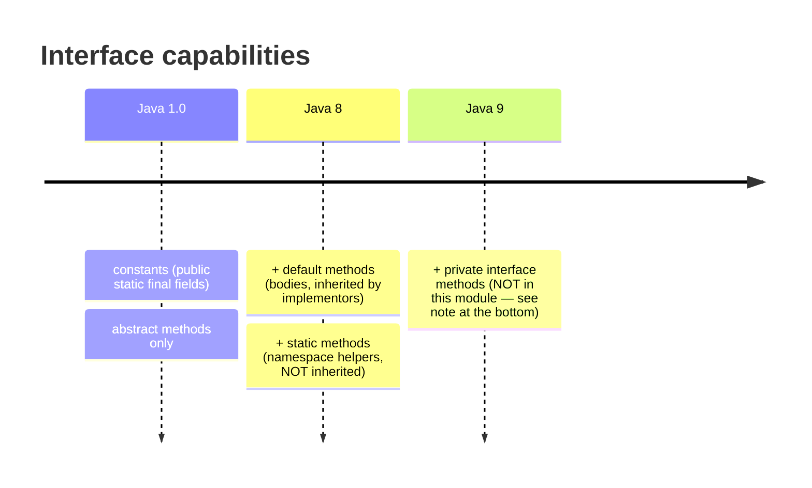
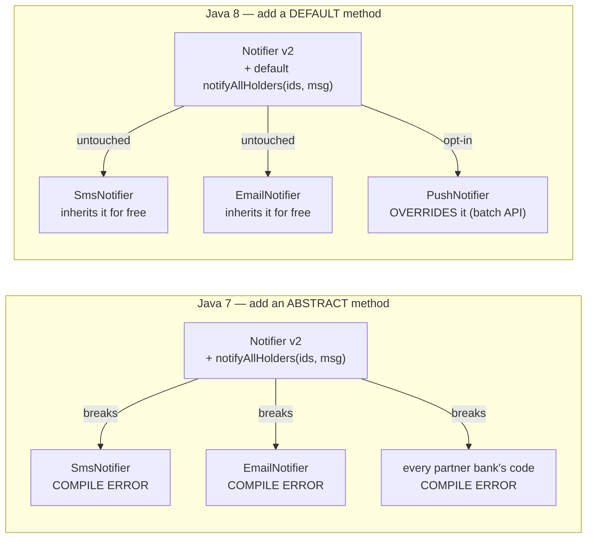
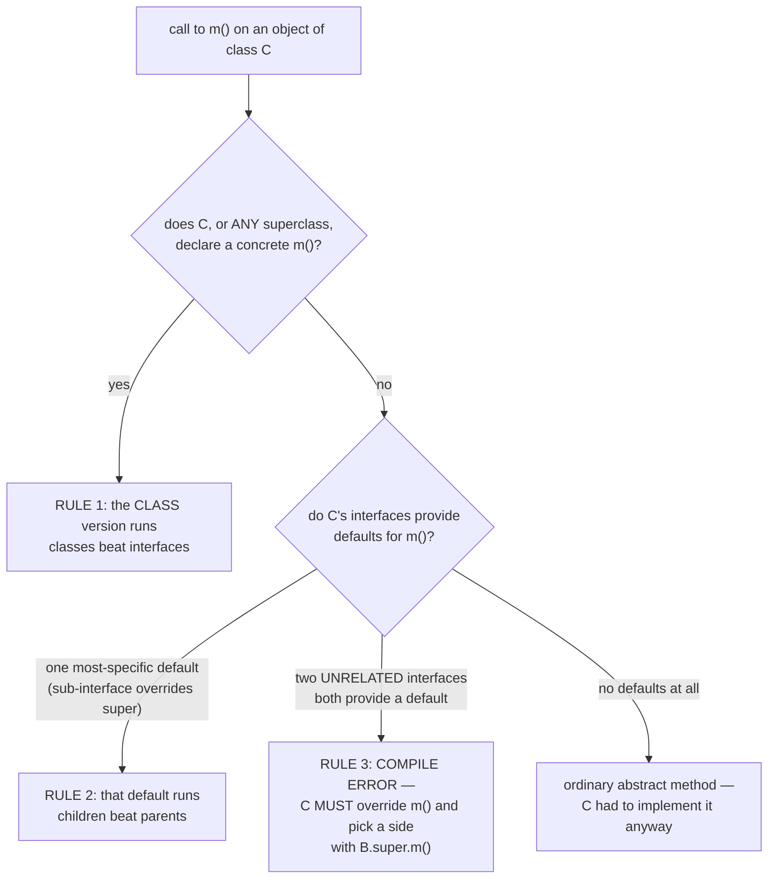
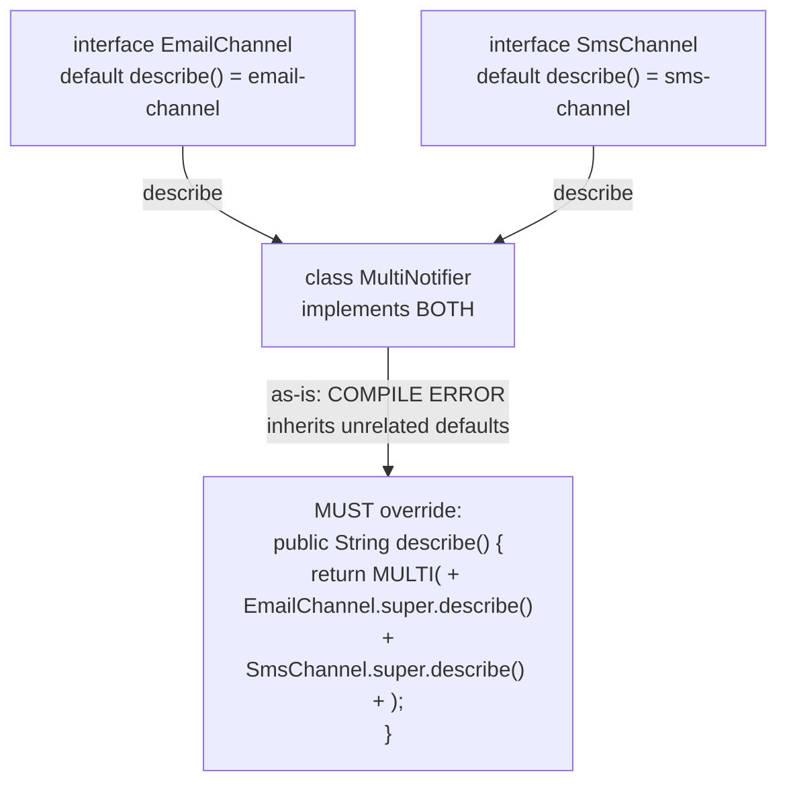

# 02 — Interface Evolution: `default` & `static` Interface Methods

**The big idea:** before Java 8, an interface was a contract that could never grow. Adding
one method broke every implementor on earth, including code you have never seen. Java 8 lets
interfaces carry **method bodies** (`default` methods) and **namespaced helpers** (`static`
methods), so published APIs can evolve without breaking the world.

This is not a convenience feature. It is *the* reason `Collection.stream()` exists on
collections that were written in 1998.

Two terms:

- *default method* — an interface method **with a body**, written `default ...`. Implementing
  classes inherit that body for free and may override it.
- *diamond problem* — a class implements two interfaces that both supply a default for the
  same method, so it inherits two bodies and the compiler cannot choose.

## What an interface may contain — then vs now



**Read the diagram:** three stops, oldest first — Java 1.0 allowed only constants and abstract
methods, Java 8 added bodies (`default`) and namespaced helpers (`static`), and Java 9 added
private helpers (see the note at the bottom).

The evolution trap, concretely (`WhyDefaultMethodsDemo`):



**Read the diagram:**
- Left half, the Java 7 option: one new abstract method, and every arrow says *breaks* — all
  three implementors fail to compile, including code you do not own.
- Right half, the Java 8 option: the same addition arrives with a body, so the arrows say
  *untouched* — existing implementors compile unchanged and inherit the behavior.
- `PushNotifier` is the only class that changes, and it changes by choice: it overrides the
  default with a batch implementation.

The exact error the Java 7 option produces (it is commented into the demo, not invented):

```text
error: SmsNotifier is not abstract and does not override abstract method
       notifyAllHolders(List<String>,String) in Notifier
```

The JDK used this escape hatch itself: `Collection.stream()`, `Collection.removeIf()`,
`Iterable.forEach()` and `List.sort()` are all `default` methods. `Method.isDefault()` (itself new
in Java 8) proves it at runtime, and the tests do exactly that.

**In one sentence:** default methods let an interface grow a body, so old implementors keep
compiling and new ones can override.

## Static interface methods

A *static interface method* belongs to the interface itself, not to any instance of it.

- Called **only** as `InterfaceName.method()` — it is a namespace, not an instance member.
- **NOT inherited** by implementing classes, **and NOT inherited by sub-interfaces**:
  `StrictRules.standard()` is `cannot find symbol` even though `StrictRules extends MoneyRules`.
- Contrast to drill in: interface **constants ARE inherited** (`TellerTerminal.TRANSFER_LIMIT`
  compiles bare) — static **methods** are not. Fields and methods play by different rules here.
- Great use: static **factories that produce behavior** (`MoneyRules.standard()` returns a
  lambda) — the JDK's poster child is `Comparator.comparing(...)` from module 01.

## Who wins? The resolution rules (`ResolutionRulesDemo`)



**Read the diagram:** read it top to bottom — each diamond is a question the compiler asks, in
this order.

- Does the class, or any superclass, have a real body for `m()`? If yes, that body runs: classes
  beat interfaces (rule 1).
- If no, do the interfaces supply defaults? One most-specific default wins — a sub-interface's
  body beats its super-interface's: children beat parents (rule 2).
- Two *unrelated* interfaces both supplying a default is the diamond: compile error, and the class
  must override and pick a side (rule 3).
- No defaults at all means `m()` was an ordinary abstract method, so the class implemented it
  anyway.

Board mnemonic: **"Classes beat interfaces. Children beat parents. Otherwise, you decide."**
The variable's declared type never matters. `Channel c = new AutoResponder(); c.describe()`
still runs the *sub-interface* default, because resolution looks at the object's class.

## The diamond (`DiamondConflictDemo`)



**Read the diagram:**
- Two unrelated interfaces each define `describe()` with a body.
- Both arrows land on one class that implements both, so it inherits two candidate bodies.
- The last arrow is the compiler's verdict: an error as written, and the required fix —
  override `describe()` yourself and call the bodies you want by name.

The compiler error, word for word (uncomment one line in the demo to show it live):

```text
error: types EmailChannel and SmsChannel are incompatible;
class Broken inherits unrelated defaults for describe() from types EmailChannel and SmsChannel
```

The fix has its own syntax worth memorizing: `InterfaceName.super.method()` — "run *that*
interface's default body", legal only for interfaces the class **directly** implements.

## Why module 01 worked at all

`Predicate.and`, `or`, `negate`, `Function.andThen`, `Comparator.comparing` — every combinator
module 01 used is a `default` (or `static`) method on a functional interface. A functional
interface must have exactly **one abstract method**. Defaults don't count toward that, which
is why `test` stays abstract while the algebra rides along. `CompositionBridgeDemo` shows this
with reflection, then re-composes bank predicates.

**In one sentence:** the lambda algebra of module 01 only exists because defaults add methods
without adding abstract methods.

> **Note (Java 9, not 8):** *private* interface methods — helpers shared between several
> default methods — arrive in **Java 9**. They do not exist in this module, and this repo
> compiles with `--release 8`, so the compiler would reject them. If a student's IDE
> offers to "make this default method private", that is the Java 9 feature leaking in.

## Class flow

1. Show the diagrams above (concept first, code second).
2. Run the demos in order: `.\mvnw.cmd -pl 02-interface-evolution compile exec:java`
   (this runs `InterfaceEvolutionDemos`, which calls each demo `main()` in teaching order).
3. Run the tests as *proof*: `.\mvnw.cmd -pl 02-interface-evolution test` — each test
   prints the behavior it asserts.

| Demo class | What it shows |
|---|---|
| `WhyDefaultMethodsDemo` | the interface-evolution problem; a 2014 class using a 2015 default for free; overriding a default; `Collection.stream()` as the real-world proof |
| `StaticInterfaceMethodDemo` | how you call `InterfaceName.method()`; static factories that produce behavior; static methods are not inherited, although interface constants are |
| `ResolutionRulesDemo` | rule 1 (class/superclass wins) and rule 2 (more specific interface wins), with empty class bodies to point at |
| `DiamondConflictDemo` | rule 3: the ambiguity compile error, and the required `InterfaceName.super.method()` disambiguation |
| `CompositionBridgeDemo` | `Predicate.and/negate` are default methods — the bridge back to module 01 |
