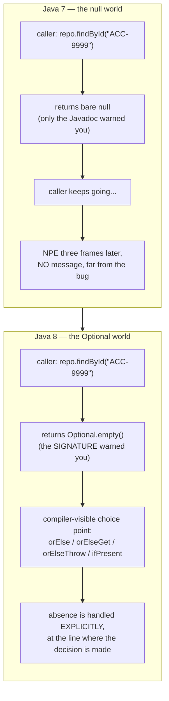
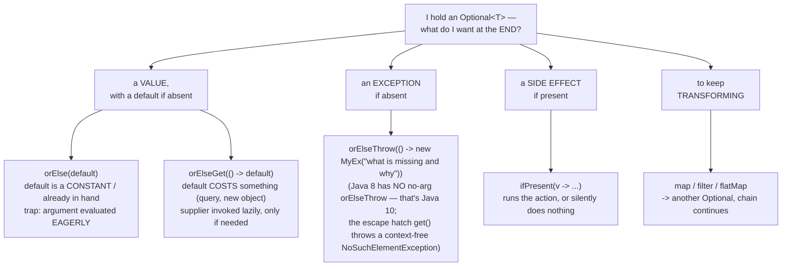
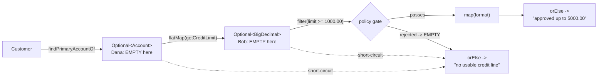

# 03 — Optional: A Better Null

**The big idea:** `null` is one value forced to mean three different things — *not found*,
*not set yet*, and *legally has no value*. Dereferencing it detonates far from the bug.
`Optional<T>` is a box the type system understands: a signature that returns
`Optional<Account>` tells every caller, and the compiler, "there may legitimately be nothing
here — unwrap it *deliberately*."

Tony Hoare, who added null references to ALGOL W in 1965, calls it his **"billion dollar
mistake"**: *"I couldn't resist the temptation to put in a null reference, simply because it
was so easy to implement."* `Optional` is Java 8's partial apology. Show `TheNullProblemDemo`
first — the NPE (a `NullPointerException`) **and** the ambiguity — before any API.

## Null-world vs Optional-world



**Read the diagram:**
- Top half, the null world: the warning lives only in the Javadoc, so the caller keeps going and
  the crash lands three frames later with no message.
- Bottom half, the Optional world: the warning lives in the *signature*, so the caller must pick
  an unwrapping method on that exact line — the decision moves from somewhere downstream to here,
  in code the compiler checks.

**In one sentence:** `Optional` moves the "there may be nothing" warning out of the Javadoc and
into the type, where the compiler can enforce it.

## Which terminal operation do I want?

A *terminal operation* is the method that ends a chain and hands back something that is not a
stream or a box — here, a value, an exception, or a side effect. (Streams have their own; module
04 defines them.)



**Read the diagram:** start at the top and answer one question — what do I want at the end?

- A **value**: pick between the two left leaves by asking what the default costs. `orElse` takes
  an already-built value; `orElseGet` takes a supplier (a `() -> T` lambda) that runs only if the
  box is empty.
- An **exception**: `orElseThrow` with a lambda that builds it, so the message says what is
  missing and why.
- A **side effect**: `ifPresent` runs the action, or does nothing at all.
- To **keep transforming**: `map` / `filter` / `flatMap` return another `Optional`, so the chain
  continues.

## The chaining pipeline (`ChainingDemo`)



**Read the diagram:** follow the solid arrows left to right for the happy path — customer, then
account, then credit limit, then the policy gate, then the formatted answer. The two dotted arrows
are *short-circuits*: to short-circuit means to stop the chain early, as soon as the answer is
known. If the account is missing (Dana) or the limit is missing (Bob), the box is already empty,
so every later link is skipped and the chain lands straight on the `orElse` fallback.

**Walkthrough — what happens when a link comes back empty:**
1. `findPrimaryAccountOf` returns `Optional.empty()` for Dana.
2. `flatMap(getCreditLimit)` sees an empty box, so it never calls `getCreditLimit`; it passes the
   empty box on.
3. `filter` and `map` do the same: an empty box in, an empty box out, no lambda invoked.
4. `orElse` sees the empty box and returns its fallback string.

Nothing after the first empty link ever runs. The whole defensive if-wall of act one is replaced
by one declaration of what absence means.

**map vs flatMap:** if the mapping function itself returns an `Optional` (like
`Account::getCreditLimit`), `map` gives you the useless type `Optional<Optional<BigDecimal>>`.
Its *outer* box is "present" even when the inner one is empty. `flatMap` flattens one level.
Rule: *mapper returns a plain value → `map`; mapper returns an Optional → `flatMap`*.

## The `orElse` vs `orElseGet` trap

```java
limit.orElse(queryCreditBureau("ACC-1001"));     // bureau is CALLED even though limit is present!
limit.orElseGet(() -> queryCreditBureau("...")); // supplier NOT called — lazy
```

`orElse(x)` takes a **value**. Java evaluates arguments *before* the call, so the expensive
default is always built, used or not. We call that *eager*: it happens whether or not it is
needed. `orElseGet(Supplier)` takes a **factory** instead, and a factory runs only when the box
is truly empty — that is *lazy*. `OrElseVsOrElseGetDemo` proves it with a call counter; the test
`orElseEagerOrElseGetLazy` asserts 1 call vs 0.

**In one sentence:** pass a value to `orElse` only when building the default costs nothing; pass
a lambda to `orElseGet` whenever it costs something.

## Design guidance — where Optional belongs

| Use | Verdict | Why |
|---|---|---|
| **Return type of a lookup method** where absence is legal | GOOD | The signature documents "may be nothing", and the compiler forces the caller to decide. This is the *only* job Optional was designed for (Brian Goetz, JSR-335). |
| **Field** | BAD | `Optional` does **not** implement `Serializable`, so the whole class breaks under Java serialization. JPA/Hibernate cannot map it to a column, and Jackson needs an extra module. It also adds a wrapper object per instance, and makes every read a `.get()` — the null check, back again. Keep the field raw (`String email`) and wrap at the boundary. |
| **Method parameter** | BAD | It forces every caller to write `Optional.of(...)`. `findById(Optional.empty())` re-creates act one's ambiguity, so you get overload soup instead of clarity. |
| **`Optional<List<T>>`** | BAD | An **empty collection already means "none found"**. Return `Collections.emptyList()`; callers iterate with zero unwrapping. See `recentStatementsFor` in `AccountRepository`. |
| **Map keys / values** | BAD | Hashing an Optional is meaningless, and `map.get(k)` returns null anyway — you would be back where you started. |

Serialization in one sentence for class: *Optional is a return-value idiom, not a
persistence idiom — anything that gets written to disk, a database, or JSON must not
contain one.*

## Class flow

1. Show the diagrams above (concept before code — especially null-world vs Optional-world).
2. Run the demos in order: `.\mvnw.cmd -pl 03-optional compile exec:java`
   (this runs `OptionalDemos`, which calls each demo `main()` in teaching order).
3. Run the tests as *proof*: `.\mvnw.cmd -pl 03-optional test` — each test prints the
   behavior it asserts.

| Demo class | What it shows |
|---|---|
| `TheNullProblemDemo` | the NPE and the AMBIGUITY: four situations, one `null`; the defensive if-wall every caller had to write |
| `CreatingOptionalsDemo` | `of` (fails fast — demoed in try/catch), `ofNullable`, `empty`; equality; the `Optional x = null` anti-pattern |
| `OrElseVsOrElseGetDemo` | the eager-argument trap with a counted side effect; `isPresent`+`get` as a dressed-up null check; `orElseThrow(Supplier)` vs `get()` |
| `ChainingDemo` | `map` vs `flatMap` nesting trap, `filter`, `ifPresent`; the customer → account → credit-limit pipeline that short-circuits |
| `OptionalDesignRulesDemo` | the design rules live (fields/params/collections) + the before/after slide: same lookup, null world vs Optional world, side by side |
