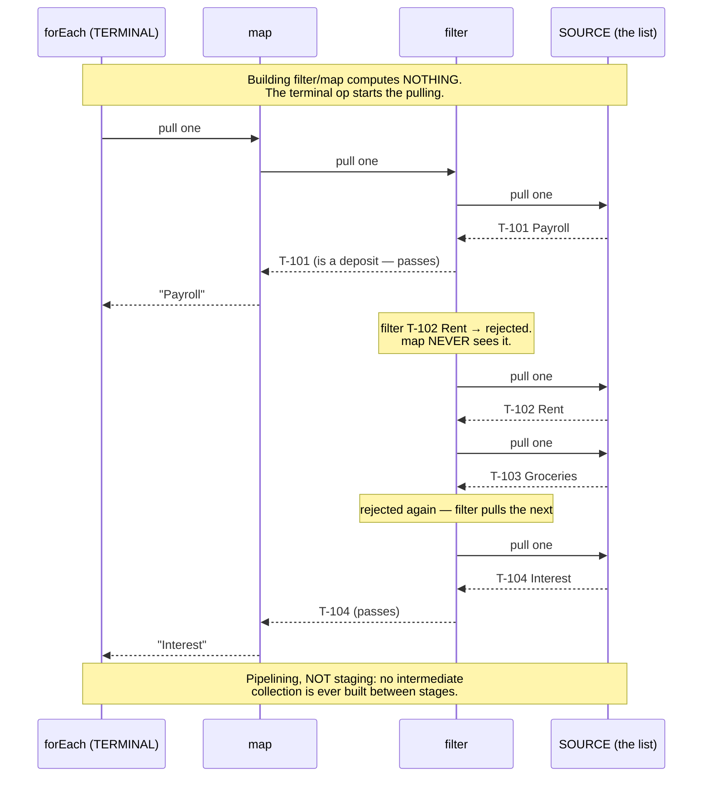
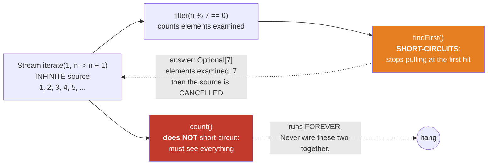

# 04 — Stream Fundamentals

**The big idea:** a `Collection` **stores** data. A `Stream` **computes** over data, on demand,
as it is pulled. You stop writing loops (external iteration — you drive) and start describing
pipelines (internal iteration — the library drives). That hand-over of control is what buys
laziness, short-circuiting, and later parallelism. It is exactly the move module **05 — Streams
vs OOP** drills on real code.

Four terms are used with the same meaning in modules 04, 05, 06 and 07:

- *intermediate operation* — lazy; returns a **new** `Stream`; computes nothing by itself.
- *terminal operation* — eager; starts the pipeline, consumes the stream, returns a non-`Stream`.
- *lazy* — nothing runs until a terminal operation pulls; building a pipeline records the recipe.
- *encounter order* — the order elements leave the source; a sequential stream always preserves it.

## (a) Pipeline anatomy — source → intermediate* → terminal

```mermaid
flowchart LR
    SRC["SOURCE<br/>statement.stream()<br/>(exactly one)<br/>collection / array / of /<br/>generate / iterate / range"]
    F["filter(isDeposit)<br/><b>INTERMEDIATE</b><br/>lazy · returns a NEW Stream"]
    M["map(getDescription)<br/><b>INTERMEDIATE</b><br/>lazy · returns a NEW Stream"]
    S["sorted()<br/><b>INTERMEDIATE</b> (stateful:<br/>must see all before emitting any)"]
    T["collect(toList())<br/><b>TERMINAL</b> (exactly one)<br/>eager · returns a non-Stream ·<br/>CONSUMES the stream"]
    SRC -->|"nothing computed yet"| F -->|"nothing computed yet"| M -->|"nothing computed yet"| S
    S -->|"the on-switch"| T
    T -.->|"result: List&lt;String&gt;"| R["data again"]

    style SRC fill:#4a90d9,color:#fff
    style T fill:#e67e22,color:#fff
```



**Read the diagram:**
- Blue on the left is the source, where elements come from. There is exactly one.
- The three middle boxes are intermediate operations. Each is lazy and each returns a brand-new
  `Stream`, so the chain grows without touching a single element — the arrow labels say it out
  loud: *nothing computed yet*. `sorted()` is *stateful*: it buffers, because it cannot release
  its first element until it has seen them all.
- Orange on the right is the terminal operation, the on-switch. It runs the whole chain, consumes
  the stream, and returns a `List<String>`, which is not a `Stream`.

The grammar rule to memorize: **one source, zero-or-more intermediate ops (lazy,
Stream → Stream), exactly one terminal op (eager, Stream → result, single-use)**.
`PipelineAnatomyDemo` shows each rule on screen — including that `filter()` returns a
*new* stream object and touches zero elements.

**Walkthrough — building and running one pipeline, stage by stage:**
1. `statement.stream()` creates a stream over the list. No element is read yet.
2. `.filter(Transaction::isDeposit)` creates a *second* stream wrapping the first, records the
   predicate, and returns. `.map(Transaction::getDescription)` wraps that one in a *third*.
   The chain is now a recipe of three stages and still nothing has run.
3. `.collect(toList())` is the terminal operation. The machine turns on.
4. It pulls one element from the source, pushes it through `filter`, then `map`, then into the
   list — and repeats until the source is exhausted.
5. The result is a `List<String>`. All three stream objects are consumed now, so a second
   terminal operation on any of them throws.

**In one sentence:** intermediates write the recipe, the terminal operation cooks it, and one
element travels the whole chain at a time.

## (b) Lazy, pull-based evaluation — the terminal op pulls ONE element through the WHOLE chain



**Read the diagram:** a sequence diagram reads top to bottom as time passing. The four columns
are the four stages in reverse order — the terminal operation on the left asks the stage to its
right, down to the source.

- Solid arrows are requests ("pull one") travelling right; dashed arrows are elements coming back
  left.
- The first note is the key claim: building `filter` and `map` computed nothing. Pulling starts
  only when `forEach` is called.
- The two middle notes show rejected elements. `T-102 Rent` and `T-103 Groceries` never reach
  `map`, so `map` runs fewer times than `filter`.

Two claims, both proven with counters inside the lambdas in `LazinessDemo`:

1. **No terminal op ⇒ nothing executes.** Building a pipeline is writing a recipe.
2. **Pipelining, not staging.** Elements flow one at a time through the whole chain —
   `map` runs 3 times where `filter` runs 6, and rejected elements never reach later
   stages. A 10-stage pipeline needs zero temporary collections.

**In one sentence:** laziness means nothing runs until a terminal operation pulls, and pulling
moves one element at a time all the way down the chain.

## (c) Infinite source + short-circuit = finite work



**Read the diagram:** one infinite source on the left feeds two different terminal operations.

- Top path (orange): `findFirst()` stops pulling the moment it gets a hit, and the dotted arrow
  back means the source is *cancelled*. An infinite stream produced finite work — 7 elements.
- Bottom path (red): `count()` must see every element, so on an infinite source it never
  finishes. That is the hang on the far right.

`anyMatch`, `findFirst`, `limit` stop pulling; `count`, `forEach`, `reduce` cannot.
`ShortCircuitDemo` prints the "elements actually examined" counters so the class sees
the infinite stream die after 11 pulls.

## The one-shot trap

A stream is a **single-use ticket**. A second terminal op throws — at *runtime*, not
compile time:

```java
Stream<Transaction> s = statement.stream();
s.filter(Transaction::isDeposit).count();   // fine
s.count();                                  // IllegalStateException:
                                            // "stream has already been operated upon or closed"
```

`OneShotDemo` catches it and prints the exact message. The fix is always the same:
go back to the **source** and build a fresh stream — the list never wore out, only the
stream did. (Mental model: a collection is a jukebox, a stream is water through a pipe.)

**In one sentence:** a stream is consumed by its terminal operation, so reuse means building a
new stream from the same source.

## Class flow

1. Show diagrams (a)–(c) above **before opening any code** (concept first).
2. Run the demos in order: `.\mvnw.cmd -pl 04-streams-fundamentals compile exec:java`
   (this runs `StreamDemos`, which calls each demo `main()` in teaching order).
3. Run the tests as *proof*: `.\mvnw.cmd -pl 04-streams-fundamentals test` — each test
   prints the behavior it asserts (counters, event logs, the one-shot exception message).

| Demo class | What it shows |
|---|---|
| `StreamVsCollectionDemo` | a collection stores, a stream computes; external iteration (you loop) vs internal iteration (the library loops) — sets up module 05 |
| `PipelineAnatomyDemo` | source → intermediate* → terminal; intermediate returns a NEW stream and computes nothing |
| `CreatingStreamsDemo` | every source: `stream()`, `of`, `empty`, `Arrays.stream`, `generate`, `iterate`, `range/rangeClosed`, `chars()` |
| `LazinessDemo` | **the big one**: no terminal op ⇒ zero execution; then pipelining-not-staging with counters and an event log |
| `ShortCircuitDemo` | `anyMatch`/`findFirst`/`limit` terminate an INFINITE stream; "elements actually examined" counters |
| `OneShotDemo` | reuse a consumed stream ⇒ `IllegalStateException`, caught and printed; the fresh-stream fix |
| `OperationsTourDemo` | guided vocabulary tour: `map/filter/sorted/distinct/limit/skip/peek` + `forEach/count/collect/reduce/min-max/match/findFirst` |

Domain classes (`Customer`, `Account`, `Transaction`, `BigDecimal` money) are duplicated
from earlier modules **on purpose** so this module stands alone on screen.

## Java 8 discipline (this module compiles with `--release 8`)

- No `Stream.toList()` (Java 16) — use `collect(Collectors.toList())`.
- No `Stream.ofNullable` / `takeWhile` / `dropWhile` / 3-arg `iterate` (Java 9).
- No `var`, no `List.of`, no records.
