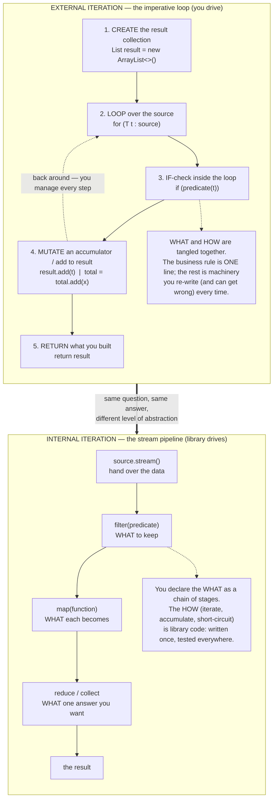
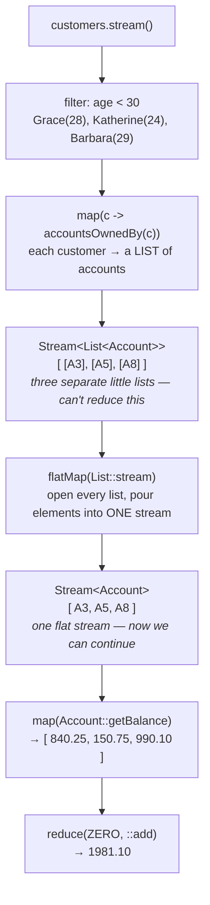

# 05 — Streams vs Classic OOP Loops

**THE HEART OF THE COURSE.** Every banking task in this module is solved TWICE, side by
side: the classic imperative OOP way (`for`-loops, accumulators, `if`-statements — the code
students already know) and the stream way. Same question, same data, same answer. The point
isn't "streams are magic"; it's that the two versions say the same thing at different levels
of abstraction, and the class gets to *choose* with eyes open.

Show the diagrams below FIRST, then open the code, then run it. Left is what they've been
writing for years; right is the new tool. Point left, point right, ask "which one is the
*question* and which one is the *machinery*?"

The pipeline words mean exactly what they meant in module 04:

- *intermediate operation* — lazy; returns a **new** `Stream`; computes nothing by itself.
- *terminal operation* — eager; starts the pipeline, consumes the stream, returns a non-`Stream`.
- *lazy* — nothing runs until a terminal operation pulls; building a pipeline records the recipe.
- *encounter order* — the order elements leave the source; a sequential stream always preserves it.
- *reduction* — a terminal operation that boils many elements down to one answer, such as a sum,
  a maximum, or a collection.

## External vs internal iteration — the big side-by-side

This is the one diagram to leave on the projector all session. External iteration (left) is
what a loop does: **you** drive. Internal iteration (right) is what a stream does: **the
library** drives, and you hand it the pieces of the question.



**Read the diagram:**
- Left column, top to bottom: the five things a loop makes you do by hand — create the result
  container, loop, test each element, mutate an accumulator, return. The dotted arrow going back
  up is the loop itself, and *you* manage every pass around it.
- The note under the left column is the complaint: only one of those five lines is the business
  rule. The other four are machinery you rewrite, and can get wrong, every single time.
- Right column: the same task as four declarations — source, `filter`, `map`, `reduce`/`collect`.
  Each line states *what* you want; the iteration, the accumulating and the short-circuiting are
  library code. The thick arrow between the columns is the module's claim: same question, same
  answer, different level of abstraction.

**The mental move:** a loop is a *procedure* — a sequence of steps that mutates state until it
is done. A stream is a *pipeline of stages*. Each stage transforms the flow and hands it on, and
nothing is mutated until the terminal operation. That is why the stream version reads
top-to-bottom like the sentence describing the task.

**In one sentence:** a loop tells the machine how to walk the data, while a stream tells it what
you want out of the walk.

## The seven tasks (teaching order, easy → hard)

| # | Class | The question | Imperative shape | Stream shape | The point |
|---|---|---|---|---|---|
| 1 | `TaskFilter` | deposits over 100 | `for` + `if` + `add` | `filter` + `collect` | the loop mixes WHAT with HOW |
| 2 | `TaskTransform` | names, uppercased | `for` + `add` | `map` + `collect` | `map` means "transform each", with no bookkeeping |
| 3 | `TaskSum` | total of all amounts (`BigDecimal`) | an accumulator variable plus a loop | `map` + `reduce(ZERO, ::add)` | a mutable accumulator becomes a `reduce` fold; go SLOW here |
| 4 | `TaskMax` | account with largest balance | `bestSoFar` plus the null edge case | `max(comparing)` → `Optional` | `Optional` kills the empty-list edge case (module 03) |
| 5 | `TaskCount` | customers per city | `HashMap` + `containsKey`/`get`/`put` | collector (`toMap` + merge) | eight lines of plumbing that module 06 turns into ONE line |
| 6 | `TaskChain` | total balance, owners under 30 | nested loops + hand join | `filter.map.flatMap.map.reduce` | `flatMap` turns a stream of streams into one stream |
| 7 | `TaskAnyMatch` | any amount over 2000? | loop + early `return` / flag | `anyMatch` | short-circuiting — stopping at the first match — is built in |

Each class holds BOTH implementations as `imperative(...)` and `withStreams(...)` right next
to each other, plus a `main()` that runs both, prints them labeled **IMPERATIVE** / **STREAMS**,
and states whether they **MATCH**.

## TaskChain — the flatMap picture

Task 6 is where `flatMap` finally clicks. Mapping "customer → their accounts" gives a stream
*of lists*, which you can't reduce. `flatMap` opens each list and pours the elements into one
continuous stream.



**Read the diagram:** follow it top to bottom; each box shows the shape of the stream at that
point.

- After `filter` we have three customers; after `map` we have three *lists*, one per customer — a
  `Stream<List<Account>>`. That is the stuck point the italic note marks: you cannot add three
  lists together, so the reduction has nothing to bite on.
- `flatMap(List::stream)` opens every list and pours its elements into one continuous stream, so
  the shape becomes `Stream<Account>`.
- From there the pipeline continues normally: `map` to the balances, `reduce` to one total.

**Rule of thumb to say out loud:** whenever the mapping function returns a *collection* and
you want the *elements*, not the collections — you need `flatMap`.

## Concept mapping (the wrap-up slide)

`ComparisonSummaryDemo` prints this table at the end. Leave it up during Q&A.

| Imperative concept | → | Stream concept | Seen in |
|---|---|---|---|
| `for` / `while` loop | → | internal iteration | every task |
| accumulator variable + reassign | → | `reduce(identity, accumulator)` | TaskSum, TaskChain |
| `result.add(...)` into a new list | → | `collect(Collectors.toList())` | TaskFilter, TaskTransform |
| `if (condition)` inside the loop | → | `filter(predicate)` | TaskFilter |
| transform each element | → | `map(function)` | TaskTransform |
| nested loops / hand-rolled join | → | `map` + `flatMap` | TaskChain |
| `containsKey`/`get`/`put` dance | → | a collector (module 06!) | TaskCount |
| early `return` / boolean flag | → | short-circuit terminal (`anyMatch`) | TaskAnyMatch |
| returning `null` for "no result" | → | `Optional<T>` | TaskMax |

## The domain (self-contained, local to this module)

A small SecureBank world so every task runs on the SAME fixed data — the difference you see
on the projector is always the *code*, never the *data*.

- `Customer` — `id, name, age, city`
- `Account` — `id, ownerId, type (CHECKING/SAVINGS), balance (BigDecimal scale 2)`
- `Transaction` — `id, accountId, description, amount (BigDecimal), deposit (boolean)`
- `SampleBank` — 6 customers, 8 accounts, 15 transactions, chosen so every task has an
  interesting case (deposits above/below 100, an empty-list edge case, uneven city counts,
  three customers under 30, transactions above/below the 2000 suspicious threshold).

Money is ALWAYS `BigDecimal` — never `double`. Timestamps and records belong to later modules;
this is strict Java 8 (`--release 8`), so no `Stream.toList()`, no `var`, no `List.of`.

## Class flow

1. Show the **external vs internal iteration** diagram. Say the WHAT-vs-HOW line.
2. Show the **flatMap** diagram — promise them task 6 will make it click.
3. Run the whole module in teaching order:
   `.\\mvnw.cmd -pl 05-streams-vs-oop compile exec:java`
   (this runs `StreamsVsOopDemos`, which calls each task `main()` easy → hard, then the summary table).
4. For any task you want to dwell on, run it alone and point left/right:
   `.\\mvnw.cmd -pl 05-streams-vs-oop compile exec:java "-Dexec.mainClass=com.evaitcs.java8.compare.TaskChain"`
5. Run the tests as **proof** that imperative == declarative for every task:
   `.\\mvnw.cmd -pl 05-streams-vs-oop test`
   Each test prints BOTH results before asserting they're equal, so the test run is itself
   a side-by-side demo.
6. Leave `ComparisonSummaryDemo`'s table on screen. Give the honest caveat (in that class):
   streams aren't better at *everything* — debugging, checked exceptions, and 3-line loops
   sometimes favor the imperative form. The skill is *recognizing the shape*.

## Commands

```powershell
# run every demo in teaching order
.\mvnw.cmd -pl 05-streams-vs-oop compile exec:java

# run one task on its own
.\mvnw.cmd -pl 05-streams-vs-oop compile exec:java "-Dexec.mainClass=com.evaitcs.java8.compare.TaskSum"

# run the tests — the imperative == declarative proof
.\mvnw.cmd -pl 05-streams-vs-oop test
```
