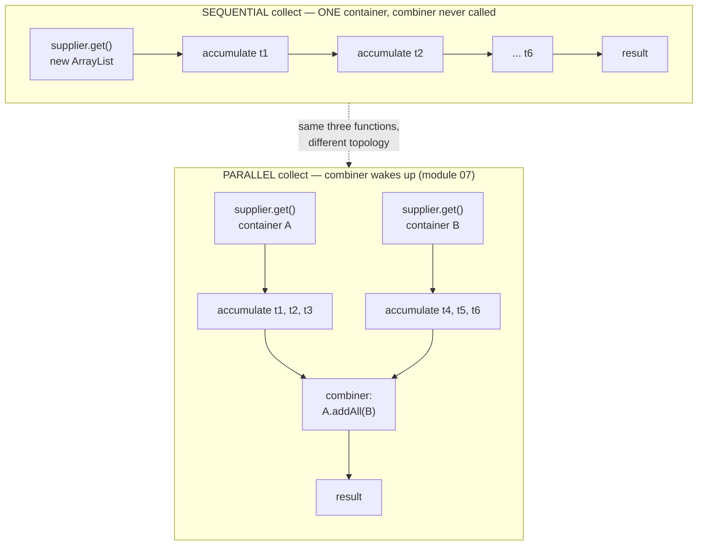
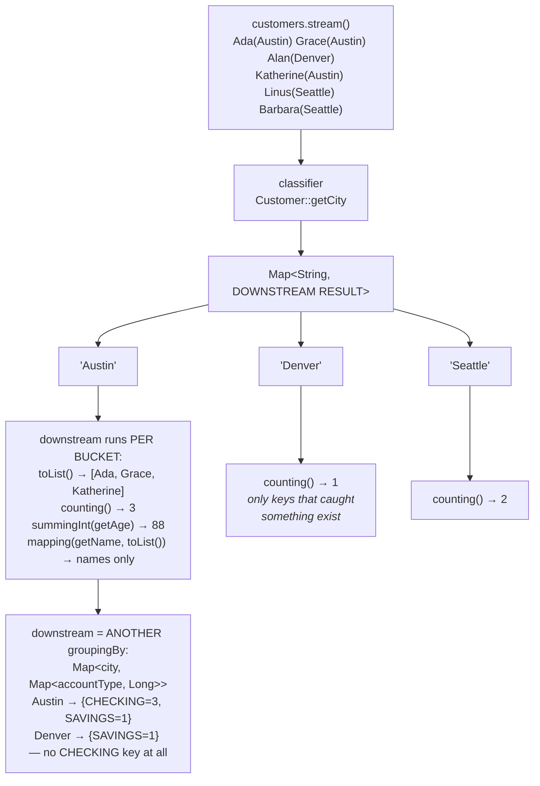
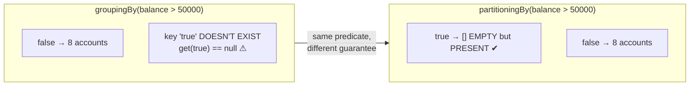

# 06 — Collectors: Where a Stream Becomes Data Again

**The big idea:** a stream is a *pipeline*, but sooner or later you need the answer as
**data**: a list, a set, a map, a report. `collect()` is the terminal operation that turns
flowing elements back into a container, and `Collectors.*` is the toolbox of ready-made
containers. Module 05's `TaskCount` made you hand-write the `containsKey`/`get`/`put` dance and
teased *"module 06 does this in ONE line"*. That line lives here, in `GroupingByDemo`, and a test
proves it returns exactly what the plumbing did.

Show the diagrams below FIRST, then open the code, then run it.

The pipeline words mean exactly what they meant in modules 04 and 05:

- *intermediate operation* — lazy; returns a **new** `Stream`; computes nothing by itself.
- *terminal operation* — eager; starts the pipeline, consumes the stream, returns a non-`Stream`.
- *lazy* — nothing runs until a terminal operation pulls; building a pipeline records the recipe.
- *encounter order* — the order elements leave the source; a sequential stream always preserves it.

Three more terms belong to this module:

- *mutable reduction* — building the answer by **adding to one container** instead of creating a
  new value at every step.
- *combiner* — the function that merges two containers into one. A sequential stream never needs
  it; a parallel stream always does (module 07).
- *downstream collector* — a second collector that runs *inside* each bucket produced by the
  first one, deciding what that bucket becomes.

## collect() is a MUTABLE REDUCTION

`reduce` folds elements into **one immutable value**: every step returns a fresh object. `collect`
instead **mutates one container**. A supplier builds the container, an accumulator drops each
element into it, and a combiner merges containers *when there is more than one*:



**Read the diagram:**
- Top box, a sequential collect: one supplier call, one container, six accumulate calls, one
  result. The combiner is never called, because there is only ever one container.
- Bottom box, a parallel collect: the supplier runs twice, so two containers fill up at the same
  time, and the combiner then merges B into A. The dotted arrow is the point — the *same three
  functions*, arranged differently.

`CollectAnatomyDemo` builds a collector **by hand** with `Collector.of(supplier, accumulator,
combiner)`, and makes the accumulator and combiner *print*, so the class watches `accumulate`
fire 6 times and `combine` fire **zero** times on a sequential stream.

Why mutable at all? Appending to an `ArrayList` is O(1) amortized. "Immutable list building"
would copy the whole list at every step — `ReduceVsCollectDemo` proves the point with string
concatenation.

**In one sentence:** `reduce` makes a new value per element while `collect` adds to one
container, and containers are why `collect` wins for building collections.

## groupingBy — SQL GROUP BY in one line

The classifier sorts each element into a bucket. The **downstream collector** decides what each
bucket *becomes*, and a downstream can itself be a `groupingBy`, giving nested reports:



**Read the diagram:**
- Top: six customers arrive as a stream, each with a city in brackets. The classifier is the
  question "which bucket?" — here, `Customer::getCity`.
- Next level: the resulting map, with one key per city that actually caught an element. Denver
  has one customer, Seattle two, Austin three.
- The Austin branch lists what the *downstream* collector produces for that one bucket. Swap the
  downstream and the same buckets become counts, sums, or name lists.
- The last box is nesting: the downstream is itself a `groupingBy`, so each city maps to a second
  map. Notice what is missing — Denver has no `CHECKING` key at all, because nothing landed there.

**Walkthrough — how `groupingBy(classifier, downstream)` accumulates:**
1. The collector's supplier creates one empty result `Map`.
2. For each element, the accumulator calls the classifier to get a key, say `"Austin"`.
3. It looks that key up. If the key is missing, it creates a fresh downstream container for it
   and stores it in the map.
4. It hands the element to that bucket's downstream container — `toList()` appends, `counting()`
   increments, `summingInt` adds.
5. When the stream ends, each bucket already holds its finished value, so the map is returned
   as-is. In parallel, each thread builds its own map and the combiner merges them key by key.

`partitioningBy` is the **boolean special case**. It adds one guarantee `groupingBy` does not
make: **both keys are always present, even when a bucket is empty**:



**Read the diagram:** both halves use the same predicate on the same 8 accounts, so both put all
8 under `false`. The only difference is the missing key — with `groupingBy` there is no `true`
entry at all and `get(true)` returns `null`, while `partitioningBy` always creates both entries
and the `true` one holds an empty list.

So `split.get(true).isEmpty()` is safe with no null check — which is why "which side won?"
reports use `partitioningBy`.

## The collector toolbox (what each demo reaches for)

| Collector | Result type | Reads as | Seen in |
|---|---|---|---|
| `toList()` / `toSet()` | `List` / `Set` | gather everything, or gather without duplicates | `CollectAnatomyDemo` |
| `toCollection(TreeSet::new)` | the collection YOU name | "I want these distinct and sorted" | `CollectAnatomyDemo` |
| `toMap(k, v)` | `Map` | build a lookup table | `ToMapAndItsTrapDemo` |
| `toMap(k, v, merge)` | `Map` | build a lookup table that survives collisions | `ToMapAndItsTrapDemo` |
| `counting()` / `summingInt` / `averagingInt` | `Long` / `Integer` / `Double` | count them, add them up, average them | `SummarizingDemo` |
| `summarizingInt` | `IntSummaryStatistics` | all five numbers in one pass | `SummarizingDemo` |
| `mapping(m, reducing(ZERO, add))` | `BigDecimal` | sum money (there is no `summingBigDecimal` in Java 8) | `SummarizingDemo` |
| `groupingBy(k)` / `groupingBy(k, down)` | `Map<K, …>` | SQL GROUP BY | `GroupingByDemo` |
| `partitioningBy(pred)` | `Map<Boolean, …>` | split in two, with both buckets guaranteed | `PartitioningByDemo` |
| `joining(", ", pre, suf)` | `String` | glue elements together for humans to read | `JoiningDemo` |
| `collectingAndThen(c, finisher)` | finisher's return | one last move: freeze it or format it | `JoiningDemo` |

Traps this module detonates on purpose (each one has a matching test):

- `toMap` keyed by city throws **`IllegalStateException: Duplicate key`**, because three
  customers live in Austin. A merge function fixes it, and that merge function IS the `else`
  branch of module 05's dance.
- `toMap` with a value mapper that returns `null` throws **`NullPointerException`**. `Map.merge`
  forbids null values, even though `HashMap` itself allows them.
- `toList()` and `toSet()` promise nothing about the concrete type or the order. Use
  `toCollection` when either matters.
- Strict Java 8 here: no `Stream.toList()` (16+), no `toUnmodifiableList()` (10+).
  `collectingAndThen(toList(), Collections::unmodifiableList)` is the Java 8 freeze.

## The domain (self-contained, local to this module)

The SAME SecureBank fixture as module 05 — `Customer(id, name, age, city)`,
`Account(id, ownerId, type CHECKING|SAVINGS, balance BigDecimal scale 2)`,
`Transaction(id, accountId, description, amount, deposit)` — 6 customers, 8 accounts,
15 transactions. Same data on purpose: it makes "the one-liner equals the plumbing"
provable.

Every quirk a collector could hit is baked in:

- three Austins, for the duplicate-key trap
- uneven city counts, so grouping is visibly a grouping
- Denver with only a SAVINGS account, for the missing inner key
- no balance over 50,000, for the empty-but-present partition bucket
- 7 deposits vs 8 withdrawals
- cent-exact amounts totalling 41231.01
- account A1 with exactly 3 transactions, for the statement line

## Class flow

1. Show the **mutable reduction tree** diagram. Say the reduce-vs-collect sentence.
2. Show the **groupingBy nesting** diagram — remind them of module 05's teaser.
3. Run the demos in order: `.\mvnw.cmd -pl 06-collectors compile exec:java`
   (this runs `CollectorsDemos`, which calls each demo `main()` in teaching order).
4. Run the tests as *proof*: `.\mvnw.cmd -pl 06-collectors test` — each test prints the
   evidence it asserts, including both deliberate explosions (caught, of course).

| Demo class | What it shows |
|---|---|
| `CollectAnatomyDemo` | `collect()` = mutable reduction; supplier/accumulator/combiner by hand (combiner stays silent until module 07); `toList`/`toSet`/`toCollection` |
| `ToMapAndItsTrapDemo` | lookup tables; the duplicate-key `IllegalStateException` caught live; merge functions; the null-value trap |
| `SummarizingDemo` | `counting`/`summingInt`/`averagingInt`/`summarizingInt`; the BigDecimal caveat and the `mapping + reducing` idiom |
| `GroupingByDemo` | SQL GROUP BY in one line — **module 05's promise kept**; downstream collectors; multi-level nesting; `TreeMap` sorted keys |
| `PartitioningByDemo` | deposits vs withdrawals; the always-two-buckets guarantee contrasted with `groupingBy` on the same predicate |
| `JoiningDemo` | delimiter, prefix/suffix, per-account statement lines; `collectingAndThen` formats and freezes |
| `ReduceVsCollectDemo` | immutable fold vs mutable accumulation; why containers win for collections; the rule of thumb |

## Commands

```powershell
# run every demo in teaching order
.\mvnw.cmd -pl 06-collectors compile exec:java

# run one demo on its own
.\mvnw.cmd -pl 06-collectors compile exec:java "-Dexec.mainClass=com.evaitcs.java8.collectors.GroupingByDemo"

# run the tests — proof, including the two deliberate explosions
.\mvnw.cmd -pl 06-collectors test
```
