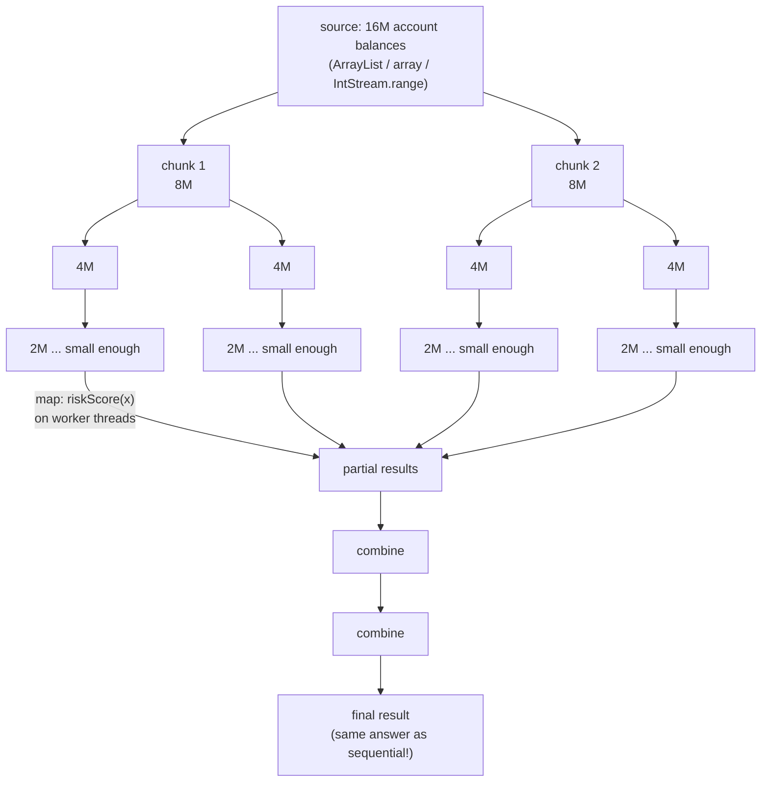
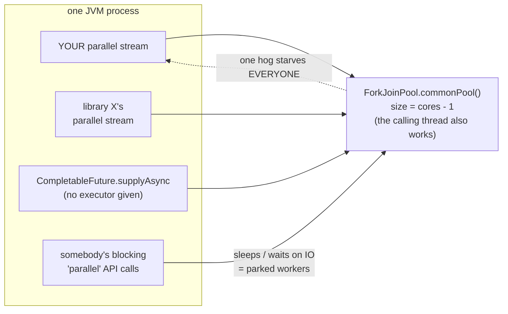

# 07 — Parallel Streams

**The big idea:** one word — `.parallel()` — buys you threads. That is the good news, and it
takes ten seconds to demo. The rest of the module is the price tag: a list of ways to
**lose data**, **lose ordering**, and **lose performance** while feeling productive.

The pipeline words still mean what they meant in modules 04, 05 and 06:

- *intermediate operation* — lazy; returns a **new** `Stream`; computes nothing by itself.
- *terminal operation* — eager; starts the pipeline, consumes the stream, returns a non-`Stream`.
- *lazy* — nothing runs until a terminal operation pulls; building a pipeline records the recipe.
- *encounter order* — the order elements leave the source; a sequential stream always preserves it.

Three more terms belong to this module:

- *fork/join* — the JDK's divide-and-conquer framework: split work into pieces, run them on a
  pool of threads, then join the partial results.
- *spliterator* — the object a stream source uses to split itself. The name is *split* +
  *iterator*: it hands out chunks and knows how big they are.
- *combiner* — the function that merges two partial results into one. Module 06 defined it for
  `collect`; here it is the last step of every parallel answer.

## How it works: split → process → combine

The stream source is recursively **split** by its `Spliterator`. Each chunk then runs on a worker
thread of `ForkJoinPool.commonPool()`. Finally the partial results are **combined**:



**Read the diagram:** read it as a tree — down, across, then back up.
- Down: the spliterator keeps halving 16M into two 8M chunks, each 8M into two 4M, each 4M into
  2M, until a chunk is small enough to stop splitting.
- Across: each small chunk is processed on its own worker thread, producing a partial result.
- Back up: the partial results are combined pairwise, twice, into one final answer — the same
  answer a sequential stream would have produced.

**Walkthrough — how a parallel reduce splits and combines:**
1. The terminal operation asks the source's spliterator whether splitting is still worth it.
2. While the answer is yes, each half is split again, so 16M becomes 8 chunks of 2M.
3. Each chunk goes to the common pool, where a worker thread runs the whole pipeline over just
   that chunk and produces a partial value.
4. The combiner merges the partial values pairwise until one value is left.
5. Because the merges follow encounter order, the result matches the sequential one — provided
   your accumulator and combiner are associative.

This is **why the combiner from module 06's `collect` anatomy matters**. In a sequential stream
`collect(supplier, accumulator, combiner)` never calls the combiner. In a parallel stream the
combiner *is* the final answer's last step. A sloppy combiner means a wrong total, silently, only
in production.

**In one sentence:** parallel means split the source, run the same pipeline on each piece, then
combine — so anything the combiner cannot merge correctly is a bug you only see at scale.

## The pool you don't see is shared by the whole JVM



**Read the diagram:**
- Left box: four unrelated things inside one JVM — your stream, a library's stream,
  `CompletableFuture.supplyAsync` with no executor given, and somebody's blocking calls. All four
  arrows point at one shared pool, sized `cores - 1` (the thread that started the stream also
  works, so the effective count is `cores`).
- The dotted arrow back to your stream is the warning: one task that blocks parks a worker, and
  every other user of the pool waits for it.

That pool is `cores - 1` workers, shared JVM-wide with every library on the classpath. One
blocking task parks a worker that *everybody else's* parallel stream is waiting for. The escape
hatch is to submit the stream into a pool you own (see `CustomPoolDemo`):

```java
ForkJoinPool privatePool = new ForkJoinPool(2);
try {
    List<Risk> results = privatePool.submit(() ->
            accounts.parallelStream().map(Risk::score).collect(toList())
    ).get();
} finally {
    privatePool.shutdown();
}
```

*Caveat to say out loud:* a parallel stream using the surrounding pool is a JDK
implementation characteristic, not a documented guarantee. It works on Java 8–21+ and is
widely used, but for blocking/IO work the honest answer is a plain `ExecutorService`.

## When parallel helps / when it hurts

Two vocabulary words used in the table: *CPU-bound* means the time goes into arithmetic, not into
waiting for a disk or a socket. *Boxing* means wrapping a primitive `int` in an `Integer` object,
which costs an allocation every time.

| Situation | Parallel? | Why |
|---|---|---|
| CPU-bound math over millions of elements (`riskScore`) | **YES** | the work per element is far greater than the split-and-combine overhead |
| `ArrayList`, array, `IntStream.range` source | **YES** | the spliterator can split in O(1) — halve the range and hand it off |
| `LinkedList`, iterator/`BufferedReader.lines()` source | **NO** | it must walk every node, and cannot even report its own size |
| Tiny data (hundreds of elements) | **NO** | splitting plus thread handoff costs more than the work itself |
| `Stream<Integer>` boxing millions of primitives | **NO (fix first)** | use `IntStream`/`mapToInt`, because boxing traffic dominates |
| IO / blocking / `Thread.sleep` per element | **NO** | it parks workers of the SHARED common pool and starves the JVM |
| Pipeline mutates shared state (`list.add` in `forEach`) | **NEVER** | you get lost updates, null holes, and random `ArrayIndexOutOfBounds` |
| Order matters and you use plain `forEach` | **NO** | `forEach` gives no ordering guarantee; use `forEachOrdered` or `collect` |

Rule of thumb to end the lecture on: **parallel streams are for CPU-bound, data-parallel,
no-shared-state, big-enough workloads. When in doubt, sequential — and then MEASURE.**

## Class flow

1. Show the two diagrams above (concept first, code second).
2. Run the demos in order: `.\mvnw.cmd -pl 07-parallel-streams compile exec:java`
   (this runs `ParallelStreamDemos`, which calls each demo `main()` in teaching order).
3. Run the tests as *proof*: `.\mvnw.cmd -pl 07-parallel-streams test` — every test prints
   the evidence it asserts. **No test asserts a timing**: a slow laptop must not fail CI,
   and "trust me, it's faster" is not a testable claim.

| Demo class | What it shows |
|---|---|
| `HowParallelWorksDemo` | how many cores you have, the common pool's parallelism, a Spliterator splitting by hand, and the worker thread names |
| `SpeedupDemo` | the one-word change; warmup + timed sequential vs parallel on 5M risk scores |
| `SharedStateTrapDemo` | TRAP #1: `forEach` + shared `ArrayList` loses data; 3 correct alternatives |
| `OrderingDemo` | TRAP #2: `forEach` scrambles order; `forEachOrdered` and `collect` preserve it |
| `WhenParallelLosesDemo` | TRAP #3: tiny data, boxing, `LinkedList`, blocking on the common pool |
| `CustomPoolDemo` | the common pool is JVM-wide; the private `ForkJoinPool` submit-trick |

Run commands:

```powershell
.\mvnw.cmd -pl 07-parallel-streams compile exec:java   # all demos, teaching order
.\mvnw.cmd -pl 07-parallel-streams test                # deterministic proof + printed evidence
```
