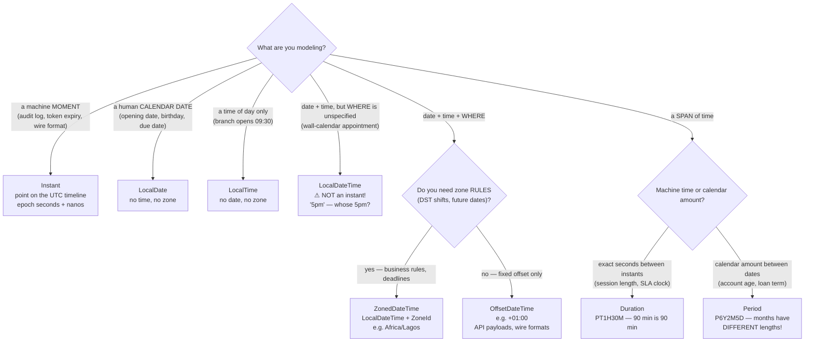
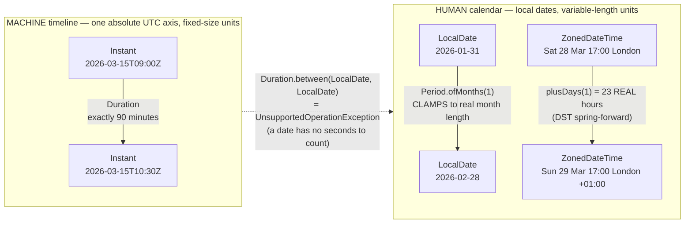

# 08 — java.time (Date/Time API)

**The big idea:** `java.util.Date` and `Calendar` were mutable, 0-based, timezone-confused and
not thread-safe. `java.time` (JSR-310, Java 8) replaces them with **immutable value objects**
whose *type* states exactly what they mean. Immutable means every `plusX`/`withX` call returns a
**new** object and the original never changes. The type says which of four things you hold: a
machine instant, a human calendar date, a wall-clock reading in a specific zone, or a span of
time. Picking the right type IS the design decision; the arithmetic then almost writes itself.

SecureBank needs all of them: **audit instants** (machine timeline), **account opening dates**
(calendar), **transaction timestamps** (zone-aware moments), **loan due dates** (calendar rules
like "last day of month"), and **interest windows** (spans of time).

## Which type do I need? (show this FIRST)

**Read the diagram:** this is a decision tree, so start at the top diamond and follow the branch
whose label matches your situation. Every leaf is the type to use.

- Four branches land directly on a type: a machine moment (`Instant`), a calendar date
  (`LocalDate`), a time of day (`LocalTime`), or a date-and-time with no location
  (`LocalDateTime`).
- The `LocalDateTime` leaf carries the module's loudest warning: it looks like a moment but is not
  one. "5pm" is meaningless until you say whose 5pm.
- Two branches ask a follow-up. "Date, time *and* where" leads to question 2 — do you need zone
  rules such as DST shifts? Yes → `ZonedDateTime`; no, a fixed offset is enough →
  `OffsetDateTime`. "A span of time" leads to question 3 — exact seconds → `Duration`; a calendar
  amount → `Period`.
- **DST** is daylight saving time: the twice-yearly clock shift that makes some local days 23 or
  25 hours long.

**In one sentence:** pick the type by asking "moment, date, time-of-day, or span?" and then
"do I need a zone?" — the arithmetic follows from the answer.

## Machine time vs calendar time

**Read the diagram:**
- Top box is the machine timeline: one absolute UTC axis where every unit has a fixed size, so 90
  minutes is always 90 minutes. `Duration` measures this axis.
- Bottom box is the human calendar, where units vary. Adding one month to 31 January *clamps* to
  28 February — clamping means pulling an out-of-range date back to the last real day instead of
  overflowing. `Period` measures this axis. The second arrow is the same idea in a zone: one
  calendar day can be 23 real hours when the clocks spring forward.
- The dotted arrow between the boxes is a prohibition, not a conversion: asking `Duration` to
  measure two `LocalDate`s throws `UnsupportedOperationException`, because a date has no seconds
  to count.

The two span arrows are the whole module in one picture: `Duration` measures the top axis,
`Period` measures the bottom one, and confusing them is the classic bug
(`DurationVsPeriodDemo` makes the failure runnable).

## Type cheatsheet

| Type | Example value | Zone? | SecureBank use | Trap to name in class |
|---|---|---|---|---|
| `Instant` | `2026-03-15T09:30:15.500Z` | UTC always | audit trail, token expiry | it has no calendar fields, so `getDayOfMonth` does not exist |
| `LocalDate` | `2026-03-15` | none | account opening, due dates | it is NOT a moment — it needs a zone to become one |
| `LocalTime` | `09:30` | none | branch opening hours | the same trap: a wall-clock reading only |
| `LocalDateTime` | `2026-03-15T17:00` | none | appointment on a wall calendar | it looks like an instant but ISN'T — "whose 5pm?" |
| `ZonedDateTime` | `2026-03-15T17:00+01:00[Africa/Lagos]` | `ZoneId` (rules, DST) | deadlines, cutoffs, FX timestamps | a calendar day can be 23 or 25 hours long |
| `OffsetDateTime` | `2026-03-15T17:00+01:00` | fixed offset only | API/wire formats | the offset is frozen, so it cannot follow future DST |
| `Duration` | `PT1H30M` | — | session length, SLA clock | it only works between types that carry a time |
| `Period` | `P6Y2M5D` | — | account age, loan term | months are variable-length, NOT 30 days |
| `DateTimeFormatter` | `ofPattern("dd/MM/yyyy HH:mm")` | — | letters, reports, logs | pin the `Locale`; the formatter is immutable and thread-safe |

## The old world's sins (all runnable in `OldApiProblemsDemo`)

| Sin | Old API | Failure it produces | java.time fix |
|---|---|---|---|
| Mutability | `Date.setTime()` | a shared object is rewritten behind your back | every type is immutable — `plusX` returns a NEW object |
| 0-based months | `Calendar` month 11 = December | month 13 silently rolls into next year | months run 1–12, and month 13 throws |
| Mystery offsets | `new Date(126, 2, 15)` | the year means year−1900, and the month is STILL 0-based | `LocalDate.of(2026, 3, 15)` |
| Type lie | `java.sql.Date extends util.Date` | a "date-only" type that stores millis and throws on `getHours()` | `LocalDate` is genuinely date-only |
| Lenient parsing | `SimpleDateFormat` | `2026-02-30` silently becomes March 2 | `DateTimeParseException` by default |
| Not thread-safe | shared `static SimpleDateFormat` | random corrupt output under load | `DateTimeFormatter` is immutable, so constants are the recommended style |

The demo prints these as **five** sins: lenient parsing and thread-unsafety are one class
(`SimpleDateFormat`), so they share Sin 5 on screen while this table gives them a row each.

## Class flow

1. Show the two diagrams above (concept before code).
2. Run the demos in order: `.\mvnw.cmd -pl 08-java-time compile exec:java`
   (this runs `JavaTimeDemos`, which calls each demo `main()` in teaching order).
3. Run the tests as *proof*: `.\mvnw.cmd -pl 08-java-time test` — each test prints the
   evidence it asserts, and all dates are fixed constants (deterministic output).

| Demo class | What it shows |
|---|---|
| `OldApiProblemsDemo` | the five sins of `Date`/`Calendar`/`SimpleDateFormat`, runnable |
| `CoreTypesTourDemo` | `Instant`, `LocalDate/Time/DateTime`, `ZonedDateTime` ("whose 5pm?"), `OffsetDateTime` |
| `ImmutabilityDemo` | `withX/plusX` return NEW objects; the discarded-result bug; why this = thread-safe |
| `DurationVsPeriodDemo` | machine vs calendar spans; `Duration.between(LocalDates)` fails; DST makes 24h ≠ 1 day |
| `AdjustersDemo` | `next(FRIDAY)`, `lastDayOfMonth`, and a custom "first business day" adjuster (a lambda!) |
| `FormatParseDemo` | patterns, ISO defaults, `Locale`, zone names in output, round-trip, strict parsing |
| `LegacyConversionDemo` | `Date.toInstant()`, `Date.from()`, `GregorianCalendar.toZonedDateTime()`, `java.sql` bridges |
| `LoanScheduleDemo` | closing demo: the whole module on one NGN 500,000 loan (schedule, interest window, letter) |

## Old → new mapping

| Old | New | Bridge |
|---|---|---|
| `java.util.Date` | `Instant` | `date.toInstant()` / `Date.from(instant)` |
| `java.util.Calendar` | `ZonedDateTime` | `((GregorianCalendar) cal).toZonedDateTime()` / `GregorianCalendar.from(zdt)` |
| `java.sql.Date` | `LocalDate` | `sqlDate.toLocalDate()` / `java.sql.Date.valueOf(localDate)` |
| `java.sql.Timestamp` | `LocalDateTime` | `ts.toLocalDateTime()` / `Timestamp.valueOf(ldt)` |
| `SimpleDateFormat` | `DateTimeFormatter` | there is no bridge — rewrite the pattern (the letters mostly match) |
| `Timer`/`Date` math | `Duration`/`Period`/`ChronoUnit` | there is no bridge — rewrite the arithmetic |

Convert **at the edge** (JDBC, legacy APIs), live in `java.time` **inside** the domain.

**In one sentence:** convert to `java.time` where the data enters and leaves the system, and let
every type inside the domain say exactly what kind of time it holds.
