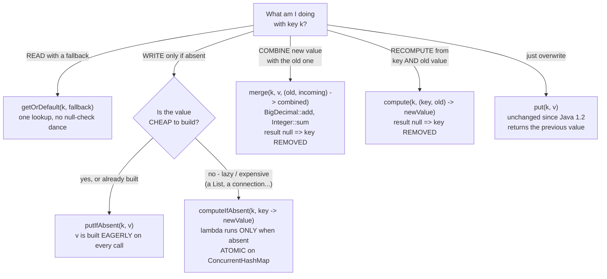
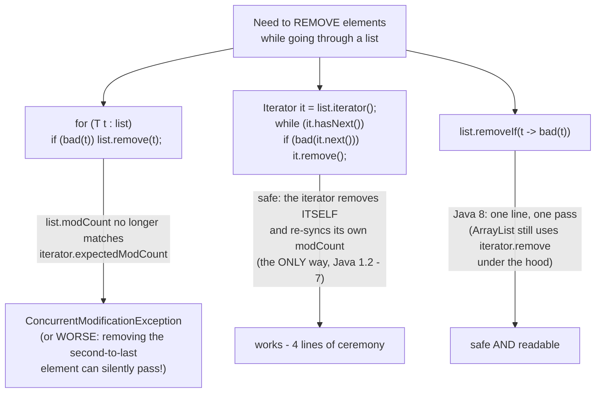
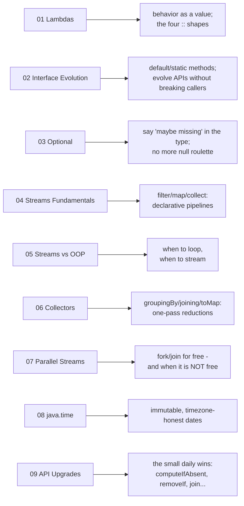

# 09 - API Upgrades: The Daily Drivers

**The big idea:** modules 01-08 gave you new *concepts* (lambdas, streams, Optional, java.time).
This module is the payoff: the small additions to the APIs you already touch every single day -
`Map`, `Collection`, `String`, `Objects`, `Arrays`, `Base64`. Each one deletes a 2-5 line ritual
you have written (and mis-written) a hundred times. If you remember one module a year from now,
make it this one.

## Which Map method do I want? (the decision chart)

**Read the diagram:** start at the top box and pick the branch that names what you are doing.
- Reading with a fallback goes left, to `getOrDefault`.
- Writing only when the key is absent leads to a second question: is the value cheap to build?
  Cheap → `putIfAbsent`. Expensive → `computeIfAbsent`, whose lambda runs only when the key is
  missing.
- Combining a new value with the old one is `merge`; recomputing from the key *and* the old value
  is `compute`. Both remove the key when the function returns `null`.
- Plain overwrite is still `put`, unchanged since Java 1.2.

**putIfAbsent vs computeIfAbsent - the trap:** `putIfAbsent(k, new ArrayList<>())` allocates a
list on *every* call, even when the key exists. The argument is evaluated eagerly - it is just an
argument. `computeIfAbsent(k, key -> new ArrayList<>())` takes a *lambda*, so the list is built
only when the key is truly absent. Cheap value: either is fine. Expensive value: always
`computeIfAbsent`.

**The computeIfAbsent contract on ConcurrentMap:** on a `ConcurrentHashMap` the whole
"check-absent + compute + insert" runs **atomically** - no other thread can slip in between the
check and the insert. That is exactly the race the old `containsKey`/`put` pair had. Two rules
come with that power:

1. The mapping function must be **short**. It runs while the map is doing its work, not before it.
2. It must **not modify the same map**. On `ConcurrentHashMap` that risks deadlock, because the
   function may run while a bin lock is held; on `HashMap` the Javadoc simply calls it undefined
   behavior.

## Removing while iterating (the bug everyone has shipped)

A **CME** is a `ConcurrentModificationException`. Despite the name it has nothing to do with
threads: it means the collection was structurally modified while an iterator was walking it.

**Read the diagram:** three ways to do one job, branching from the same starting box.
- Top branch: the naive `for-each` plus `list.remove(t)`. It fails, and the arrow says why - the
  list's `modCount` (its structural-change counter) no longer matches the iterator's copy.
- Middle branch: an explicit `Iterator` with `it.remove()`. Safe, because the iterator removes
  the element itself and re-syncs its own counter. This was the only way from Java 1.2 to 7, and
  it costs four lines of ceremony.
- Bottom branch: `removeIf` with a predicate. One line, one pass, and safe - `ArrayList` still
  uses `iterator.remove` under the hood.

**Walkthrough - what happens when you remove inside a `for-each`:**
1. `for (T t : list)` really means "get an `Iterator` and call `next()`/`hasNext()`".
2. The iterator copies the list's `modCount` into `expectedModCount` when it is created.
3. `list.remove(t)` changes the list's `modCount`, but the iterator's copy is now stale.
4. The next `hasNext()`/`next()` compares the two counters, sees the mismatch, and throws
   `ConcurrentModificationException`.
5. `it.remove()` avoids this because the iterator performs the removal itself and updates its own
   copy of the counter.

## Before / after - the daily-driver table

| Task | Pre-Java-8 | Java 8 |
|---|---|---|
| read with a fallback | `map.containsKey(k) ? map.get(k) : dflt` (two lookups) | `map.getOrDefault(k, dflt)` |
| insert if absent | `if (!map.containsKey(k)) map.put(k, v)` | `map.putIfAbsent(k, v)` |
| group into lists | five lines: `containsKey`, `new`, `put`, `get`, `add` | `map.computeIfAbsent(k, x -> new ArrayList<>()).add(v)` |
| sum a counter | `get`, then a null check, then `add`, then `put` | `map.merge(k, one, BigDecimal::add)` |
| transform all values | `for (Entry e : map.entrySet()) e.setValue(...)` | `map.replaceAll((k, v) -> ...)` |
| iterate entries | `for (Map.Entry<..> e : map.entrySet())` | `map.forEach((k, v) -> ...)` |
| remove while iterating | an `Iterator` plus `it.remove()` | `list.removeIf(t -> ...)` |
| sort a list | `Collections.sort(list, cmp)` | `list.sort(cmp)` (a default method!) |
| join with a delimiter | a `StringBuilder` plus the `setLength` chop hack | `String.join(", ", parts)` / `StringJoiner` |
| fail fast on null | `if (x == null) throw new NPE("...")` | `Objects.requireNonNull(x, "...")` |
| null-safe equals | `a == null ? b == null : a.equals(b)` | `Objects.equals(a, b)` |
| drop nulls from a stream | a hand-rolled filter lambda | `.filter(Objects::nonNull)` - the classic |
| fill an array from its index | `for (int i...) a[i] = f(i)` | `Arrays.setAll(a, i -> f(i))` |
| Base64 | Apache Commons or `DatatypeConverter` (removed in Java 11) | `java.util.Base64` |

Two more worth knowing but too small to demo. `ThreadLocalRandom.current().nextInt(bound)`
replaces the shared-`Random` contention pattern (the class itself dates to Java 7, but it is
*the* concurrent-code random in the lambda era - use it everywhere in concurrent code).
And `Objects.isNull` / `nonNull` exist purely so `null`-checks can be *method references*.

## Class flow

1. Show the two diagrams above (concept first, code second).
2. Run the demos in order: `.\mvnw.cmd -pl 09-api-upgrades compile exec:java`
   (this runs `ApiUpgradesDemos`, which calls each demo `main()` in teaching order -
   including the live `ConcurrentModificationException`, which is caught and printed).
3. Run the tests as *proof*: `.\mvnw.cmd -pl 09-api-upgrades test` - each test proves exactly
   one claim (mapping function not called for present keys, merge summing, CME vs removeIf...)
   and prints the evidence it asserts.

| Demo class | What it shows |
|---|---|
| `MapUpgradesDemo` | getOrDefault, putIfAbsent, merge (incl. null-removes-key), replaceAll, forEach - each next to its old idiom |
| `ComputeIfAbsentStarDemo` | the 5-line grouping ritual vs the one-liner, lazy-vs-eager proof, both traps |
| `RemoveIfDemo` | the CME bug live, iterator.remove, removeIf, List.sort vs Collections.sort, spliterator (→ module 07) |
| `StringJoinerDemo` | String.join, StringJoiner prefix/suffix, the setLength hack it replaced, Collectors.joining overlap (→ module 06) |
| `ObjectsHelpersDemo` | requireNonNull in a constructor, Objects.equals/hash, `filter(Objects::nonNull)` |
| `QuickHitsDemo` | Arrays.setAll / parallelSetAll (→ module 07), Comparator.comparing/thenComparing/nullsFirst recap (built in module 01) |
| `Base64Demo` | encode/round-trip an API key, the three encoder flavors, "encoding is NOT encryption" |

## You now know Java 8

That is the whole tour. Every module handed you one daily-driver skill:

**Read the diagram:** nine pairs, one per module, in course order. The left box is the module;
the right box is the single skill it left you with. Use it as the closing slide — walk down the
left column and let the class fill in the right one.

**In one sentence:** Java 8 gave you behavior as a value (01-02), a way to say "maybe nothing"
(03), pipelines that describe *what* instead of *how* (04-07), honest dates (08), and the small
daily wins that delete boilerplate (09).

Checklist - you can now, without looking anything up:

- [ ] write a lambda and read all four method-reference shapes
- [ ] add a default method to an interface without breaking implementors
- [ ] replace a null-returning API with `Optional` and use `map/orElse`
- [ ] turn a loop into `filter -> map -> collect`, and know when NOT to
- [ ] group, count and join with `Collectors`
- [ ] decide honestly whether a stream should be parallel
- [ ] use `LocalDate/Instant/ZonedDateTime/Duration` correctly
- [ ] group with `computeIfAbsent`, sum with `merge`, remove with `removeIf`,
      join with `StringJoiner`, guard with `requireNonNull` - the daily drivers
