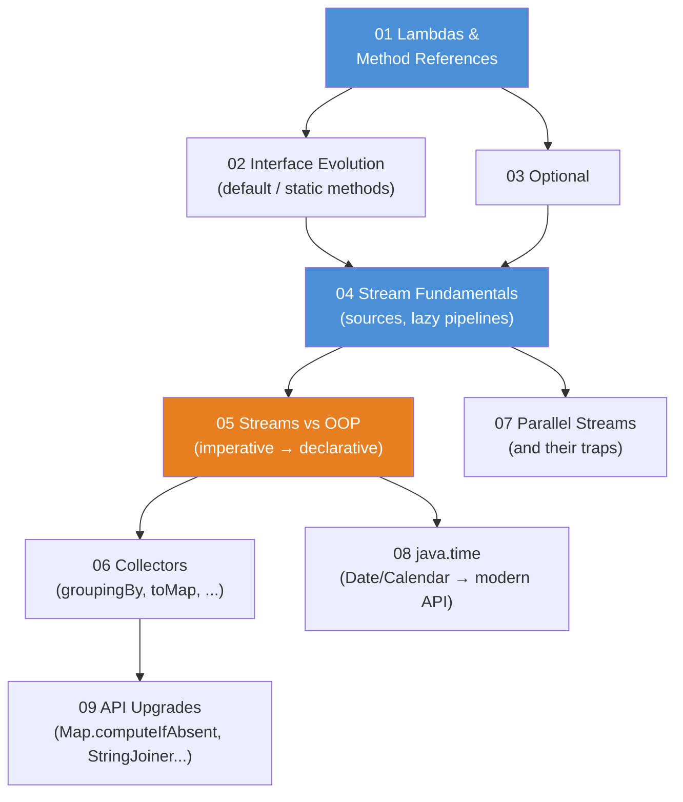
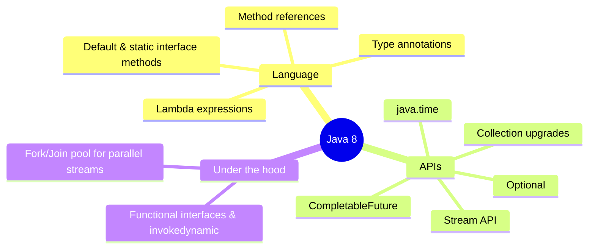
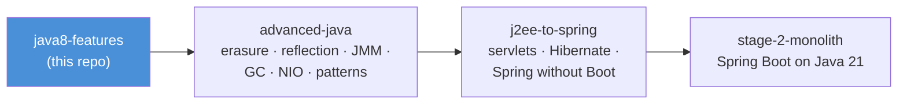

# Java 8 Features — Teaching Repo

A tour of everything Java 8 changed about how we *write* Java, built for live,
stand-up-and-point teaching. Every module is a self-contained Maven project with:

- **demo classes** (`src/main/java`) — each has a `main()` that prints what is happening, step by step
- **JUnit tests** (`src/test/java`) — each test proves one behavior and prints the evidence
- **README.md with mermaid diagrams** — the conceptual picture *before* you open the code

Everything compiles with `--release 8`, so no post-Java-8 API can sneak in.
If it's in this repo, it's genuine Java 8.

## The course map



**Read the diagram:**
- Arrows mean "teach this first". Module 01 (lambdas) feeds both 02 and 03, and both of those
  feed 04, so 01-04 form the spine.
- The two blue boxes (01 and 04) are the ones everything else assumes you have seen.
- 05 (orange) is the pivot: it re-solves real banking tasks both ways, and it feeds 06 and 08.
- 07 hangs off 04 directly, because parallelism is a property of the pipeline itself.
- 09 hangs off 06 and is the last stop: it collects the small daily-driver APIs the earlier
  modules kept using.

The orange module (**05**) is the heart of the course: the same banking problem solved
the old imperative way and the stream way, side by side, line by line.

## Suggested teaching order

| # | Module | The one-sentence pitch | Run the demos |
|---|--------|------------------------|---------------|
| 01 | `01-lambdas` | Behavior as a value: `() -> {}`, functional interfaces (interfaces with one abstract method), and `::` references | `.\mvnw.cmd -pl 01-lambdas compile exec:java` |
| 02 | `02-interface-evolution` | Interfaces grow up: `default` and `static` methods, and the diamond problem | `.\mvnw.cmd -pl 02-interface-evolution compile exec:java` |
| 03 | `03-optional` | "Maybe there is no result" becomes a type instead of a `null` surprise | `.\mvnw.cmd -pl 03-optional compile exec:java` |
| 04 | `04-streams-fundamentals` | A stream is a *pipeline*, not a container: source → intermediate → terminal, evaluated lazily (nothing runs until the terminal operation pulls) | `.\mvnw.cmd -pl 04-streams-fundamentals compile exec:java` |
| 05 | `05-streams-vs-oop` | The same task, the OOP way vs the stream way — external iteration (you drive the loop) vs internal iteration (the library drives it) | `.\mvnw.cmd -pl 05-streams-vs-oop compile exec:java` |
| 06 | `06-collectors` | `collect` is where a stream becomes data again: grouping, partitioning, mapping | `.\mvnw.cmd -pl 06-collectors compile exec:java` |
| 07 | `07-parallel-streams` | One word (`parallel()`) buys you threads — and a list of ways to lose data | `.\mvnw.cmd -pl 07-parallel-streams compile exec:java` |
| 08 | `08-java-time` | `Date`/`Calendar` were mutable and confusing; `java.time` is immutable and readable | `.\mvnw.cmd -pl 08-java-time compile exec:java` |
| 09 | `09-api-upgrades` | The small stuff you'll use daily: `computeIfAbsent`, `getOrDefault`, `StringJoiner`, `Objects` | `.\mvnw.cmd -pl 09-api-upgrades compile exec:java` |

## Running things

All commands run **from this folder** (`java8-features/`), Windows PowerShell shown:

```powershell
# run one module's demo launcher (prints every demo in teaching order)
.\mvnw.cmd -pl 05-streams-vs-oop compile exec:java

# run ONE specific demo class instead of the whole launcher
.\mvnw.cmd -pl 04-streams-fundamentals compile exec:java "-Dexec.mainClass=com.evaitcs.java8.streams.LazinessDemo"

# run one module's tests (tests print what they prove)
.\mvnw.cmd -pl 01-lambdas test

# run everything
.\mvnw.cmd test
```

Tip for class: run the **mermaid diagram in the module README first** (concept),
then the demo `main()` (behavior), then the test (proof), in that order.

If em-dashes/arrows print as garbage in a plain `cmd` window, run `chcp 65001` first
(UTF-8 code page). Windows Terminal and IDE consoles are fine as-is.

## Shared conventions

- **Domain**: a tiny SecureBank-style world — `Customer`, `Account`, `Transaction`. Each module
  holds its own copy on purpose, so it stands alone on screen with no cross-module scrolling.
- **Money is `BigDecimal`** with scale 2; **timestamps are `Instant`/`LocalDate`** from `java.time`.
- **Comments are teaching material**: they explain *why*, connect the diagram to the code,
  and call out the traps ("this line is the whole idea", "students often ask...").
- Demo output is written with plain `System.out.printf` so it's readable from the back of the room.

## What Java 8 actually changed (the 30-second version)



**Read the diagram:** three branches hang off Java 8. *Language* is what you type differently,
*APIs* is what you call, and *Under the hood* is what the JVM does to support both. Two labels
there are worth a gloss: `invokedynamic` is the JVM instruction that wires a lambda to its
interface at runtime, and the *fork/join pool* is the JDK engine that splits work across threads
and joins the results.

Before Java 8, behavior could only be passed around as *objects* — anonymous classes, strategy
patterns, callbacks. Java 8 lets you pass *behavior itself* as a value. The Stream API is what
becomes possible once behavior is a value: you describe **what** you want instead of **how** to
loop for it.

**In one sentence:** Java 8 turned behavior into a value, and everything else in this repo —
streams, collectors, `Optional`, `java.time` — is what that one change buys you.

## Where this course leads



**Read the diagram:** this course teaches the language level; `advanced-java` (Java 21) then
opens the machine underneath — what erasure really deletes, how reflection and annotations
power Spring, what the memory model promises your threads — `j2ee-to-spring` acts out the
servlet → Hibernate → Spring evolution and hand-wires the very app Boot automates, and
`stage-2-monolith` runs all of it for real.
